Castle Game Engine
==================

["Castle Game Engine"](https://castle-engine.io/) is a cross-platform (desktop, mobile, console) 3D and 2D game engine.

We feature:

* Powerful visual editor to design 3D and 2D games.

* A lot of components to design viewport contents (3D and 2D world, using scenes, cameras, navigation, primitives, lights...) and user inteface (buttons, images, labels...).

* Support for glTF, X3D, Spine and more formats.

* Composable shader effects, shadows, mirrors, physically based rendering, bump mapping, gamma correction...

* Fast clean code using modern Pascal.

* We are free and open-source.

See https://castle-engine.io/features for the complete list of engine features.

Unreal Engine 5.x Editor Modernization & Blueprint Visual Scripting
-------------------------------------------------------------------

This branch modernizes `castle-editor` and the Castle Game Engine runtime toward **Unreal Engine 5.5 parity** across **394+ Phases** (Horizons 1–12 Complete; Horizons 13–14 Active), **114 Specialized Editor Studios** (`Ctrl+Shift+P` Studio Hub), and an embedded **37-Tool Model Context Protocol (MCP) JSON-RPC 2.0 Server** (`http://127.0.0.1:8765/mcp`):

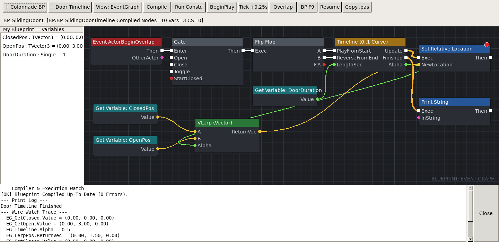

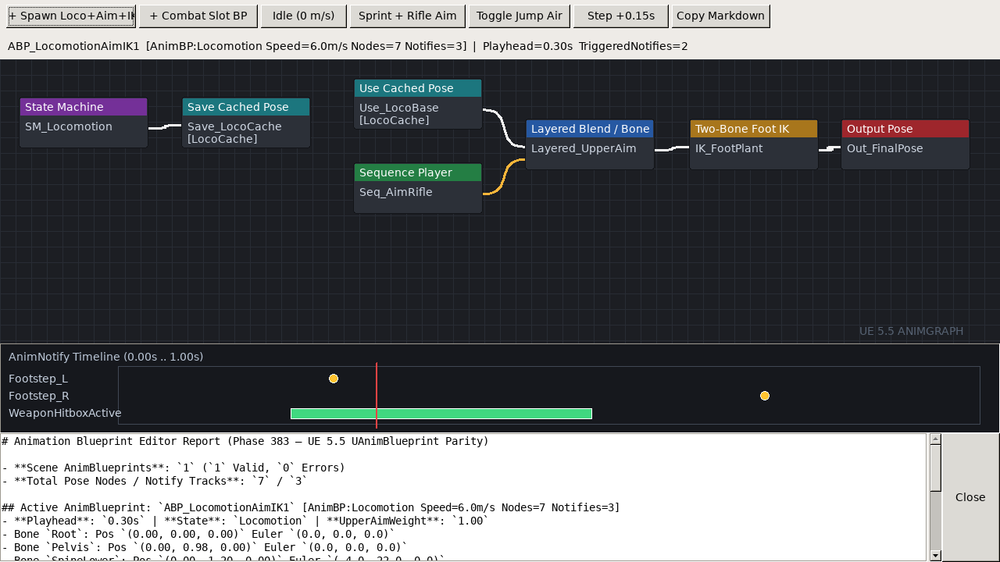

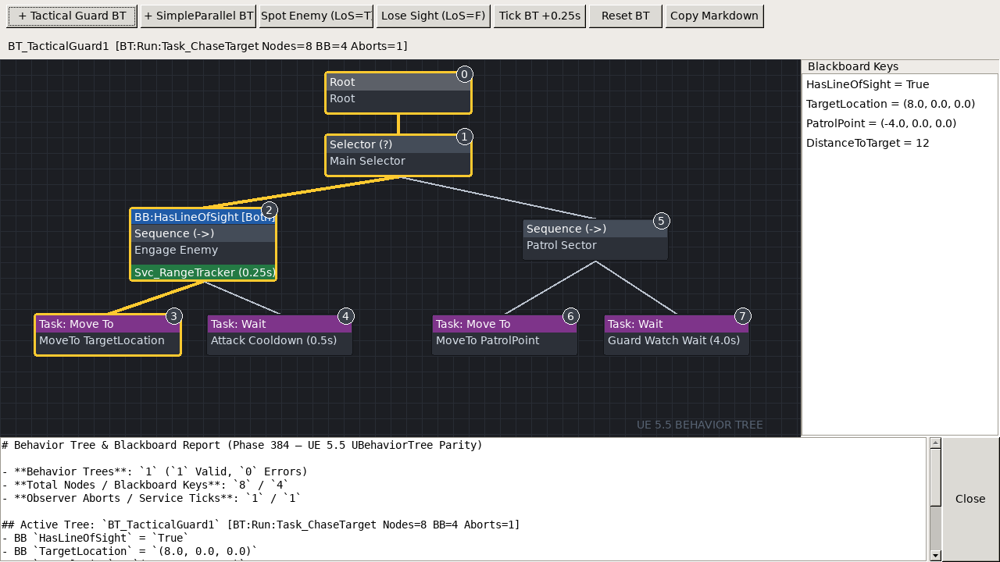

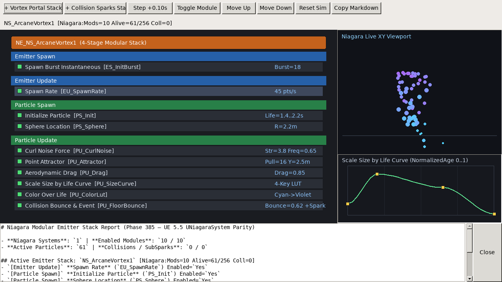

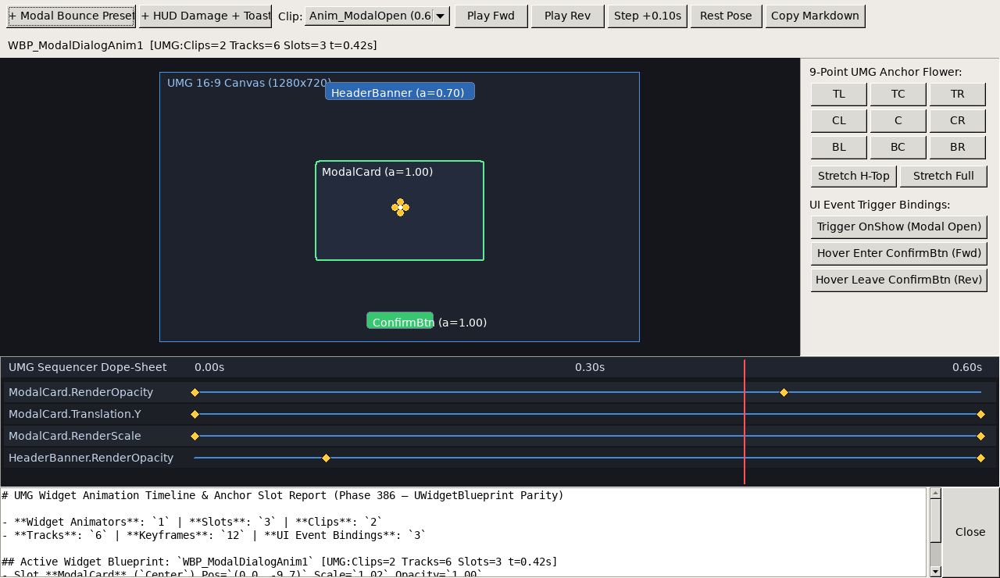

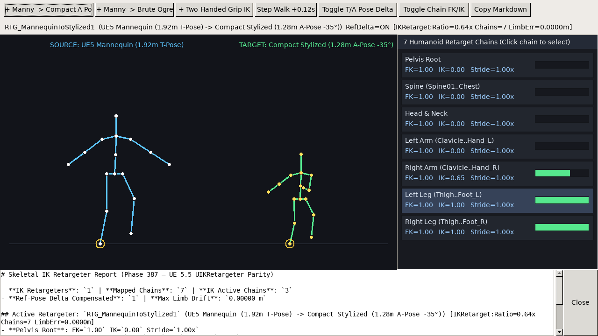

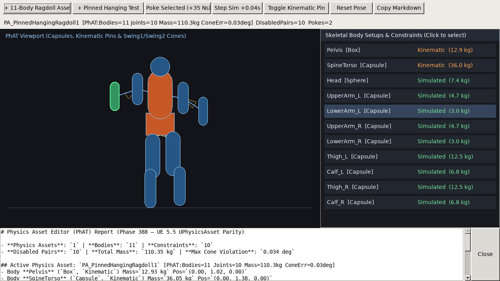

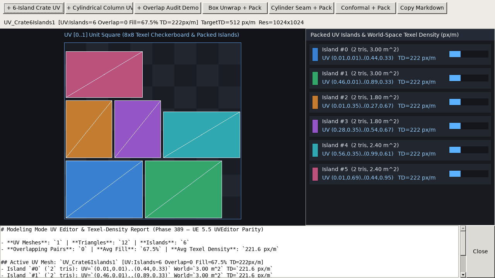

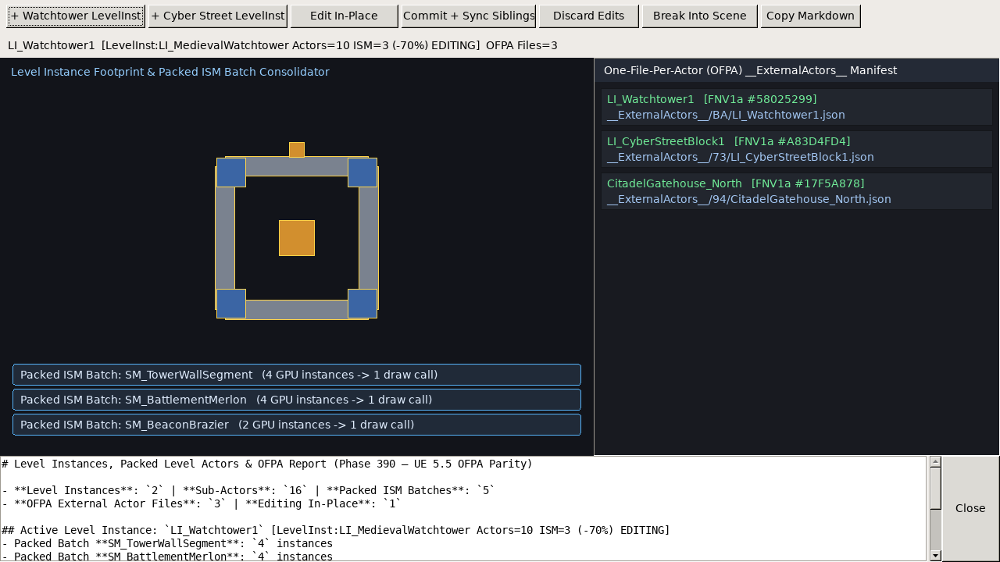

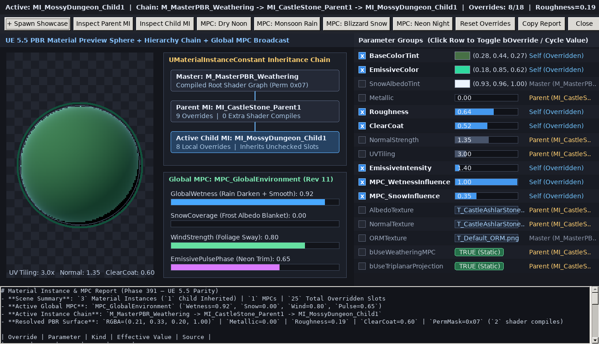

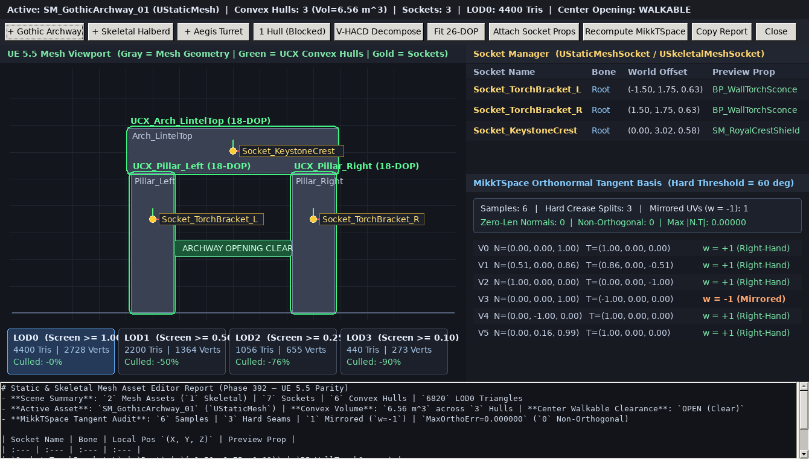

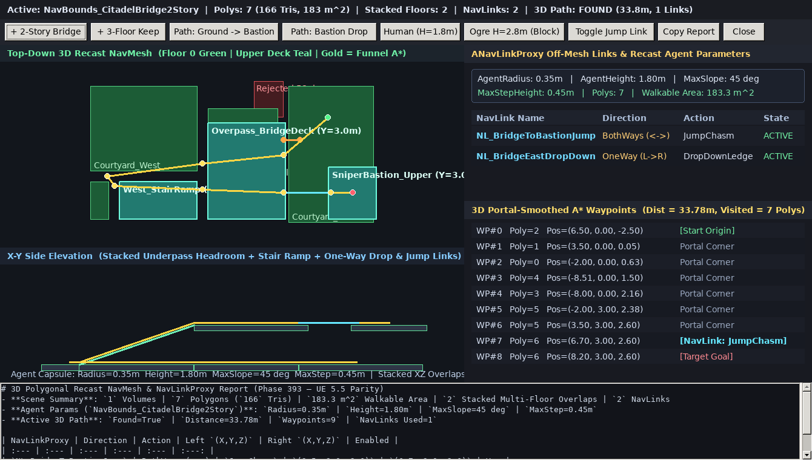

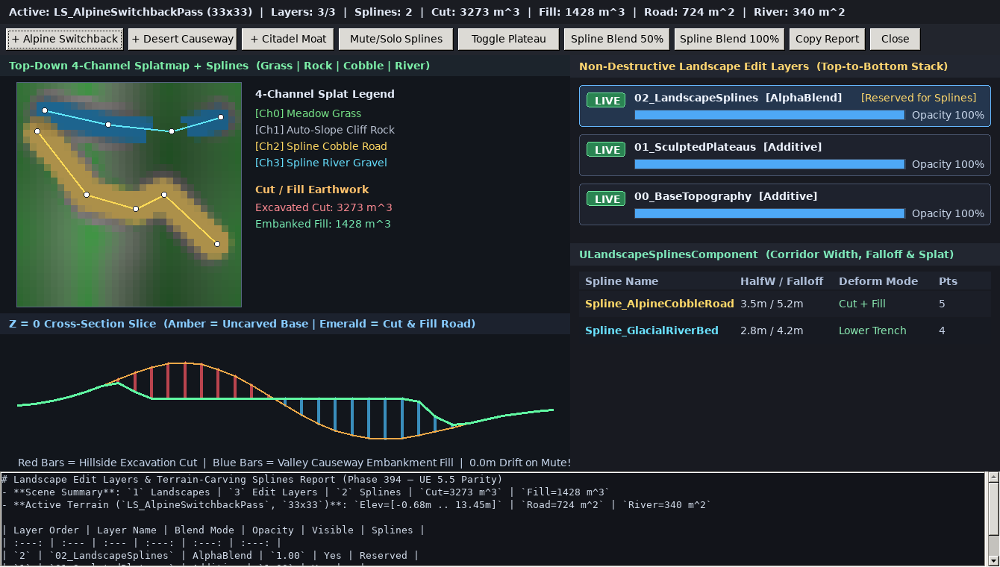

* **Blueprint Visual Scripting Editor (`TCastleBlueprint`)**: Interactive 2D **EventGraph** (`EventBeginPlay`, `EventTick`, `EventActorBeginOverlap`, `CustomEvent`) and live in-editor **Construction Script**, white `Exec` wires + color-coded typed `Data` pins, member variables (`Get`/`Set`), flow control (`Branch`, `Sequence`, `ForLoop`, `DoOnce`, `FlipFlop`, `Gate`), latent `Delay` & `Timeline` (`0..1` Hermite curve) schedulers, node **Breakpoints (`F9`)** with live Wire Watch & execution-trace highlighting, and **Blueprint Nativization** to FreePascal `TCastleBehavior` units.
* **Animation Blueprint (`TCastleAnimBlueprint`), Behavior Tree (`TCastleBehaviorTree`), Skeletal IK Retargeter (`TCastleIkRetargeter`) & Physics Asset Editor (`TCastlePhysicsAsset`)**: Visual `AnimGraph` pose evaluation DAG (`State Machine`, `Layered Blend Per Bone`, `Cached Pose`, `Two-Bone IK`, looping `AnimNotify` & `AnimNotifyState` tracks), `UBehaviorTree` AI editor (`Selector`, `Sequence`, `SimpleParallel`, `ExecutionIndex` priority badges, Blackboard-driven `Decorators` with `Self`/`LowerPriority`/`Both` **Observer Aborts**, and periodic branch `Services`), 7-chain cross-skeleton `UIKRetargeter` (`T-Pose <-> A-Pose` reference delta compensation & pelvis stride scaling), and `PhAT` ragdoll body/joint-cone authoring (`Capsule`/`Sphere`/`Box` mass fitting, elliptical `Swing1`/`Swing2` & `Twist` cones, collision disable matrix, and limb poke testing).
* **PCG Visual Node Graph (`TCastlePcgGraph`), Niagara Modular Emitter Stack (`TCastleNiagaraSystem`), UMG Widget Animation Timeline (`TCastleWidgetAnimator`), Modeling Mode UV Editor (`TCastleUvEditorMesh`) & Level Instances / OFPA (`TCastleLevelInstance`)**: Directed point-cloud pipelines (`Surface/Spline Sampler`, `Density/Slope Filter`, `Difference`, `Self-Pruning`), reorderable 4-stage Niagara VFX stacks, multi-track keyframed 2D UI sequencers (`BackOvershoot` / `BounceOut` easing & 9-point Anchor Flower presets), Modeling Mode UV unwrap/Shelf-packing with exact 2D overlap & world-space Texel Density (`px/m`) auditing, and in-place Level Instance `Edit`/`Commit`/`Break`, Packed `ISM` draw-call consolidation (`-70%`), and conflict-free One-File-Per-Actor (`OFPA`) Git branch merging.
* **Roadmap & Reference Guide**: See [`EDITOR_ROADMAP.md`](EDITOR_ROADMAP.md) and [`docs/EDITOR_MODERNIZATION_GUIDE.md`](docs/EDITOR_MODERNIZATION_GUIDE.md).

Installation and building your first application
---------

See the [Installation](https://castle-engine.io/install) manual page.

We recommend you download the engine from [our downloads](https://castle-engine.io/download), unpack the release and then run `bin/castle-editor` executable inside.

If you got the source code straight from our [GitHub repository](https://github.com/castle-engine/castle-engine/) then read first [Compiling from source](https://castle-engine.io/compiling_from_source.php).

Usage in short:

- Our [editor](https://castle-engine.io/editor) is used to design and build your applications.

- Our [build tool](https://castle-engine.io/build_tool) is used to build your applications from the command-line.

    Both the build tool and editor use the project settings
    from the [CastleEngineManifest.xml](https://castle-engine.io/project_manifest)
    file.

- You can also use [Visual Studio Code](https://castle-engine.io/vscode).

    We have a [Castle Game Engine extension for VS Code](https://marketplace.visualstudio.com/items?itemName=castle-engine-team.castle-engine), that enables comfortable Pascal code editing (with completion, syntax highighting) and integration with CGE projects (so you can build, debug, run the projects straight from VS Code).

- You can also use [Lazarus](https://www.lazarus-ide.org/).

    Make sure to [register in Lazarus our packages](https://castle-engine.io/lazarus). It's easiest to do this using the button _"Register Lazarus Packages"_ in CGE editor _"Preferences -> FPC and Lazarus"_.

    You can install the `castle_engine_lcl.lpk` package in Lazarus, to have LCL component `TCastleControl` (see https://castle-engine.io/control_on_form ).

    You can build the most important CGE packages and tools (editor, build tool) using Lazarus [project group](https://wiki.freepascal.org/Project_Groups) called `most_important_lazarus_packages_and_tools.lpg`.

- You can also use [Delphi](https://www.embarcadero.com/products/Delphi).

    We recommend to install [our Delphi packages](https://castle-engine.io/delphi_packages) in Delphi. This will give you a comfortable menu in Delphi IDE _"Tools → Castle Game Engine"_, with useful commands like _"Set Engine Path..."_ and _"Configure Delphi to Use Engine"_.

Documentation
-------

- [Manual](https://castle-engine.io/manual) is the most recommended way to learn the engine.

- [API reference](https://castle-engine.io/apidoc/html/index.html).

    It is also available offline in the engine archive (if you downloaded the binary engine release), just open the file `doc/reference/index.html` in your WWW browser.

- Numerous examples are provided in the `examples/` subdirectory.

- [Guide to creating game data](https://castle-engine.io/creating_data_intro.php).

Support
-------

Questions? Talk to us on [forum or Discord chat](https://castle-engine.io/talk.php).

[Support us on Patreon](https://www.patreon.com/castleengine).

License
-------

The engine is available on the terms of LGPL >= 2 license with "static linking exception". This is the same license as used by FPC RTL and Lazarus LCL. In short, you *can* make commercial and closed-source games using the engine, you only have to share your modifications to the engine core.

See [license](https://castle-engine.io/license) for details.

Have fun!

Authors
-------

This is the life project of _Michalis Kamburelis_.

Thank you to [all the contributors and supporters](https://castle-engine.io/credits) for making the engine with me throughout the years. Keep it going please :)
