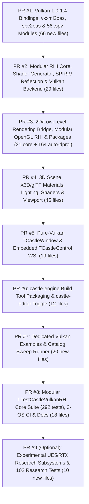

# Upstream Maintainer PR Review & Slicing Guide (`castle-engine/castle-engine`)

This guide documents how the `vulkan-renderer` branch (merge-base `e97e84b7aa51f628a7978c5420cefb53a3da05ab` on `castle-engine/castle-engine` `master`) is partitioned into **8 strictly acyclic, dependency-ordered core pull request slices** (`PR #1` .. `PR #8`) — plus an **optional, zero-core-dependency `PR #9`** isolating experimental UE5/RTX research subsystems — so upstream maintainers can review, compile, and merge each subsystem incrementally with **zero risk to existing OpenGL / OpenGL ES users**.

---

## 1. Guiding Upstream Principles

1. **100% Default Backward Compatibility (`backendAuto` -> OpenGL)**:
   - `TCastleApplicationProperties.RenderBackend` defaults to `backendAuto`, which resolves to `rbOpenGL` / `rbOpenGLES` everywhere unless opted into `backendVulkan` via `CastleEngineManifest.xml`, `--render-backend=vulkan`, `CASTLE_RENDER_BACKEND=vulkan`, or Pascal code.
   - When `RHIDevice = nil` (default OpenGL path), all existing CGE OpenGL code paths execute unchanged.
2. **Modular `< 5,200`-Line `.inc` Architecture & External `.spv` Assets**:
   - All large RHI, Vulkan, OpenGL, shader, and unit-test units (`castleinternalrhi_vulkan.pas`, `castleinternalshaderrhi.pas`, `castleinternalrhi_opengl.pas`, `castleinternalrhi.pas`, `testcastlevulkanrhi.pas`) are structured as compact `< 450`-line umbrella units paired with focused `< 5,200`-line `.inc` modules, and all `56` built-in SPIR-V fallback modules live as standalone binary `src/base_rendering/vulkan/spirv/*.spv` files packed reproducibly via `spv2pas.dpr`.
3. **Strictly Acyclic Pascal `uses` Layering & Complete Experimental Isolation**:
   - Every `.pas`, `.dpr`, and `.inc` file in `Slices 1..9` satisfies a machine-verified topological invariant (`prepare_upstream_slices.sh --verify`): **no unit in `Slice K` ever `uses` a unit introduced or modified in `Slice M` (`M > K`)**.
   - All speculative / UE5 / RTX research subsystems (`src/base_rendering/experimental/*` and `tests/code/testcases/testcastlevulkanrhi_experimental.pas`) are isolated in **optional `Slice 9`**: `PR #1` through `PR #8` (`240` core files) compile and pass all **`292` core `TTestCastleVulkanRHI` tests** without `Slice 9` present (`-dCASTLE_WITHOUT_EXPERIMENTAL`).
4. **Mechanical `.dproj` Search-Path Noise & Branch Handover Docs Isolated**:
   - Adding `src/base_rendering/{rhi,vulkan,opengl}` touches `164` `examples/**/*.dproj` files by 1 line (`DCC_UnitSearchPath`) via `examples_regenerate_auto_files`; these are tagged `auto-dproj` and exported separately into `03b-examples-auto-dproj.patch`.
   - `PLAN.md` and `AGENTS.md` are assigned to `Slice 0` (`branch-meta`) and excluded from upstream PRs.

---

## 2. Dependency DAG & Overview of Upstream PR Slices (`PR #1..#8` Core + Optional `PR #9`)



| PR Slice | Slug | Core / Exp Files | Auto `.dproj` | Existing Engine Files Modified? | Independent Verification |
| :---: | :--- | :---: | :---: | :--- | :--- |
| **PR #1** | `vulkan-bindings-generator` | `66` | `0` | `1` (`.gitattributes` EOL/binary rules) | Compile & run `vkxml2pas.dpr` and `spv2pas.dpr` (`diff -u` idempotent); compile `CastleInternalVulkan` & `CastleInternalRenderDoc` |
| **PR #2** | `rhi-core-and-vulkan-backend` | `29` | `0` | `4` (`src/base/castleapplicationproperties.pas`, `castlerenderoptions*`) | Compile modular `CastleInternalRHI`, `CastleInternalShaderRHI`, `CastleInternalSPIRVReflection`, `CastleInternalVulkanMemory`, `CastleInternalVulkanWSI`, `CastleInternalShaderCompiler`, `CastleInternalRHI_Vulkan` |
| **PR #3** | `low-level-rendering-opengl-rhi-and-packages` | `31` | `164` | `26` (`castlerendercontext`, `castleglimages*`, `castleglutils*`, `castlefonts*`, packages) | Build `fpmake.pp`, `castle_engine_base.lpk`, `castle_engine.dpk`; run existing OpenGL test suite |
| **PR #4** | `scene-x3d-viewport-and-ui` | `45` | `0` | `45` (`src/transform/*`, `src/scene/*`, `src/ui/*`) | Compile full `TCastleViewport` + `TCastleScene` + `TCastleUserInterface` on FPC & Lazarus |
| **PR #5** | `window-and-embedded-controls-wsi` | `19` | `0` | `19` (`src/window/*`, `src/lcl/castlecontrol.pas`, `src/delphi/*`) | Compile `TCastleWindow` (Xlib/GTK/WinAPI/Cocoa/Android) & `castle_engine_lcl.lpk`; verify `--render-backend=vulkan` |
| **PR #6** | `build-tool-packaging-and-editor` | `12` | `0` | `12` (`tools/build-tool/*`, `tools/common-code/*`, `tools/castle-editor*`) | Compile `castle-engine` CLI & `castle_editor.lpi`; test `bundle_vulkan_caches="true"` packaging |
| **PR #7** | `vulkan-examples-and-catalog-sweep` | `20` | `0` | **No (`0` modified)** — 100% additive | Run `vulkan_triangle`, `vulkan_sprite_batch`, `vulkan_3d_scene --headless` & `run_vulkan_example_sweep.sh` |
| **PR #8** | `tests-ci-and-documentation` | `18` | `0` | `3` (`tests/testcases.pas`, `CastleEngineManifest.xml`, `.lpi`) | Run `castle_tester_standalone -dCASTLE_WITHOUT_EXPERIMENTAL` (`292/292` core `TTestCastleVulkanRHI` + 3-OS `vulkan-rhi.yml` CI) |
| **PR #9 *(Optional)*** | `experimental-ue5-rtx-research` | `10` | `0` | **No (`0` modified)** — 100% additive & opt-in | Run `TTestCastleVulkanRHIExperimental` (`102/102` research tests; `394/394` combined `TTestCastleVulkanRHI*`) |

---

## 3. Detailed Per-Slice Scope & Maintainer Review Checklist

### PR #1 — `vulkan-bindings-generator` (`66` files)
- **Files**:
  - `tools/internal/generate_vulkan_api/{vkxml2pas.dpr, CastleEngineManifest.xml, README.md}` + `src/base_rendering/vulkan/castleinternalvulkan.pas`
  - `tools/internal/generate_vulkan_spirv/{spv2pas.dpr, CastleEngineManifest.xml, README.md}` + `src/base_rendering/vulkan/spirv/*.spv` (`56` binary SPIR-V modules) + `src/base_rendering/vulkan/generated-pascal/castleinternalvulkanspirv_blobs.inc`
  - `src/base_rendering/rhi/castleinternalrenderdoc.pas` and `.gitattributes`
- **What Reviewers Should Check**:
  - `castleinternalvulkan.pas` uses only `SysUtils`, `CastleDynLib`, and `CastleLog`, loading `vulkan-1.dll` / `libvulkan.so.1` / `libMoltenVK.dylib` lazily via `TDynLib` with zero link-time dependencies.
  - `spv2pas` deterministically regenerates `castleinternalvulkanspirv_blobs.inc` byte-for-byte from `src/base_rendering/vulkan/spirv/*.spv`.

### PR #2 — `rhi-core-and-vulkan-backend` (`29` files)
- **Files**:
  - Public enums/options: `src/base/castleapplicationproperties.pas` (`TRenderBackend`), `src/base/castlerenderoptions.pas` + `*.inc`.
  - Modular RHI & Vulkan units (`< 5,200` lines per `.inc` module): `castleinternalrhi.pas` (`+ 3 .inc`), `castleinternalshaderrhi.pas` (`+ 3 .inc`), `castleinternalspirvreflection.pas`, `castleinternalvulkanmemory.pas`, `castleinternalvulkanwsi.pas`, `castleinternalshadercompiler.pas` (`+ castleinternalshadercompiler_builtins.inc`), and `castleinternalrhi_vulkan.pas` (`+ 11 .inc`).
- **What Reviewers Should Check**:
  - `ApplicationProperties.RenderBackend` defaults to `backendAuto` (preserving OpenGL).
  - `TCastleVulkanMemoryAllocator` sub-allocation pools (`64 MB` device-local / `16 MB` host-visible), `DefragmentPools`, and fence-synchronized deferred resource deletion (`FlushDeferredDeletions`).
  - Zero speculative UE5/RTX units or classes exist in `PR #2`.

### PR #3 — `low-level-rendering-opengl-rhi-and-packages` (`31` core files + `164` `auto-dproj`)
- **Files**:
  - `castleinternalbatch2drhi.pas`, `castleinternalrhi_opengl.pas` (`+ 3 .inc`)
  - `castlerendercontext.pas`, `castleglimages*.pas`/`*.inc`, `castleglshaders.pas`, `castleglutils*.pas`/`*.inc`, `castlerenderprimitives*.pas`/`*.inc`, `castlevideos.pas`, `castlefonts*.pas`/`*.inc`
  - `castle-fpc.cfg`, `fpmake.pp` (`DirectoryExists` guard for optional `experimental`), `packages/lazarus/castle_engine_base.lpk`, `packages/delphi/castle_engine.{dpk,dproj}` (+ `03b` `examples/**/*.dproj`).
- **What Reviewers Should Check**:
  - Every RHI dispatch branch in `TDrawableImage`, `TCastleFont`, `DrawPrimitive2D`, `TCastleRenderUnlitMesh`, and `TRenderContext` is guarded by `(ApplicationProperties.RenderBackend = backendVulkan) and (RHIDevice <> nil)` so OpenGL behavior is untouched.
  - `castle_engine_base.lpk` and `castle_engine.{dpk,dproj}` contain only core production units (zero experimental units).

### PR #4 — `scene-x3d-viewport-and-ui` (`45` files)
- **Files**: `src/transform/*`, `src/scene/*`, `src/scene/x3d/*.inc`, `src/ui/*`.
- **What Reviewers Should Check**:
  - `TX3DRendererShape`, `TShapeCache`, `TRenderer`, `TLightsRenderer`, and `TCastleViewport` RHI paths for PBR/Phong/Unlit, 32 lights, PCF/VSM & stencil shadow volumes, `TSkinNode` GPU skinning, `TEnvironmentLightNode` Split-Sum IBL, custom `TEffectNode` / `TComposedShaderNode` / `TScreenEffectNode` uniform/sampler reflection, and `TCastleMask` UI/3D stencil masking.

### PR #5 — `window-and-embedded-controls-wsi` (`19` files)
- **Files**: `src/window/*`, `src/lcl/castlecontrol.pas`, `src/delphi/*`.
- **What Reviewers Should Check**:
  - Pure-Vulkan window/widget open (`BypassOpenGLContextForVulkan`: no GLX/WGL/EGL/`NSOpenGLContext` created when Vulkan is active, with automatic fallback to OpenGL if Vulkan initialization fails).
  - CLI flags `--render-backend`, `--auto-exit-frames`, `--capture-screenshot` in `castlewindow.pas`, shared-device multi-window/multi-control `TCastleVulkanSwapchainSurface`, and live runtime `SwitchRenderBackend`.

### PR #6 — `build-tool-packaging-and-editor` (`12` files)
- **Files**: `src/files/*`, `tools/common-code/*`, `tools/build-tool/*`, `tools/castle-editor*`.
- **What Reviewers Should Check**:
  - `CastleEngineManifest.xml` attributes `render_backend` and `bundle_vulkan_caches`, Android `${ANDROID_VULKAN_FEATURE}` manifest substitution, APK/macOS `.app`/desktop `shader_cache/*.spv` indexing in `CastleDataInformation.xml`, and `castle-editor` **Viewport -> Render Backend** live toggle.

### PR #7 — `vulkan-examples-and-catalog-sweep` (`20` new files)
- **Files**: `examples/vulkan/{vulkan_triangle,vulkan_sprite_batch,vulkan_3d_scene}/*`, `tools/internal/vulkan_example_sweep/run_vulkan_example_sweep.sh`.
- **What Reviewers Should Check**: Self-contained Vulkan example projects (using purely core production RHI units by default, with optional `-dCASTLE_EXPERIMENTAL_VULKAN` in `vulkan_3d_scene.dpr`) plus automated smoke/screenshot verification across existing catalog examples.

### PR #8 — `tests-ci-and-documentation` (`18` files)
- **Files**: `tests/code/testcases/testcastlevulkanrhi.pas` (`432`-line umbrella) + `8` modular `testcastlevulkanrhi_part1..8_*.inc` files (`< 4,800` lines each), `tests/testcases.pas`, `tests/CastleEngineManifest.xml`, `tests/castle_tester_standalone.lpi`, `.github/workflows/vulkan-rhi.yml`, `doc/vulkan_renderer.md`, `doc/vulkan_release_notes.md`, `doc/vulkan_upstream_pr_guide.md`, `tools/internal/vulkan_upstream_slices/*`.
- **What Reviewers Should Check**: `292` core production RHI/Vulkan/OpenGL unit & visual-parity tests (`0` `Heaptrc` leaks, `0` Khronos validation errors, `0` experimental `uses`) and 3-OS GitHub Actions workflow (`Ubuntu Lavapipe`, `macOS MoltenVK`, `Windows x64`).

### PR #9 *(Optional / Separate Research Add-On)* — `experimental-ue5-rtx-research` (`10` new files)
- **Files**: `src/base_rendering/experimental/{README.md, castleinternalshaderrhi_experimental.pas, castleinternalshaderrhi_experimental_*.inc, castleinternalrhi_vulkan_experimental.pas, castleinternalrhi_vulkan_experimental_*.inc}` + `tests/code/testcases/testcastlevulkanrhi_experimental.pas` (`TTestCastleVulkanRHIExperimental`, `102` tests).
- **Maintainer Choice**: Can be deferred indefinitely, kept in a separate research package/plugin, or merged independently after `PR #1..#8` without affecting any core engine unit, example, or Lazarus/Delphi package.

---

## 4. Automated Verification & Patch Export Tooling

Use [prepare_upstream_slices.sh](file:///F:/work/castle-engine/tools/internal/vulkan_upstream_slices/prepare_upstream_slices.sh) and [slice_manifest.tsv](file:///F:/work/castle-engine/tools/internal/vulkan_upstream_slices/slice_manifest.tsv) to audit slice completeness, verify the Pascal `uses` DAG, or materialize clean `.patch` series locally without touching your working tree:

```bash
# 1. Verify 100% diff coverage, zero duplicates, file existence & acyclic Pascal uses DAG:
./tools/internal/vulkan_upstream_slices/prepare_upstream_slices.sh --verify --summary

# 2. Export clean per-slice patch files (01..08 Core + 03b-examples-auto-dproj + optional 09-experimental):
./tools/internal/vulkan_upstream_slices/prepare_upstream_slices.sh \
  --export-patches=/tmp/cge-vulkan-upstream-patches
```
