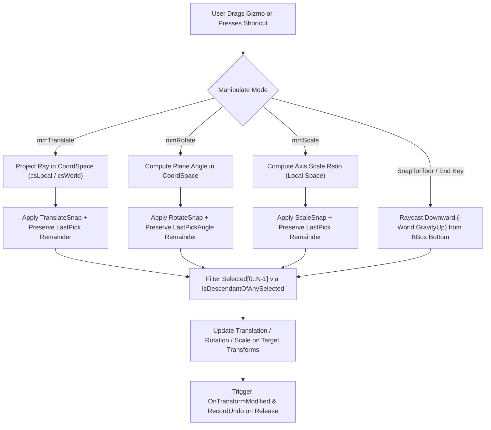
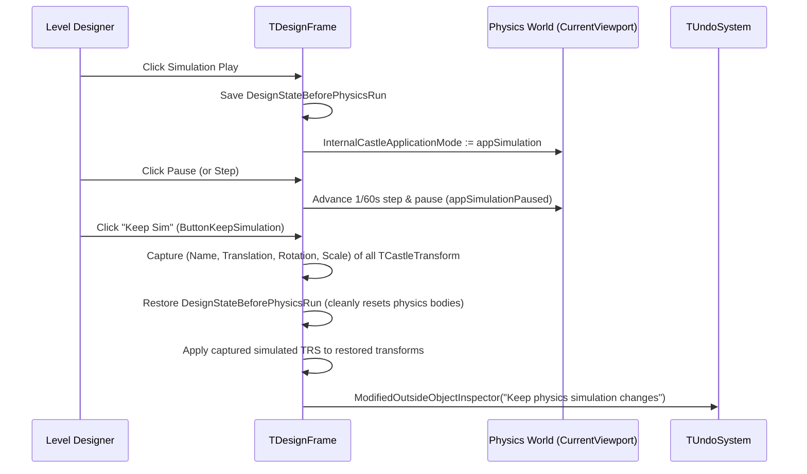

# Castle Game Engine — Editor Modernization & 3D Manipulation Guide

This guide provides comprehensive documentation for the **Castle Game Engine (`castle-editor`)** modernization initiative (**Phases 1–253**), inspired by **Unreal Engine 5.5**, **Godot 4**, **Blender 4**, and **Unity** workflows. It covers both **interactive editor workflows** in `tools/castle-editor` and the **runtime/editor Pascal APIs** in `CastleTransformManipulate` and `CastleRenderOptions`.

---

## Table of Contents

1. [Overview & Unreal Engine 5.5 Feature Parity Matrix](#1-overview--unreal-engine-55-feature-parity-matrix)
   - [1.1. Official Reference Documentation & Visual Screenshots (Castle Game Engine, Unreal Engine 5.5, Godot 4, Blender 4 & Unity)](#11-official-reference-documentation--visual-screenshots-castle-game-engine-unreal-engine-55-godot-4-blender-4--unity)
2. [Phase 1: 3D Viewport Gizmos, Snapping, Coordinate Spaces & Multi-Selection](#2-phase-1-3d-viewport-gizmos-snapping-coordinate-spaces--multi-selection)
   - [2.1. World vs. Local Coordinate Space (`TManipulateCoordSpace`)](#21-world-vs-local-coordinate-space-tmanipulatecoordspace)
   - [2.2. 3D Grid, Rotation & Scale Snapping (`TranslateSnap`, `RotateSnap`, `ScaleSnap`)](#22-3d-grid-rotation--scale-snapping-translatesnap-rotatesnap-scalesnap)
   - [2.3. Multi-Selection Transform Manipulation & Ancestor Deduplication](#23-multi-selection-transform-manipulation--ancestor-deduplication)
   - [2.4. Snap to Floor (`SnapToFloor` / `End` Key)](#24-snap-to-floor-snaptofloor--end-key)
   - [2.5. Pascal API Reference & Code Examples (`CastleTransformManipulate`)](#25-pascal-api-reference--code-examples-castletransformmanipulate)
3. [Phase 2: Scene Outliner (Hierarchy Panel) Modernization](#3-phase-2-scene-outliner-hierarchy-panel-modernization)
   - [3.1. Live Hierarchy Filter by Name and `+ClassName`](#31-live-hierarchy-filter-by-name-and-classname)
   - [3.2. Quick Visibility Toggle (`H` Key) & `[Hidden]` Badges](#32-quick-visibility-toggle-h-key--hidden-badges)
   - [3.3. Multi-Selection Duplication (`Ctrl+D`)](#33-multi-selection-duplication-ctrld)
   - [3.4. Double-Click Node to Focus Camera](#34-double-click-node-to-focus-camera)
4. [Phase 3: Details Panel (Object Inspector) Enhancements](#4-phase-3-details-panel-object-inspector-enhancements)
   - [4.1. Live Property Search Across Inspector Tabs](#41-live-property-search-across-inspector-tabs)
   - [4.2. Copy, Paste & Multi-Selection Reset Transform](#42-copy-paste--multi-selection-reset-transform)
5. [Phase 4: Viewport Rendering Modes, Colliders Toggle & Real-Time Stats Overlay](#5-phase-4-viewport-rendering-modes-colliders-toggle--real-time-stats-overlay)
   - [5.1. Lit, Unlit, Wireframe & Solid Wireframe Modes (`InternalForceUnlit` & `ButtonViewMode`)](#51-lit-unlit-wireframe--solid-wireframe-modes-internalforceunlit--buttonviewmode)
   - [5.2. Real-Time Viewport Statistics & Active Transform HUD (`ButtonShowStats`)](#52-real-time-viewport-statistics--active-transform-hud-buttonshowstats)
   - [5.3. One-Click Physics Collider Visualization (`ButtonShowColliders`)](#53-one-click-physics-collider-visualization-buttonshowcolliders)
6. [Phase 5: Content Browser Search, Asset Filter Pills & Grid-Snapped Viewport Drop](#6-phase-5-content-browser-search-asset-filter-pills--grid-snapped-viewport-drop)
   - [6.1. Content Browser Live Search & Category Filter Pills](#61-content-browser-live-search--category-filter-pills)
   - [6.2. 3D Grid-Snapped Viewport Drag-and-Drop](#62-3d-grid-snapped-viewport-drag-and-drop)
7. [Phase 6: Quick-Add Component Palette (`Ctrl+P` / `+ Add`)](#7-phase-6-quick-add-component-palette-ctrlp---add)
8. [Phase 7: Enhanced In-Editor Physics Simulation (`Step` & `Keep Sim`)](#8-phase-7-enhanced-in-editor-physics-simulation-step--keep-sim)
   - [8.1. Frame-by-Frame Physics Stepping (`SimulationSingleStep`)](#81-frame-by-frame-physics-stepping-simulationsinglestep)
   - [8.2. Keep Simulation Transform Changes (`KeepSimulationChanges`)](#82-keep-simulation-transform-changes-keepsimulationchanges)
9. [Phase 8: Multi-Object Alignment, Distribution, Snap-to-Grid (`Ctrl+End`) & Selection Center Pivot](#9-phase-8-multi-object-alignment-distribution-snap-to-grid-ctrlend--selection-center-pivot)
   - [9.1. Selection Center Orbital Pivot Mode (`TManipulatePivotMode`)](#91-selection-center-orbital-pivot-mode-tmanipulatepivotmode)
   - [9.2. Multi-Object Alignment & Even Distribution (`AlignSelected`, `DistributeSelected`)](#92-multi-object-alignment--even-distribution-alignselected-distributeselected)
   - [9.3. Absolute Snap-to-Grid (`SnapSelectedToGrid` / `Ctrl+End`)](#93-absolute-snap-to-grid-snapselectedtogrid--ctrlend)
10. [Phase 9: Viewport Camera Bookmarks (`Ctrl+0..9` / `0..9`) & Move Transform to View](#10-phase-9-viewport-camera-bookmarks-ctrl09--09--move-transform-to-view)
    - [10.1. Instant Viewport Camera Bookmarks (`SaveCameraBookmark`, `RecallCameraBookmark`)](#101-instant-viewport-camera-bookmarks-savecamerabookmark-recallcamerabookmark)
    - [10.2. Move Selected Transform to Camera View (`ViewportAlignTransformToView`)](#102-move-selected-transform-to-camera-view-viewportaligntransformtoview)
11. [Phase 10: Hierarchy & Object Inspector Productivity Tools](#11-phase-10-hierarchy--object-inspector-productivity-tools)
    - [11.1. Select All of Same Class & Expand/Collapse Subtree](#111-select-all-of-same-class--expandcollapse-subtree)
    - [11.2. One-Click Reset Property to Default (`ResetSelectedPropertyToDefault`)](#112-one-click-reset-property-to-default-resetselectedpropertytodefault)
12. [Phase 11: Surface Normal Alignment (`Alt+End`), Physics-Safe Mirroring, 90° Step Rotation & Transform Randomizer](#12-phase-11-surface-normal-alignment-altend-physics-safe-mirroring-90-step-rotation--transform-randomizer)
    - [12.1. Snap to Floor with Surface Normal Alignment (`SnapToFloor(true)` / `Alt+End`)](#121-snap-to-floor-with-surface-normal-alignment-snaptofloortrue--altend)
    - [12.2. Physics-Safe Axis Mirroring (`MirrorSelected`)](#122-physics-safe-axis-mirroring-mirrorselected)
    - [12.3. Exact 90° Step Rotation (`RotateSelected90`) & Set-Dressing Randomizer (`RandomizeSelected`)](#123-exact-90-step-rotation-rotateselected90--set-dressing-randomizer-randomizeselected)
13. [Phase 12: Scene Outliner Selection Isolation (`Shift+H` / `Alt+H`) & Group Selected (`Ctrl+G`)](#13-phase-12-scene-outliner-selection-isolation-shifth--alth--group-selected-ctrlg)
    - [13.1. Isolate Selected (`Shift+H`) & Show All Hidden (`Alt+H`)](#131-isolate-selected-shifth--show-all-hidden-alth)
    - [13.2. Group Selected Under New Transform (`Ctrl+G` / `GroupSelectedTransforms`)](#132-group-selected-under-new-transform-ctrlg--groupselectedtransforms)
14. [Phase 13: Dynamic Viewport Camera Speed Controls (`[` / `]`) & Camera Speed HUD](#14-phase-13-dynamic-viewport-camera-speed-controls-----camera-speed-hud)
15. [Phase 14: Alt-Drag 3D Gizmo Duplication & Bounding-Box Flush Stacking (`StackSelected`)](#15-phase-14-alt-drag-3d-gizmo-duplication--bounding-box-flush-stacking-stackselected)
16. [Phase 15: Ungroup Selected Transforms (`Ctrl+Shift+G` / `UngroupSelectedTransforms`)](#16-phase-15-ungroup-selected-transforms-ctrlshiftg--ungroupselectedtransforms)
17. [Phase 16: Viewport Marquee / Box Selection (`SelectComponentsInMarquee`)](#17-phase-16-viewport-marquee--box-selection-selectcomponentsinmarquee)
18. [Phase 17: Interactive Surface & Vertex Snapping (`SnapSelectedToRay` / `V` Key)](#18-phase-17-interactive-surface--vertex-snapping-snapselectedtoray--v-key)
19. [Phase 18: Linear / Step Array Duplication Tool (`ArrayDuplicateSelected` / `Ctrl+Shift+D`)](#19-phase-18-linear--step-array-duplication-tool-arrayduplicateselected--ctrlshiftd)
20. [Phase 19: Hierarchy Selection Locking (`L` Key / `Alt+L` / `[Locked]` Badge)](#20-phase-19-hierarchy-selection-locking-l-key--altl--locked-badge)
21. [Phase 20: Radial / Circular Array Duplication (`RadialDuplicateSelected` / `Ctrl+Alt+D`)](#21-phase-20-radial--circular-array-duplication-radialduplicateselected--ctrlaltd)
22. [Phase 21: Multi-Component Replace With Another Class (`ReplaceSelectedComponents` / `Ctrl+Shift+R`)](#22-phase-21-multi-component-replace-with-another-class-replaceselectedcomponents--ctrlshiftr)
23. [Phase 22: Selection-Aware Standard Axis Viewport Camera Views (`Numpad 1/3/7/5` & `Alt+1/3/7/5`)](#23-phase-22-selection-aware-standard-axis-viewport-camera-views-numpad-1375--alt1375)
24. [Phase 23: 3D Viewport Ruler & Distance Measurement Tool (`M` Key / Multi-Select Ruler HUD)](#24-phase-23-3d-viewport-ruler--distance-measurement-tool-m-key--multi-select-ruler-hud)
25. [Phase 24: 2D / 3D Grid Array Duplication (`GridDuplicateSelected` / `Ctrl+Alt+G`)](#25-phase-24-2d--3d-grid-array-duplication-gridduplicateselected--ctrlaltg)
26. [Phase 25: Project Selected Transforms Along Any Direction / Camera View Ray (`ProjectSelectedAlongDirection` / `Ctrl+Shift+End`)](#26-phase-25-project-selected-transforms-along-any-direction--camera-view-ray-projectselectedalongdirection--ctrlshiftend)
27. [Phase 26: Hierarchy & Viewport Selection Power Tools (`InvertSelection` / `Ctrl+I`, `SelectChildren` / `Ctrl+]`)](#27-phase-26-hierarchy--viewport-selection-power-tools-invertselection--ctrli-selectchildren--ctrl)
28. [Phase 27: Bounding-Box Equal-Gap Distribution (`DistributeSelectedGaps`) & Absolute Rotation/Scale Grid Quantization (`SnapSelectedRotationAndScaleToGrid`)](#28-phase-27-bounding-box-equal-gap-distribution-distributeselectedgaps--absolute-rotationscale-grid-quantization-snapselectedrotationandscaletogrid)
29. [Phases 28–119: 3D Parametric Arrangements, Spatial Projections, Non-Linear Deformers & 2D UI Layout Operators (Sections 29–62)](#29-phase-28-ground-aware-scatter-duplication-scatterduplicateselected--ctrlalts--hierarchy-select-parent--siblings-ctrl--)
30. [Phases 120–174: Differential Geometry Minimal Surfaces, Classical Parametric Curves, Spatial Deformers, 2D UI Splitters/Docking & Scene Audit Filters](#63-phases-120174-differential-geometry-minimal-surfaces-classical-parametric-curves-spatial-deformers-2d-ui-splittersdocking--scene-audit-filters)
31. [Phases 175–210: Batch Asset & Prefab Utilities, 3D Level/Lighting/Physics/Terrain Rigs & 2D HUD/Dialog/Inventory Builders](#64-phases-175210-batch-asset--prefab-utilities-3d-levellightingphysicsterrain-rigs--2d-huddialoginventory-builders)
32. [Phases 211–250: Advanced 3D Navigation/Joint/Combine Rigs, 2D Font/Mask/ScrollView/Keyboard/Color Generators, Categorized Context Submenus & Final Design Readiness Auditor](#65-phases-211250-advanced-3d-navigationjointcombine-rigs-2d-fontmaskscrollviewkeyboardcolor-generators-categorized-context-submenus--final-design-readiness-auditor)
33. [Complete Keyboard Shortcuts & Toolbar Reference](#66-complete-keyboard-shortcuts--toolbar-reference)
34. [Automated Unit Tests & Verification](#67-automated-unit-tests--verification)

---

## 1. Overview & Unreal Engine 5.5 Feature Parity Matrix

Modern 3D level design and UI composition require fast, deterministic spatial manipulation, immediate hierarchy/property/asset filtering, and seamless physics-assisted placement. The table below summarizes how Unreal Engine 5.5 workflows map to Castle Game Engine (`castle-editor`, `TCastleTransformManipulate`, and `CastleRenderOptions`):

| Workflow Feature | Unreal Engine 5.5 | Castle Game Engine (`editor-modernization`) | Source Location |
| :--- | :--- | :--- | :--- |
| **Coordinate Space Toggle** | World / Local gizmo toggle (`Ctrl+~` or toolbar icon) | `CoordSpace` (`csLocal` / `csWorld`) + Toolbar `Local`/`World` button (`ButtonCoordSpace`) + `Ctrl+~` | `src/scene/castletransformmanipulate.pas`<br>`tools/castle-editor/code/framedesign.pas` |
| **Multi-Selection Pivot Mode** | Pivot at Primary Actor vs. Selection Center | `PivotMode` (`pmPrimarySelected` / `pmSelectionCenter`) + Toolbar `Pivot: Primary`/`Center` button (`ButtonPivotMode`) | `src/scene/castletransformmanipulate.pas`<br>`tools/castle-editor/code/framedesign.pas` |
| **3D Translation Snapping** | Grid Snap increments (e.g., `1`, `5`, `10`, `50`) | `TranslateSnap: Single` + Toolbar `3D snap:` spin edit (`SpinEditSnap3D`) | `src/scene/castletransformmanipulate.pas` |
| **3D Rotation Snapping** | Angle Snap increments (e.g., `5°`, `15°`, `45°`) | `RotateSnap: Single` (in radians; automatically linked to `SpinEditSnap3D` in editor) | `src/scene/castletransformmanipulate.pas` |
| **3D Scale Snapping** | Scale Snap increments (e.g., `0.1`, `0.25`, `0.5`) | `ScaleSnap: Single` (linked to `SpinEditSnap3D` in editor) | `src/scene/castletransformmanipulate.pas` |
| **Multi-Actor Gizmo Drag** | Select multiple actors and translate/rotate/scale together | Multi-selection gizmo attached to `Selected[0]` (`SelectedCount >= 1`) with ancestor deduplication | `src/scene/castletransformmanipulate.pas` |
| **Viewport Marquee Box Selection** | Drag selection rectangle in viewport to batch-select actors | Left-Drag in `Select` mode (`moSelect`) or `Ctrl+Alt` + Left-Drag in any mode (`SelectComponentsInMarquee`, `Shift` for additive) | `tools/castle-editor/code/framedesign.pas` |
| **Surface & Vertex Snapping** | Hold `V` to snap selection onto mesh vertices or surfaces | `SnapSelectedToRay` (`V` = surface snap, `Shift+V` = vertex snap, `Alt+V` = surface + normal, `Shift+Alt+V` = vertex + normal) | `src/scene/castletransformmanipulate.pas`<br>`tools/castle-editor/code/framedesign.pas` |
| **Snap to Floor, Normal & Grid** | `End` snaps to floor; `Alt+End` aligns to surface normal; `Ctrl+End` snaps to grid | `SnapToFloor(false)` (`End`), `SnapToFloor(true)` (`Alt+End`), & `SnapSelectedToGrid` (`Ctrl+End`) | `src/scene/castletransformmanipulate.pas`<br>`tools/castle-editor/code/framedesign.pas` |
| **Alt-Drag & Array Duplication** | `Alt` + gizmo drag duplicates actor; Step-and-Repeat array | `GizmoTransformModifyBegin` (`Alt` + Gizmo drag), `ArrayDuplicateSelected` (`Ctrl+Shift+D`), `RadialDuplicateSelected` (`Ctrl+Alt+D`), `GridDuplicateSelected` (`Ctrl+Alt+G`), & `ScatterDuplicateSelected` (`Ctrl+Alt+S`) | `src/scene/castletransformmanipulate.pas`<br>`tools/castle-editor/code/framedesign.pas` |
| **Mirror, 90° Step & Randomize** | Mirror Actor X/Y/Z, 90° Quick Rotate, Foliage/Actor Randomizer | `MirrorSelected` (`Mirror X/Y/Z`), `RotateSelected90` (`Rot 90° Y`), `RandomizeSelected` (`Randomize`) | `src/scene/castletransformmanipulate.pas`<br>`tools/castle-editor/code/framedesign.pas` |
| **Multi-Actor Align, Distribute & Stack** | Actor Align / Distribute / Flush Bounding-Box Stack along X, Y, Z | `AlignSelected` (`Align X/Y/Z`), `DistributeSelected` (`Dist X/Y/Z`), `DistributeSelectedGaps`, & `StackSelected` (`Stack X/Y/Z`) in `PanelLayoutTransform` | `src/scene/castletransformmanipulate.pas`<br>`tools/castle-editor/code/framedesign.pas` |
| **Parametric 3D Curves, Minimal Surfaces & Spatial Deformers** | Spline/Curve Placement, Modeling Deformers (Bend, Twist, Taper, Spherify, Displace) | **60+ Parametric 3D Curves, Minimal Surfaces & Spatial Deformers** (`ArrangeSelectedInCircle`, `Helix`, `ParabolicArch`, `OnSphere`, `OnTorus`, `Catenary`, `Lissajous`, `TwistSelected`, `TaperSelected`, `BendSelected`, `SpherifySelected`, `RippleSelected`, `VolumeSquashStretchSelected`, `SwirlSelected`, `GyroidDeformSelected`, `ScherkDeformSelected`, `StereographicDeformSelected`, `ArrangeSelectedOnDupinCyclide`, `OnKuenSurface`, `OnPluckerConoid`, `OnSuperellipsoid`, etc.) | `src/scene/castletransformmanipulate.pas`<br>`tools/castle-editor/code/framedesign.pas` |
| **Camera Bookmarks & Speed** | `Ctrl+0..9` / `0..9` bookmarks; `[` / `]` camera speed | `SaveCameraBookmark`, `RecallCameraBookmark`, & `AdjustCameraSpeed` (`[` / `]` + HUD `Cam Speed`) | `tools/castle-editor/code/framedesign.pas` |
| **Move Actor to View** | Snap selected actor/light to current camera view | `Move to View` (`ButtonMoveTransformToView` / `ViewportAlignTransformToView`) | `tools/castle-editor/code/framedesign.pas` |
| **Outliner Live Search** | Top search box (`ActorName` or `+ClassName`) | Always-visible `EditFindInHierarchy` supporting `Name`, `ClassName`, and `+ClassName` with yellow node highlighting | `tools/castle-editor/code/framedesign.pas` |
| **Outliner Batch Selection & Tree Ops** | Select All of Same Class, Expand/Collapse All, Group (`Ctrl+G`) / Ungroup (`Ctrl+Shift+G`) | `Select All of Same Class`, `Expand/Collapse Subtree`, `Group Selected (Ctrl+G)`, `Ungroup Selected (Ctrl+Shift+G)`, plus **5 Categorized Context Menu Submenus** | `tools/castle-editor/code/framedesign.pas` |
| **Actor Visibility, Isolation & Lock** | `H` toggles visibility, `Shift+H` isolates, `Alt+H` un-hides all, `L` locks selection | `H` (`ToggleSelectedVisibility`), `Shift+H` (`IsolateSelected`), `Alt+H` (`ShowAllHidden`), `L` (`ToggleSelectedLock`), `Alt+L` (`UnlockAll`), `[Hidden]` & `[Locked]` badges | `tools/castle-editor/code/framedesign.pas` |
| **Multi-Actor Duplicate** | `Ctrl+D` / `Ctrl+W` duplicates all selected actors | `Ctrl+D` (`DuplicateComponent`) duplicates all selected `TCastleTransform`, `TCastleUserInterface`, or `TCastleComponent` items | `tools/castle-editor/code/framedesign.pas` |
| **Outliner Focus Camera** | Double-click actor in Outliner or press `F` | Double-click `TCastleTransform` in `ControlsTree` or press `F` (`ViewportViewSelected`) | `tools/castle-editor/code/framedesign.pas` |
| **Details Property Search & Reset** | Top search bar + Reset to Default (`Revert`) arrow | `EditPropertyFilter` (`Search Properties...`) + `Reset Prop` (`ButtonResetProperty`) | `tools/castle-editor/code/framedesign.pas` |
| **Copy / Paste Transform** | Right-click Transform header -> Copy / Paste / Reset | `Copy Transform`, `Paste Transform`, and `Reset` buttons in `PanelLayoutTransform` (supports multi-selection) | `tools/castle-editor/code/framedesign.pas` |
| **Viewport View Modes** | `Lit`, `Unlit` (`Alt+3`), `Wireframe` (`Alt+2`), `Lit Wireframe` | `View: Lit / Unlit / Wire / SolidWire` button (`ButtonViewMode`) & `Ctrl+T` (`InternalForceUnlit`, `InternalForceWireframe`) | `src/base/castlerenderoptions_globals.inc`<br>`tools/castle-editor/code/framedesign.pas` |
| **Viewport Stats & Colliders** | `Stat FPS` / `Stat Unit` + `Show Collision` | Toolbar `Stats` (`ButtonShowStats`) & `Colliders` (`ButtonShowColliders`) toggles with enriched HUD | `tools/castle-editor/code/framedesign.pas` |
| **Content Browser Filtering** | Search bar + Asset Type Filter pills (`Meshes`, `Textures`, `Audio`...) | `EditFileFilter` + 6 Asset Category pills (`All`, `3D/Scenes`, `Designs`, `Images`, `Audio`, `Code`) | `tools/castle-editor/code/formproject.pas` |
| **Quick-Add Palette** | "Quickly Add to the Project" searchable popup | `+ Add` button (`ButtonQuickAdd`) & `Ctrl+P` shortcut opening `ShowQuickAddPalette` | `tools/castle-editor/code/framedesign.pas` |
| **Physics Step & Keep Sim** | Single-Step simulation & "Keep Simulation Changes" (`K`) | `Step` (`ButtonSimulationStep`) & `Keep Sim` (`ButtonKeepSimulation`) toolbar buttons during physics simulation | `tools/castle-editor/code/framedesign.pas` |
| **3D Level, Physics, Terrain & Navigation Rig Generators** | Place Actors / Blueprints for Lighting, Terrain, Water, Joints, Ragdolls, Character Rigs | **30+ 3D Quick Rig Builders** (Studio Lighting, Sky/Fog, Terrain & TerrainCombine, Water Volume, Physics Joints, Ragdolls, Trigger Volumes, Living/Hurt Creatures, Walk/Examine/2D/Third-Person Navigation Rigs) | `tools/castle-editor/code/framedesign.pas` |
| **2D UI Layouts, HUD, Font, ScrollView & Customizer Builders** | UMG Designer Layouts, RichText, ScrollBox, Virtual Keyboard, Color Picker | **30+ 2D UI Layout Operators** (`PanelLayoutUI`) & **25+ Interactive 2D UI Generators** (HUD, Dialog, Inventory, Minimap, Radial Wheel, Skill Hotbar, FontFamily, BitmapFont, ScrollView, Crosshair, Virtual Keyboard, Color Customizer) | `tools/castle-editor/code/framedesign.pas` |
| **Batch Asset Utilities & Design Readiness Auditor** | Asset Audit / Map Check / Batch Rename / Prefab Extraction | Batch Rename (`F2`), Batch URL Find/Replace, Extract Subtree to Prefab, Hierarchy Statistics Report, & **Final Pre-Release Design Readiness Auditor** (`ShowDesignReadinessAuditDialog`) | `tools/castle-editor/code/framedesign.pas` |

### 1.1. Official Reference Documentation & Visual Screenshots (Castle Game Engine, Unreal Engine 5.5, Godot 4, Blender 4 & Unity)

#### A. Castle Game Engine (`castle-editor` & Runtime Scene/UI Architecture)
- **Official Documentation:**
  - [Castle Game Engine — Visual Editor (`castle-editor`) Manual](https://castle-engine.io/manual_editor.php)
  - [Castle Game Engine — Viewport and 3D Scenes (`TCastleViewport`, `TCastleTransform`, `TCastleScene`)](https://castle-engine.io/viewport_and_scenes)
  - [Castle Game Engine — Designing User Interface & 2D Controls (`TCastleUserInterface`)](https://castle-engine.io/user_interface)
  - [Castle Game Engine — Physics, Colliders, Rigid Bodies & Joints](https://castle-engine.io/physics)
- **Official Screenshots:**

| Castle Game Engine 3D Viewport & Hierarchy Editor | Castle Game Engine UI Designer & Object Inspector | Castle Game Engine Code & Editor Integration |
| :---: | :---: | :---: |
|  |  |  |

#### B. Unreal Engine 5.5 (Level Editor, World Outliner, Viewport Toolbar & UMG UI Designer)
- **Official Documentation:**
  - [Unreal Engine 5.5 — Unreal Editor Interface Overview](https://dev.epicgames.com/documentation/en-us/unreal-engine/unreal-editor-interface)
  - [Unreal Engine 5.5 — Transforming Actors (Translate, Rotate, Scale, Snapping & Pivot)](https://dev.epicgames.com/documentation/en-us/unreal-engine/transforming-actors-in-unreal-engine)
  - [Unreal Engine 5.5 — World Outliner (Hierarchy Filtering, Visibility & Grouping)](https://dev.epicgames.com/documentation/en-us/unreal-engine/outliner-in-unreal-engine)
  - [Unreal Engine 5.5 — Viewport Toolbar (View Modes, Camera Speed & Grid Snapping)](https://dev.epicgames.com/documentation/en-us/unreal-engine/viewport-toolbar-in-unreal-engine)
  - [Unreal Engine 5.5 — UMG UI Designer (2D Widgets, Anchors & Layouts)](https://dev.epicgames.com/documentation/en-us/unreal-engine/umg-ui-designer-for-unreal-engine)
- **Official Screenshots:**

| Unreal Engine 5 Editor Interface Overview | Unreal Engine 5 World Outliner & Hierarchy |
| :---: | :---: |
|  |  |

#### C. Godot Engine 4.x (3D Viewport, `Node3D` Gizmos, `Control` Anchors & GUI Containers)
- **Official Documentation:**
  - [Godot Engine 4 — Introduction to 3D & Using the 3D Editor](https://docs.godotengine.org/en/stable/tutorials/3d/introduction_to_3d.html)
  - [Godot Engine 4 — Using 3D Transforms (`Node3D`, Local vs. Global Space)](https://docs.godotengine.org/en/stable/tutorials/3d/using_transforms.html)
  - [Godot Engine 4 — 2D UI Size and Anchors (`Control`)](https://docs.godotengine.org/en/stable/tutorials/ui/size_and_anchors.html)
  - [Godot Engine 4 — 2D GUI Containers (Box, Grid, Split & Margin Containers)](https://docs.godotengine.org/en/stable/tutorials/ui/gui_containers.html)
- **Official Screenshots:**

| Godot 4 3D Viewport & Transform Gizmo | Godot 4 3D Viewport Toolbar & Snapping | Godot 4 2D UI Anchors & Offsets | Godot 4 2D GUI Layout Containers |
| :---: | :---: | :---: | :---: |
|  |  |  |  |

#### D. Blender 4.x (3D Viewport Gizmos, Surface/Vertex Snapping, Array & Simple Deform Modifiers)
- **Official Documentation:**
  - [Blender 4 Manual — 3D Viewport Gizmos (Move, Rotate, Scale & Orientations)](https://docs.blender.org/manual/en/latest/editors/3dview/display/gizmo.html)
  - [Blender 4 Manual — 3D Snapping (Increment, Vertex, Face & Align Rotation to Target)](https://docs.blender.org/manual/en/latest/editors/3dview/controls/snapping.html)
  - [Blender 4 Manual — Array Modifier (Linear, Radial & Object-Offset Duplication)](https://docs.blender.org/manual/en/latest/modeling/modifiers/generate/array.html)
  - [Blender 4 Manual — Simple Deform Modifier (Twist, Bend, Taper & Stretch)](https://docs.blender.org/manual/en/latest/modeling/modifiers/deform/simple_deform.html)
- **Official Screenshots:**

| Blender 3D Viewport Transform Gizmo | Blender 3D Snapping Element Menu | Blender Simple Deform (Twist, Bend, Taper, Stretch) |
| :---: | :---: | :---: |
|  |  |  |

#### E. Unity Engine (Scene View Transform Gizmos, Center/Pivot & Global/Local Coordinate Toggles)
- **Official Documentation:**
  - [Unity Manual — Positioning GameObjects (Transform Gizmos, Center/Pivot & Global/Local)](https://docs.unity3d.com/Manual/PositioningGameObjects.html)
  - [Unity Manual — Grid and Snap Overlays](https://docs.unity3d.com/Manual/GridSnapping.html)
- **Official Screenshots:**

| Unity Scene View Transform Modes | Unity Center/Pivot & Global/Local Handle Toggles |
| :---: | :---: |
|  |  |

---

## 2. Phase 1: 3D Viewport Gizmos, Snapping, Coordinate Spaces & Multi-Selection

> **Official Reference Documentation & Visual Inspiration:**
> - **Castle Game Engine:** [Viewport and 3D Scenes (`TCastleViewport`, `TCastleTransform`)](https://castle-engine.io/viewport_and_scenes) · [`TCastleTransformManipulate` API Reference](https://castle-engine.io/apidoc/html/CastleTransformManipulate.TCastleTransformManipulate.html)
> - **Unreal Engine 5.5:** [Transforming Actors (Translate, Rotate, Scale, World/Local & Grid Snapping)](https://dev.epicgames.com/documentation/en-us/unreal-engine/transforming-actors-in-unreal-engine)
> - **Godot Engine 4:** [Introduction to 3D & 3D Transform Gizmos](https://docs.godotengine.org/en/stable/tutorials/3d/introduction_to_3d.html) · [Using 3D Transforms (`Node3D`)](https://docs.godotengine.org/en/stable/tutorials/3d/using_transforms.html)
> - **Blender 4:** [3D Viewport Gizmos](https://docs.blender.org/manual/en/latest/editors/3dview/display/gizmo.html) · [3D Snapping](https://docs.blender.org/manual/en/latest/editors/3dview/controls/snapping.html)
> - **Unity:** [Positioning GameObjects & Gizmo Handle Toggles](https://docs.unity3d.com/Manual/PositioningGameObjects.html)

| CGE 3D Viewport & Transform Gizmo | Godot 4 3D Transform Gizmo | Blender 4 Translate / Rotate / Scale Gizmos | Unity Global / Local & Pivot Toggles |
| :---: | :---: | :---: | :---: |
|  |  |  |  |

All 3D manipulation features are implemented in `TCastleTransformManipulate` (`src/scene/castletransformmanipulate.pas`), making them available both inside `castle-editor` and in any custom runtime level editor or CAD tool built with Castle Game Engine.



### 2.1. World vs. Local Coordinate Space (`TManipulateCoordSpace`)

By default, a `TCastleTransform` stores its `Translation`, `Rotation`, and `Scale` relative to its `Parent`. Because `TGizmoScene` is attached as an internal child of `FMainSelected` (`Selected[0]`):
- **`csLocal` (Default):** The gizmo inherits `FMainSelected`'s rotation and orientation directly. Dragging the X arrow translates the object along its own local X axis, and dragging a rotation ring rotates around its local axis.
- **`csWorld`:** When `CoordSpace = csWorld` and `Mode in [mmTranslate, mmRotate]`:
  1. **Visual Alignment (`TGizmoScene.LocalRender`):** Before rendering the gizmo mesh, `TGizmoScene` strips the rotation portion of `FMainSelected`'s world transformation while preserving the world translation center and uniform scale factor. Consequently, the Red (X), Green (Y), and Blue (Z) gizmo axes always point along the World $(X, Y, Z)$ axes regardless of how the object or its parent hierarchy is rotated.
  2. **Ray Projection (`TGizmoScene.GetEffectiveRay`):** Incoming pointer rays (`Pick.RayOrigin`, `Pick.RayDirection` in `FMainSelected` local space) are rotated by `FMainSelected` world rotation so that axis intersection (`PointOnAxis`) and rotation plane angle (`AngleOnPlane`) are evaluated in World axis directions.
  3. **Delta Application (`ApplyTranslateDelta`, `ApplyRotateDelta`):** World-aligned deltas are converted into each selected transform's parent coordinate space (`Parent.WorldToLocalDirection`), ensuring accurate movement even when selected objects sit inside rotated parent transforms.
  4. **Scale Exception:** Just like in Unreal Engine, `mmScale` always operates in `csLocal` space because non-uniform world-axis scaling on a rotated transform would induce shear, which cannot be represented by a TRS (`Translation`, `Rotation`, `Scale`) decomposition.

### 2.2. 3D Grid, Rotation & Scale Snapping (`TranslateSnap`, `RotateSnap`, `ScaleSnap`)

Interactive gizmo dragging requires **remainder-preserving snapping** so the object does not drift from the mouse cursor or get stuck on small mouse movements:
- **Translation Snapping (`TranslateSnap > 0`):**
  Let $\Delta = P_{\text{current}} - P_{\text{last}}$ be the raw displacement along the active gizmo axis (or plane) since the last snapped step, and let $S = \text{TranslateSnap}$. The snapped displacement is:
  $$\Delta_{\text{snapped}} = \text{Round}\!\left(\frac{\Delta}{S}\right) \cdot S$$
  Instead of advancing `LastPick` to the raw intersection $P_{\text{current}}$, `LastPick` is advanced by the exact snapped increment:
  $$P_{\text{last}} \leftarrow P_{\text{last}} + \Delta_{\text{snapped}}$$
  If $|\Delta_{\text{snapped}}| < \epsilon$, no movement is applied on that frame and the sub-grid motion accumulates until the cursor crosses the next snap boundary.
- **Rotation Snapping (`RotateSnap > 0`):**
  Angles are measured in radians. Given raw angular delta $\Delta\theta = \theta_{\text{current}} - \theta_{\text{last}}$ (normalized to $[-\pi, \pi]$) and snap step $S_\theta = \text{RotateSnap}$:
  $$\Delta\theta_{\text{snapped}} = \text{Round}\!\left(\frac{\Delta\theta}{S_\theta}\right) \cdot S_\theta, \qquad \theta_{\text{last}} \leftarrow \theta_{\text{last}} + \Delta\theta_{\text{snapped}}$$
  In `castle-editor`, setting the toolbar **`3D snap:`** spin edit (`SpinEditSnap3D`) to:
  - `0`: Disables 3D snapping (`TranslateSnap = 0`, `RotateSnap = 0`, `ScaleSnap = 0`).
  - `0 < Value <= 1.0` (e.g., `0.5` or `1.0` meter): Sets `TranslateSnap := Value`, `ScaleSnap := Value`, and `RotateSnap := DegToRad(15.0)` ($15^\circ$).
  - `Value > 1.0` (e.g., `5`, `10`, `15`, `45`): Sets `TranslateSnap := Value`, `ScaleSnap := Value`, and `RotateSnap := DegToRad(Value)`.

### 2.3. Multi-Selection Transform Manipulation & Ancestor Deduplication

Previously, selecting more than one `TCastleTransform` hid the 3D gizmo (`MainSelected` was set to `nil` when `SelectedCount > 1`). Now:
- Whenever `SelectedCount >= 1`, `MainSelected` is set to `Selected[0]`, displaying the gizmo at the primary selected transform while rendering selection bounding boxes around all `Selected[0 .. SelectedCount - 1]`.
- **Hierarchy Ancestor Deduplication (`IsDescendantOfAnySelected`):**
  If a user selects both a `ParentTransform` and its `ChildTransform` and drags the gizmo, applying the translation/rotation/scale delta to both would move `ChildTransform` **twice** (once inherited from `ParentTransform`, and once directly). `TCastleTransformManipulate.IsDescendantOfAnySelected` walks up `T.UniqueParent` and skips any selected transform that has an ancestor in the current selection.
- **Viewport Click Preservation (`TDesignerLayer.Press`):**
  Clicking directly on the 3D gizmo or on an already-selected `TCastleTransform` in the viewport preserves the existing multi-selection instead of collapsing it to a single object.

### 2.4. Snap to Floor (`SnapToFloor` / `End` Key)

Pressing the **`End`** key in the viewport or clicking the **`Snap to Floor (End)`** button in the Transform layout panel invokes `TCastleTransformManipulate.SnapToFloor`:
1. Determines the downward direction from the world gravity vector: $\vec{D}_{\text{down}} = -\text{World.GravityUp}$ (typically $(0, -1, 0)$).
2. For each top-level selected transform $T$:
   - Computes $T.\text{WorldBoundingBox}$.
   - Sets the ray origin at the horizontal center of the bounding box and at its lowest point along the gravity axis (plus a tiny upward offset $10^{-4}$ to avoid self-surface precision issues). If $T$ has an empty bounding box (such as a `TCastleTransform` grouping node or point light), the ray starts at $T$'s world translation origin.
   - Temporarily hides all selected transforms (`Exists := false`) and disables gizmo picking (`Pickable := false`) so the downward ray (`World.WorldRay`) only hits unselected environment geometry.
   - Moves $T$ downward by $( \text{Distance} - \text{RayEpsilon} ) \cdot \vec{D}_{\text{down}}$ converted into $T.\text{UniqueParent}$'s local space.
3. Fires `OnTransformModified` and `OnTransformModifyEnd` so the editor records a single Undo step.

### 2.5. Pascal API Reference & Code Examples (`CastleTransformManipulate`)

```pascal
uses
  CastleTransform, CastleTransformManipulate, CastleVectors, CastleUtils, Math;

procedure ConfigureManipulator(const Manipulate: TCastleTransformManipulate;
  const Box1, Box2: TCastleTransform);
begin
  // 1. Select multiple transforms at once
  Manipulate.SetSelected([Box1, Box2]);

  // 2. Choose World or Local coordinate space
  Manipulate.CoordSpace := csWorld;

  // 3. Configure 3D snapping increments
  Manipulate.TranslateSnap := 0.5;          // Snap translation to 0.5m grid steps
  Manipulate.RotateSnap := DegToRad(15.0);  // Snap rotation to 15-degree increments
  Manipulate.ScaleSnap := 0.25;             // Snap scale to 0.25x steps

  // 4. Programmatically translate/rotate/scale all selected transforms
  //    (automatically honors CoordSpace, Snapping, and Ancestor Deduplication)
  Manipulate.TranslateSelected(Vector3(1.2, 0.0, 0.0)); // Snaps to (1.0, 0.0, 0.0)
  Manipulate.RotateSelected(1 {Y axis}, DegToRad(28.0)); // Snaps to 30 degrees

  // 5. Snap all selected transforms down to the nearest floor collider/mesh
  Manipulate.SnapToFloor;
end;
```

---

## 3. Phase 2: Scene Outliner (Hierarchy Panel) Modernization

> **Official Reference Documentation & Visual Inspiration:**
> - **Castle Game Engine:** [Visual Editor Hierarchy & Design Tree](https://castle-engine.io/manual_editor.php)
> - **Unreal Engine 5.5:** [World Outliner (Filtering by `+Type`, Eye Visibility & Actor Hierarchy)](https://dev.epicgames.com/documentation/en-us/unreal-engine/outliner-in-unreal-engine)
> - **Blender 4:** [Outliner Interface, Search Filter & Restriction Toggles](https://docs.blender.org/manual/en/latest/editors/outliner/introduction.html)

| CGE Scene Hierarchy & Viewport | Unreal Engine 5 World Outliner | Blender 4 Outliner Tree & Filter |
| :---: | :---: | :---: |
|  |  |  |

The left-hand Hierarchy panel (`ControlsTree` inside `TDesignFrame`) has been upgraded for large scenes with hundreds of components.

### 3.1. Live Hierarchy Filter by Name and `+ClassName`

The search bar (`EditFindInHierarchy`) at the top of the Hierarchy panel is now **always visible**:
- **Match by Name or Class:** Typing `light` matches any component whose `Name` contains `light` **or** whose `ClassName` contains `light` (e.g., `TCastleDirectionalLight`, `TCastlePointLight`).
- **Explicit Class Filter (`+ClassName`):** Prefixing the query with `+` (such as `+Scene`, `+Transform`, `+Button`, `+RigidBody`) restricts matching strictly to the component's `ClassName`.
- **Live Visual Highlighting:** All nodes in `ControlsTree` that match the current search filter have their class suffix highlighted in bright yellow (`clYellow`), making it effortless to spot all matching components across deep hierarchies while `F3` (`FindNext`) cycles selection through every matching node.

### 3.2. Quick Visibility Toggle (`H` Key) & `[Hidden]` Badges

- Pressing **`H`** while focused in either the **3D/2D Viewport** or the **Hierarchy Tree** (or choosing **`Toggle Visibility (Exists) (H)`** from the right-click Hierarchy context menu) toggles the `Exists` property of all currently selected `TCastleTransform` and `TCastleUserInterface` components.
- When multiple objects are selected, `ToggleSelectedVisibility` inspects the first selected item and sets all selected items to the opposite `Exists` state in a single Undo step.
- Any component with `Exists = false` is immediately marked in the Hierarchy tree with a dimmed **`[Hidden]`** suffix (e.g., `MyDungeonWall (TCastleScene) [Hidden]`).

### 3.3. Multi-Selection Duplication (`Ctrl+D`)

- Selecting multiple components (`Ctrl+Click` or `Shift+Click`) in the Hierarchy or Viewport and pressing **`Ctrl+D`** (or right-click -> **Duplicate**) duplicates every selected component (`TCastleTransform`, `TCastleUserInterface`, or non-visual `TCastleComponent`).
- **Ancestor Deduplication (`IsComponentDescendantOfSelection`):** If both a parent transform/UI and its child are selected during `Ctrl+D`, only the parent subtree is duplicated (which already clones its children), preventing duplicate copies of the child.
- After duplication, the editor automatically selects all newly created clones so you can immediately move them together with the 3D gizmo.

### 3.4. Double-Click Node to Focus Camera & Example Workflow

- Double-clicking any `TCastleTransform` node in the Hierarchy tree (`ControlsTreeDblClick`) immediately frames and focuses the active 3D viewport camera onto that transform's bounding box (`ViewportViewSelected`, identical to pressing **`F`** in the viewport).

```text
Example Editor Workflow (Phase 2):
1. Press Ctrl+F and type "+PointLight" -> All TCastlePointLight nodes highlight in yellow.
2. Press F3 repeatedly to cycle through each point light, or Ctrl+Click 3 lights in the tree.
3. Press H to toggle their visibility ([Hidden] badge appears), or Ctrl+D to duplicate all 3 lights at once.
4. Double-click any TCastleScene node in the Hierarchy tree to smoothly fly the 3D camera to frame it.
```

---

## 4. Phase 3: Details Panel (Object Inspector) Enhancements

> **Official Reference Documentation & Visual Inspiration:**
> - **Castle Game Engine:** [Visual Editor Object Inspector & Properties](https://castle-engine.io/manual_editor.php) · [User Interface Layout & Inspector](https://castle-engine.io/user_interface)
> - **Unreal Engine 5.5:** [Details Panel in Unreal Engine (Property Search, Revert to Default & Copy/Paste Transform)](https://dev.epicgames.com/documentation/en-us/unreal-engine/unreal-editor-interface)

| Castle Game Engine Object Inspector (Design Time) | Castle Game Engine Inspector (Runtime Debugging) |
| :---: | :---: |
|  |  |

### 4.1. Live Property Search Across Inspector Tabs

- A live **`Search Properties...`** filter bar (`EditPropertyFilter`) is positioned at the top of the right-hand Object Inspector panel.
- Typing any substring (e.g., `shadow`, `color`, `translation`, `url`, `anchor`, `collider`) immediately filters the property rows across **`Basic`**, **`Layout`**, **`Events`**, and **`All`** tabs via `TDesignFrame.InspectorFilter`.
- Clearing the search box restores the full property list for the active tab.
- The search bar remains accessible even when multiple components are selected simultaneously.

### 4.2. Copy, Paste & Multi-Selection Reset Transform

When one or more `TCastleTransform` instances are selected and the **`Layout`** tab is active in the Object Inspector (`PanelLayoutTransform`):
- **`Reset` (`ButtonResetTransformation`):** Resets `Translation := Zero`, `Rotation := Zero`, and `Scale := One` (`T.Identity`) on the selected transform — or across **all** selected transforms when multiple transforms are selected.
- **`Copy Transform` (`ButtonCopyTransform`):** Copies the primary selected transform's `Translation`, `Rotation`, and `Scale` vectors to the editor's transform clipboard (`FCopiedTranslation`, `FCopiedRotation`, `FCopiedScale`) and enables the `Paste Transform` button.
- **`Paste Transform` (`ButtonPasteTransform`):** Pastes the copied `Translation`, `Rotation`, and `Scale` onto the selected transform — or onto **all** selected transforms in a multi-selection — recording a single Undo step.

```text
Example Editor Workflow (Phase 3):
1. Select a configured pillar (PillarMaster) -> Open the "Layout" tab -> Click "Copy Transform".
2. Multi-select 5 unaligned pillars -> Click "Paste Transform" (or "Reset" to return all 5 to Identity).
3. Type "shadow" in "Search Properties..." at the top of the Inspector to immediately filter ShadowVolumes / CastShadows across all tabs.
```

---

## 5. Phase 4: Viewport Rendering Modes, Colliders Toggle & Real-Time Stats Overlay

> **Official Reference Documentation & Visual Inspiration:**
> - **Castle Game Engine:** [Viewport and Scenes Rendering](https://castle-engine.io/viewport_and_scenes) · [`TCastleRenderOptions` API](https://castle-engine.io/apidoc/html/CastleRenderOptions.TCastleRenderOptions.html)
> - **Unreal Engine 5.5:** [Viewport Toolbar & View Modes (Lit, Unlit, Wireframe & Show Collision)](https://dev.epicgames.com/documentation/en-us/unreal-engine/viewport-toolbar-in-unreal-engine)
> - **Godot Engine 4:** [3D Viewport Toolbar, View Modes & Frame Stats](https://docs.godotengine.org/en/stable/tutorials/3d/introduction_to_3d.html)

| CGE 3D Viewport Rendering | Godot 4 3D Viewport Toolbar | CGE Physics Collider Visualization |
| :---: | :---: | :---: |
|  |  |  |

### 5.1. Lit, Unlit, Wireframe & Solid Wireframe Modes (`InternalForceUnlit` & `ButtonViewMode`)

Level designers frequently need to inspect dark indoor environments or check base albedo textures without lighting or shadow attenuation (equivalent to Unreal Engine's **Unlit (`Alt+3`)** mode), as well as inspect triangle topology via **Wireframe** and **Solid Wireframe**:
- **Engine Renderer Support (`InternalForceUnlit: Boolean`):**
  Defined in [`src/base/castlerenderoptions_globals.inc`](../src/base/castlerenderoptions_globals.inc) alongside `InternalForceWireframe`. When `InternalForceUnlit = true`:
  - `castleinternalrenderer_materials.inc` forces `Lighting := false`.
  - `castleinternalrenderer_meshrenderer.inc` switches `Shader.LightingModel` to `lmUnlit` and passes `Vector4(Shader.Material.MainColor, Shader.Material.Opacity)` to the unlit shader while preserving base/diffuse textures.
- **Toolbar & Shortcut Cycling (`ButtonViewMode` / `Ctrl+T`):**
  Clicking the **`View: Lit`** button on the top toolbar (or pressing **`Ctrl+T`**) cycles through all four rendering modes:
  $$\text{Lit} \longrightarrow \text{Unlit} \longrightarrow \text{Wireframe} \longrightarrow \text{Solid Wireframe} \longrightarrow \text{Lit}$$

### 5.2. Real-Time Viewport Statistics & Active Transform HUD (`ButtonShowStats`)

Clicking the **`Stats`** toggle button (`ButtonShowStats`) on the top toolbar displays a non-intrusive HUD overlay in the top-right corner of the viewport showing:
- **Frame Rate:** Current and real FPS (`Container.Fps.ToString`).
- **Editor State:** Active Rendering Mode (`Lit` / `Unlit` / `Wireframe` / `Solid Wireframe`), active Gizmo Coordinate Space (`Local` / `World`), and number of selected components.
- **Viewport Rendering Metrics:** `Viewport.Statistics.ToString` (Rendered Shapes, Total Shapes, Culling efficiency, Draw Calls).
- **Active Transform Spatial Telemetry:** When a `TCastleTransform` is selected, displays its exact **World Position** (`T.WorldTranslation`) and **World Bounding Box Dimensions** (`T.WorldBoundingBox.Size`).

### 5.3. One-Click Physics Collider Visualization (`ButtonShowColliders`)

Clicking the **`Colliders`** toggle button (`ButtonShowColliders`) on the top toolbar toggles wireframe visualization for all `TCastleCollider` behaviors (`TCastleBoxCollider`, `TCastleSphereCollider`, `TCastleCapsuleCollider`, `TCastleMeshCollider`, etc.) in the current viewport, staying synchronized with the `Physics -> Show Colliders` menu item.

```pascal
// Runtime / Editor Pascal Example (Phase 4 — Toggles Unlit or Wireframe globally):
uses CastleRenderOptions;

procedure SetEditorViewMode(const Unlit, Wireframe: Boolean);
begin
  InternalForceUnlit := Unlit;
  InternalForceWireframe := Wireframe;
end;
```

---

## 6. Phase 5: Content Browser Search, Asset Filter Pills & Grid-Snapped Viewport Drop

> **Official Reference Documentation & Visual Inspiration:**
> - **Castle Game Engine:** [Visual Editor Project Files & Asset Drag-and-Drop](https://castle-engine.io/manual_editor.php)
> - **Unreal Engine 5.5:** [Content Browser / Content Drawer Search & Type Filters](https://dev.epicgames.com/documentation/en-us/unreal-engine/unreal-editor-interface)

### 6.1. Content Browser Live Search & Category Filter Pills

The project **Files** panel (`TProjectForm.CreateShellViews` in [`tools/castle-editor/code/formproject.pas`](../tools/castle-editor/code/formproject.pas)) now includes a top filter bar (`PanelFilesTop`) above `ShellListView1`:
- **Asset Category Filter Pills (`BtnFilterAll` .. `BtnFilterCode`):**
  - **`All`**: Shows all project files in the current folder.
  - **`3D/Scenes`**: Filters for `*.gltf;*.glb;*.x3d;*.x3dv;*.wrl;*.obj;*.dae;*.stl;*.md3;*.ifc;*.plist;*.castle-sprite-sheet;*.starling-xml;*.cocos2d-plist`.
  - **`Designs`**: Filters for `*.castle-user-interface;*.castle-transform;*.castle-component`.
  - **`Images`**: Filters for `*.png;*.jpg;*.jpeg;*.dds;*.ktx;*.tga;*.bmp;*.ppm;*.rgbe;*.webp`.
  - **`Audio`**: Filters for `*.wav;*.ogg`.
  - **`Code`**: Filters for `*.pas;*.inc;*.pp;*.lpr;*.dpr;*.glsl;*.vs;*.fs`.
- **Combined Substring + Category Filtering (`UpdateShellListMask`):**
  Typing in the **`Search files in folder...`** box (`EditFileFilter`) while a category pill is active dynamically rewrites each extension mask `*.ext` into `*<query>*.ext` (for example, selecting `3D/Scenes` and typing `tree` sets `ShellListView1.Mask` to `*tree*.gltf;*tree*.glb;*tree*.x3d;...`), filtering both by asset type and filename simultaneously.

### 6.2. 3D Grid-Snapped Viewport Drag-and-Drop

When dragging a 3D scene or `.castle-transform` asset from `ShellListView1` directly onto a `TCastleViewport` (`TDesignFrame.CastleControlDragDrop`):
- The editor raycasts into the 3D viewport (`Viewport.Items.WorldRay`) to find the exact surface hit point `DropPos`.
- If **`3D snap`** (`TransformManipulate.TranslateSnap > 0`) is enabled, `DropPos.X` and `DropPos.Z` are automatically snapped to multiples of `TranslateSnap` while keeping `DropPos.Y` flush with the hit surface elevation.

```text
Example Editor Workflow (Phase 5):
1. In the bottom Files panel, click the "3D/Scenes" pill and type "wall" in "Search files in folder...".
2. Set "3D snap:" on the top toolbar to 2.0.
3. Drag "dungeon_wall.gltf" from the Files panel onto the 3D Viewport floor -> It instantiates a TCastleScene snapped to the nearest 2.0m XZ grid coordinate and flush with the floor elevation.
```

---

## 7. Phase 6: Quick-Add Component Palette (`Ctrl+P` / `+ Add`)

> **Official Reference Documentation & Visual Inspiration:**
> - **Castle Game Engine:** [Visual Editor Component Creation](https://castle-engine.io/manual_editor.php)
> - **Unreal Engine 5.5:** [Quickly Add to the Project Menu (`+` Toolbar Menu)](https://dev.epicgames.com/documentation/en-us/unreal-engine/unreal-editor-interface)
> - **Godot Engine 4:** [Create New Node Search Dialog (`Ctrl+A`)](https://docs.godotengine.org/en/stable/tutorials/3d/introduction_to_3d.html)

Instead of navigating multi-level context menus (`Add Transform -> ...` or `Add User Interface -> ...`), level and UI designers can press **`Ctrl+P`** while focused in the viewport or click the **`+ Add`** button (`ButtonQuickAdd`) on the top toolbar to open the **Quick-Add Component Palette** (`TDesignFrame.ShowQuickAddPalette`):
1. Automatically detects which component categories (`[Transform]`, `[UI]`, `[Behavior]`, `[NonVisual]`) are valid for the currently selected parent or active viewport.
2. Lists all non-deprecated registered CGE components (`RegisteredComponents`) formatted as `[Category] Caption (ClassName)`.
3. Typing in the search box filters the list live by caption, category, or class name (e.g., typing `point` finds `[Transform] Light -> Point (TCastlePointLight)`).
4. Use `Up`/`Down` arrow keys and press **`Enter`** (or double-click) to instantiate and select the component immediately.

```text
Example Editor Workflow (Phase 6):
1. Select Viewport1 in the Hierarchy -> Press Ctrl+P.
2. Type "capsule" -> Highlights "[Behavior] Collider -> Capsule (TCastleCapsuleCollider)" and "[Transform] Primitive -> Capsule (TCastleCapsule)".
3. Press Enter to immediately spawn and select the component under Viewport1.
```

---

## 8. Phase 7: Enhanced In-Editor Physics Simulation (`Step` & `Keep Sim`)

> **Official Reference Documentation & Visual Inspiration:**
> - **Castle Game Engine:** [Physics Manual (`TCastleRigidBody`, `TCastleCollider`, Simulation in Editor)](https://castle-engine.io/physics)
> - **Unreal Engine 5.5:** [Play-In-Editor (PIE), Simulate-In-Editor & Keep Simulation Changes (`K`)](https://dev.epicgames.com/documentation/en-us/unreal-engine/unreal-editor-interface)
> - **Godot Engine 4:** [Physics Introduction (`RigidBody3D`, `CollisionShape3D`)](https://docs.godotengine.org/en/stable/tutorials/physics/physics_introduction.html)

| Castle Game Engine Physics Simulation in Editor | Godot 4 Physics Collision Shape Setup |
| :---: | :---: |
|  |  |

When Physics Simulation is started (`ButtonSimulationPlayStop`), two additional buttons appear on the top toolbar alongside Pause (`ButtonSimulationPause`):



### 8.1. Frame-by-Frame Physics Stepping (`SimulationSingleStep`)

Clicking **`Step`** (`ButtonSimulationStep`) while physics simulation is running pauses the simulation; clicking **`Step`** while paused advances `CurrentViewport.Update(1.0 / 60.0, ...)` by exactly one $60\text{ Hz}$ frame and returns immediately to `appSimulationPaused`. This makes debugging fast-moving rigid bodies, ragdolls, and joints effortless.

### 8.2. Keep Simulation Transform Changes (`KeepSimulationChanges`)

In Unreal Engine, pressing **`K`** ("Keep Simulation Changes") during Simulate-In-Editor saves the physically settled positions and rotations of actors back to the level design. In `castle-editor`, clicking **`Keep Sim`** (`ButtonKeepSimulation`) during an active or paused physics simulation:
1. Snapshots `(Name, Translation, Rotation, Scale)` of every selectable `TCastleTransform` in `DesignOwner`.
2. Calls `SimulationPlayStop`, which cleanly exits simulation mode and restores `DesignStateBeforePhysicsRun` (ensuring internal transient physics state is cleanly reset).
3. Applies the physically settled `Translation`, `Rotation`, and `Scale` onto all matching `TCastleTransform` components in the restored design.
4. Calls `ModifiedOutsideObjectInspector('Keep physics simulation changes (...)', ucHigh)`, recording the entire operation as a single Undo-able step (`Ctrl+Z` restores the pre-simulation layout).

```text
Example Editor Workflow (Phase 7 — Physics-Assisted Set Dressing):
1. Scatter 15 rocks and crates above uneven terrain with dynamic TCastleRigidBody + TCastleBoxCollider.
2. Click the Physics "Play" toolbar button -> Watch the crates tumble and settle naturally on the terrain.
3. Click "Step" to fine-tune the exact resting frame, then click "Keep Sim" to bake their settled positions into the design (with full Ctrl+Z undo support).
```

---

## 9. Phase 8: Multi-Object Alignment, Distribution, Snap-to-Grid (`Ctrl+End`) & Selection Center Pivot

> **Official Reference Documentation & Visual Inspiration:**
> - **Castle Game Engine:** [`TCastleTransformManipulate` API](https://castle-engine.io/apidoc/html/CastleTransformManipulate.TCastleTransformManipulate.html)
> - **Unreal Engine 5.5:** [Transforming Actors & Pivot Point Offset](https://dev.epicgames.com/documentation/en-us/unreal-engine/transforming-actors-in-unreal-engine)
> - **Blender 4:** [Transform Pivot Point (Median Point vs. Active Element) & Align Objects](https://docs.blender.org/manual/en/latest/editors/3dview/controls/snapping.html)
> - **Unity:** [Gizmo Handle Position Toggles (`Center` vs. `Pivot`)](https://docs.unity3d.com/Manual/PositioningGameObjects.html)

| Unity Center vs. Pivot Mode | Blender Snap & Median Target |
| :---: | :---: |
|  |  |

### 9.1. Selection Center Orbital Pivot Mode (`TManipulatePivotMode`)

When rotating multiple selected `TCastleTransform` objects simultaneously, level designers need to choose whether each object rotates in place around its own origin or whether the entire group orbits around its shared center:

- **`pmPrimarySelected` (Default — `Pivot: Primary`):**
  Each top-level selected transform rotates its orientation around its own local origin.
- **`pmSelectionCenter` (`Pivot: Center`):**
  `TCastleTransformManipulate.SelectionWorkingCenter` computes the arithmetic centroid of all top-level selected transforms:
  $$\mathbf{C} = \frac{1}{N} \sum_{i=1}^{N} \mathbf{P}_{\text{world}}(T_i)$$
  During rotation by angle $\Delta \theta$ around axis $\hat{\mathbf{u}}$ (in local or world space according to `CoordSpace`), each top-level selected transform $T_i$ both rotates its orientation **and** orbits its world position around $\mathbf{C}$:
  $$\mathbf{P}'_{\text{world}}(T_i) = \mathbf{C} + \operatorname{Rotate}_{\hat{\mathbf{u}}, \Delta\theta}\!\left(\mathbf{P}_{\text{world}}(T_i) - \mathbf{C}\right)$$
- **Toolbar Toggle (`ButtonPivotMode`):**
  Click **`Pivot: Primary`** / **`Pivot: Center`** on the top toolbar to switch between individual-pivot and orbital-center rotation at any time.

### 9.2. Multi-Object Alignment & Even Distribution (`AlignSelected`, `DistributeSelected`)

When 2 or more `TCastleTransform` objects are selected, `TCastleTransformManipulate` provides deterministic spatial alignment and distribution along any 3D axis (`Axis: T3DAxis`, where `0 = X`, `1 = Y`, `2 = Z`):

- **Multi-Object Alignment (`AlignSelected(Axis, Target)`):**
  Aligns the working coordinate $\mathbf{P}_{\text{working}}(T_i)[\text{Axis}]$ of all top-level selected transforms to one of four `TAlignTarget` references:
  - `atPrimary`: Coordinate of the primary (`Selected[0]`) transform.
  - `atMin`: Minimum coordinate among the selected transforms.
  - `atCenter`: Midpoint $\frac{1}{2}(\min + \max)$ of the selection along `Axis`.
  - `atMax`: Maximum coordinate among the selected transforms.
  In `castle-editor`, the **`Align X`**, **`Align Y`**, and **`Align Z`** buttons in the **`Layout`** tab (`PanelLayoutTransform`) align all selected transforms to the primary selected object along X, Y, or Z with one click.

- **Even Spatial Distribution (`DistributeSelected(Axis)`):**
  When 3 or more top-level `TCastleTransform` objects are selected:
  1. Sorts the selected transforms in ascending order of their coordinate along `Axis`: $c_0 \le c_1 \le \dots \le c_{N-1}$.
  2. Computes the uniform interval step:
     $$\Delta c = \frac{c_{N-1} - c_0}{N - 1}$$
  3. Places each interior transform $i \in \{1, \dots, N-2\}$ at:
     $$c'_i = c_0 + i \cdot \Delta c$$
  In `castle-editor`, the **`Dist X`**, **`Dist Y`**, and **`Dist Z`** buttons in `PanelLayoutTransform` evenly space any 3+ selected transforms along X, Y, or Z.

### 9.3. Absolute Snap-to-Grid (`SnapSelectedToGrid` / `Ctrl+End`)

While dragging the translation gizmo with `TranslateSnap > 0` snaps *relative movement deltas*, imported scenes or hand-placed objects often start at fractional coordinates (e.g., `(-4.3, 1.8, 0.2)`).
- **`TCastleTransformManipulate.SnapSelectedToGrid`:**
  Rounds each component $c \in \{X, Y, Z\}$ of `T.Translation` on every top-level selected transform to the nearest multiple of `TranslateSnap`:
  $$T.\text{Translation}[c] \leftarrow \operatorname{Round}\!\left(\frac{T.\text{Translation}[c]}{\text{TranslateSnap}}\right) \times \text{TranslateSnap}$$
- **Editor Shortcut & Button (`Ctrl+End` / `ButtonSnapToGrid`):**
  Press **`Ctrl+End`** in the viewport or click **`Snap to Grid (Ctrl+End)`** in the `Layout` tab (`PanelLayoutTransform`). If `3D snap` (`SpinEditSnap3D`) is `0`, `ViewportSnapToGrid` defaults to a `1.0` unit grid so `Ctrl+End` always works immediately.

```pascal
// Programmatic example of Phase 8 APIs in CastleTransformManipulate:
Manipulate.SetSelected([Column1, Column2, Column3, Column4]);

// 1. Align all columns to the same Y elevation and Z row as Column1:
Manipulate.AlignSelected(1, atPrimary); // Align Y
Manipulate.AlignSelected(2, atPrimary); // Align Z

// 2. Space all 4 columns evenly between the leftmost and rightmost X positions:
Manipulate.DistributeSelected(0);       // Distribute X

// 3. Orbit the entire colonnade 45 degrees around its shared center:
Manipulate.CoordSpace := csWorld;
Manipulate.PivotMode := pmSelectionCenter;
Manipulate.RotateSelected(1, DegToRad(45));
```

---

## 10. Phase 9: Viewport Camera Bookmarks (`Ctrl+0..9` / `0..9`) & Move Transform to View

> **Official Reference Documentation & Visual Inspiration:**
> - **Castle Game Engine:** [Viewport Camera & Navigation (`TCastleCamera`)](https://castle-engine.io/viewport_and_scenes)
> - **Unreal Engine 5.5:** [Viewport Bookmarks (`Ctrl+0..9` / `0..9`) & Snap Object to View](https://dev.epicgames.com/documentation/en-us/unreal-engine/viewport-toolbar-in-unreal-engine)
> - **Blender 4:** [Align Active Camera to View (`Ctrl+Alt+Numpad 0`)](https://docs.blender.org/manual/en/latest/editors/3dview/navigate/navigation.html)

### 10.1. Instant Viewport Camera Bookmarks (`SaveCameraBookmark`, `RecallCameraBookmark`)

Just like Unreal Engine's viewport camera bookmarks (`Ctrl+0..9` to save, `0..9` to recall), `TDesignFrame` maintains 10 camera bookmark slots (`FCameraBookmarks[0..9]`):
- **Save Camera Bookmark (`Ctrl+0` .. `Ctrl+9`):**
  Pressing `Ctrl` + any digit key `0..9` while the viewport is focused captures the current `CurrentViewport.InternalCamera` world view vectors (`Pos`, `Dir`, `Up`) into slot `0..9`.
- **Recall Camera Bookmark (`0` .. `9`):**
  Pressing any digit key `0..9` (with no modifier keys and without right-mouse navigation held) smoothly animates `CurrentViewport.InternalCamera` back to the saved `(Pos, Dir, Up)` over `CameraTransitionTime` (`0.2s`) via `V.InternalCamera.AnimateTo`.

### 10.2. Move Selected Transform to Camera View (`ViewportAlignTransformToView`)

Previously, `castle-editor` only supported aligning a `TCastleCamera` to the viewport view. Level designers frequently pilot the viewport camera to look from a desired vantage point and want to place a **`TCastleSpotLight`**, **`TCastleDirectionalLight`**, **`TCastlePointLight`**, **`TCastleScene`**, or spawn marker at that exact position and orientation:
- Clicking **`Move to View`** (`ButtonMoveTransformToView` in `PanelLayoutTransform`) invokes `TDesignFrame.ViewportAlignTransformToView`:
  1. Queries `CurrentViewport.InternalCamera.GetWorldView(CamPos, CamDir, CamUp)`.
  2. Applies `T.SetWorldView(CamPos, CamDir, CamUp)` on the selected `TCastleTransform`.
  3. Records an Undo step (`Move Transform To View: <Name>`).

```text
Example Editor Workflow (Phase 9):
1. Fly the 3D camera to overlook the boss arena -> Press Ctrl+1 to bookmark this vantage point.
2. Fly to the player entrance -> Press Ctrl+2 to bookmark the entrance view.
3. Select SpotLightKey -> Click "Move to View" in the Layout tab to snap the spotlight directly to your current camera position and aim direction.
4. Press 1 or 2 at any time to smoothly animate the camera between the boss arena and entrance views.
```

---

## 11. Phase 10: Hierarchy & Object Inspector Productivity Tools

> **Official Reference Documentation & Visual Inspiration:**
> - **Castle Game Engine:** [Visual Editor Hierarchy & Object Inspector](https://castle-engine.io/manual_editor.php)
> - **Unreal Engine 5.5:** [World Outliner Select Matching & Details Revert Property](https://dev.epicgames.com/documentation/en-us/unreal-engine/outliner-in-unreal-engine)
> - **Godot Engine 4:** [Scene Tree Expand/Collapse & Property Revert Icon](https://docs.godotengine.org/en/stable/tutorials/3d/introduction_to_3d.html)

### 11.1. Select All of Same Class & Expand/Collapse Subtree

Right-clicking any node in the Hierarchy (`ControlsTree`) opens `MenuTreeView` with three new batch productivity actions:
- **`Select All of Same Class` (`SelectAllOfSameClass`):**
  Finds every component in the Hierarchy whose exact `ClassType` matches `SelectedComponent.ClassType` (for example, selecting one `TCastlePointLight` and clicking `Select All of Same Class` immediately multi-selects all `TCastlePointLight` instances in the level so you can batch-edit their `Color`, `Intensity`, or `Shadows` in the Object Inspector).
- **`Expand Subtree` (`ExpandSelectedSubtree`):**
  Recursively expands all child nodes under the selected hierarchy node(s), or expands the entire hierarchy tree if nothing is selected.
- **`Collapse Subtree` (`CollapseSelectedSubtree`):**
  Recursively collapses all child nodes under the selected hierarchy node(s), or collapses the entire hierarchy tree if nothing is selected.

### 11.2. One-Click Reset Property to Default (`ResetSelectedPropertyToDefault`)

Next to the **`Search Properties...`** filter box (`EditPropertyFilter`) at the top of the Object Inspector panel is the **`Reset Prop`** button (`ButtonResetProperty`):
- Clicking **`Reset Prop`** queries the active row (`ActiveInspector.GetActiveRow`) in the current Object Inspector tab (`Basic`, `Layout`, `Events`, or `All`).
- Retrieves the property's registered default value via `Row.Editor.GetDefaultValue` and applies `Row.Editor.SetValue(DefaultVal)` (falling back to `Row.Editor.Revert` when applicable), recording a full Undo step (`Reset property <PropName> to default`).

---

## 12. Phase 11: Surface Normal Alignment (`Alt+End`), Physics-Safe Mirroring, 90° Step Rotation & Transform Randomizer

> **Official Reference Documentation & Visual Inspiration:**
> - **Castle Game Engine:** [Physics Colliders & Scale Requirements](https://castle-engine.io/physics)
> - **Unreal Engine 5.5:** [Snap to Floor & Align to Surface Normal (`End` / `Alt+End`)](https://dev.epicgames.com/documentation/en-us/unreal-engine/transforming-actors-in-unreal-engine)
> - **Blender 4:** [Snap Align Rotation to Target & Randomize Transform](https://docs.blender.org/manual/en/latest/editors/3dview/controls/snapping.html)

| Blender Snap Target & Normal Alignment | Godot 3D Lights & Scene Setup |
| :---: | :---: |
|  |  |

### 12.1. Snap to Floor with Surface Normal Alignment (`SnapToFloor(true)` / `Alt+End`)

In Unreal Engine 5.5, pressing `End` drops an actor vertically onto the floor while preserving its existing rotation, whereas `Alt+End` aligns the actor's local Up vector (`+Y` in Castle Game Engine) to the hit surface normal before resting its bounding box onto the surface.

`TCastleTransformManipulate.SnapToFloor` now accepts `AlignToNormal: Boolean = false`:
```pascal
function SnapToFloor(const AlignToNormal: Boolean = false): Boolean;
```

1. **Surface Normal Extraction (`WorldRay`):**
   Instead of `T.World.WorldRayCast`, `SnapToFloor` calls `RayHit := T.World.WorldRay(RayOrigin, DownDir)` (which returns a detailed `TRayCollision` chain).
   - If the ray hits a `TCastleScene` triangle (`RayHit.First.Triangle <> nil`), its face normal in scene space (`RayHit.First.Triangle^.SceneSpace.Normal`) is transformed into world space via `RayHit.First.Item.LocalToWorldDirection(...)`.
   - If the ray hits a primitive transform without triangle data (`TCastleBox`, `TCastlePlane`, etc.), the hit transform's local `+Y` axis is transformed into world space (`RayHit.First.Item.LocalToWorldDirection(Vector3(0, 1, 0))`).
   - If the normal points downward ($\mathbf{N}_{\text{world}} \cdot \mathbf{D}_{\text{down}} > 0$), it is negated so it always points outward toward the ray origin.
2. **Quaternion Up-Axis Alignment:**
   Given the selected transform's current local `+Y` axis in parent space $\mathbf{u}_{\text{cur}} = \text{RotatePointAroundAxis}(R, (0, 1, 0))$ and the target surface normal in parent space $\mathbf{u}_{\text{target}}$, the shortest-arc rotation is applied:
   $$q_{\text{new}} = q_{\text{align}}(\mathbf{u}_{\text{cur}} \to \mathbf{u}_{\text{target}}) \otimes q_{\text{current}}$$
3. **Editor Controls:**
   - Press **`Alt+End`** (or **`Shift+End`**) in the 3D Viewport.
   - Click **`Snap + Normal (Alt+End)`** (`ButtonSnapToFloorNormal`) in the `Layout` tab (`PanelLayoutTransform`).

### 12.2. Physics-Safe Axis Mirroring (`MirrorSelected`)

Game engines that mirror objects by negating `Scale` (e.g. `Scale.X := -Scale.X`) often break physics engines (`TCastleBoxCollider`, `TCastleMeshCollider`, Kraft physics) and invert triangle winding normals.

`TCastleTransformManipulate.MirrorSelected` performs **physics-safe reflection** along `Axis: T3DAxis` (`0 = X`, `1 = Y`, `2 = Z`) while keeping `Scale` strictly positive:
```pascal
function MirrorSelected(const Axis: T3DAxis): Boolean;
```

- **Position Reflection:**
  For a multi-selection (`SelectedCount > 1`), each root-selected transform's position along `Axis` is reflected across `SelectionWorkingCenter[Axis]`:
  $$P'_{\text{axis}} = 2 \cdot C_{\text{axis}} - P_{\text{axis}}$$
  For a single selected transform (`SelectedCount = 1`), its position is reflected across its parent's origin ($C_{\text{axis}} = 0 \implies P'_{\text{axis}} = -P_{\text{axis}}$).
- **Orientation Reflection:**
  An axis-angle rotation $(\mathbf{v}, \theta)$ reflected across the plane perpendicular to `Axis` negates the two rotation axis components perpendicular to `Axis` (which flips the handedness twice: once from reflecting the axis and once from the pseudovector chirality change, leaving `T.Rotation[Axis]` unchanged and negating the other two axis components).
- **Editor Controls:**
  Click **`Mirror X`**, **`Mirror Y`**, or **`Mirror Z`** (`ButtonMirrorX`, `ButtonMirrorY`, `ButtonMirrorZ`) in the `Layout` tab (`PanelLayoutTransform`).

### 12.3. Exact 90° Step Rotation (`RotateSelected90`) & Set-Dressing Randomizer (`RandomizeSelected`)

- **Exact 90° Step Rotation (`RotateSelected90`):**
  ```pascal
  function RotateSelected90(const Axis: T3DAxis; const Clockwise: Boolean = true): Boolean;
  ```
  Rotates all selected transforms by an exact $\pm 90^\circ$ ($\pm \pi/2\text{ rad}$) around `Axis`, respecting both `CoordSpace` (`csLocal` vs. `csWorld`) and `PivotMode` (`pmPrimarySelected` vs. `pmSelectionCenter`), while temporarily bypassing `RotateSnap`.
  - Accessible in the `Layout` tab via **`Rot 90° Y`** (`ButtonRotate90Y`).
- **Set-Dressing Transform Randomizer (`RandomizeSelected`):**
  ```pascal
  function RandomizeSelected(const MaxYawRad: Single;
    const ScaleMin, ScaleMax: Single;
    const MaxPositionJitter: Single = 0): Boolean;
  ```
  Applies natural variation to selected props (trees, rocks, crates, foliage):
  - Random yaw rotation around $+Y$ in $[-\text{MaxYawRad}, +\text{MaxYawRad}]$.
  - Uniform scale multiplier in $[\text{ScaleMin}, \text{ScaleMax}]$.
  - Optional XZ position jitter in $[-\text{MaxPositionJitter}, +\text{MaxPositionJitter}]$.
  - Accessible in the `Layout` tab via **`Randomize`** (`ButtonRandomizeTransform`, which applies $\pm 180^\circ$ random yaw and $0.85\times\text{–}1.15\times$ uniform scale with a single Undo step).

```pascal
// Pascal API Example (Phase 11 — Randomize foliage, then drop & align to sloped terrain):
Manipulate.SetSelected([PineTree1, PineTree2, Boulder1]);
Manipulate.RandomizeSelected(Pi, 0.85, 1.20, 0.5); // Random yaw, 85%..120% scale, 0.5m XZ jitter
Manipulate.SnapToFloor(true);                      // Drop to terrain & align +Y to slope normal
```

---

## 13. Phase 12: Scene Outliner Selection Isolation (`Shift+H` / `Alt+H`) & Group Selected (`Ctrl+G`)

> **Official Reference Documentation & Visual Inspiration:**
> - **Castle Game Engine:** [Visual Editor Hierarchy & Grouping (`TCastleTransform`)](https://castle-engine.io/viewport_and_scenes)
> - **Unreal Engine 5.5:** [World Outliner Visibility & Actor Grouping (`Ctrl+G`)](https://dev.epicgames.com/documentation/en-us/unreal-engine/outliner-in-unreal-engine)
> - **Blender 4:** [Local View / Isolate (`Numpad /` & `Shift+H` / `Alt+H`)](https://docs.blender.org/manual/en/latest/editors/outliner/introduction.html)

### 13.1. Isolate Selected (`Shift+H`) & Show All Hidden (`Alt+H`)

When editing dense 3D scenes or complex multi-layer UIs, isolating a subset of components eliminates visual clutter and prevents accidental selection of background objects:
- **Isolate Selected (`Shift+H` / `IsolateSelected`):**
  - Keeps all currently selected `TCastleTransform` and `TCastleUserInterface` components visible (`Exists := true`).
  - Keeps every **ancestor** of a selected component visible (`IsAncestorOfSelected`) so the selected component's parent chain remains rendered in the viewport.
  - Keeps every **descendant** of a selected component visible (`IsDescendantOfSelected`) so composite prefabs/groups remain intact.
  - Sets `Exists := false` on all other sibling/unrelated components in the design tree and refreshes the Hierarchy tree with `[Hidden]` badges.
- **Show All Hidden (`Alt+H` / `ShowAllHidden`):**
  - Recursively traverses `DesignRoot` and restores `Exists := true` on every hidden `TCastleTransform` and `TCastleUserInterface` in a single Undo step (`Show All Hidden`).
- Both actions are also available in the Hierarchy context menu (`Isolate Selected (Shift+H)` and `Show All Hidden (Alt+H)`).

### 13.2. Group Selected Under New Transform (`Ctrl+G` / `GroupSelectedTransforms`)

Pressing **`Ctrl+G`** in the Viewport or Hierarchy tree (or choosing **`Group Selected Under New Transform (Ctrl+G)`** from the Hierarchy context menu) groups the current 3D selection:
1. Collects all top-level selected `TCastleTransform` components (skipping `DesignRoot` and any selected transform whose ancestor is also selected).
2. Computes the group center in world space via `TransformManipulate.SelectionWorkingCenter` and converts it into the common parent's local coordinate space.
3. Creates a new `TCastleTransform` (`Group1`, `Group2`, ...) inside the common parent at the selection center.
4. Reparents each selected transform into the new group while adjusting its `Translation` so that its world-space position remains unchanged.
5. Selects the newly created group in the Hierarchy tree and records a single Undo step (`Group Selected`).

```text
Example Editor Workflow (Phase 12):
1. Select TableMesh, ChairLeft, ChairRight, and CandleLight in the 3D Viewport.
2. Press Shift+H to isolate the dining set while hiding the rest of the castle interior.
3. Press Ctrl+G to group all 4 objects under a new Group1 transform centered at their shared centroid.
4. Press Alt+H to unhide the rest of the level.
```

---

## 14. Phase 13: Dynamic Viewport Camera Speed Controls (`[` / `]`) & Camera Speed HUD

> **Official Reference Documentation & Visual Inspiration:**
> - **Castle Game Engine:** [Navigation & Camera MoveSpeed (`TCastleNavigation`)](https://castle-engine.io/navigation)
> - **Unreal Engine 5.5:** [Viewport Toolbar Camera Speed Controls (`[` / `]` & Mouse Wheel)](https://dev.epicgames.com/documentation/en-us/unreal-engine/viewport-toolbar-in-unreal-engine)

When navigating between macro-scale terrain and micro-scale interior props, level designers need instant keyboard control over camera fly speed without leaving the viewport:
- **Decrease / Increase Camera Speed (`[` and `]` Keys):**
  - Pressing **`[`** (`keyLeftBracket`) in the 3D Viewport divides the active navigation's `MoveSpeed` by $1.5$ (clamped to a minimum of $0.05$).
  - Pressing **`]`** (`keyRightBracket`) in the 3D Viewport multiplies the active navigation's `MoveSpeed` by $1.5$ (clamped to a maximum of $5000$).
- **Live Camera Speed HUD Readout:**
  - When the **`Stats`** HUD overlay (`ButtonShowStats`) is enabled, the overlay now includes a live `Cam Speed: X.XX` readout alongside `FPS`, `Shapes`, `Manipulate`, `Selection`, and `World BBox`.

```text
Example Editor Workflow (Phase 13):
1. Press ] three times when flying across a 2 km terrain patch to boost camera speed by 3.375x.
2. Fly inside a small room and press [ four times to slow camera speed down for fine tabletop prop placement.
```

---

## 15. Phase 14: Alt-Drag 3D Gizmo Duplication & Bounding-Box Flush Stacking (`StackSelected`)

> **Official Reference Documentation & Visual Inspiration:**
> - **Castle Game Engine:** [`TCastleTransformManipulate.StackSelected` API](https://castle-engine.io/apidoc/html/CastleTransformManipulate.TCastleTransformManipulate.html)
> - **Unreal Engine 5.5:** [Alt-Drag Actor Duplication in Viewport](https://dev.epicgames.com/documentation/en-us/unreal-engine/transforming-actors-in-unreal-engine)
> - **Blender 4:** [Bounding-Box Flush Alignment & Translate Gizmo](https://docs.blender.org/manual/en/latest/editors/3dview/display/gizmo.html)

### 15.1. Alt-Drag 3D Gizmo Duplication (`OnTransformModifyBegin` / `GizmoTransformModifyBegin`)

In Unreal Engine 5.5, holding **`Alt`** while dragging any 3D gizmo handle (Translate, Rotate, or Scale) duplicates the selected actor(s) in-place and immediately transforms the active selection away from the stationary clone(s):
- **`TCastleTransformManipulate.OnTransformModifyBegin`:** Fired by `TGizmoScene.PointingDevicePress` at the exact moment a 3D gizmo drag gesture starts.
- **`TDesignFrame.GizmoTransformModifyBegin`:** When `mkAlt` is held in `CastleControl.Container.Pressed.Modifiers` during design mode (`appDesign`), iterates over all top-level selected `TCastleTransform` instances, clones each via `ComponentToString` / `StringToComponent` into the same `Parent` at the original index (leaving the stationary duplicate at the drag start transform while the gizmo continues dragging the selected instance seamlessly), and records a single `'Alt-Drag Duplicate ...'` Undo step upon mouse release in `GizmoTransformModifyEnd`.
- **`Ctrl+~` Coordinate Space Shortcut:** Pressing **`Ctrl+~`** (`keyBackQuote` with `mkCtrl`) in the 3D Viewport toggles `TransformManipulate.CoordSpace` between `csLocal` and `csWorld`.

### 15.2. Bounding-Box Flush Edge-to-Edge Stacking (`StackSelected` / `Stack X/Y/Z`)

While `DistributeSelected` spaces object centers evenly, modular level design (walls, floor tiles, crates, pillars, fences) requires placing objects **flush edge-to-edge** using their actual 3D bounding-box extents:
- **`TCastleTransformManipulate.StackSelected(const Axis: T3DAxis; const Spacing: Single = 0): Boolean`:**
  1. Collects all top-level selected `TCastleTransform` instances and queries their `WorldBoundingBox` (or `BoundingBox` when `HasWorldTransform = false`).
  2. Sorts the transforms by their world position along `Axis`.
  3. Keeps the first transform (`Items[0]`) anchored in place and sets `CurrentEdge := Items[0].BoxMax`.
  4. Places each subsequent transform `Items[I]` so that its minimum bounding-box face along `Axis` aligns with `CurrentEdge + Spacing`, advancing `CurrentEdge` by `Items[I].BoxSize + Spacing`.
- **Editor UI (`PanelLayoutTransform`):** Exposed via **`Stack X`**, **`Stack Y`**, and **`Stack Z`** (`ButtonStackX`, `ButtonStackY`, `ButtonStackZ`), enabled whenever 2 or more `TCastleTransform` objects are selected.

```pascal
// Pascal API Example (Phase 14 — Stack modular wall segments flush along X with 0 gap):
Manipulate.SetSelected([WallShort, WallDoorway, WallLong, WallCorner]);
Manipulate.StackSelected(0 {X axis}, 0.0 {flush edge-to-edge});
```

---

## 16. Phase 15: Ungroup Selected Transforms (`Ctrl+Shift+G` / `UngroupSelectedTransforms`)

> **Official Reference Documentation & Visual Inspiration:**
> - **Unreal Engine 5.5:** [World Outliner Ungroup Actors (`Shift+G`)](https://dev.epicgames.com/documentation/en-us/unreal-engine/outliner-in-unreal-engine)
> - **Blender 4:** [Clear Parent & Keep Transformation (`Alt+P`)](https://docs.blender.org/manual/en/latest/editors/outliner/introduction.html)

Complementing **`Ctrl+G`** (`GroupSelectedTransforms`), pressing **`Ctrl+Shift+G`** in the 3D Viewport or Hierarchy Tree (or choosing **`Ungroup Selected Transform(s) (Ctrl+Shift+G)`** from the Hierarchy context menu) unpacks selected transform groups:
1. For each selected `TCastleTransform` group with a valid `Parent`, captures the world position and orientation (`GetWorldView`) of every selectable child `TCastleTransform`.
2. Moves each child into the group's parent at the group's hierarchy position and restores its exact world transform via `SetWorldView`.
3. If the group was a plain `TCastleTransform` container with no remaining children, behaviors, or non-visual components, automatically frees the empty group container.
4. Selects all unpacked child transforms in the Hierarchy tree and records a single `'Ungroup ...'` Undo step.

---

## 17. Phase 16: Viewport Marquee / Box Selection (`SelectComponentsInMarquee`)

> **Official Reference Documentation & Visual Inspiration:**
> - **Unreal Engine 5.5:** [Viewport Marquee Selection Rectangle](https://dev.epicgames.com/documentation/en-us/unreal-engine/transforming-actors-in-unreal-engine)
> - **Blender 4:** [Box Select (`B` / Left-Drag in 3D Viewport)](https://docs.blender.org/manual/en/latest/editors/3dview/display/gizmo.html)
> - **Godot Engine 4:** [3D & 2D Viewport Box Selection](https://docs.godotengine.org/en/stable/tutorials/3d/introduction_to_3d.html)

Batch-selecting dozens of props or UI widgets one by one is slow in large levels. Phase 16 introduces **Viewport Marquee / Box Selection** for both 3D viewports and 2D UI designs:
- **Activation:**
  - In **Select Mode (`moSelect`)**: Left-drag anywhere in the viewport. Once the cursor moves $\ge 4\text{ px}$ from the initial press point, the drag transitions into a marquee selection box (`dmMarquee`), while a simple click ($< 4\text{ px}$) still performs standard single-object picking.
  - In **Any Mode (`moTranslate`, `moRotate`, `moScale`, `moInteract`)**: Hold **`Ctrl+Alt`** + Left-drag to draw a marquee selection box without switching tools.
- **Visual Feedback (`TDesignerLayer.Render`):**
  - Draws a translucent blue selection rectangle (`Vector4(0.2, 0.6, 1.0, 0.22)`) with a crisp 1 px border (`Vector4(0.3, 0.75, 1.0, 0.9)`).
- **3D & 2D Projection (`SelectComponentsInMarquee`):**
  - **3D `TCastleViewport`**: Recursively traverses all selectable, visible (`ExistsInRoot`), unlocked (`not IsComponentLocked`) `TCastleTransform` instances in `V.Items`. For each transform, tests whether its world origin (`T.LocalToWorld(TVector3.Zero)`) or world bounding-box center (`T.WorldBoundingBox.Center`) is in front of the camera (`CamDir.DotProduct(WorldPos - CamPos) > 0`) and projects inside `MarqueeRect` via `V.LocalToContainerPosition(V.PositionFromWorld(WorldPos))`.
  - **2D `TCastleUserInterface`**: Selects all selectable, visible, unlocked `TCastleUserInterface` controls whose `RenderRect` overlaps `MarqueeRect`.
  - **Additive Selection (`Shift`)**: Holding **`Shift`** when releasing the mouse button adds the marquee-enclosed objects to the existing selection instead of replacing it.

```text
Example Editor Workflow (Phase 16):
1. While in Translate mode, hold Ctrl+Alt and drag a rectangle around 12 dungeon torches -> All 12 are selected at once.
2. Hold Shift + Ctrl+Alt and drag a second rectangle around 4 wall sconces to add them to the active selection.
```

---

## 18. Phase 17: Interactive Surface & Vertex Snapping (`SnapSelectedToRay` / `V` Key)

> **Official Reference Documentation & Visual Inspiration:**
> - **Unreal Engine 5.5:** [Vertex Snapping (`V` Key) & Surface Snapping](https://dev.epicgames.com/documentation/en-us/unreal-engine/transforming-actors-in-unreal-engine)
> - **Blender 4:** [Snapping Element Menu (Vertex, Face Project & Align Rotation to Target)](https://docs.blender.org/manual/en/latest/editors/3dview/controls/snapping.html)
> - **Unity:** [Vertex Snapping (`V` Key) in Scene View](https://docs.unity3d.com/Manual/PositioningGameObjects.html)

| Blender Snapping Element Menu (Vertex / Face) | Blender Snap Target Closest |
| :---: | :---: |
|  |  |

While `SnapToFloor` (`End`) always raycasts along the downward gravity vector, level designers frequently need to snap selected props directly onto walls, ceilings, arbitrary mesh surfaces, or exact corner vertices under the mouse cursor:
- **`TCastleTransformManipulate.SnapSelectedToRay`:**
  ```pascal
  function SnapSelectedToRay(const RayOrigin, RayDirection: TVector3;
    const SnapToNearestVertex: Boolean = false;
    const AlignToNormal: Boolean = false): Boolean;
  ```
  1. Temporarily sets `Pickable := false` on all internal gizmo scenes (`FGizmoTranslate`, `FGizmoRotate`, `FGizmoScale`) and all currently selected `TCastleTransform` instances so the ray hits only unselected scene geometry.
  2. Casts `FMainSelected.World.WorldRay(RayOrigin, RayDirection.Normalize)`.
  3. **Surface Snap (`SnapToNearestVertex = false`)**: Uses the exact ray-surface intersection point `RayHit.First.Point` in world space.
  4. **Nearest Vertex Snap (`SnapToNearestVertex = true`)**: Inspects the hit triangle `RayHit.First.Triangle^.SceneSpace.Triangle`, transforms its 3 vertices (`Data[0..2]`) into world space via `RayHit.First.Item.LocalToWorld(...)`, and selects the vertex with minimum squared distance to `RayHit.First.Point`.
  5. Computes the world-space delta from the active pivot (`SelectionWorkingCenter` when `PivotMode = pmSelectionCenter`, or `FMainSelected`'s world origin when `PivotMode = pmPrimarySelected`) to `TargetWorldPos`, moving all selected transforms together while preserving their relative offsets.
  6. When `AlignToNormal = true`, extracts the hit triangle's world normal and rotates each selected transform so its local `+Y` axis aligns with the surface normal.
- **Interactive Viewport Shortcuts (`ViewportSnapToCursor`):**
  - **`V`**: Snap selected transform(s) onto the surface point directly under the mouse cursor.
  - **`Shift+V`**: Snap selected transform(s) onto the **nearest mesh triangle vertex** under the mouse cursor.
  - **`Alt+V`**: Snap selected transform(s) onto the surface under the cursor and align local `+Y` to the surface normal.
  - **`Shift+Alt+V`**: Snap selected transform(s) onto the nearest mesh vertex under the cursor and align local `+Y` to the surface normal.

```pascal
// Pascal API Example (Phase 17 — Snap selected prop to nearest triangle vertex along a ray):
Manipulate.SetSelected([CornerPillar]);
Manipulate.SnapSelectedToRay(CamPos, CamDir, true {SnapToNearestVertex}, false {AlignToNormal});
```

---

## 19. Phase 18: Linear / Step Array Duplication Tool (`ArrayDuplicateSelected` / `Ctrl+Shift+D`)

> **Official Reference Documentation & Visual Inspiration:**
> - **Blender 4:** [Array Modifier (Constant Offset, Relative Offset & Object Offset)](https://docs.blender.org/manual/en/latest/modeling/modifiers/generate/array.html)
> - **Unreal Engine 5.5:** [Duplicate & Transform Step-and-Repeat Workflow](https://dev.epicgames.com/documentation/en-us/unreal-engine/transforming-actors-in-unreal-engine)

Constructing stairs, colonnades, fences, streetlamps, or evenly spaced UI grids is automated by the **Array Duplication Tool**:
- **`TDesignFrame.ArrayDuplicateSelected(Count, StepOffset, StepYawDeg)`:**
  - Accepts `Count` ($1\dots 100$), `StepOffset: TVector3`, and `StepYawDeg: Single`.
  - Collects all top-level selected components (deduplicating descendants via `HasSelectedAncestor`).
  - For each step $i \in \{1\dots \text{Count}\}$, serializes and clones each source component into the same parent:
    - For `TCastleTransform`: adds $i \times \text{StepOffset}$ to `Translation` and applies an incremental Y-axis rotation of $i \times \text{StepYawDeg}$ degrees (`QuatFromAxisAngle(T.Rotation) * QuatFromAxisAngle(Vector4(0, 1, 0, DegToRad(StepYawDeg * i)))`).
    - For `TCastleUserInterface`: adds $i \times (\text{StepOffset.X}, \text{StepOffset.Y})$ to `Translation`.
  - Selects all newly created clones and records a single Undo step (`'Array Duplicate (N copies)'`).
- **Modal Dialog (`ShowArrayDuplicateDialog`):**
  - Triggered via **`Ctrl+Shift+D`** (in the Viewport or Hierarchy Tree), **`Array Dup...`** (`ButtonArrayDuplicate`) in `PanelLayoutTransform`, or **`Array Duplicate... (Ctrl+Shift+D)`** in `MenuTreeView`.
  - Prompts for **Number of Copies (`1..100`)**, **Step Offset X / Y / Z**, and **Step Yaw Rotation (deg, Y axis)**, automatically pre-filling `Step Offset X` from `TranslateSnap` when 3D snapping is active.

```text
Example Editor Workflow (Phase 18 — Spiral Staircase in 1 Step):
1. Select a single stair step (StairStep1) -> Press Ctrl+Shift+D.
2. Set Copies = 16, Step Offset = (0.0, 0.25, 0.0), Step Yaw Rotation = 15.0 deg -> Click OK.
3. All 16 ascending spiral steps are instantiated and selected as a single Undoable action.
```

---

## 20. Phase 19: Hierarchy Selection Locking (`L` Key / `Alt+L` / `[Locked]` Badge)

> **Official Reference Documentation & Visual Inspiration:**
> - **Unreal Engine 5.5:** [World Outliner Actor Selection Locking](https://dev.epicgames.com/documentation/en-us/unreal-engine/outliner-in-unreal-engine)
> - **Blender 4:** [Outliner Selectability Restriction Toggle](https://docs.blender.org/manual/en/latest/editors/outliner/introduction.html)
> - **Godot Engine 4:** [Lock Selected Node (`Lock` Toolbar Toggle)](https://docs.godotengine.org/en/stable/tutorials/3d/introduction_to_3d.html)

When dressing an interior room or terrain, accidentally clicking the floor, skybox, or surrounding walls in the 3D viewport constantly disrupts selection. **Hierarchy Selection Locking** lets you keep background actors visible while making them unpickable in the viewport:
- **Lock / Unlock Selected (`L` Key / `ToggleSelectedLock`):**
  - Toggles the lock state of all selected components in `FLockedComponents`.
  - Locked components display a `' [Locked]'` badge in the Hierarchy tree (`ControlsTreeAdvancedCustomDrawItem`).
  - **Ancestor Lock Propagation (`IsComponentLocked`)**: Locking a parent `TCastleTransform` or `TCastleUserInterface` group automatically locks all of its child/descendant transforms and controls in the viewport.
- **Viewport & Gizmo Protection:**
  - `HoverUserInterface` and `HoverComponent` skip any component where `IsComponentLocked` is `true`, allowing clicks to pass through locked foreground/background objects to unlocked props.
  - `SelectComponentsInMarquee` skips locked components during box selection.
  - Selecting a locked component in the Hierarchy tree (`ControlsTree`) still allows inspecting its properties in the Object Inspector, while `UpdateSelectedControl` detaches the 3D transform gizmo (`TransformManipulate.SetSelected([])`) and blocks 2D UI dragging so its transform cannot be accidentally dragged in the viewport.
- **Unlock All (`Alt+L` / `UnlockAll`):**
  - Clears `FLockedComponents` and refreshes the Hierarchy tree in one keystroke (also available in `MenuTreeView` as `Unlock All (Alt+L)`).

---

## 21. Phase 20: Radial / Circular Array Duplication (`RadialDuplicateSelected` / `Ctrl+Alt+D`)

> **Official Reference Documentation & Visual Inspiration:**
> - **Blender 4:** [Array Modifier (Object Offset Circular Array) & Spin Tool](https://docs.blender.org/manual/en/latest/modeling/modifiers/generate/array.html)

Creating circular pillars, stonehenge rings, chandelier lights, turret emplacements, or curved archways is automated by the **Radial / Circular Array Duplication Tool**:
- **`TDesignFrame.RadialDuplicateSelected(Count, Radius, TotalAngleDeg, OrientToCenter)`:**
  - Accepts `Count` ($1\dots 360$), `Radius: Single`, `TotalAngleDeg: Single`, and `OrientToCenter: Boolean`.
  - When `Abs(TotalAngleDeg)` is $360^\circ$, uses $\Delta\theta = \text{TotalAngleDeg} / (\text{Count} + 1)$ so `Count` copies plus the original transform are evenly distributed around the full circle without overlapping the final copy onto the original ($0^\circ$). For partial arcs (e.g. $180^\circ$ or $90^\circ$), uses $\Delta\theta = \text{TotalAngleDeg} / \text{Count}$.
  - Places each copy $k \in \{1\dots \text{Count}\}$ at angle $\theta_k = k \cdot \Delta\theta$ around the circle center $\mathbf{C} = \mathbf{P}_0 - (0, 0, R)$ in the XZ plane:
    $$\mathbf{P}_k = \mathbf{C} + (R \sin\theta_k,\, 0,\, R \cos\theta_k)$$
    (or orbits around the origin $(0,0,0)$ when $R = 0$).
  - When `OrientToCenter = true`, composes a $+Y$ yaw rotation of $\theta_k$ (`CombineRotations(Src.Rotation, Vector4(0, 1, 0, AngleRad))`) so each copy faces consistently inward/outward along the ring.
  - Selects all newly created clones and records a single Undo step.
- **Modal Dialog (`ShowRadialDuplicateDialog`):**
  - Triggered via **`Ctrl+Alt+D`** (in the Viewport or Hierarchy Tree), **`Radial Dup...`** (`ButtonRadialDuplicate`) in `PanelLayoutTransform`, or **`Radial / Circular Duplicate... (Ctrl+Alt+D)`** in `MenuTreeView`.

```text
Example Editor Workflow (Phase 20 — 12-Pillar Temple Ring):
1. Place Pillar1 at (0, 0, 8) -> Press Ctrl+Alt+D.
2. Set Count = 11 (for 12 total pillars), Radius = 8.0, Total Angle = 360.0, Orient to Center = Checked -> Click OK.
```

---

## 22. Phase 21: Multi-Component Replace With Another Class (`ReplaceSelectedComponents` / `Ctrl+Shift+R`)

> **Official Reference Documentation & Visual Inspiration:**
> - **Unreal Engine 5.5:** [Replace Selected Actors With... (Greybox-to-Final Mesh Workflow)](https://dev.epicgames.com/documentation/en-us/unreal-engine/outliner-in-unreal-engine)
> - **Godot Engine 4:** [Change Type... on Scene Nodes](https://docs.godotengine.org/en/stable/tutorials/3d/introduction_to_3d.html)

When greyboxing a level with placeholder `TCastleBox` or `TCastleSphere` primitives and later swapping them to `TCastleScene` or `TCastleTransformDesign` instances (or swapping multiple `TCastlePointLight` nodes to `TCastleSpotLight`), **Replace Selected With...** replaces any number of selected components in-place:
- **`TDesignFrame.ReplaceSelectedComponents(NewClass, ComponentOnCreate)`:**
  - Filters the current selection to components compatible with `NewClass` (`TCastleTransform`, `TCastleUserInterface`, `TCastleBehavior`, or non-visual) that are not subcomponents.
  - Uses `TInternalComponentLoadInfo` (`ChangeClassName` / `ChangeClassClass`) across all selected component names so that:
    - Component names (`Name`) are preserved.
    - All shared properties (`Translation`, `Rotation`, `Scale`, `Center`, `Exists`, UI anchors, etc.) are preserved.
    - All child transforms, UI controls, behaviors, and non-visual components inside each replaced component are preserved.
    - Cross-component references throughout the design remain intact.
  - Re-selects all replaced components and records a single Undo entry (`'Replace N component(s) with ClassName'`).
- **Searchable Replace Palette (`ShowReplaceComponentPalette`):**
  - Triggered via **`Ctrl+Shift+R`** in the Viewport or Hierarchy Tree, or **`Replace Selected With... (Ctrl+Shift+R)`** in `MenuTreeView`.

---

## 23. Phase 22: Selection-Aware Standard Axis Viewport Camera Views (`Numpad 1/3/7/5` & `Alt+1/3/7/5`)

> **Official Reference Documentation & Visual Inspiration:**
> - **Blender 4:** [Viewpoint Alignment (`Numpad 1/3/7` & Perspective/Orthographic `Numpad 5`)](https://docs.blender.org/manual/en/latest/editors/3dview/navigate/navigation.html)
> - **Godot Engine 4:** [3D Viewport Orthogonal Axis Views (`Numpad 1/3/7/5`)](https://docs.godotengine.org/en/stable/tutorials/3d/introduction_to_3d.html)

Inspecting alignment from orthogonal directions is streamlined with selection-aware axis views:
- **Selection-Aware `ViewportViewAxis(Dir, Up)`:**
  - Orbits the camera to view `TransformManipulate.SelectionWorkingCenter` when one or more transforms are selected (or `V.Items.BoundingBox.Center` when nothing is selected, with a safe $(0, 0, 0)$ fallback at distance $10$ when the scene is empty), preserving the camera's distance to the target.
- **Viewport Shortcuts & Layout Buttons:**
  - **`Numpad 7`** or **`Alt+7`**: Top View ($-Y$ direction, $-Z$ up). Hold **`Ctrl`** (`Ctrl+Numpad 7` / `Ctrl+Alt+7`) for Bottom View ($+Y$).
  - **`Numpad 1`** or **`Alt+1`**: Front View ($-Z$ direction, $+Y$ up). Hold **`Ctrl`** (`Ctrl+Numpad 1` / `Ctrl+Alt+1`) for Back View ($+Z$).
  - **`Numpad 3`** or **`Alt+3`**: Right View ($-X$ direction, $+Y$ up). Hold **`Ctrl`** (`Ctrl+Numpad 3` / `Ctrl+Alt+3`) for Left View ($+X$).
  - **`Numpad 5`** or **`Alt+5`**: Toggle viewport camera between Perspective (`ptPerspective`) and Orthographic (`ptOrthographic`) projection (`ViewportToggleProjection`).
  - **`View: Top (-Y)`**, **`View: Front (-Z)`**, and **`View: Right (-X)`** buttons in `PanelLayoutTransform` (`Ctrl`-click for opposite axis).

---

## 24. Phase 23: 3D Viewport Ruler & Distance Measurement Tool (`M` Key / Multi-Select Ruler HUD)

> **Official Reference Documentation & Visual Inspiration:**
> - **Unreal Engine 5.5:** [Viewport Measure Tool (Middle-Mouse Drag in Orthographic / Ruler)](https://dev.epicgames.com/documentation/en-us/unreal-engine/viewport-toolbar-in-unreal-engine)
> - **Blender 4:** [Measure Tool in 3D Viewport](https://docs.blender.org/manual/en/latest/editors/3dview/display/gizmo.html)

Verifying corridor widths, jump gaps, ceiling heights, and prop spacing directly in the 3D viewport is provided by two complementary measurement modes:
- **Automatic Multi-Selection Ruler (`TCastleTransformManipulate.MeasureSelectedDistance`):**
  - Whenever 2 or more `TCastleTransform` objects are selected and the `Stats` HUD is active, the HUD automatically displays the exact world-space Euclidean distance and axis breakdown $(\Delta X, \Delta Y, \Delta Z)$ between the first two selected transforms (`Ruler (Sel[0]->Sel[1]): Dist (dX=..., dY=..., dZ=...)`).
- **Interactive Cursor Ray Measurement (`TCastleTransformManipulate.MeasureRayDistanceFromSelected` / `M` Key):**
  - Pressing **`M`** in the 3D viewport casts a ray from the mouse cursor into the scene (ignoring gizmos and selected objects) and measures the exact world-space distance and $(\Delta X, \Delta Y, \Delta Z)$ from `SelectionWorkingCenter` to the hit surface point.
  - Automatically enables the `Stats` HUD to display `Measured Ray (M): Dist (dX=..., dY=..., dZ=...)` and renders 2D screen-space start and end crosshair markers over the viewport.
  - Pressing **`Alt+M`** clears the active cursor ray measurement (`ClearViewportMeasurement`).

```pascal
// Pascal API Example (Phase 23 — Measure distance between two selected platforms):
var
  Delta: TVector3;
  Dist: Single;
begin
  Manipulate.SetSelected([PlatformStart, PlatformEnd]);
  Dist := Manipulate.MeasureSelectedDistance(Delta); // Returns Euclidean distance & World Delta
end;
```

---

## 25. Phase 24: 2D / 3D Grid Array Duplication (`GridDuplicateSelected` / `Ctrl+Alt+G`)

> **Official Reference Documentation & Visual Inspiration:**
> - **Blender 4:** [Stacked X/Y/Z Array Modifiers for 2D/3D Lattices](https://docs.blender.org/manual/en/latest/modeling/modifiers/generate/array.html)

Building multi-dimensional tile floors, crate stacks, pillar halls, or 3D voxel lattices is automated by **2D / 3D Grid Array Duplication**:
- **How It Works (`TDesignFrame.GridDuplicateSelected` & `ShowGridDuplicateDialog`):**
  - Press **`Ctrl+Alt+G`** in the Viewport or Hierarchy Tree, click **`Grid Dup...`** (`ButtonGridDuplicate`) in the Layout (`PanelLayoutTransform`) tab, or choose **`2D / 3D Grid Duplicate... (Ctrl+Alt+G)`** from the Hierarchy context menu.
  - Automatically pre-populates cell spacing $(S_X, S_Y, S_Z)$ from the active transform's world bounding-box size (`WorldBoundingBox.SizeX/Y/Z`, defaulting to $2.0$ when empty).
  - Iterates over $(i_X, i_Y, i_Z) \in [0\dots N_X-1] \times [0\dots N_Y-1] \times [0\dots N_Z-1] \setminus \{(0, 0, 0)\}$ and places each serialized clone at:
    $$\mathbf{P}(i_X, i_Y, i_Z) = \mathbf{P}_{\text{src}} + (i_X S_X,\; i_Y S_Y,\; i_Z S_Z)$$
  - Selects all newly created lattice copies and records a single Undo step (`Grid duplicate (Nx*Ny*Nz, M new copies)`).

---

## 26. Phase 25: Project Selected Transforms Along Any Direction / Camera View Ray (`ProjectSelectedAlongDirection` / `Ctrl+Shift+End`)

> **Official Reference Documentation & Visual Inspiration:**
> - **Blender 4:** [Face Project Snapping Along View Direction](https://docs.blender.org/manual/en/latest/editors/3dview/controls/snapping.html)

While `SnapToFloor` (`End`) always projects downward along `-World.GravityUp`, level designers frequently need to push wall sconces, decals, posters, ceiling lights, or angled props flush against walls, ceilings, or arbitrary surfaces along the camera's line of sight:
- **Runtime / Editor API (`TCastleTransformManipulate.ProjectSelectedAlongDirection`):**
  - Casts a ray from each top-level selected transform along any arbitrary world-space vector `WorldDirection`, temporarily disabling `Pickable` on gizmos and selected transforms.
  - Computes the selected transform's half-extent along `WorldDirection` from its `WorldBoundingBox` (`HalfExtent = 0.5 * (|Dir.X|*SizeX + |Dir.Y|*SizeY + |Dir.Z|*SizeZ)`) so the transform's leading face lands flush against the hit surface without penetrating it.
  - When `AlignToNormal = true`, rotates the transform's local `+Y` axis to match the hit triangle's world normal.
- **Editor Shortcuts & Controls (`TDesignFrame.ViewportProjectAlongView`):**
  - **`Ctrl+Shift+End`** in the 3D Viewport projects selected transforms along the viewport camera's forward look direction (`CamDir`). Hold **`Alt`** (`Ctrl+Shift+Alt+End`) to also align local `+Y` to the hit surface normal.
  - **`Project Along View`** button (`ButtonProjectAlongView`) in `PanelLayoutTransform` (`Shift`- or `Alt`-click to align to surface normal).

---

## 27. Phase 26: Hierarchy & Viewport Selection Power Tools (`InvertSelection` / `Ctrl+I`, `SelectChildren` / `Ctrl+]`)

> **Official Reference Documentation & Visual Inspiration:**
> - **Blender 4:** [Select Invert (`Ctrl+I`) & Select Hierarchy Children (`]`)](https://docs.blender.org/manual/en/latest/editors/outliner/introduction.html)
> - **Unreal Engine 5.5:** [World Outliner Select Immediate Children & Select All Descendants](https://dev.epicgames.com/documentation/en-us/unreal-engine/outliner-in-unreal-engine)

Managing complex component hierarchies is accelerated by three keyboard-driven selection commands:
- **Invert Selection (`TDesignFrame.InvertSelection` / `Ctrl+I`):**
  - When components are selected inside a parent node, **`Ctrl+I`** inverts the selection among all sibling nodes under that same parent (allowing you to select 1 or 2 exceptions in a group and press `Ctrl+I` to select all other siblings). When at root level, inverts selection across all non-root components in the design.
- **Select Direct Children (`TDesignFrame.SelectChildren(false)` / `Ctrl+]`):**
  - Replaces the current selection with all direct child components of the currently selected hierarchy node(s).
- **Select All Descendants (`TDesignFrame.SelectChildren(true)` / `Ctrl+Shift+]`):**
  - Replaces the current selection with all recursive descendant components of the currently selected hierarchy node(s).

---

## 28. Phase 27: Bounding-Box Equal-Gap Distribution (`DistributeSelectedGaps`) & Absolute Rotation/Scale Grid Quantization (`SnapSelectedRotationAndScaleToGrid`)

> **Official Reference Documentation & Visual Inspiration:**
> - **Castle Game Engine:** [`TCastleTransformManipulate.DistributeSelectedGaps` API](https://castle-engine.io/apidoc/html/CastleTransformManipulate.TCastleTransformManipulate.html)
> - **Unreal Engine 5.5:** [Snap Rotation & Scale to Grid Increments](https://dev.epicgames.com/documentation/en-us/unreal-engine/transforming-actors-in-unreal-engine)

- **Bounding-Box Equal-Gap Distribution (`TCastleTransformManipulate.DistributeSelectedGaps` / `Shift+Dist X/Y/Z`):**
  - Standard `DistributeSelected` spaces object centers evenly, which causes objects of different sizes to have uneven gaps (or overlap).
  - `DistributeSelectedGaps(Axis)` sorts 3+ selected transforms by their world bounding-box centers along `Axis`, computes the total outer span $[B_{\min}, B_{\max}]$ and the sum of all individual object widths $\sum W_i$, and places each intermediate object so the empty gap between every pair of adjacent bounding boxes is identical:
    $$\text{Gap} = \frac{(B_{\max} - B_{\min}) - \sum_{i=0}^{N-1} W_i}{N - 1}$$
  - Triggered in `castle-editor` by holding **`Shift`** while clicking **`Dist X`**, **`Dist Y`**, or **`Dist Z`** in `PanelLayoutTransform`.
- **Absolute Rotation & Scale Grid Quantization (`TCastleTransformManipulate.SnapSelectedRotationAndScaleToGrid` / `Ctrl+End`):**
  - Rounds each selected transform's existing `Rotation.W` angle to the nearest multiple of `RotateSnap` (when `RotateSnap > 0`) and each component of `Scale` to the nearest non-zero multiple of `ScaleSnap` (when `ScaleSnap > 0`).
  - Automatically invoked alongside `SnapSelectedToGrid` when pressing **`Ctrl+End`** (`ViewportSnapToGrid`) or clicking **`Snap to Grid (Ctrl+End)`**.

---

## 29. Phase 28: Match Size / Scale to Primary Selection (`MatchSelectedSize`) & Swap / Cycle Positions (`SwapSelectedPositions` / `Ctrl+Shift+S`)

> **Official Reference Documentation & Visual Inspiration:**
> - **Blender 4:** [Copy Scale / Make Links & Swap Object Locations](https://docs.blender.org/manual/en/latest/editors/3dview/display/gizmo.html)

- **Swap / Cycle World Positions (`TCastleTransformManipulate.SwapSelectedPositions` / `Ctrl+Shift+S`):**
  - When 2 `TCastleTransform` objects are selected, swaps their world-space origins ($T_0 \leftrightarrow T_1$).
  - When $N \ge 3$ `TCastleTransform` objects are selected, cyclically rotates their world-space positions ($T_0 \to T_1 \to \dots \to T_{N-1} \to T_0$), converting each target world position back into each transform's parent local space (`Parent.WorldToLocal`).
  - Triggered via **`Ctrl+Shift+S`** in the Viewport or Hierarchy Tree, or **`Swap Pos`** (`ButtonSwapPositions`) in `PanelLayoutTransform`.
- **Match World Bounding-Box Size to Primary Selection (`TCastleTransformManipulate.MatchSelectedSize` / `Match Size`):**
  - Adjusts `Scale` on all secondary selected transforms (`Selected[1..N-1]`) so their world-space bounding-box dimensions (`WorldBoundingBox.Size`) match the primary selected transform (`Selected[0]`):
    $$S'_i[A] = S_i[A] \cdot \frac{\text{PrimarySize}[A]}{\text{CurrentSize}_i[A]}$$
  - Clicking **`Match Size`** (`ButtonMatchSize`) in `PanelLayoutTransform` matches all 3 axes (`Axis = -1`). Holding **`Shift`** while clicking **`Match Size`** matches only the Y height (`Axis = 1`).

---

## 30. Phase 29: Camera Pilot / "Lock Actor to Viewport Camera" Mode (`TogglePilotTransform` / `Ctrl+Shift+P`)

> **Official Reference Documentation & Visual Inspiration:**
> - **Unreal Engine 5.5:** [Pilot Actor in Viewport (`Ctrl+Shift+P`)](https://dev.epicgames.com/documentation/en-us/unreal-engine/viewport-toolbar-in-unreal-engine)
> - **Blender 4:** [Lock Camera to View in 3D Viewport](https://docs.blender.org/manual/en/latest/editors/3dview/navigate/navigation.html)

Inspired by Unreal Engine 5.5's **Pilot Actor (`Ctrl+Shift+P`)**, **Camera Pilot Mode** lets you position lights, cameras, spawn points, or props by flying/orbiting through the viewport from the object's own perspective:
- **Entering Pilot Mode (`TogglePilotTransform` / `Ctrl+Shift+P`):**
  - Press **`Ctrl+Shift+P`** in the Viewport or Hierarchy Tree, or click **`Pilot Transform`** (`ButtonPilotTransform`) in `PanelLayoutTransform`.
  - Immediately aligns the viewport camera (`CurrentViewport.InternalCamera`) to the selected `TCastleTransform`'s world view (`GetWorldView` / `SetWorldView`), updates the button caption to `Stop Pilot (<Name>)`, and enables the Viewport Statistics HUD showing `[PILOT ACTIVE: "<Name>" - Ctrl+Shift+P to exit]`.
- **Live Per-Frame Synchronization (`CastleControlUpdate`):**
  - While `FPilotTransform <> nil`, every frame `CastleControlUpdate` compares `CurrentViewport.InternalCamera.GetWorldView` with `FPilotTransform.GetWorldView` and updates `FPilotTransform.SetWorldView(CamPos, CamDir, CamUp)` in real time as you navigate (Fly WASD, Examine orbit, mouse wheel, axis views, or camera bookmarks).
- **Exiting Pilot Mode (`StopPilotTransform`):**
  - Press **`Ctrl+Shift+P`** again, click **`Stop Pilot (<Name>)`**, or select a different component. If the transform moved while piloted (`FPilotModified = true`), a single clean Undo step (`'Pilot Transform: <Name>'`) is recorded.

---

## 31. Phase 30: Select By Spatial Proximity (`SelectWithinRadius`) & Select All With Same Asset URL (`SelectAllWithSameUrl`)

> **Official Reference Documentation & Visual Inspiration:**
> - **Unreal Engine 5.5:** [Select All Using Same Static Mesh / Asset](https://dev.epicgames.com/documentation/en-us/unreal-engine/outliner-in-unreal-engine)
> - **Blender 4:** [Select Linked (`Shift+L` -> Object Data)](https://docs.blender.org/manual/en/latest/editors/outliner/introduction.html)

- **Select All With Same Asset URL (`SelectAllWithSameUrl`):**
  - Uses FreePascal `TypInfo` RTTI (`GetPropInfo(C, 'Url')` / `GetStrProp`) to inspect the published `Url` property of the currently selected component (working across `TCastleScene`, `TCastleDesign`, `TCastleTransformDesign`, `TCastleImageControl`, `TCastleImageTransform`, `TCastleTiledMap`, `TCastleSound`, etc.).
  - Selects every selectable, unlocked component in the design that references the exact same asset `Url`. Available in the Hierarchy context menu (`Select All With Same Asset URL`).
- **Select Within Radius (`SelectWithinRadius` / `ShowSelectWithinRadiusDialog`):**
  - Prompts for a search radius in world units (default `10.0`) and selects all visible, unlocked `TCastleTransform` instances in the same world whose world bounding-box center (or origin) lies within `Radius` units of `SelectionWorkingCenter`. Available in the Hierarchy context menu (`Select Within Radius...`).

---

## 32. Phase 31: Ground-Aware Scatter / Drop-to-Floor Duplication (`ScatterDuplicateSelected` / `Ctrl+Alt+S`)

> **Official Reference Documentation & Visual Inspiration:**
> - **Unreal Engine 5.5:** [Foliage & Ground-Aligned Scatter Placement](https://dev.epicgames.com/documentation/en-us/unreal-engine/transforming-actors-in-unreal-engine)

For foliage, rocks, debris, trees, and natural set-dressing, **Ground-Aware Scatter Duplication** combines uniform-disk sampling, randomized yaw/scale, and raycast floor snapping in a single modal tool:
- **How It Works (`TDesignFrame.ScatterDuplicateSelected` & `ShowScatterDuplicateDialog`):**
  - Press **`Ctrl+Alt+S`** in the Viewport or Hierarchy Tree, click **`Scatter Dup...`** (`ButtonScatterDuplicate`) in `PanelLayoutTransform`, or choose **`Scatter Duplicate on Ground... (Ctrl+Alt+S)`** in `MenuTreeView`.
  - Configures **Copies per Selected Object** ($1\dots 500$, default `8`), **Scatter Radius (XZ disk)** (default `5.0`), **Max Random Yaw (deg)** (default `180.0`), **Min / Max Uniform Scale Multiplier** (default `0.85`..`1.15`), **Snap scattered copies onto floor below** (`true`), and **Align +Y Up to floor surface normal** (`false`).
  - Samples each copy's XZ offset uniformly across the disk using polar square-root sampling ($r = \sqrt{u} \cdot R$, $\theta = 2\pi v$), applies random Yaw and uniform scale, selects all newly scattered clones, snaps them onto the terrain/floor below via `TransformManipulate.SnapToFloor(AlignToNormal)`, and records a single Undo entry (`'Scatter duplicate (N copies, radius R)'`).

---

## 33. Phase 32: Look-At / Aim Selected Transforms at Primary or Cursor Target (`LookAtWorldPoint` / `AimSelectedAtPrimary` / `Ctrl+Shift+L`)

> **Official Reference Documentation & Visual Inspiration:**
> - **Blender 4:** [Track To / Look-At Orientation Alignment](https://docs.blender.org/manual/en/latest/scene_layout/object/editing/transform/align_transform_orientation.html)

Aiming lights, cameras, turrets, or props at a specific target object or 3D surface point is instantaneous with **Aim at Target**:
- **Multi-Selection Aim at Primary (`TCastleTransformManipulate.AimSelectedAtPrimary`):**
  - When 2 or more `TCastleTransform` objects are selected, rotates all secondary selected transforms (`Selected[1..N-1]`) so their world forward direction (`SetWorldView`) points directly at the primary selected transform (`Selected[0]`), keeping their Up vector orthogonalized around `World.GravityUp` and preserving their existing `Scale`.
- **Single-Selection Aim at Cursor Ray Hit (`TCastleTransformManipulate.LookAtWorldPoint`):**
  - When 1 `TCastleTransform` is selected and **`Ctrl+Shift+L`** (or **`Aim at Target`**) is triggered, raycasts from the mouse cursor into the 3D viewport (`MeasureRayDistanceFromSelected`) and rotates the selected transform to look at the hit 3D surface point.

---

## 34. Phase 33: Bounding-Box Min / Max Face Alignment (`AlignSelectedBounds` / `Ctrl`/`Alt` + `Align X/Y/Z`)

> **Official Reference Documentation & Visual Inspiration:**
> - **Blender 4:** [Align Objects (Negative Sides / Centers / Positive Sides)](https://docs.blender.org/manual/en/latest/scene_layout/object/editing/transform/align_transform_orientation.html)

While standard `AlignSelected` aligns transform origins, objects of different sizes often need their **outer bounding-box faces** (e.g., bottoms, tops, left/right walls) aligned flush:
- **World AABB Face Alignment (`TCastleTransformManipulate.AlignSelectedBounds(Axis, UseMaxFace)`):**
  - Translates each secondary selected transform (`Selected[1..N-1]`) along `Axis` so its minimum (`UseMaxFace = false`, `WorldBoundingBox.Data[0]`) or maximum (`UseMaxFace = true`, `WorldBoundingBox.Data[1]`) world bounding-box face matches the corresponding face of `Selected[0]`:
    $$\Delta_A = B_{\text{primary}}[F, A] - B_i[F, A], \qquad F \in \{0\text{ (Min)}, 1\text{ (Max)}\}$$
- **Modifier Clicks on `Align X`, `Align Y`, `Align Z` (`ButtonAlignAxisClick`):**
  - **Click:** Align origins to Primary (`atPrimary`).
  - **`Shift` + Click:** Align origins to Selection Center (`atCenter`).
  - **`Ctrl` + Click:** Align **Minimum** world bounding-box faces (`AlignSelectedBounds(Axis, false)`).
  - **`Alt` + Click:** Align **Maximum** world bounding-box faces (`AlignSelectedBounds(Axis, true)`).

---

## 35. Phase 34: Interactive 2D UI Layout Alignment, Equal-Gap Distribution & Size Matching (`PanelLayoutUI`)

> **Official Reference Documentation & Visual Inspiration:**
> - **Castle Game Engine:** [Designing 2D User Interface & Anchors (`TCastleUserInterface`)](https://castle-engine.io/user_interface)
> - **Unreal Engine 5.5:** [UMG UI Designer Alignment & Anchors](https://dev.epicgames.com/documentation/en-us/unreal-engine/umg-ui-designer-for-unreal-engine)
> - **Godot Engine 4:** [2D UI Size and Anchors (`Control`)](https://docs.godotengine.org/en/stable/tutorials/ui/size_and_anchors.html) · [GUI Containers](https://docs.godotengine.org/en/stable/tutorials/ui/gui_containers.html)

| Castle Game Engine 2D UI Designer | Godot 4 2D UI Anchors & Offsets | Godot 4 GUI Layout Containers |
| :---: | :---: | :---: |
|  |  |  |

When 2 or more unlocked `TCastleUserInterface` controls are selected, `PanelLayoutUI` automatically appears in the **`Layout`** tab (`PanelLayoutTop`), providing 9 anchor-aware 2D UI layout tools:
- **6-Way 2D UI Edge & Center Alignment (`AlignSelectedUserInterfaces`):**
  - **`UI Align Left`**, **`UI Center H`**, **`UI Align Right`**, **`UI Align Bottom`**, **`UI Middle V`**, and **`UI Align Top`** align the screen-space `RenderRectWithBorder` edges or centers of all secondary selected UI controls to the primary selected UI control, converting screen pixel deltas via `UI.UIScale` so alignment works seamlessly across any anchor configuration.
- **Equal-Gap 2D UI Distribution (`DistributeSelectedUserInterfaces`):**
  - **`UI Dist H`** and **`UI Dist V`** (enabled when 3+ UI controls are selected) sort selected UI controls along X or Y and space them with identical screen-space gaps between adjacent `RenderRectWithBorder` rectangles.
- **2D UI Size Matching (`MatchSelectedUserInterfaceSize`):**
  - **`UI Match Size`** matches `Width` and `Height` of all secondary selected UI controls to `PrimaryUI.EffectiveWidth` and `EffectiveHeight` (**`Shift`-click** for Width only, **`Ctrl`-click** for Height only).

---

## 36. Phase 35: Hierarchy Selection Sets (`Ctrl+Shift+0..9` / `Shift+0..9`) & Select By Name / Wildcard Pattern (`SelectByNamePattern`)

> **Official Reference Documentation & Visual Inspiration:**
> - **Unreal Engine 5.5:** [World Outliner Wildcard Search & Actor Selection Sets](https://dev.epicgames.com/documentation/en-us/unreal-engine/outliner-in-unreal-engine)
> - **Blender 4:** [Select Pattern (`*` and `?` Wildcards) in Outliner & 3D Viewport](https://docs.blender.org/manual/en/latest/editors/outliner/introduction.html)

- **10 Named Selection Set Slots (`SaveSelectionSet` / `RecallSelectionSet`):**
  - Press **`Ctrl+Shift+0..9`** in the Viewport or Hierarchy Tree to save the current multi-selection into Selection Set slot `0..9`.
  - Press **`Shift+0..9`** to restore that saved selection set, or **`Alt+Shift+0..9`** to additively union the saved set with the current selection.
- **Select By Name / Wildcard Pattern (`SelectByNamePattern` / `ShowSelectByNamePatternDialog`):**
  - Right-click in the Hierarchy Tree and choose **`Select By Name Pattern...`** (`MenuTreeViewItemSelectByPattern`).
  - Pre-populates a wildcard pattern from the active component's base name (e.g., `Tree*` for `Tree12`) and supports case-insensitive `*` and `?` wildcards (`StrUtils.IsWild`) or plain substring matching across all selectable, unlocked components.

---

## 37. Phase 36: Match Rotation (`MatchSelectedRotation`) & Match Transform (`MatchSelectedTransform` / `Ctrl+Shift+M`)

> **Official Reference Documentation & Visual Inspiration:**
> - **Blender 4:** [Copy Rotation / Copy Location / Copy Scale Attributes](https://docs.blender.org/manual/en/latest/scene_layout/object/editing/transform/align_transform_orientation.html)

Aligning orientation, position, and scale of secondary selected `TCastleTransform` objects to the primary selected object (`Selected[0]`) is handled by **`MatchSelectedRotation`** and **`MatchSelectedTransform`**:
- **World-Space Rotation Matching (`TCastleTransformManipulate.MatchSelectedRotation`):**
  - Reads the primary transform's world view vectors `(PrimaryPos, PrimaryDir, PrimaryUp)` via `GetWorldView` and applies `(CurPos, PrimaryDir, PrimaryUp)` to every secondary selected transform via `SetWorldView`, preserving each transform's existing world position and `Scale`.
- **Flexible Transform Attribute Matching (`TCastleTransformManipulate.MatchSelectedTransform(MatchPos, MatchRot, MatchScale)`):**
  - Selectively matches any combination of world position (`Parent.WorldToLocal(PrimaryPos)`), world orientation (`SetWorldView`), and scale (`Primary.Scale`) from `Selected[0]` onto `Selected[1..N-1]`.
- **Editor Shortcuts & Modifier Clicks (`ButtonMatchRotation` / `Ctrl+Shift+M`):**
  - **Click `Match Rot`** (or press **`Ctrl+Shift+M`**): Match **Rotation** only (`MatchSelectedRotation`).
  - **`Shift` + Click `Match Rot`**: Match **Position + Rotation** (`MatchSelectedTransform(true, true, false)`).
  - **`Ctrl` + Click `Match Rot`**: Match **Full Transform (Position + Rotation + Scale)** (`MatchSelectedTransform(true, true, true)`).

---

## 38. Phase 37: Circular / Radial Arrange of Existing Selection (`ArrangeSelectedInCircle` / `Alt+Shift+C`)

> **Official Reference Documentation & Visual Inspiration:**
> - **Castle Game Engine:** [`TCastleTransformManipulate.ArrangeSelectedInCircle` API](https://castle-engine.io/apidoc/html/CastleTransformManipulate.TCastleTransformManipulate.html)
> - **Blender 4:** [To Sphere / Circle Arrangement & Radial Object Offset](https://docs.blender.org/manual/en/latest/modeling/modifiers/generate/array.html)

While **Radial Array Duplicate (`Ctrl+Alt+D`)** clones a single object into a ring of identical copies, level designers frequently have $N$ **distinct** existing objects (e.g., different statues, pillars, spawn points, or waypoint markers) that need to be arranged into a clean circle or arc without duplicating them:
- **Runtime / Editor API (`TCastleTransformManipulate.ArrangeSelectedInCircle(Radius, TotalAngleDeg, OrientToCenter)`):**
  - Computes the average world position $\mathbf{C}$ of all top-level selected transforms.
  - When `Radius <= 0`, automatically derives the circle radius from the average horizontal XZ distance of the selected objects to $\mathbf{C}$ (falling back to $2.0$ when all objects start at the same point).
  - Distributes the $N$ selected objects evenly around $\mathbf{C}$ on the horizontal XZ plane:
    $$\mathbf{P}_i = \mathbf{C} + \bigl(R \sin\theta_i,\; 0,\; R \cos\theta_i\bigr)$$
    using $\Delta\theta = \text{TotalAngleDeg} / N$ for full $360^\circ$ rings or $\text{TotalAngleDeg} / (N - 1)$ for partial arcs ($|\text{TotalAngleDeg}| < 360^\circ$).
  - When `OrientToCenter = true`, rotates each transform around $+Y$ by $\theta_i + \pi$ so it faces inward toward $\mathbf{C}$.
- **Editor Controls (`ButtonArrangeCircle` & `ShowArrangeInCircleDialog` / `Alt+Shift+C`):**
  - **Click `Circle Arrange`** (`ButtonArrangeCircle`) in `PanelLayoutTransform`: Immediately arranges the 2+ selected transforms in a full $360^\circ$ circle using their auto-computed radius and inward orientation.
  - **`Shift` + Click `Circle Arrange`** or press **`Alt+Shift+C`**: Opens the **Arrange Selected Transforms in Circle** dialog (`ShowArrangeInCircleDialog`) to customize **Circle Radius (`0` = auto)**, **Total Arc Angle (deg)**, and **Orient objects toward circle center (+Y yaw)**.

```pascal
// Pascal API Example (Phase 37 — Arrange 6 distinct hero statues in a 10m circle facing inward):
Manipulate.SetSelected([Statue1, Statue2, Statue3, Statue4, Statue5, Statue6]);
Manipulate.ArrangeSelectedInCircle(10.0 {Radius}, 360.0 {Full circle}, true {OrientToCenter});
```

---

## 39. Phase 38: Select Overlapping / Intersecting Transforms (`SelectOverlappingTransforms` / `Ctrl+Shift+O`) & Select By Size Range (`SelectBySizeRange`)

> **Official Reference Documentation & Visual Inspiration:**
> - **Castle Game Engine:** [3D Bounding Boxes (`TBox3D.Collision`)](https://castle-engine.io/viewport_and_scenes)
> - **Unreal Engine 5.5:** [Level Map Check for Overlapping Actors](https://dev.epicgames.com/documentation/en-us/unreal-engine/outliner-in-unreal-engine)

Auditing scenes for accidental overlapping duplicates, colliding geometry, or tiny/huge outlier props is streamlined by two spatial query tools:
- **Select Overlapping / Intersecting Transforms (`SelectOverlappingTransforms` / `Ctrl+Shift+O`):**
  - When 1 or more `TCastleTransform` objects are selected, finds and selects all visible, unlocked `TCastleTransform` objects in the same world whose `WorldBoundingBox` collides with (`Box3D.Collision`) any currently selected transform's `WorldBoundingBox` (excluding ancestor/descendant pairs).
  - When no `TCastleTransform` is selected (or the root is selected), scans all pairs of visible, unlocked `TCastleTransform` objects in the active viewport's world and selects every transform involved in a bounding-box overlap.
  - Triggered via **`Ctrl+Shift+O`** in the Viewport or Hierarchy Tree, or **`Select Overlapping Transforms (Ctrl+Shift+O)`** (`MenuTreeViewItemSelectOverlapping`) in the Hierarchy context menu.
- **Select By Bounding-Box Diagonal Size Range (`SelectBySizeRange` / `ShowSelectBySizeRangeDialog`):**
  - Right-click in the Hierarchy Tree and choose **`Select By Bounding-Box Size Range...`** (`MenuTreeViewItemSelectBySize`).
  - Pre-populates a `[MinSize, MaxSize]` range ($\pm 20\%$ around the active transform's `WorldBoundingBox.Size.Length`) and selects all visible, unlocked `TCastleTransform` instances whose world bounding-box diagonal length lies within `[MinSize, MaxSize]`.

---

## 40. Phase 39: World/Local-Aware 3D Transform & 2D UI Layout Attribute Copy / Paste (`CopyTransform` / `PasteTransform`, `Ctrl+Alt+C` / `Ctrl+Alt+V`)

> **Official Reference Documentation & Visual Inspiration:**
> - **Unreal Engine 5.5:** [Copy / Paste Transform in Details Panel & UMG Slot Layout Copy](https://dev.epicgames.com/documentation/en-us/unreal-engine/transforming-actors-in-unreal-engine)
> - **Godot Engine 4:** [2D Control Size & Anchor Presets](https://docs.godotengine.org/en/stable/tutorials/ui/size_and_anchors.html)

While `Ctrl+C` / `Ctrl+V` duplicates an entire component subtree, designers frequently want to copy just the **spatial placement or sizing attributes** from one 3D transform or 2D UI control and paste them onto one or more existing targets across different hierarchy levels:
- **3D Transform Attribute Copy / Paste (`CopyTransform` & `PasteTransform`):**
  - Pressing **`Ctrl+Alt+C`** (or clicking **`Copy Xform`** / choosing **`Copy Transform / UI Layout (Ctrl+Alt+C)`**) captures the active `TCastleTransform`'s local `Translation`, `Rotation`, `Scale`, and world view `(Pos, Dir, Up)`.
  - Pressing **`Ctrl+Alt+V`** (or clicking **`Paste Xform`**) pastes the copied transform onto all selected `TCastleTransform` targets, respecting `TransformManipulate.CoordSpace` (`csWorld` preserves world position and world orientation across different parent transforms via `Parent.WorldToLocal` and `SetWorldView`; `csLocal` copies local `Translation` and `Rotation` directly).
  - Pressing **`Ctrl+Alt+Shift+V`** (or **`Shift`-clicking `Paste Xform`**) pastes **Rotation + Scale only**, leaving each target transform's position untouched.
- **2D UI Layout Attribute Copy / Paste:**
  - When a `TCastleUserInterface` is selected, **`Ctrl+Alt+C`** captures its `Width`, `Height`, `WidthFraction`, `HeightFraction`, `HorizontalAnchorSelf/Parent/Delta`, `VerticalAnchorSelf/Parent/Delta`, and `FullSize`.
  - **`Ctrl+Alt+V`** pastes the full 2D UI layout (anchors + size) onto all selected `TCastleUserInterface` controls; **`Ctrl+Alt+Shift+V`** (or **`Shift`-click `Paste Xform`**) pastes **Size only** (`Width`, `Height`, `WidthFraction`, `HeightFraction`), preserving each target control's anchors and position.

---

## 41. Phase 40: Arrange Existing Selection in 2D / 3D Grid (`ArrangeSelectedInGrid`, `ButtonArrangeGrid`, `Alt+Shift+G`)

> **Official Reference Documentation & Visual Inspiration:**
> - **Godot Engine 4:** [GridMap & GridContainer Layouts](https://docs.godotengine.org/en/stable/tutorials/ui/gui_containers.html)
> - **Blender 4:** [Grid Distribution of Selected Objects](https://docs.blender.org/manual/en/latest/modeling/modifiers/generate/array.html)

While **Grid Duplicate** (`Ctrl+Alt+G`) clones a template into a new grid, level designers frequently have $N$ **already-placed, distinct** transforms (different crates, statues, foliage variations, or furniture pieces) that they want to neatly organize into a structured 2D or 3D grid without creating duplicates:
- **Core Engine API (`TCastleTransformManipulate.ArrangeSelectedInGrid`):**
  - Accepts `AColumnsX` (`0` = auto $\lceil\sqrt{N}\rceil$), `ARowsZ` (`0` = all remaining items on a single Y layer; `> 0` = wraps into vertical $+Y$ layers every `ColumnsX * RowsZ` items), `ASpacing` (`TVector3`, where $\le 0$ auto-computes spacing from the average world bounding-box extent of the selected items $\times 1.5$), and `ACenterGrid: Boolean = true`.
  - Places each item $i \in [0..N-1]$ at grid indices:
    $$c_x = i \bmod \text{ColsX}, \quad r_z = (i \div \text{ColsX}) \bmod \text{RowsZ}, \quad l_y = i \div (\text{ColsX} \cdot \text{RowsZ})$$
  - Supports both centered placement around the existing selection centroid (`ACenterGrid = true`) and anchored placement starting from the primary selected item (`Targets[0]`, `ACenterGrid = false`), with full single-step Undo/Redo support.
- **Editor Controls (`ButtonArrangeGrid` & `ShowArrangeInGridDialog` / `Alt+Shift+G`):**
  - **Click `Grid Arrange`** (`ButtonArrangeGrid`) in `PanelLayoutTransform`: Immediately arranges the 2+ selected transforms in an auto-sized square XZ grid (`ColumnsX = 0`, auto-spacing, centered).
  - **`Shift` + Click `Grid Arrange`** or press **`Alt+Shift+G`**: Opens the **Arrange Selected Transforms in 2D / 3D Grid** dialog (`ShowArrangeInGridDialog`) to configure **Columns along X (`0` = auto $\sqrt{N}$)**, **Rows along Z (`0` = single Y layer)**, **Spacing X / Y / Z (`0` = auto from BBox)**, and **Center grid on current selection center**.

---

## 42. Phase 41: Push / Pull (Expand / Contract) Selected Positions From Pivot (`ScaleSelectedPositionsFromPivot`, `Alt+Shift+=` / `Alt+Shift+-`)

> **Official Reference Documentation & Visual Inspiration:**
> - **Blender 4:** [Push / Pull & Affect Only Locations Transform Mode](https://docs.blender.org/manual/en/latest/editors/3dview/controls/snapping.html)

When dressing a room, clearing a path, or adjusting the spacing of a cluster of lights, pillars, or props, designers often want to **push objects outward** or **pull objects inward** relative to their shared center (or the primary selected object) without changing the `Scale` or `Rotation` of the individual meshes:
- **Core Engine API (`TCastleTransformManipulate.ScaleSelectedPositionsFromPivot`):**
  - Respects `PivotMode`: uses `Targets[0]`'s world origin when `PivotMode = pmPrimarySelected`, or the arithmetic mean of all top-level selected origins when `PivotMode = pmSelectionCenter`.
  - Scales every selected transform's world offset from the pivot $\mathbf{P}$ by `AFactor`:
    $$\mathbf{W}'_i = \mathbf{P} + (\mathbf{W}_i - \mathbf{P}) \cdot \text{AFactor}$$
  - Converts $\mathbf{W}'_i$ back into each transform's parent local space while leaving `Scale` and `Rotation` untouched, recording a single composite Undo/Redo step.
- **Editor Controls (`ButtonExpandPositions`, `ButtonContractPositions`, `Alt+Shift+=` / `Alt+Shift+-`):**
  - **`Expand +25%`** (`ButtonExpandPositions`) or **`Alt+Shift+=`** (`Alt+Shift+Plus`): Pushes selected transforms outward from the active pivot (`Factor = 1.25`; **`Shift`-click** for fine $+10\%$ `1.10`).
  - **`Contract -20%`** (`ButtonContractPositions`) or **`Alt+Shift+-`** (`Alt+Shift+Minus`): Pulls selected transforms inward toward the active pivot (`Factor = 0.80`, the exact inverse of $1.25\times$; **`Shift`-click** for fine $-10\%$ `0.90`).

---

## 43. Phase 42: Granular Transform Attribute Reset (`ResetSelectedTransform`, `Alt+G` / `Alt+R` / `Alt+S` & `ButtonResetTransform`)

> **Official Reference Documentation & Visual Inspiration:**
> - **Blender 4:** [Clear Location (`Alt+G`), Clear Rotation (`Alt+R`) & Clear Scale (`Alt+S`)](https://docs.blender.org/manual/en/latest/editors/3dview/display/gizmo.html)

Inspired by Blender's muscle-memory clear-transform shortcuts (`Alt+G`, `Alt+R`, `Alt+S`), designers can immediately zero out specific transform channels across all selected `TCastleTransform` objects (or reset 2D UI anchor deltas):
- **Core Engine API (`TCastleTransformManipulate.ResetSelectedTransform`):**
  - `ResetSelectedTransform(AResetTranslation, AResetRotation, AResetScale: Boolean)` resets `Translation := Vector3(0, 0, 0)`, `Rotation := Vector4(0, 1, 0, 0)`, and/or `Scale := Vector3(1, 1, 1)` across all selected top-level transforms in a single Undo/Redo transaction.
- **Keyboard Shortcuts & Toolbar Button (`ButtonResetTransform`):**
  - **`Alt+G`**: Reset **Translation** (`(0, 0, 0)`) on selected 3D transforms (or reset 2D UI `AnchorDelta` to `(0, 0)` when a `TCastleUserInterface` is selected).
  - **`Alt+R`**: Reset **Rotation** (`(0, 0, 0, 0)`) on selected 3D transforms.
  - **`Alt+S`**: Reset **Scale** (`(1, 1, 1)`) on selected 3D transforms.
  - **`Reset Xform` Button** (`ButtonResetTransform`) in `PanelLayoutTransform`:
    - **Normal Click**: Resets **Rotation + Scale** (preserving each object's placed position in the level).
    - **`Shift` + Click**: Resets **Rotation only**.
    - **`Ctrl` + Click**: Resets **All** (`Translation`, `Rotation`, and `Scale`).

---

## 44. Phase 43: Select Transforms At Same Elevation (`SelectAtSameElevation` / `Ctrl+Shift+E`) & 2D UI Position Swap / 2D UI Grid Arrange (`ButtonUISwapPos` & `ButtonUIGridArrange`)

> **Official Reference Documentation & Visual Inspiration:**
> - **Godot Engine 4:** [GUI GridContainer & BoxContainer](https://docs.godotengine.org/en/stable/tutorials/ui/gui_containers.html)

- **Select Transforms At Same Y Elevation (`SelectAtSameElevation` / `Ctrl+Shift+E`):**
  - In multi-story buildings, dungeons, or platformer levels, pressing **`Ctrl+Shift+E`** (or choosing **`Select At Same Y Elevation... (Ctrl+Shift+E)`** in the Hierarchy context menu) opens a tolerance dialog (`ShowSelectAtSameElevationDialog`, default $\pm 0.25$ world units around the active transform's world Y elevation).
  - Selects all visible, unlocked `TCastleTransform` instances in the same world whose world-space origin Y lies within $[Y_0 - \text{Tol},\; Y_0 + \text{Tol}]$, making it effortless to select an entire floor's props, tiles, or lights at once.
- **2D UI Position Swap (`SwapSelectedUserInterfacePositions` / `ButtonUISwapPos`):**
  - Clicking **`UI Swap Pos`** (`ButtonUISwapPos`) in `PanelLayoutUI` swaps (for 2 selected controls) or cyclically rotates (for 3+ selected controls) the rendered screen-space center positions of the selected `TCastleUserInterface` controls via `EffectiveRect` and parent `UIScale`, wrapped in a single Undo/Redo step.
- **2D UI Grid Arrange (`ArrangeSelectedUserInterfacesInGrid` / `ButtonUIGridArrange`):**
  - Clicking **`UI Grid`** (`ButtonUIGridArrange`) in `PanelLayoutUI` arranges 2+ selected `TCastleUserInterface` controls into a neat 2D grid (auto $\lceil\sqrt{N}\rceil$ columns, top-to-bottom rows, with $16\text{ px}$ unscaled gap — or $8\text{ px}$ when **`Shift`-clicked**) starting from the top-left of their combined screen bounds.

---

## 45. Phase 44: Arrange Existing Selection Along 3D Line Segment (`ArrangeSelectedAlongLine`, `ArrangeSelectedBetweenEndpoints`, `Alt+Shift+L`)

> **Official Reference Documentation & Visual Inspiration:**
> - **Blender 4:** [Linear Array & Distribute Along Line](https://docs.blender.org/manual/en/latest/modeling/modifiers/generate/array.html)

When placing fence posts, waypoints, bridge planks, streetlights, or columns between two endpoints in 3D space, designers can arrange $N$ already-selected transforms along a straight 3D line segment:
- **Core Engine API (`TCastleTransformManipulate.ArrangeSelectedAlongLine` & `ArrangeSelectedBetweenEndpoints`):**
  - `ArrangeSelectedAlongLine(StartWorldPos, EndWorldPos, OrientAlongLine)` linearly interpolates the world position of each top-level selected transform $i \in [0..N-1]$ at $t = i / (N - 1)$ between `StartWorldPos` and `EndWorldPos`.
  - `ArrangeSelectedBetweenEndpoints(OrientAlongLine)` uses the first selected transform (`Selected[0]`) as `StartWorldPos` and the last selected transform (`Selected[N-1]`) as `EndWorldPos`, spacing all intermediate selected transforms evenly along the 3D segment connecting them.
  - When `OrientAlongLine = true`, rotates each transform so its world forward direction faces along `EndWorldPos - StartWorldPos` while keeping its up vector aligned with `World.GravityUp`.
- **Editor Controls (`ButtonArrangeLine` & `ShowArrangeAlongLineDialog` / `Alt+Shift+L`):**
  - **Click `Line Arrange`** (`ButtonArrangeLine`) in `PanelLayoutTransform`: Immediately arranges 2+ selected transforms evenly along the 3D line between the first and last selected transform (**`Ctrl`-click** also orients each transform forward along the line).
  - **`Shift` + Click `Line Arrange`** or press **`Alt+Shift+L`**: Opens the **Arrange Selection Along 3D Line** dialog (`ShowArrangeAlongLineDialog`), pre-populated with the first and last selected transforms' world coordinates and an **Orient transforms forward along line direction** checkbox.

---

## 46. Phase 45: Automatic Bounding-Box Overlap Separation / Depenetrate (`SeparateOverlappingSelected`, `ButtonSeparateOverlaps`, `Alt+Shift+X`)

> **Official Reference Documentation & Visual Inspiration:**
> - **Castle Game Engine:** [Physics Collision Detection & Depenetration](https://castle-engine.io/physics)
> - **Godot Engine 4:** [Physics Separation & Collision Shapes](https://docs.godotengine.org/en/stable/tutorials/physics/physics_introduction.html)

After scatter-duplicating foliage/rocks or kitbashing props, bounding boxes often accidentally intersect. Designers can automatically push apart overlapping objects without disturbing non-overlapping ones:
- **Core Engine API (`TCastleTransformManipulate.SeparateOverlappingSelected`):**
  - `SeparateOverlappingSelected(MinPadding, HorizontalOnly, MaxIterations)` iteratively inspects all pairs of top-level selected transforms and computes their `WorldBoundingBox` overlap along X, Y, and Z (including `MinPadding` clearance).
  - Pushes intersecting pairs apart by half the penetration depth each along the minimum-penetration axis (restricted to the horizontal XZ plane when `HorizontalOnly = true` so objects remain on the floor, or across all 3 axes when `HorizontalOnly = false`).
- **Editor Controls (`ButtonSeparateOverlaps` & `ShowSeparateOverlappingDialog` / `Alt+Shift+X`):**
  - **Click `Depenetrate`** (`ButtonSeparateOverlaps`) or press **`Alt+Shift+X`**: Immediately resolves horizontal XZ bounding-box overlaps among selected transforms.
  - **`Shift` + Click `Depenetrate`**: Opens the **Depenetrate / Separate Overlapping Transforms** dialog (`ShowSeparateOverlappingDialog`) to specify **Minimum Clearance Padding** and toggle **Separate horizontally only (preserve Y elevation)**.

---

## 47. Phase 46: Progressive Scale Taper & Cumulative Rotation Step (`ApplyProgressiveTransformSelected`, `ButtonProgressiveXform`, `Alt+Shift+T`)

> **Official Reference Documentation & Visual Inspiration:**
> - **Blender 4:** [Simple Deform Modifier (Taper & Twist)](https://docs.blender.org/manual/en/latest/modeling/modifiers/deform/simple_deform.html)

Creating spiral staircases, tapering foliage rows, perspective colonnades, or progressively scaled/rotated prop chains across an existing selection is handled by `ApplyProgressiveTransformSelected`:
- **Core Engine API (`TCastleTransformManipulate.ApplyProgressiveTransformSelected`):**
  - Interpolates `Scale` linearly from `StartScale` (`Selected[0]`) to `EndScale` (`Selected[N-1]`) at $t = i / (N - 1)$ when `ApplyScaleGradient = true`.
  - Applies a cumulative rotation increment of $i \cdot \text{StepAngleRad}$ around `Axis` in the active `CoordSpace` (`csWorld` or `csLocal`) when `StepAngleRad <> 0`.
- **Editor Controls (`ButtonProgressiveXform` & `ShowProgressiveTransformDialog` / `Alt+Shift+T`):**
  - Clicking **`Taper / Spiral...`** (`ButtonProgressiveXform`) in `PanelLayoutTransform` or pressing **`Alt+Shift+T`** opens the **Progressive Scale Taper & Rotation Step** dialog (`ShowProgressiveTransformDialog`) to configure **Start Uniform Scale (First)**, **End Uniform Scale (Last)**, and **Cumulative Yaw Step (deg/item)**.

---

## 48. Phase 47: Select Transforms Visible In Camera Frustum (`SelectTransformsInCameraFrustum` / `Ctrl+Shift+F`) & 2D UI Edge-to-Edge Stack (`ButtonUIStackH` & `ButtonUIStackV`)

> **Official Reference Documentation & Visual Inspiration:**
> - **Castle Game Engine:** [Viewport Frustum Culling (`TCastleCamera.Frustum`)](https://castle-engine.io/viewport_and_scenes)
> - **Godot Engine 4:** [`HBoxContainer` & `VBoxContainer` Edge-to-Edge Stacking](https://docs.godotengine.org/en/stable/tutorials/ui/gui_containers.html)

- **Select Transforms Visible In Camera View (`SelectTransformsInCameraFrustum` / `Ctrl+Shift+F`):**
  - Pressing **`Ctrl+Shift+F`** in the Viewport or Hierarchy Tree (or choosing **`Select Visible In Camera View (Ctrl+Shift+F)`** in the Hierarchy context menu) tests all visible, unlocked `TCastleTransform` instances in the active viewport against `CurrentViewport.Camera.Frustum` (`Box3DCollisionPossibleSimple` for non-empty bounding boxes, `SphereCollisionPossibleSimple` for point transforms) and selects every transform currently in the camera's view frustum.
- **2D UI Edge-to-Edge Horizontal & Vertical Stack (`StackSelectedUserInterfaces` / `ButtonUIStackH` & `ButtonUIStackV`):**
  - Clicking **`UI Stack H`** (`ButtonUIStackH`) or **`UI Stack V`** (`ButtonUIStackV`) in `PanelLayoutUI` sorts 2+ selected `TCastleUserInterface` controls left-to-right or top-to-bottom by their rendered screen rects and stacks them flush edge-to-edge ($0\text{ px}$ gap on normal click, or $8\text{ px}$ gap when **`Shift`-clicked**).

---

## 49. Phase 48: 3D Polyline / Multi-Waypoint Path Arrangement (`ArrangeSelectedAlongWaypoints`, `ButtonArrangePath`, `Alt+Shift+P`)

> **Official Reference Documentation & Visual Inspiration:**
> - **Godot Engine 4:** [`Path3D` & `PathFollow3D` Curve Placement](https://docs.godotengine.org/en/stable/tutorials/3d/introduction_to_3d.html)
> - **Blender 4:** [Array Fit Curve & Curve Deform](https://docs.blender.org/manual/en/latest/modeling/modifiers/generate/array.html)

When placing fence posts around a corner, torches along an L-shaped corridor, or props along a multi-segment 3D path, designers can arrange 2+ selected transforms at equal arc-length intervals along a 3D polyline:
- **Core Engine API (`TCastleTransformManipulate.ArrangeSelectedAlongWaypoints`):**
  - Computes cumulative segment distances along `Waypoints: array of TVector3` (`Length(Waypoints) >= 2`) and places each top-level selected transform $i \in [0..N-1]$ at arc-length distance $d_i = \frac{i}{N - 1} L_{\text{total}}$.
  - When `OrientAlongPath = true`, rotates each transform so its world forward direction faces along the active polyline segment tangent while keeping its up vector aligned with `World.GravityUp`.
- **Editor Controls (`ButtonArrangePath` & `ShowArrangeAlongPathDialog` / `Alt+Shift+P`):**
  - **Click `Path Arrange`** (`ButtonArrangePath`) in `PanelLayoutTransform`: Immediately arranges selected transforms along the 3-waypoint polyline formed by the first (`Selected[0]`), middle (`Selected[Count div 2]`), and last (`Selected[Count - 1]`) selected transforms (**`Ctrl`-click** also orients each transform along the path).
  - **`Shift` + Click `Path Arrange`** or press **`Alt+Shift+P`**: Opens the **Arrange Selection Along 3-Waypoint Path** dialog (`ShowArrangeAlongPathDialog`) to specify custom Start, Corner, and End 3D waypoints and tangent orientation.

---

## 50. Phase 49: 3D Spiral / Helix Arrangement for Existing Selection (`ArrangeSelectedInHelix`, `ButtonArrangeHelix`, `Alt+Shift+H`)

> **Official Reference Documentation & Visual Inspiration:**
> - **Blender 4:** [Screw / Helix Modifier & Spiral Curve](https://docs.blender.org/manual/en/latest/modeling/modifiers/generate/array.html)

Building spiral staircases, helical pillars, tornado/vortex prop formations, or ascending/descending ramps from an existing selection of transforms is handled by `ArrangeSelectedInHelix`:
- **Core Engine API (`TCastleTransformManipulate.ArrangeSelectedInHelix`):**
  - `ArrangeSelectedInHelix(StartRadius, EndRadius, HeightSpan, Turns, OrientToCenter)` distributes 2+ top-level selected transforms at $t = i / (N - 1)$ around the active selection pivot with radius $R(t) = \operatorname{Lerp}(t, R_{\text{start}}, R_{\text{end}})$, angle $\theta(t) = 2\pi \cdot \text{Turns} \cdot t$, and vertical elevation $Y(t) = Y_{\text{base}} + t \cdot \text{HeightSpan}$.
  - When `OrientToCenter = true`, rotates each transform horizontally so its world forward vector faces the central vertical axis of the helix.
- **Editor Controls (`ButtonArrangeHelix` & `ShowArrangeInHelixDialog` / `Alt+Shift+H`):**
  - Clicking **`Helix Arrange...`** (`ButtonArrangeHelix`) in `PanelLayoutTransform` or pressing **`Alt+Shift+H`** opens the **Arrange Selection in 3D Helix / Spiral** dialog (`ShowArrangeInHelixDialog`) to configure **Start Radius XZ**, **End Radius XZ**, **Total Height Span (Y)**, **Revolutions / Turns**, and **Orient transforms toward central helix axis**.

---

## 51. Phase 50: Center / Snap Parent Transform Origin to Children Bounds (`CenterSelectedOriginOnChildren`, `ButtonCenterPivotOnChildren`, `Alt+Shift+O`)

> **Official Reference Documentation & Visual Inspiration:**
> - **Blender 4:** [Set Origin -> Origin to Geometry / Bottom Bounds (`Alt+Shift+O`)](https://docs.blender.org/manual/en/latest/editors/3dview/controls/snapping.html)

After moving child meshes or props inside a parent `TCastleTransform` group, the parent's origin (`Translation`) often ends up far away from its children, making rotation gizmos and snapping awkward:
- **Core Engine API (`TCastleTransformManipulate.CenterSelectedOriginOnChildren`):**
  - `CenterSelectedOriginOnChildren(UseBottomCenter)` computes the combined `WorldBoundingBox` of all direct `TCastleTransform` children of each selected parent transform, moves the parent's world origin to the children's bounding-box center (or bottom-center `MinY` when `UseBottomCenter = true`), and restores every direct child's world position so no child visually moves in the viewport.
- **Editor Controls (`ButtonCenterPivotOnChildren` / `Alt+Shift+O`):**
  - **Click `Center Parent Origin`** (`ButtonCenterPivotOnChildren`) or press **`Alt+Shift+O`**: Snaps the selected parent transform's origin to the center of its children's world bounding box.
  - **`Shift` + Click `Center Parent Origin`**: Snaps the selected parent transform's origin to the **bottom-center (`MinY`)** of its children's world bounding box (ideal for floor-snapping a grouped prefab).

---

## 52. Phase 51: Select Transforms By World Axis Coordinate Slice (`SelectByAxisRange` / `Ctrl+Shift+B`) & 2D UI Center In Parent (`ButtonUICenterInParent`)

> **Official Reference Documentation & Visual Inspiration:**
> - **Godot Engine 4:** [2D Control Anchor Preset (`Center`)](https://docs.godotengine.org/en/stable/tutorials/ui/size_and_anchors.html)

- **Select Transforms By World Axis Coordinate Slice (`SelectByAxisRange` / `Ctrl+Shift+B`):**
  - Pressing **`Ctrl+Shift+B`** in the Viewport or Hierarchy Tree (or choosing **`Select By Axis Coordinate Slice... (Ctrl+Shift+B)`** in the Hierarchy context menu) opens `ShowSelectByAxisRangeDialog`, allowing designers to choose an axis (`X Axis`, `Y Axis (Elevation)`, or `Z Axis`) and a `[MinCoord, MaxCoord]` world-coordinate interval to select an entire vertical floor slice or horizontal corridor section at once.
- **2D UI Center In Parent Container (`CenterSelectedUserInterfacesInParent` / `ButtonUICenterInParent`):**
  - Clicking **`UI Center Parent`** (`ButtonUICenterInParent`) in `PanelLayoutUI` (available whenever **1 or more** unlocked `TCastleUserInterface` controls are selected) centers each selected UI control inside its parent container's `ParentRenderRect` (**Click**: center both Horizontally & Vertically; **`Shift`-click**: Horizontal only; **`Ctrl`-click**: Vertical only), adjusting `UI.Translation` cleanly via `UI.UIScale`.

---

## 53. Phase 52: 3D Parabolic / Quadratic Bezier Arch Arrangement (`ArrangeSelectedInBezierArch`, `ButtonArrangeArch`, `Alt+Shift+A`)

> **Official Reference Documentation & Visual Inspiration:**
> - **Blender 4:** [Bezier Curve Arch & Simple Deform Bend](https://docs.blender.org/manual/en/latest/modeling/modifiers/deform/simple_deform.html)

When constructing arched bridges, doorways, stone gateways, or hanging cable/lantern spans between two anchor points, designers can arrange 2+ selected transforms along a smooth 3D quadratic Bezier curve or parabolic arch:
- **Core Engine API (`TCastleTransformManipulate.ArrangeSelectedInBezierArch` & `ArrangeSelectedInParabolicArchBetweenEndpoints`):**
  - Evaluates the quadratic Bezier curve $B(t) = (1 - t)^2 P_0 + 2(1 - t)t P_1 + t^2 P_2$ at $t = i / (N - 1)$ for $i \in [0..N-1]$, where setting $P_1 = \operatorname{Lerp}(0.5, P_0, P_2) + (0, 2 \cdot H_{\text{apex}}, 0)$ guarantees the arch passes through $H_{\text{apex}}$ above the midpoint at $t = 0.5$.
  - When `OrientAlongCurve = true`, rotates each transform so its world forward direction faces along the instantaneous curve tangent $B'(t) = 2(1 - t)(P_1 - P_0) + 2t(P_2 - P_1)$.
- **Editor Controls (`ButtonArrangeArch` & `ShowArrangeInArchDialog` / `Alt+Shift+A`):**
  - **Click `Arch Arrange`** (`ButtonArrangeArch`) in `PanelLayoutTransform`: Immediately arranges selected transforms in a parabolic arch between the first (`Selected[0]`) and last (`Selected[Count - 1]`) selected transforms (**`Ctrl`-click** also orients each transform along the arch tangent).
  - **`Shift` + Click `Arch Arrange`** or press **`Alt+Shift+A`**: Opens the **Arrange Selection in 3D Parabolic / Bezier Arch** dialog (`ShowArrangeInArchDialog`) to customize Start/End positions, Apex Height Offset, and tangent orientation.

---

## 54. Phase 53: 3D Spherical / Dome Fibonacci Lattice Arrangement (`ArrangeSelectedOnSphere`, `ButtonArrangeSphere`, `Alt+Shift+S`)

> **Official Reference Documentation & Visual Inspiration:**
> - **Blender 4:** [Cast Modifier (Sphere Projection)](https://docs.blender.org/manual/en/latest/modeling/modifiers/deform/cast.html)

Distributing lights, emitters, shield nodes, or decorative props evenly over a 3D sphere, hemisphere dome, or latitude band without polar bunching is provided by `ArrangeSelectedOnSphere`:
- **Core Engine API (`TCastleTransformManipulate.ArrangeSelectedOnSphere`):**
  - `ArrangeSelectedOnSphere(Radius, MinElevationDeg, MaxElevationDeg, OrientOutward)` uses the Fibonacci golden-angle spiral lattice ($\Delta\theta = \pi(3 - \sqrt{5}) \approx 137.508^\circ$) with uniform $\sin(\text{elevation})$ interpolation between `MinElevationDeg` ($0^\circ$ for a dome, $-90^\circ$ for a full sphere) and `MaxElevationDeg` ($+90^\circ$ for the top pole) around the active selection pivot.
  - When `OrientOutward = true`, rotates each transform so its world forward direction points radially outward from the sphere center.
- **Editor Controls (`ButtonArrangeSphere` & `ShowArrangeOnSphereDialog` / `Alt+Shift+S`):**
  - Clicking **`Sphere / Dome...`** (`ButtonArrangeSphere`) in `PanelLayoutTransform` or pressing **`Alt+Shift+S`** opens the **Arrange Selection on 3D Sphere / Dome** dialog (`ShowArrangeOnSphereDialog`) to configure **Radius**, **Min Elevation**, **Max Elevation**, and **Orient transforms radially outward**.

---

## 55. Phase 54: Cohesive Group Scaling Around Pivot (`ScaleSelectedGroupAroundPivot`, `ButtonScaleGroupUp`, `ButtonScaleGroupDown`, `Alt+Shift+]` & `Alt+Shift+[`)

> **Official Reference Documentation & Visual Inspiration:**
> - **Unity:** [Scale Around Selection Center vs. Individual Pivot](https://docs.unity3d.com/Manual/PositioningGameObjects.html)

Whereas `ScaleSelectedPositionsFromPivot` (`Alt+Shift+=` / `Alt+Shift+-`) expands or contracts only the spacing between selected objects, `ScaleSelectedGroupAroundPivot` scales an entire multi-selection as a **cohesive 3D assembly** around the active pivot (`SelectionWorkingCenter` or `Selected[0]`):
- **Core Engine API (`TCastleTransformManipulate.ScaleSelectedGroupAroundPivot`):**
  - Simultaneously multiplies each selected transform's world-space offset from the active pivot by `Factor` **and** multiplies each transform's local `Scale` by `Factor`.
- **Editor Controls (`ButtonScaleGroupUp`, `ButtonScaleGroupDown` / `Alt+Shift+]` & `Alt+Shift+[`):**
  - **`Group Scale +25%`** (`ButtonScaleGroupUp`) or **`Alt+Shift+]`**: Scales both positions from pivot and local scales up by $1.25\times$ (`Shift`-click button for horizontal XZ plane only).
  - **`Group Scale -20%`** (`ButtonScaleGroupDown`) or **`Alt+Shift+[`**: Scales both positions from pivot and local scales down by $0.80\times$ (`Shift`-click button for horizontal XZ plane only).

---

## 56. Phase 55: Select Empty / Unreferenced Transforms (`SelectEmptyTransforms` / `Ctrl+Shift+U`) & 2D UI Fit Parent Container (`ButtonUIFitParent`)

> **Official Reference Documentation & Visual Inspiration:**
> - **Godot Engine 4:** [2D Control Anchor Preset (`Full Rect`)](https://docs.godotengine.org/en/stable/tutorials/ui/size_and_anchors.html)

- **Select Empty / Unreferenced Transforms (`SelectEmptyTransforms` / `Ctrl+Shift+U`):**
  - Pressing **`Ctrl+Shift+U`** in the Viewport or Hierarchy Tree (or choosing **`Select Empty / Unreferenced Transforms (Ctrl+Shift+U)`** in the Hierarchy context menu) audits the scene and selects all visible, unlocked `TCastleTransform` nodes that have zero child transforms, zero behaviors, and zero non-visual components, and are either plain `TCastleTransform` group placeholders or `TCastleScene` / `TCastleTransformDesign` components with an empty `Url`.
- **2D UI Fit To Parent Container (`FitSelectedUserInterfacesToParent` / `ButtonUIFitParent`):**
  - Clicking **`UI Fit Parent`** (`ButtonUIFitParent`) in `PanelLayoutUI` (available whenever **1 or more** unlocked `TCastleUserInterface` controls are selected) resizes and centers each selected UI control to match its parent container's `ParentRenderRect` (**Click**: fit both Width & Height; **`Shift`-click**: fit Width & horizontal center only; **`Ctrl`-click**: fit Height & vertical center only).

---

## 57. Phases 56–59: 3D Sine-Wave Arrangement (`Alt+Shift+W`), 3D Elliptical Ring Arrangement (`Alt+Shift+E`), Reverse Selection Order (`Alt+Shift+R`), Non-Uniform Scale Audit (`Ctrl+Shift+N`) & 2D UI Equal-Span Parent Split (`UI Split Row` / `UI Split Col`)

> **Official Reference Documentation & Visual Inspiration:**
> - **Blender 4:** [Wave Modifier (Linear Sine Wave)](https://docs.blender.org/manual/en/latest/modeling/modifiers/deform/wave.html)
> - **Godot Engine 4:** [Container Sizing Options (`Expand` / Equal-Span Split)](https://docs.godotengine.org/en/stable/tutorials/ui/gui_containers.html)

| Blender Linear Sine Wave Deformation | Godot 4 Container Equal-Span Sizing Options |
| :---: | :---: |
|  |  |

- **3D Sine-Wave / Undulating Ribbon Arrangement (`ArrangeSelectedInSineWave` / `Alt+Shift+W`):**
  - `TCastleTransformManipulate.ArrangeSelectedInSineWave(StartWorldPos, EndWorldPos, Amplitude, Cycles, WaveAxis, OrientAlongWave)` and `ArrangeSelectedInSineWaveBetweenEndpoints` place 2+ top-level selected transforms along a 3D line between `StartWorldPos` and `EndWorldPos` with sinusoidal displacement $A \sin(2\pi \cdot \text{Cycles} \cdot t)$ along `WaveAxis` (`X`, `Y`, or `Z`) and optional forward orientation along the instantaneous wave tangent $P'(t)$.
  - Accessible via **`Wave Arrange`** (`ButtonArrangeWave` in `PanelLayoutTransform`: **Click** arranges immediately; **`Ctrl`-click** also orients forward along the wave tangent; **`Shift`-click** or **`Alt+Shift+W`** opens `ShowArrangeInWaveDialog`).
- **3D Elliptical / Stadium Ring Arrangement (`ArrangeSelectedInEllipse` / `Alt+Shift+E`):**
  - `TCastleTransformManipulate.ArrangeSelectedInEllipse(RadiusX, RadiusZ, OrientMode)` distributes 2+ top-level selected transforms evenly around a horizontal XZ ellipse centered at the active selection pivot with independent `RadiusX` and `RadiusZ` semi-axes and `OrientMode` (`0` = keep rotation, `1` = orient inward toward center, `2` = orient along ellipse tangent).
  - Accessible via **`Ellipse Arrange...`** (`ButtonArrangeEllipse` in `PanelLayoutTransform`) or **`Alt+Shift+E`** (`ShowArrangeInEllipseDialog`).
- **Reverse / Flip Selection Order (`ReverseSelectedPositions` / `Alt+Shift+R`):**
  - `TCastleTransformManipulate.ReverseSelectedPositions(ReverseRotations, ReverseScales)` reverses the order of world-space positions ($T_0 \leftrightarrow T_{N-1}, \; T_1 \leftrightarrow T_{N-2}, \dots$), and optionally world rotations and local scales, across 2+ top-level selected transforms.
  - Accessible via **`Reverse Order`** (`ButtonReversePositions` in `PanelLayoutTransform`: **Click** or **`Alt+Shift+R`** reverses positions; **`Shift`-click** reverses positions + rotations; **`Ctrl`-click** reverses positions + rotations + scales).
- **Select Non-Uniformly Scaled Transforms (`SelectNonUniformlyScaledTransforms` / `Ctrl+Shift+N`):**
  - Pressing **`Ctrl+Shift+N`** or choosing **`Select Non-Uniformly Scaled Transforms (Ctrl+Shift+N)`** (`MenuTreeViewItemSelectNonUniformScale`) in the Hierarchy context menu selects all visible, unlocked `TCastleTransform` instances whose `Scale` is non-uniform (`S.X <> S.Y` or `S.Y <> S.Z`) or has any non-positive component (`<= 0`), helping level designers audit physics collider compatibility.
- **2D UI Equal-Span Row & Column Split In Parent (`StretchSelectedUserInterfacesAcrossParent` / `ButtonUIStretchRow` & `ButtonUIStretchCol`):**
  - Clicking **`UI Split Row`** (`ButtonUIStretchRow`) or **`UI Split Col`** (`ButtonUIStretchCol`) in `PanelLayoutUI` divides `ParentRenderRect` width (`UI Split Row`) or height (`UI Split Col`) equally across 2+ selected `TCastleUserInterface` controls with `8 px` spacing on normal click or `0 px` flush spacing on `Shift`-click.

---

## 58. Phases 60–63: 3D Phyllotaxis Disk Arrangement (`Alt+Shift+D`), 3D Staircase Arrangement (`Alt+Shift+Y`), Radial XZ Push-Pull (`Alt+Shift+.` / `Alt+Shift+,`), Select Rotated Transforms (`Ctrl+Shift+T`) & 2D UI Margin Inset In Parent (`UI Inset Parent`)

> **Official Reference Documentation & Visual Inspiration:**
> - **Godot Engine 4:** [`MarginContainer` Uniform Inset Padding](https://docs.godotengine.org/en/stable/tutorials/ui/gui_containers.html)

- **3D Phyllotaxis / Golden-Angle Sunflower Disk Arrangement (`ArrangeSelectedInPhyllotaxisDisk` / `Alt+Shift+D`):**
  - `TCastleTransformManipulate.ArrangeSelectedInPhyllotaxisDisk(OuterRadius, OrientMode)` distributes 2+ top-level selected transforms across a horizontal XZ disk of radius `OuterRadius` centered at the active selection pivot using Vogel's golden-angle spiral ($r_i = R \sqrt{i / (N - 1)}, \; \theta_i = i \cdot \pi(3 - \sqrt{5})$) with `OrientMode` (`0` = keep rotation, `1` = orient inward toward center, `2` = orient outward from center).
  - Accessible via **`Disk Arrange...`** (`ButtonArrangeDisk` in `PanelLayoutTransform`) or **`Alt+Shift+D`** (`ShowArrangeInDiskDialog`).
- **3D Staircase / Stepped Ramp Arrangement (`ArrangeSelectedInStaircase` / `Alt+Shift+Y`):**
  - `TCastleTransformManipulate.ArrangeSelectedInStaircase(StartWorldPos, EndWorldPos, CurveExponent, OrientHorizontallyAlongRun)` and `ArrangeSelectedInStaircaseBetweenEndpoints` arrange 2+ top-level selected transforms between `StartWorldPos` and `EndWorldPos` with linear horizontal XZ progression and power-curve vertical Y elevation ($y(t) = y_0 + (y_1 - y_0)t^E$), optionally orienting each step's horizontal yaw along the XZ run while keeping steps level (`World.GravityUp`).
  - Accessible via **`Stair Arrange`** (`ButtonArrangeStairs` in `PanelLayoutTransform`: **Click** arranges immediately; **`Ctrl`-click** also orients yaw along the horizontal run; **`Shift`-click** or **`Alt+Shift+Y`** opens `ShowArrangeInStairsDialog`).
- **Radial / Cylindrical XZ Push-Pull From Pivot (`ScaleSelectedRadialDistanceXZ` / `Alt+Shift+.` & `Alt+Shift+,`):**
  - `TCastleTransformManipulate.ScaleSelectedRadialDistanceXZ(RadialFactor)` scales only the horizontal XZ radial distance of 2+ top-level selected transforms away from or toward the active selection pivot by `RadialFactor` while preserving each transform's world Y elevation, `Rotation`, and `Scale`.
  - Accessible via **`Radial +25%`** (`ButtonRadialExpand` / **`Alt+Shift+.`**) and **`Radial -20%`** (`ButtonRadialContract` / **`Alt+Shift+,`**) in `PanelLayoutTransform`.
- **Select Rotated / Tilted Transforms (`SelectRotatedTransforms` / `Ctrl+Shift+T`):**
  - Pressing **`Ctrl+Shift+T`** or choosing **`Select Rotated / Tilted Transforms (Ctrl+Shift+T)`** (`MenuTreeViewItemSelectRotatedTransforms`) in the Hierarchy context menu selects all visible, unlocked `TCastleTransform` instances with non-zero rotation (`Abs(T.Rotation.W) > 1e-3`) or tilted world orientation.
- **2D UI Uniform Margin Inset In Parent (`InsetSelectedUserInterfacesInParent` / `ButtonUIInsetParent`):**
  - Clicking **`UI Inset Parent`** (`ButtonUIInsetParent`) in `PanelLayoutUI` resizes and centers 1+ selected `TCastleUserInterface` controls inside their parent container with a uniform screen-space margin (`16 px` on normal click, `8 px` on `Shift`-click, `32 px` on `Ctrl`-click).

---

## 59. Phases 64–67: 3D Torus / Coil Arrangement (`Alt+Shift+U`), 3D Zigzag Corridor Arrangement (`Alt+Shift+Z`), Equalize Bounding-Box Sizes (`Alt+Shift+N`), Select Transforms With Behaviors (`Ctrl+Shift+K`) & 2D UI Make Square (`UI Make Square`)

> **Official Reference Documentation & Visual Inspiration:**
> - **Castle Game Engine:** [Behaviors & Physics (`TCastleBehavior`, `TCastleRigidBody`)](https://castle-engine.io/physics)

- **3D Torus / Helical Torus Coil Arrangement (`ArrangeSelectedOnTorus` / `Alt+Shift+U`):**
  - `TCastleTransformManipulate.ArrangeSelectedOnTorus(MajorRadius, MinorRadius, MinorTurns, OrientMode)` distributes 2+ top-level selected transforms around a 3D torus or helical torus coil centered at the active selection pivot ($x = (R + r\cos\phi)\cos\theta, \; y = r\sin\phi, \; z = (R + r\cos\phi)\sin\theta$ where $\theta_i = 2\pi i / N$ and $\phi_i = 2\pi \cdot \text{MinorTurns} \cdot i / N$) with `OrientMode` (`0` = keep rotation, `1` = orient outward along torus tube normal, `2` = orient along helical torus tangent).
  - Accessible via **`Torus / Coil...`** (`ButtonArrangeTorus` in `PanelLayoutTransform`) or **`Alt+Shift+U`** (`ShowArrangeOnTorusDialog`).
- **3D Zigzag / Alternating Staggered Corridor Arrangement (`ArrangeSelectedInZigzag` / `Alt+Shift+Z`):**
  - `TCastleTransformManipulate.ArrangeSelectedInZigzag(StartWorldPos, EndWorldPos, LateralOffset, OrientMode)` and `ArrangeSelectedInZigzagBetweenEndpoints` arrange 2+ top-level selected transforms evenly between `StartWorldPos` and `EndWorldPos` with alternating lateral horizontal offset $(-1)^i \cdot \text{LateralOffset}$ perpendicular to the corridor line and `OrientMode` (`0` = keep rotation, `1` = orient forward along corridor line, `2` = orient inward toward central corridor walkway).
  - Accessible via **`Zigzag Arrange`** (`ButtonArrangeZigzag` in `PanelLayoutTransform`: **Click** arranges immediately; **`Ctrl`-click** also orients inward toward the central corridor; **`Shift`-click** or **`Alt+Shift+Z`** opens `ShowArrangeInZigzagDialog`).
- **Equalize / Normalize World Bounding-Box Sizes (`NormalizeSelectedSizes` / `Alt+Shift+N`):**
  - `TCastleTransformManipulate.NormalizeSelectedSizes(PreserveAspectRatio)` computes the average world bounding-box diagonal (when `PreserveAspectRatio = true`) or per-axis bounding-box size $(S_X, S_Y, S_Z)$ (when `PreserveAspectRatio = false`) across 2+ top-level selected transforms and scales each transform's `Scale` so all selected transforms match the average size.
  - Accessible via **`Equalize Size`** (`ButtonNormalizeSize` in `PanelLayoutTransform`: **Click** or **`Alt+Shift+N`** equalizes diagonals uniformly; **`Shift`-click** equalizes X, Y, Z dimensions independently).
- **Select Transforms With Behaviors / Physics (`SelectTransformsWithBehaviors` / `Ctrl+Shift+K`):**
  - Pressing **`Ctrl+Shift+K`** or choosing **`Select Transforms With Behaviors / Physics (Ctrl+Shift+K)`** (`MenuTreeViewItemSelectWithBehaviors`) in the Hierarchy context menu selects all visible, unlocked `TCastleTransform` instances with attached behaviors (`Shift`-click menu item for physics rigid-body/collider transforms only).
- **2D UI Equal-Aspect Square Sizing (`MakeSelectedUserInterfacesSquare` / `ButtonUISquareSize`):**
  - Clicking **`UI Make Square`** (`ButtonUISquareSize`) in `PanelLayoutUI` resizes 1+ selected `TCastleUserInterface` controls to a 1:1 square around their current screen center (**Click**: `Max(W, H)`; **`Shift`-click**: `Min(W, H)`; **`Ctrl`-click**: `0.5 * (W + H)`).

---

## 60. Phases 68–71: 3D Figure-8 / Lissajous Arrangement (`Alt+Shift+F`), 3D Catenary / Hanging Cable Arrangement (`Alt+Shift+B`), Orthogonal Line Projection (`Alt+Shift+I`), Select All Lights & Cameras (`Ctrl+Shift+J`) & 2D UI Golden Ratio (`UI Golden Ratio`)

> **Official Reference Documentation & Visual Inspiration:**
> - **Godot Engine 4:** [3D Lights and Shadows (`DirectionalLight3D`, `OmniLight3D`, `SpotLight3D`)](https://docs.godotengine.org/en/stable/tutorials/3d/lights_and_shadows.html)

- **3D Figure-8 / Lemniscate & Lissajous Curve Arrangement (`ArrangeSelectedInLissajous` / `Alt+Shift+F`):**
  - `TCastleTransformManipulate.ArrangeSelectedInLissajous(RadiusX, RadiusZ, FreqX, FreqZ, VerticalAmplitude, OrientMode)` distributes 2+ top-level selected transforms along a 3D Lissajous / figure-8 / lemniscate curve around the active selection pivot ($x(\theta) = C_x + R_x \sin(\omega_x \theta), \; y(\theta) = C_y + H_y \cos(\omega_x \theta), \; z(\theta) = C_z + R_z \sin(\omega_z \theta)$ for $\theta_i = 2\pi i / N$) with `OrientMode` (`0` = keep rotation, `1` = orient horizontally inward toward center, `2` = orient forward along 3D curve tangent).
  - Accessible via **`Figure-8 / Lissajous`** (`ButtonArrangeLissajous` in `PanelLayoutTransform`: **Click** arranges in a figure-8 loop; **`Ctrl`-click** also orients along the curve tangent; **`Shift`-click** or **`Alt+Shift+F`** opens `ShowArrangeInLissajousDialog`).
- **3D Catenary / Hanging Cable / Suspension Chain Arrangement (`ArrangeSelectedInCatenary` / `Alt+Shift+B`):**
  - `TCastleTransformManipulate.ArrangeSelectedInCatenary(StartWorldPos, EndWorldPos, SagDepth, OrientAlongCurve)` and `ArrangeSelectedInCatenaryBetweenEndpoints` arrange 2+ top-level selected transforms along a hanging catenary cable / suspension bridge chain between `StartWorldPos` and `EndWorldPos` with normalized hyperbolic cosine sag $S(u) = \frac{\cosh(k) - \cosh(k u)}{\cosh(k) - 1}$ ($k = 1.5, u = 2t - 1$) so endpoints match $P_0, P_1$ exactly while the midpoint sags by `SagDepth`, with optional 3D catenary tangent orientation.
  - Accessible via **`Catenary Cable`** (`ButtonArrangeCatenary` in `PanelLayoutTransform`: **Click** arranges with auto $25\%$ span sag; **`Ctrl`-click** also orients along the cable tangent; **`Shift`-click** or **`Alt+Shift+B`** opens `ShowArrangeInCatenaryDialog`).
- **Orthogonal Projection / Snap Selected Transforms Onto Connecting Line (`ProjectSelectedOntoLine` / `Alt+Shift+I`):**
  - `TCastleTransformManipulate.ProjectSelectedOntoLine(LineStartWorldPos, LineEndWorldPos, ClampToSegment, OrientAlongLine)` and `ProjectSelectedOntoLineBetweenEndpoints` project each selected transform orthogonally onto the 3D line connecting `LineStartWorldPos` and `LineEndWorldPos` ($P'_i = P_0 + t_i(P_1 - P_0)$), straightening hand-placed rows of props without altering their relative longitudinal spacing.
  - Accessible via **`Snap to Line`** (`ButtonProjectOntoLine` in `PanelLayoutTransform`: **Click** or **`Alt+Shift+I`** projects onto the line between first & last selected transforms; **`Shift`-click** clamps to segment $[0, 1]$; **`Ctrl`-click** orients along the line).
- **Select All Lights & Cameras (`SelectLightsAndCameras` / `Ctrl+Shift+J`):**
  - Pressing **`Ctrl+Shift+J`** or choosing **`Select All Lights & Cameras (Ctrl+Shift+J)`** (`MenuTreeViewItemSelectLightsAndCameras`) in the Hierarchy context menu selects all visible, unlocked `TCastleAbstractLight` and `TCastleCamera` instances in the hierarchy (`Shift`-click menu item for lights only; `Ctrl`-click for cameras only).
- **2D UI Golden-Ratio Aspect Sizing (`ApplyGoldenRatioToSelectedUserInterfaces` / `ButtonUIGoldenRatio`):**
  - Clicking **`UI Golden Ratio`** (`ButtonUIGoldenRatio`) in `PanelLayoutUI` resizes 1+ selected `TCastleUserInterface` controls around their current screen center to the golden ratio $\varphi = \frac{1 + \sqrt{5}}{2} \approx 1.618034$ (**Click**: landscape `Width := Height * Phi`; **`Shift`-click**: portrait `Height := Width * Phi`; **`Ctrl`-click**: landscape keeping width `Height := Width / Phi`).

---

## 61. Phases 96–103: Helical Twist & Linear Taper (`Ctrl+Alt+T`), Spherical Spiral (`Ctrl+Alt+W`), Superellipse / Astroid Star (`Ctrl+Alt+E`), Select Group Transforms (`Ctrl+Alt+N`), 2D UI Tile Mosaic (`UI Tile Mosaic`), 3D Circular Arc Bend (`Ctrl+Alt+A`), Viviani Curve (`Ctrl+Alt+Q`), Spirograph Roulette (`Ctrl+Alt+R`), Select Nested Design Instances (`Ctrl+Alt+I`) & 2D UI Border Ring (`UI Border Ring`)

> **Official Reference Documentation & Visual Inspiration:**
> - **Blender 4:** [Simple Deform Modifier (Twist, Bend, Taper & Stretch)](https://docs.blender.org/manual/en/latest/modeling/modifiers/deform/simple_deform.html)
> - **Castle Game Engine:** [Reusing Designs (`TCastleDesign`, `TCastleTransformDesign`)](https://castle-engine.io/manual_editor.php)

| Blender Simple Deform Modes (Twist, Bend, Taper, Stretch) | Blender Helical Twist Mode | Blender Circular Arc Bend Mode |
| :---: | :---: | :---: |
|  |  |  |

- **3D Helical Twist & Linear Taper Deformation (`TwistSelected` / `TaperSelected` / `Ctrl+Alt+T`):**
  - `TCastleTransformManipulate.TwistSelected(TwistAxis, TotalAngleRad, RotateOrientations)` helically rotates 2+ selected transforms around `TwistAxis` across $[-\text{TotalAngleRad}/2, +\text{TotalAngleRad}/2]$, and `TaperSelected(TaperAxis, TopScaleFactor, ScaleObjects)` linearly tapers cross-sectional offsets and optional local `Scale` along `TaperAxis`.
  - Accessible via **`Twist / Taper...`** (`ButtonTwistTaper` in `PanelLayoutTransform`: **Click** twists $90^\circ$ around Y; **`Ctrl`-click** tapers $0.5\times$ along Y; **`Shift`-click** or **`Ctrl+Alt+T`** opens `ShowTwistTaperSelectionDialog`).
- **3D Spherical Spiral / Loxodrome Arrangement (`ArrangeSelectedInSphericalSpiral` / `Ctrl+Alt+W`):**
  - `TCastleTransformManipulate.ArrangeSelectedInSphericalSpiral(Radius, Turns, OrientMode)` distributes 2+ top-level selected transforms along a continuous pole-to-pole 3D spherical spiral on a sphere of radius $R$ with `OrientMode` (`0` = keep, `1` = outward sphere normal, `2` = 3D spiral tangent).
- **3D Superellipse / Squircle / Astroid Star Arrangement (`ArrangeSelectedInSuperellipse` / `Ctrl+Alt+E`):**
  - `TCastleTransformManipulate.ArrangeSelectedInSuperellipse(RadiusX, RadiusZ, ExponentN, OrientMode)` arranges 2+ top-level selected transforms around a 3D Lamé curve / Superellipse on the XZ plane (**Click**: squircle $n = 4$; **`Ctrl`-click**: 4-cusped Astroid star $n = 2/3$; **`Shift`-click** or **`Ctrl+Alt+E`**: dialog).
- **Select Group / Parent Transforms (`SelectGroupTransforms` / `Ctrl+Alt+N`) & 2D UI Tile Mosaic (`TileSelectedUserInterfacesInParent` / `ButtonUITileMosaic`):**
  - Pressing **`Ctrl+Alt+N`** selects all visible, unlocked parent `TCastleTransform` nodes that have 1+ selectable child transforms (`Shift`-click menu item for pure `TCastleTransform` container groups only).
  - Clicking **`UI Tile Mosaic`** (`ButtonUITileMosaic`) resizes and tiles 2+ selected `TCastleUserInterface` controls across their parent container in an automatic $\text{Cols} \times \text{Rows}$ mosaic grid (**Click**: $8\text{ px}$ gap; **`Shift`-click**: $0\text{ px}$ flush; **`Ctrl`-click**: $16\text{ px}$ gap).
- **3D Circular Arc Bend / Curvature Deformation (`BendSelected` / `Ctrl+Alt+A`):**
  - `TCastleTransformManipulate.BendSelected(SpineAxis, BendDirAxis, TotalAngleRad, RotateOrientations)` curves 2+ top-level selected transforms distributed along `SpineAxis` into a circular arc of total angle `TotalAngleRad` toward `BendDirAxis` around the active selection pivot ($R = L_{\text{spine}} / \text{TotalAngleRad}$) while preserving the third perpendicular axis and optionally rotating 3D orientations along the arc.
  - Accessible via **`Bend Arc...`** (`ButtonBendSelection` in `PanelLayoutTransform`: **Click** bends $90^\circ$ along Y toward X; **`Ctrl`-click** bends $180^\circ$ along X toward Y; **`Shift`-click** or **`Ctrl+Alt+A`** opens `ShowBendSelectionDialog`).
- **3D Viviani Curve / Spherical Figure-8 Arrangement (`ArrangeSelectedInVivianiCurve` / `Ctrl+Alt+Q`):**
  - `TCastleTransformManipulate.ArrangeSelectedInVivianiCurve(Radius, OrientMode)` distributes 2+ top-level selected transforms along a 3D Viviani Curve ($x = C_x + \frac{R}{2}(1 + \cos t), \; y = C_y + R\sin(t/2), \; z = C_z + \frac{R}{2}\sin t$ for $t \in [0, 4\pi)$) on a sphere of radius $R$ with `OrientMode` (`0` = keep, `1` = outward sphere normal, `2` = analytical 3D curve tangent).
  - Accessible via **`Viviani Curve...`** (`ButtonArrangeViviani` in `PanelLayoutTransform` or **`Ctrl+Alt+Q`**).
- **3D Spirograph / Hypotrochoid & Epitrochoid Arrangement (`ArrangeSelectedInSpirograph` / `Ctrl+Alt+R`):**
  - `TCastleTransformManipulate.ArrangeSelectedInSpirograph(FixedRadiusR, RollingRadiusSmallR, PenOffsetD, Epitrochoid, OrientMode)` distributes 2+ top-level selected transforms along a 3D Spirograph gear-tooth roulette on the XZ plane (**Click**: 5-pointed star hypotrochoid; **`Ctrl`-click**: 5-lobe epitrochoid gear; **`Shift`-click** or **`Ctrl+Alt+R`**: dialog).
- **Select Nested Design / Prefab Instances (`SelectDesignInstances` / `Ctrl+Alt+I`) & 2D UI Rectangular Border Ring (`ArrangeSelectedUserInterfacesOnParentBorder` / `ButtonUIBorderRing`):**
  - Pressing **`Ctrl+Alt+I`** or choosing **`Select Nested Design / Prefab Instances (Ctrl+Alt+I)`** (`MenuTreeViewItemSelectDesignInstances`) selects all visible, unlocked `TCastleTransformDesign` and `TCastleDesign` instances across the hierarchy (`Shift`-click menu item for 3D `TCastleTransformDesign` instances only).
  - Clicking **`UI Border Ring`** (`ButtonUIBorderRing` in `PanelLayoutUI`) arranges 2+ selected `TCastleUserInterface` controls evenly clockwise around the inner rectangular perimeter border of their parent container (**Click**: $16\text{ px}$ margin; **`Shift`-click**: $0\text{ px}$ flush border; **`Ctrl`-click**: $32\text{ px}$ inset margin).

```pascal
// Pascal API Example (Phases 96–103 — Twist a vertical tower of blocks by 180 deg, then bend into a 90 deg arch):
Manipulate.SetSelected([Block1, Block2, Block3, Block4, Block5, Block6]);
Manipulate.TwistSelected(1 {Y axis}, Pi {180 deg}, true {RotateOrientations});
Manipulate.BendSelected(1 {Spine Y}, 0 {Bend toward +X}, Pi / 2 {90 deg}, true);
```

---

## 62. Phases 104–119: Spherify / Bulge (`Ctrl+Alt+X`), Möbius Strip (`Ctrl+Alt+Y`), Heart / Cardioid (`Ctrl+Alt+Z`), Select Primitive Shapes (`Ctrl+Alt+J`), 2D UI Pyramid (`UI Pyramid`), 3D Radial Ripple Wave (`Ctrl+Alt+;`), Lemniscate of Bernoulli (`Ctrl+Alt+'`), Toroidal Solenoid Coil (`Ctrl+Alt+[`), Select 3D Scene / Mesh Instances (`Ctrl+Alt+]`), 2D UI Diamond Ring (`UI Diamond`), Volume Squash & Stretch (`Ctrl+Alt+,`), Butterfly Curve (`Ctrl+Alt+.`), Clélie Spherical Rosette (`Ctrl+Alt+/`), Select 2D UI Controls (`Ctrl+Alt+\`), 2D UI Cross (`UI Cross / +`), 3D Swirl Vortex (`Ctrl+Alt+~`), 3D Trefoil / Figure-Eight Knot (`Ctrl+Alt+-`), Geodesic Dome (`Ctrl+Alt+=`), Select 2D UI Containers (`Ctrl+Alt+0`) & 2D UI Zigzag (`UI Zigzag`)

> **Official Reference Documentation & Visual Inspiration:**
> - **Blender 4:** [Cast Modifier (Sphere / Cylinder Projection)](https://docs.blender.org/manual/en/latest/modeling/modifiers/deform/cast.html) · [Wave Modifier (Circular Concentric Ripple & Normals)](https://docs.blender.org/manual/en/latest/modeling/modifiers/deform/wave.html)

| Blender Cast / Spherify Deformation | Blender Circular Ripple Wave Deformation | Blender Wave Surface Normal Tilt |
| :---: | :---: | :---: |
|  |  |  |

- **3D Spherical Spherify / Bulge / Pinch Deformation (`SpherifySelected` / `Ctrl+Alt+X`):**
  - `TCastleTransformManipulate.SpherifySelected(TargetRadius, StrengthFactor, OrientRadially)` blends 2+ top-level selected transforms toward (`StrengthFactor > 0`) or away from (`StrengthFactor < 0`) a bounding sphere of radius `TargetRadius` around the active selection pivot, optionally orienting world $+Y$ Up radially outward (`ButtonSpherifySelection` or **`Ctrl+Alt+X`**).
- **3D Möbius Strip / Twisted Ribbon Arrangement (`ArrangeSelectedInMobiusStrip` / `Ctrl+Alt+Y`):**
  - `TCastleTransformManipulate.ArrangeSelectedInMobiusStrip(MajorRadius, StripHalfWidth, HalfTwists, OrientMode)` distributes 2+ top-level selected transforms along a 3D Möbius Strip / Twisted Ribbon with `HalfTwists` half-twists and twisting ribbon surface normal orientation (`ButtonArrangeMobius` or **`Ctrl+Alt+Y`**).
- **3D Parametric Heart & Cardioid Curve Arrangement (`ArrangeSelectedInCardioidOrHeart` / `Ctrl+Alt+Z`):**
  - `TCastleTransformManipulate.ArrangeSelectedInCardioidOrHeart(SizeScale, HeartShape, VerticalWave, OrientMode)` distributes 2+ top-level selected transforms along an algebraic Heart curve (`HeartShape = true`) or classical Cardioid (`HeartShape = false`) (`ButtonArrangeHeart` or **`Ctrl+Alt+Z`**).
- **Select 3D Primitive / Greybox Shapes (`SelectPrimitiveShapes` / `Ctrl+Alt+J`) & 2D UI Pyramid Layout (`ArrangeSelectedUserInterfacesInPyramid` / `ButtonUIPyramid`):**
  - Pressing **`Ctrl+Alt+J`** selects all visible, unlocked `TCastleAbstractPrimitive` instances (`Shift`-click menu item for `TCastleBox` and `TCastleSphere` only).
  - Clicking **`UI Pyramid`** (`ButtonUIPyramid`) arranges 2+ selected `TCastleUserInterface` controls into a centered triangular pyramid stack (1 on row 0, 2 on row 1, 3 on row 2...).
- **3D Radial Ripple / Concentric Wave Deformation (`RippleSelected` / `Ctrl+Alt+;`):**
  - `TCastleTransformManipulate.RippleSelected(Amplitude, Wavelength, PhaseRad, DecayRate, TiltNormals)` applies a damped concentric sinusoidal wave displacement along Y as a function of radial XZ distance $r_i$ from the selection pivot ($\Delta Y_i = A e^{-\alpha r_i}\cos(kr_i + \phi)$), optionally tilting each transform's world $+Y$ Up to the analytical wave surface normal (`ButtonRippleSelection` or **`Ctrl+Alt+;`**).
- **3D Lemniscate of Bernoulli / Infinity Curve ($\infty$) Arrangement (`ArrangeSelectedInLemniscate` / `Ctrl+Alt+'`):**
  - `TCastleTransformManipulate.ArrangeSelectedInLemniscate(HalfWidthA, VerticalBridgeLift, OrientMode)` distributes 2+ top-level selected transforms along a 3D Lemniscate of Bernoulli ($\infty$ curve) with optional vertical overpass bridge lift at the central crossing (`ButtonArrangeLemniscate` or **`Ctrl+Alt+'`**).
- **3D Toroidal Solenoid / Helical Coil Arrangement (`ArrangeSelectedInTorusHelix` / `Ctrl+Alt+[`):**
  - `TCastleTransformManipulate.ArrangeSelectedInTorusHelix(MajorRadius, MinorRadius, CoilWindings, OrientMode)` distributes 2+ top-level selected transforms along a 3D Toroidal Solenoid winding `CoilWindings` times around a circular torus with analytical 3D coil tangent or outward tube normal orientation (`ButtonArrangeTorusHelix` or **`Ctrl+Alt+[`**).
- **Select 3D Scene / Mesh Instances (`SelectSceneMeshes` / `Ctrl+Alt+]`) & 2D UI Diamond Ring (`ArrangeSelectedUserInterfacesInDiamond` / `ButtonUIDiamond`):**
  - Pressing **`Ctrl+Alt+]`** or choosing **`Select 3D Scene / Mesh Instances (Ctrl+Alt+])`** (`MenuTreeViewItemSelectSceneMeshes`) selects all visible, unlocked `TCastleScene` 3D mesh instances (`Shift`-click menu item for non-empty `Url` only).
  - Clicking **`UI Diamond`** (`ButtonUIDiamond` in `PanelLayoutUI`) arranges 2+ selected `TCastleUserInterface` controls evenly clockwise along the 4 diagonal edges of a 2D Diamond / Rhombus ($L_1$ Manhattan circle) around their shared center.
- **3D Volume-Preserving Squash & Stretch Deformation (`VolumeSquashStretchSelected` / `Ctrl+Alt+,`):**
  - `TCastleTransformManipulate.VolumeSquashStretchSelected(Axis, StretchFactor, AnchorAtBase, ScaleObjects)` applies a volume-preserving axial squash/stretch ($s_\parallel = \text{StretchFactor}, \; s_\perp = 1/\sqrt{\text{StretchFactor}}$) anchored at the minimum coordinate along `Axis` (`AnchorAtBase = true`) or the active selection pivot (`ButtonSquashStretch` or **`Ctrl+Alt+,`**).
- **3D Parametric Butterfly Curve Arrangement (`ArrangeSelectedInButterflyCurve` / `Ctrl+Alt+.`):**
  - `TCastleTransformManipulate.ArrangeSelectedInButterflyCurve(SizeScale, WingFlapHeight, OrientMode)` distributes 2+ top-level selected transforms along Temple H. Fay's Parametric Butterfly Curve with optional 3D dihedral wing-flap lift (`ButtonArrangeButterfly` or **`Ctrl+Alt+.`**).
- **3D Clélie Curve / Spherical Rosette Orbit Arrangement (`ArrangeSelectedInClelieCurve` / `Ctrl+Alt+/`):**
  - `TCastleTransformManipulate.ArrangeSelectedInClelieCurve(Radius, PetalRatioM, OrientMode)` distributes 2+ top-level selected transforms along a 3D Clélie spherical rosette ($\phi = m\theta$) on a sphere of radius $R$ with outward sphere normal or analytical 3D curve tangent orientation (`ButtonArrangeClelie` or **`Ctrl+Alt+/`**).
- **Select 2D UI Controls / Interactive Widgets (`SelectUserInterfaceControls` / `Ctrl+Alt+\`) & 2D UI Cross Layout (`ArrangeSelectedUserInterfacesInCross` / `ButtonUICross`):**
  - Pressing **`Ctrl+Alt+\`** or choosing **`Select 2D UI Controls / Interactive Widgets (Ctrl+Alt+\)`** (`MenuTreeViewItemSelectUIControls`) selects all visible, unlocked `TCastleUserInterface` controls (`Shift`-click menu item for interactive widgets only).
  - Clicking **`UI Cross / +`** (`ButtonUICross` in `PanelLayoutUI`) arranges 2+ selected `TCastleUserInterface` controls into a centered 4-arm Cross (`+`) or Diagonal Saltire (`×`) D-pad layout around their shared center.
- **3D Radial Vortex / Swirl Deformation (`SwirlSelected` / `Ctrl+Alt+~`):**
  - `TCastleTransformManipulate.SwirlSelected(Axis, CenterAngleRad, OuterRadius, RotateOrientations)` rotates 2+ top-level selected transforms around the active selection pivot along `Axis` by a radial distance-falloff angle $\theta(r_i) = \text{CenterAngleRad}\cdot(1 - \text{Clamp}(r_i / R_{\text{outer}}, 0, 1))$ (`ButtonSwirlSelection` or **`Ctrl+Alt+~`**).
- **3D Parametric Trefoil ($3_1$) / Figure-Eight ($4_1$) Knot Arrangement (`ArrangeSelectedInKnotCurve` / `Ctrl+Alt+-`):**
  - `TCastleTransformManipulate.ArrangeSelectedInKnotCurve(ScaleRadius, KnotType, OrientMode)` distributes 2+ top-level selected transforms along a classical 3D Trefoil Knot (`KnotType = 0`) or Listing's Figure-Eight Knot (`KnotType = 1`) with analytical 3D tangent or outward radial orientation (`ButtonArrangeKnot` or **`Ctrl+Alt+-`**).
- **3D Geodesic / Upper-Hemisphere Dome Arrangement (`ArrangeSelectedInGeodesicDome` / `Ctrl+Alt+=`):**
  - `TCastleTransformManipulate.ArrangeSelectedInGeodesicDome(Radius, Rings, OrientMode)` places `Targets[0]` at the dome apex $(C_x, C_y + R, C_z)$ and distributes `Targets[1..N-1]` across `Rings` staggered concentric latitude rings with outward dome surface normal or inward center orientation (`ButtonArrangeDome` or **`Ctrl+Alt+=`**).
- **Select 2D UI Layout Containers (`SelectUserInterfaceContainers` / `Ctrl+Alt+0`) & 2D UI Zigzag / Wave Ribbon (`ArrangeSelectedUserInterfacesInZigzag` / `ButtonUIZigzag`):**
  - Pressing **`Ctrl+Alt+0`** or choosing **`Select 2D UI Layout Containers / Groups (Ctrl+Alt+0)`** (`MenuTreeViewItemSelectUIContainers`) selects all visible, unlocked parent `TCastleUserInterface` containers (`Shift`-click menu item for dedicated layout container groups only).
  - Clicking **`UI Zigzag`** (`ButtonUIZigzag` in `PanelLayoutUI`) arranges 2+ selected `TCastleUserInterface` controls left-to-right in an alternating vertical zigzag or smooth sinusoidal wave ribbon (**Click**: $\pm 24\text{ px}$ zigzag; **`Shift`-click**: $\pm 24\text{ px}$ sine wave; **`Ctrl`-click**: $\pm 12\text{ px}$ compact zigzag).
- **3D Radial Implode / Explode / Gravity Well Falloff Deformation (`RadialFalloffSelected` / `Ctrl+Alt+2`):**
  - `TCastleTransformManipulate.RadialFalloffSelected(Strength, FalloffRadius, ScaleWithDisplacement)` radially displaces 2+ top-level selected transforms away from (`Strength > 0`, explode / shockwave) or toward (`Strength < 0`, implode / gravity well) the active selection pivot $\mathbf{C}$ with Gaussian distance falloff $d'_i = \max\left(0, d_i + \text{Strength}\cdot\exp(-(d_i / R_{\text{falloff}})^2)\right)$, optionally scaling each transform proportionally to the local falloff intensity (`ButtonRadialFalloff` or **`Ctrl+Alt+2`**).
- **3D Hypocycloid / Epicycloid Star Arrangement (`ArrangeSelectedInCycloid` / `Ctrl+Alt+4`):**
  - `TCastleTransformManipulate.ArrangeSelectedInCycloid(Radius, Cusps, Epicycloid, OrientMode)` distributes 2+ top-level selected transforms along a $k$-cusped Hypocycloid (`Epicycloid = false`, e.g., Deltoid $k=3$, Astroid $k=4$) or $k$-cusped Epicycloid (`Epicycloid = true`, e.g., Nephroid $k=2$, Ranunculoid $k=5$) in the horizontal XZ plane around $\mathbf{C}$, with analytical tangent or outward radial orientation (`ButtonArrangeCycloid` or **`Ctrl+Alt+4`**).
- **3D Hyperboloid of One Sheet / Ruled Cooling-Tower Shell Arrangement (`ArrangeSelectedOnHyperboloid` / `Ctrl+Alt+6`):**
  - `TCastleTransformManipulate.ArrangeSelectedOnHyperboloid(WaistRadius, HeightSpan, FlareFactor, OrientMode)` distributes 2+ top-level selected transforms across a doubly-ruled 3D Hyperboloid of One Sheet ($r_i = R_{\text{waist}}\sqrt{1 + (\text{FlareFactor}\cdot u_i)^2}$) with outward hyperboloid surface normal or straight-line ruling generator orientation (`ButtonArrangeHyperboloid` or **`Ctrl+Alt+6`**).
- **Select 2D UI Images & Text Labels (`SelectUserInterfaceImagesAndLabels` / `Ctrl+Alt+8`) & 2D UI Spiral Layout (`ArrangeSelectedUserInterfacesInSpiral` / `ButtonUISpiral`):**
  - Pressing **`Ctrl+Alt+8`** or choosing **`Select 2D UI Images & Text Labels (Ctrl+Alt+8)`** (`MenuTreeViewItemSelectUIImagesAndLabels`) selects all visible, unlocked `TCastleImageControl`, `TCastleLabel`, and `TCastleShape` UI controls (`Shift`-click menu item for `TCastleLabel` text controls only).
  - Clicking **`UI Spiral`** (`ButtonUISpiral` in `PanelLayoutUI`) arranges 2+ selected `TCastleUserInterface` controls along a 2D Archimedean spiral or Vogel Golden-Angle Sunflower Phyllotaxis disk (**Click**: $1.5$-turn Archimedean spiral; **`Shift`-click**: Golden-Angle Sunflower Phyllotaxis disk; **`Ctrl`-click**: $2.5$-turn Archimedean spiral).

---

## 63. Phases 120–174: Differential Geometry Minimal Surfaces, Classical Parametric Curves, Spatial Deformers, 2D UI Splitters/Docking & Scene Audit Filters

> **Official Reference Documentation & Visual Inspiration:**
> - **Castle Game Engine:** [`TCastleTransformManipulate` Parametric & Deformation API](https://castle-engine.io/apidoc/html/CastleTransformManipulate.TCastleTransformManipulate.html) · [2D User Interface Anchors & Containers](https://castle-engine.io/user_interface)
> - **Blender 4:** [Cast Modifier (Cylinder / Cuboid)](https://docs.blender.org/manual/en/latest/modeling/modifiers/deform/cast.html) · [Wave Modifier](https://docs.blender.org/manual/en/latest/modeling/modifiers/deform/wave.html)
> - **Godot Engine 4:** [`SplitContainer`, `GridContainer` & `Anchor` Presets](https://docs.godotengine.org/en/stable/tutorials/ui/gui_containers.html)

| Blender Cast Modifier Panel | Godot 4 Animated Container Layout | Godot 4 Anchor Offset Controls |
| :---: | :---: | :---: |
|  |  |  |

- **3D Spatial & Minimal-Surface Deformers (`CastleTransformManipulate`):**
  - **Cylindrify / 3D Capsule Projection (`CylindrifySelected`):** Projects 2+ top-level selected transforms onto a vertical cylinder or hemispherical-capped 3D capsule of radius `TargetRadius` around the selection pivot with blend factor `StrengthFactor` and outward radial/hemispherical normal alignment.
  - **Barrel Bulge & Pincushion Waist (`BarrelPincushionSelected`):** Applies a quadratic axial profile $s(u) = 1 + k(1 - u^2)$ (`BulgeStrength > 0` barrel, `< 0` pincushion hourglass) along `Axis` with optional transverse scale modulation.
  - **Linear Directional Sine Wave Deformer (`WaveDeformSelected`):** Displaces selected transforms along `DispAxis` as a sinusoidal function of position along `WaveAxis` with analytical wave tangent and surface normal alignment.
  - **Hyperbolic Paraboloid Saddle & Dome Deformer (`SaddleDomeDeformSelected`):** Applies a bivariate quadratic height profile $\Delta h = A u^2 + B v^2$ (`B < 0` saddle, `B > 0` dome) along `UpAxis`.
  - **$\ell_p$ Octahedral / Superquadric Diamond Deformer (`OctahedralDeformSelected`):** Projects selected transforms toward an $\ell_p$ norm shell ($\|\mathbf{d}\|_p = (|x|^p + |y|^p + |z|^p)^{1/p}$, where $p=1$ is an octahedron and $p=2/3$ is a 3D astroid star) with analytical gradient normals.
  - **Schoen Gyroid & Schwarz P Minimal Surface Deformer (`GyroidDeformSelected`):** Displaces transforms along Y using the triply-periodic Schoen Gyroid ($\sin kx\cos kz + \sin kz\cos ky + \sin ky\cos kx$) or Schwarz P ($\cos kx + \cos kz$) minimal surface.
  - **Scherk Minimal Surface & Saddle Tower Deformer (`ScherkDeformSelected`):** Displaces transforms along Y using Heinrich Scherk's doubly-periodic First Minimal Surface ($\ln(\cos kz / \cos kx)$) or Saddle Tower ($\sin kx \cdot \sinh kz$).
  - **Conformal Inverse Stereographic Sphere Projection (`StereographicDeformSelected`):** Conformally maps a planar XZ layout around the pivot onto a 3D Riemann Sphere of radius $R$ from the South or North Pole with analytical sphere normals.
- **3D Classical Minimal Surfaces, Pseudospheres & Parametric Curves (`CastleTransformManipulate`):**
  - **Surfaces:** Catenoid (`ArrangeSelectedOnCatenoid`), Helicoid (`ArrangeSelectedOnHelicoid`), Enneper Surface (`ArrangeSelectedOnEnneperSurface`), Figure-8 Klein Bottle (`ArrangeSelectedOnKleinBottle`), Ulisse Dini's Twisted Pseudosphere (`ArrangeSelectedOnDiniSurface`), Jakob Steiner's Roman Surface (`ArrangeSelectedOnRomanSurface`), Werner Boy's Surface (`ArrangeSelectedOnBoysSurface`), Eugène Catalan's Minimal Surface (`ArrangeSelectedOnCatalanSurface`), Charles Dupin's Cyclide (`ArrangeSelectedOnDupinCyclide`), Edmond Bour's Minimal Surface (`ArrangeSelectedOnBourSurface`), Lebrecht Henneberg's Minimal Surface (`ArrangeSelectedOnHennebergSurface`), Baseball / Tennis Spherical Epicycloid (`ArrangeSelectedOnSphericalEpicycloid`), Theodor Kuen's Pseudospherical Surface (`ArrangeSelectedOnKuenSurface`), Herbert Richmond's Planar-End Minimal Surface (`ArrangeSelectedOnRichmondSurface`), Julius Plücker's Ruled Conoid (`ArrangeSelectedOnPluckerConoid`), and Alan Barr's 3D Superellipsoid (`ArrangeSelectedOnSuperellipsoid`).
  - **Curves:** Cassini Oval (`ArrangeSelectedInCassiniOval`), Spherical Hippopede (`ArrangeSelectedInHippopede`),Involute Gear Wheel (`ArrangeSelectedInGearWheel`), Fermat Parabolic Spiral (`ArrangeSelectedInFermatSpiral`), Fresnel Cornu / Euler Clothoid Spiral (`ArrangeSelectedInCornuSpiral`), Cochleoid Snail Spiral (`ArrangeSelectedInCochleoid`), Bicorn & Piriform Teardrop (`ArrangeSelectedInBicornCurve`), Cylindrical Harmonic Crown Wave (`ArrangeSelectedInCylindricalHarmonic`), Pascal's Limaçon Trisectrix (`ArrangeSelectedInLimaconCurve`), Talbot's Negative-Pedal Curve (`ArrangeSelectedInTalbotCurve`), Cramer's Devil's Curve (`ArrangeSelectedInDevilsCurve`), and Gerono's Figure-Eight Lemniscate (`ArrangeSelectedInGeronoLemniscate`).
- **2D UI Responsive Docking, Splitters & Card Grids (`PanelLayoutUI` in `framedesign.pas`):**
  - Added 1-click 2D UI layout operators for **Staggered Brick / Honeycomb Grid**, **Circular Arc / Fan**, **Horizontal / Vertical / 4-Quad Splitters**, **9-Point Parent Anchor Docking**, **Diagonal Cascade**, **Concentric Nested Frames**, **Padded Card Rows**, **Header / Body / Footer App Shell**, **Left / Center / Right 3-Column Holy Grail Layout**, **16:9 / 4:3 / 21:9 Widescreen Aspect Ratio Sizing**, and **2-Column Form Label+Field Pairs**.
- **Hierarchy Scene Audit & Component Selection Filters (`MenuTreeView` in `framedesign.pas`):**
  - Added specialized 1-click selection filters for **3D Sound Sources**, **3D Terrains & Water Volumes**, **3D Viewport Navigation & Third-Person Cameras**, **3D Physics Joints**, **3D Text & Billboards**, **Non-Uniformly / Negatively Scaled 3D Transforms**, **Shadow-Casting / Non-Shadow 3D Transforms**, **Empty / Leaf 3D Transforms**, **Missing / Unresolved Asset URLs**, **Duplicate-Named Components**, and **Out-of-Bounds / Far-From-Origin 3D Transforms**.

```pascal
// Pascal API Example (Phases 120–174 — Deform a planar grid of tiles along a Schoen Gyroid minimal surface,
// or arrange props across Alan Barr's 3D Superellipsoid):
Manipulate.SetSelected(FloorTiles);
Manipulate.GyroidDeformSelected(8.0 {Wavelength}, 2.5 {Amplitude}, false {Gyroid}, true {TiltNormals});

Manipulate.SetSelected(ShieldNodes);
Manipulate.ArrangeSelectedOnSuperellipsoid(Vector3(10, 6, 8), 0.5, 0.5, 1.0, 1 {Outward Normal});
```

---

## 64. Phases 175–210: Batch Asset & Prefab Utilities, 3D Level/Lighting/Physics/Terrain Rigs & 2D HUD/Dialog/Inventory Builders

> **Official Reference Documentation & Visual Inspiration:**
> - **Castle Game Engine:** [3D Text & Fonts (`TCastleText`, `TCastleLabel`)](https://castle-engine.io/text) · [Physics Colliders & Rigid Bodies](https://castle-engine.io/physics) · [Viewport, Background Sky & Fog](https://castle-engine.io/viewport_and_scenes)
> - **Unreal Engine 5.5:** [Environment Light Mixer, Actor Merging / Prefabs & UMG HUD Widgets](https://dev.epicgames.com/documentation/en-us/unreal-engine/umg-ui-designer-for-unreal-engine)
> - **Godot Engine 4:** [3D Lights and Shadows](https://docs.godotengine.org/en/stable/tutorials/3d/lights_and_shadows.html)

| Castle Game Engine 3D Text & Billboards | Godot 4 3D Shadow & Lighting Rig | Castle Game Engine FPS Game & HUD |
| :---: | :---: | :---: |
|  |  |  |

- **Batch Asset, Prefab & Hierarchy Utilities (`framedesign.pas`):**
  - **Batch Rename Selected Components (`ShowBatchRenameDialog` / `F2`):** Renames multiple selected components with `Prefix`, `BaseName`, `Suffix`, `StartIndex`, `ZeroPadding`, and live regex/substring `Find`/`Replace`.
  - **Batch Find & Replace Asset URLs (`ShowBatchReplaceUrlsDialog`):** Audits and batch-replaces substrings across all `Url` properties (`TCastleScene`, `TCastleImageControl`, `TCastleSound`, `TCastleDesign`, `TCastleTransformDesign`, fonts, terrains) in the active design.
  - **Extract Selected Subtree to Reusable Prefab Design (`ExtractSelectedToPrefabDesign`):** Saves the selected `TCastleTransform` or `TCastleUserInterface` subtree to a new `.castle-transform` or `.castle-user-interface` file and optionally replaces the in-place subtree with a linked `TCastleTransformDesign` / `TCastleDesign` instance.
  - **Hierarchy Statistics & Asset Audit Report (`ShowHierarchyStatsDialog`):** Summarizes total component counts by category, unique/missing asset URLs, vertex/triangle counts, and physics bodies.
  - **Batch Randomize Material Tint & Opacity (`ShowBatchColorizeDialog`):** Applies uniform or randomized HSV/RGB color tints and opacity across selected 3D primitives, lights, and 2D UI controls.
- **3D Level, Lighting, Environment & Physics Rig Generators (`framedesign.pas`):**
  - **3-Point Studio Lighting Rig (`ShowThreePointLightingDialog`):** Spawns a balanced `KeyLight` (`TCastleDirectionalLight` or `TCastleSpotLight`), `FillLight`, and `RimLight` around the selection or origin.
  - **Sky, Fog & Atmosphere Rig (`ShowQuickEnvironmentDialog`):** Creates and links a `TCastleBackground` skybox/gradient and `TCastleFog` (`ftLinear` / `ftExponential`) onto the active `TCastleViewport`.
  - **Physics Collider Auto-Fitter (`ShowAutoFitCollidersDialog`):** Inspects selected 3D transforms' local bounding boxes and automatically attaches or updates matching `TCastleBoxCollider`, `TCastleSphereCollider`, `TCastleCapsuleCollider`, or `TCastleMeshCollider` plus `TCastleRigidBody`.
  - **Procedural 3D Terrain Patch (`ShowQuickTerrainDialog`) & Water Volume (`ShowQuickWaterDialog`):** Spawns a `TCastleTerrain` with `TCastleTerrainNoise` or `TCastleTerrainImage`, or a translucent animated water plane with optional buoyancy trigger collider.
  - **3D Room / Corridor Greybox Builder (`ShowGreyboxRoomDialog`), Waypoint Patrol Path (`ShowWaypointPatrolDialog`), Billboard & 3D Text Labeler (`ShowQuick3DLabelDialog`), & Turntable / Pendulum / Bobbing Motion Rig (`ShowQuickMotionRigDialog`).**
- **2D UI HUD, Dialog, Inventory & Minimap Builders (`framedesign.pas`):**
  - **Quick 2D HUD Bar (`ShowQuickHudGeneratorDialog`), Modal Dialog / Pause Menu (`ShowQuickDialogGenerator`), RPG Inventory Slot Grid (`ShowQuickInventoryGridDialog`), 2D Minimap Viewport Overlay (`ShowQuickMinimapDialog`), Radial Pie Menu Wheel (`ShowQuickRadialMenuDialog`), & Cooldown Skill Hotbar (`ShowQuickSkillHotbarDialog`).**

```text
Example Editor Workflow (Phases 175–210 — 1-Minute Playable Level Setup):
1. Right-click Viewport1 -> "3D Level, Scene & Physics Tools" -> "Quick 3-Point Studio Lighting Rig..." -> Shift-click for Warm Sunset rig.
2. Right-click Viewport1 -> "3D Level, Scene & Physics Tools" -> "Quick Sky, Fog & Atmosphere Rig..." -> Select "Alpine Day Sky + Distance Fog".
3. Multi-select 20 imported dungeon props -> "Auto-Fit Physics Colliders & RigidBody..." -> Automatically fits TCastleBoxCollider + static TCastleRigidBody to each mesh's bounding box.
4. Right-click RootGroup1 -> "2D UI, HUD & Screen Generators" -> "Quick 2D HUD Bar..." and "Quick 2D RPG Inventory Grid..." to generate the player HUD.
```

---

## 65. Phases 211–253: Advanced 3D Navigation/Joint/Combine Rigs, 2D Font/Mask/ScrollView/Keyboard/Color Generators, Categorized Submenus, Auditor, 3D Model Exporter, `Events` Stub Generator & Multi-Viewport Colliders / UI Scaling HUD

> **Official Reference Documentation & Visual Inspiration:**
> - **Castle Game Engine:** [Navigation (`TCastleWalkNavigation`, `TCastleExamineNavigation`, `TCastleThirdPersonNavigation`)](https://castle-engine.io/navigation) · [Text & Custom Fonts (`TCastleFont`, `TCastleFontFamily`, `TCastleBitmapFont`)](https://castle-engine.io/text) · [Physics Joints](https://castle-engine.io/physics)
> - **Unreal Engine 5.5:** [Third-Person Character Template, UMG ScrollBox / RichTextBlock & Map Check Build Validation](https://dev.epicgames.com/documentation/en-us/unreal-engine/umg-ui-designer-for-unreal-engine)
> - **Godot Engine 4:** [3D Third-Person Controller Demo & Physics Layers](https://docs.godotengine.org/en/stable/tutorials/3d/introduction_to_3d.html)

| CGE Custom Fonts in Editor (`TCastleFontFamily` / `TCastleBitmapFont`) | CGE Runtime Rich Text & Font Rendering | Godot 4 Third-Person Character Rig Demo |
| :---: | :---: | :---: |
|  |  |  |

- **Advanced 3D Physics, AI, Terrain Combine & Navigation Rigs (`MenuTreeViewSubmenu3DTools`):**
  - **3D Physics Joints (`ShowQuickPhysicsJointDialog`) & Multi-Part Ragdoll Chain (`ShowQuickRagdollChainDialog`):** Connects selected transforms with `TCastleHingeJoint`, `TCastleBallJoint`, `TCastleRopeJoint`, `TCastleDistanceJoint`, or `TCastleFixedJoint`, or generates an articulated capsule/box physics chain.
  - **3D Trigger Volume (`ShowQuickTriggerVolumeDialog`), Living & Hurt Creature AI (`ShowQuickLivingHurtDialog`), Sound Emitter Zone (`ShowQuickSoundZoneDialog`), Camera Shake / View-Bobbing Rig (`ShowQuickCameraRigDialog`), & Decal / Blob Shadow Projector (`ShowQuickDecalProjectorDialog`).**
  - **3D Modular Staircase & Ramp (`ShowQuickStairRampDialog`), Portal / Teleporter Pair (`ShowQuickPortalPairDialog`), Collectible Pickup (`ShowQuickCollectibleDialog`), & Multi-Light Kelvin Temperature Tweaker (`ShowMultiLightTweakerDialog`).**
  - **3D Viewport Navigation Rig (`ShowQuickNavigationRigDialog` — Phase 239):** Configures `TCastleWalkNavigation`, `TCastleExamineNavigation`, or `TCastle2DNavigation` on the active `TCastleViewport` with presets (`FPS Walk + Gravity`, `Fly Walk`, `3D Turntable Examine`, `2D Orthographic Pan/Zoom`).
  - **3D Combined Multi-Source Terrain Rig (`ShowQuickTerrainCombineDialog` — Phase 246):** Builds a `TCastleTerrain` driven by `TCastleTerrainCombine` (`opAdd`, `opMax`, `opMin`, `opMultiply`) blending a macro `TCastleTerrainNoise` (`Data1`) with a detail `TCastleTerrainNoise` or `TCastleTerrainImage` (`Data2`).
  - **3D Third-Person Character & Follow-Camera Rig (`ShowQuickThirdPersonRigDialog` — Phase 247):** Spawns or updates a `TCastleThirdPersonNavigation` with `AvatarHierarchy`, `Avatar` (`TCastleScene`), `AimAvatar`, camera follow distance/speed, `CrouchSpeed`/`MoveSpeed`/`RunSpeed`, optional upright dynamic `TCastleCapsuleCollider` + `TCastleRigidBody` (`LockRotation := [0, 1, 2]`), and calls `Init`.
- **Advanced 2D UI, HUD, Font, Mask, ScrollView, Virtual Keyboard & Color Customizer Builders (`MenuTreeViewSubmenu2DTools`):**
  - **2D Compass Tape (`ShowQuickCompassBarDialog`), Keycap Input Prompts (`ShowQuickInputPromptDialog`), Notification Toast Stack (`ShowQuickNotificationStackDialog`), Tabbed Page Switcher (`ShowQuickTabControlDialog`), Loading Screen (`ShowQuickLoadingScreenDialog`), Achievement Banner (`ShowQuickAchievementBannerDialog`), Floating Damage Numbers (`ShowQuickDamagePopupDialog`), Settings Sliders (`ShowQuickSliderGroupDialog`), Checkbox / Toggle Pills (`ShowQuickToggleGroupDialog`), & 9-Slice `ProtectedSides` Configurator (`ShowNineSliceSetupDialog`).**
  - **2D Stencil Mask (`TCastleMask` — Phase 240) & Tiled Image (`TCastleImageTransform` — Phase 241):** Wraps selected UI controls inside a stencil `TCastleMask`, or spawns a 3D `TCastleImageTransform` billboard with UV `RepeatS`/`RepeatT` tiling and `AlphaChannel` presets.
  - **2D Font Family (`TCastleFontFamily` — Phase 242) & Sprite-Sheet Bitmap Font (`TCastleBitmapFont` — Phase 243):** Creates a 4-variant `TCastleFontFamily` (`Regular`, `Bold`, `Italic`, `BoldItalic`) with `Html := true` rich-text markup, or a grid-based `TCastleBitmapFont` (`ImageUrl`, `ImageColumns`, `ImageRows`, `ImageMargin`, `DisplayMargin`) and binds `CustomFont`.
  - **2D Scrollable List & Table View (`TCastleScrollView` — Phase 244) & Built-In Crosshair (`TCastleCrosshair` — Phase 245):** Builds a framed `TCastleScrollView` + `TCastleVerticalGroup` of styled row cards (Quest Log, Leaderboard, Credits, Server Browser), or spawns a centered `TCastleCrosshair` (`csCross` / `csCrossRect`).
  - **2D Virtual On-Screen Keyboard (`ShowQuickVirtualKeyboardDialog` — Phase 248) & Color Swatch / RGBA Customizer (`ShowQuickColorCustomizerDialog` — Phase 249):** Spawns a gamepad/touch-friendly virtual keyboard (`Full QWERTY`, `4x3 PIN Keypad`, `3-Letter Arcade Initials`) with a live `TCastleEdit` display, or an interactive RGBA `TCastleFloatSlider` + 6-swatch color customizer card.
- **Categorized Context Menu Submenus (Phase 238) & Final Pre-Release Design Readiness Auditor (Phase 250):**
  - `OrganizeHierarchyContextMenuSubmenus` groups all specialized hierarchy context menu items into 5 clean submenus: **`3D Level, Scene & Physics Tools`**, **`2D UI, HUD & Screen Generators`**, **`Batch, Prefab & Asset Utilities`**, **`Duplicate, Group & Array`**, and **`Select & Scene Audit Filters`**.
  - **`Final Pre-Release Design Readiness & Asset Integrity Auditor...` (`ShowDesignReadinessAuditDialog` — Phase 250):** Performs a one-click pre-release QA inspection across the entire design hierarchy for missing/broken asset URLs, invalid negative/near-zero 3D scales, dynamic `TCastleRigidBody` nodes missing a `TCastleCollider`, unlinked navigation/behavior references, and zero-sized visible 2D UI controls, with an interactive **`Select All Flagged Components in Hierarchy`** action.
  - **`Export 3D Viewport / Selected Subtree to glTF / X3D / STL Model...` (`ShowExportModelDialog` / `ExportToModelWithOptions` — Phase 251):** Resolves the `TUrlProcessing` `TODO` in `TDesignFrame.ExportToModel` by allowing designers to export either the **Entire Active 3D Viewport** (`CurrentViewport.InternalBuildNode`) or **Only the Selected `TCastleTransform` Subtree** (`TargetTransform.InternalBuildNode as TAbstractChildNode`, with optional `(0, 0, 0)` root origin centering) across all 5 `TUrlProcessing` resource packaging modes (`suChangeCastleDataToRelative`, `suChangeAllPathsToRelative`, `suEmbedResources`, `suCopyResourcesToSubdirectory`, and `suNone`).
  - **Object Inspector `Events` Tab Interactive Pascal Event Stub Generator (`CopySelectedEventStubToClipboard` / `ButtonCopyEventStub` / `ButtonOpenPascalCodeGen` — Phase 252):** Resolves the `TabEvents` `TODO` by adding live `EditPropertyFilter` filtering on `Inspector[itEvents]` and one-click **`Copy Event Stub`** and **`View & Event Code...`** buttons in `PanelEventsInfo` that generate signature-accurate `TCastleView` event declarations, `Start` wiring (`{$ifdef FPC}@{$endif}`), and handler bodies for any selected event row (`OnClick`, `OnChange`, `OnTimer`, `OnPress`, `OnRelease`, `OnMotion`, `OnUpdate`, `OnCollisionEnter`, `OnCollisionExit`).
  - **Design-Wide Multi-Viewport Physics Collider Visualization & Live Container UI Scaling Diagnostics (`UpdateColliders` / `UIScalingStatusToString` — Phase 253):** Resolves the `UpdateColliders` and `UIScaling` `TODO`s by recursively updating `TCastleCollider.InternalDesigningBegin` / `InternalDesigningEnd` across every `TCastleViewport.Items` and `.castle-transform` root in `FDesignRoot`, and displaying the live `UIScaling` policy, calculated scale percentage, actual pixel size, and simulated unscaled surface dimensions in both the Viewport Statistics HUD (`StatisticsToString`) and the Object Inspector `Info` tab (`UpdateSelectedInfo`).
    - **Official Videos & Animated Movies (Phase 253):** [🎬 CGE Official Video: Designing UI & UI Scaling (YouTube)](https://www.youtube.com/watch?v=5jBdPdj75yk) · [🎬 CGE Official Video: Physics & Colliders in Editor (YouTube)](https://www.youtube.com/watch?v=9VPL2awHsMA) · [🎬 CGE Official Video: 3D Viewports & Scenes (YouTube)](https://www.youtube.com/watch?v=gwnKMnAGUcg) · [🎞️ Animated Movie: Enclose UI Scaling](https://docs.godotengine.org/en/stable/_images/stretch_2d_expand.gif) · [🎞️ Animated Movie: Fit UI Scaling](https://docs.godotengine.org/en/stable/_images/stretch_viewport_keep.gif)

| CGE `CastleSettings.xml` UI Scaling | CGE UI Scaling Component Gallery | CGE Physics Collider Visualization | Animated Movie: `usEncloseReferenceSize` | Animated Movie: `usFitReferenceSize` |
| :---: | :---: | :---: | :---: | :---: |
|  |  |  |  |  |

```text
Example Editor Workflow (Phases 246–251 — Complete Third-Person Level, Pre-Release QA Audit & glTF/X3D Subtree Export):
1. Right-click Viewport1 -> "3D Level, Scene & Physics Tools" -> "Quick 3D Combined Multi-Source Terrain (TCastleTerrainCombine) Rig..." (Shift-click for instant Macro+Detail ridge terrain).
2. Right-click Viewport1 -> "3D Level, Scene & Physics Tools" -> "Quick 3D Third-Person Character & Follow-Camera Rig (TCastleThirdPersonNavigation)..." (Shift-click for Action RPG character rig + upright capsule collider + rigid body).
3. Right-click RootGroup1 -> "2D UI, HUD & Screen Generators" -> Add a Crosshair (TCastleCrosshair), Quest Log ScrollView (TCastleScrollView), Virtual On-Screen Keyboard, and Color Swatch Customizer Card.
4. Before shipping, right-click in Hierarchy -> "Batch, Prefab & Asset Utilities" -> "Final Pre-Release Design Readiness & Asset Integrity Auditor..." to verify 0 broken asset URLs, 0 collider mismatches, and 0 unlinked references.
5. Select any kitbashed 3D subtree or procedural terrain -> "Batch, Prefab & Asset Utilities" -> "Export 3D Viewport / Selected Subtree to glTF / X3D / STL Model..." (Shift-click for self-contained embedded data: URI export).
```

---

## 66. Complete Keyboard Shortcuts & Toolbar Reference

| Shortcut / Control | Context | Action |
| :--- | :--- | :--- |
| **Left-Drag (in Select Mode)** or **`Ctrl+Alt` + Left-Drag** | 3D / 2D Viewport | Draw a **Marquee / Box Selection** rectangle (`Shift` for additive selection). |
| **`V`** | 3D Viewport | Snap selected `TCastleTransform` object(s) onto the mesh surface under the mouse cursor. |
| **`Shift+V`** | 3D Viewport | Snap selected `TCastleTransform` object(s) onto the **nearest mesh triangle vertex** under the mouse cursor. |
| **`Alt+V`** / **`Shift+Alt+V`** | 3D Viewport | Snap selected `TCastleTransform` object(s) to surface (`Alt+V`) or nearest vertex (`Shift+Alt+V`) and align local `+Y` to the surface normal. |
| **`M`** / **`Alt+M`** | 3D Viewport | **Measure 3D distance** (`M`) from active selection center to surface under cursor (with HUD readout & markers); **`Alt+M`** clears measurement. |
| **`Numpad 7 / 1 / 3`** or **`Alt+7 / 1 / 3`** | 3D Viewport | Snap camera to **Top (`-Y`)**, **Front (`-Z`)**, or **Right (`-X`)** view centered on selection (`Ctrl` for **Bottom / Back / Left**). |
| **`Numpad 5`** or **`Alt+5`** | 3D Viewport | Toggle viewport camera between **Perspective** and **Orthographic** projection. |
| **`Alt` + Drag 3D Gizmo** | 3D Viewport | Duplicate selected `TCastleTransform` object(s) in-place and drag the active copy. |
| **`Ctrl+Shift+D`** / **`Array Dup...`** | Viewport / Hierarchy / Layout Tab | Open the **Linear / Step Array Duplicate** dialog (`Count`, `StepOffset`, `StepYawDeg`). |
| **`Ctrl+Alt+D`** / **`Radial Dup...`** | Viewport / Hierarchy / Layout Tab | Open the **Radial / Circular Array Duplicate** dialog (`Count`, `Radius`, `TotalAngleDeg`, `OrientToCenter`). |
| **`Ctrl+Alt+G`** / **`Grid Dup...`** | Viewport / Hierarchy / Layout Tab | Open the **2D / 3D Grid Array Duplicate** dialog (`CountX`, `CountY`, `CountZ`, `Spacing`). |
| **`Ctrl+Alt+S`** / **`Scatter Dup...`** | Viewport / Hierarchy / Layout Tab | Open the **Ground-Aware Scatter Duplicate** dialog (`Count`, `Radius`, `MaxYaw`, `ScaleMin..Max`, `SnapToFloor`, `AlignToNormal`). |
| **`Alt+Shift+C`** / **`Circle Arrange`** | Viewport / Hierarchy / Layout Tab | **Arrange 2+ selected transforms in a circle** (**Click**: auto-radius $360^\circ$ circle; **`Shift`-click** or **`Alt+Shift+C`**: dialog). |
| **`Alt+Shift+G`** / **`Grid Arrange`** | Viewport / Hierarchy / Layout Tab | **Arrange 2+ selected transforms in a 2D / 3D grid** (**Click**: auto $\lceil\sqrt{N}\rceil$ grid; **`Shift`-click** or **`Alt+Shift+G`**: dialog). |
| **`Alt+Shift+L`** / **`Line Arrange`** | Viewport / Hierarchy / Layout Tab | **Arrange 2+ selected transforms along a 3D line** (**Click**: between first & last; **`Ctrl`-click**: orient along line; **`Shift`-click** / **`Alt+Shift+L`**: dialog). |
| **`Alt+Shift+P`** / **`Path Arrange`** | Viewport / Hierarchy / Layout Tab | **Arrange 2+ selected transforms along a 3-waypoint polyline** (**Click**: first/mid/last; **`Ctrl`-click**: orient along path; **`Shift`-click** / **`Alt+Shift+P`**: dialog). |
| **`Alt+Shift+H`** / **`Helix Arrange...`** | Viewport / Hierarchy / Layout Tab | Open the **Arrange Selection in 3D Helix / Spiral** dialog (`StartRadius`, `EndRadius`, `HeightSpan`, `Turns`, `OrientToCenter`). |
| **`Alt+Shift+A`** / **`Arch Arrange`** | Viewport / Hierarchy / Layout Tab | **Arrange 2+ selected transforms in a 3D parabolic / Bezier arch** (**Click**: between first & last; **`Ctrl`-click**: orient along curve; **`Shift`-click** / **`Alt+Shift+A`**: dialog). |
| **`Alt+Shift+S`** / **`Sphere / Dome...`** | Viewport / Hierarchy / Layout Tab | Open the **Arrange Selection on 3D Sphere / Dome** Fibonacci lattice dialog (`Radius`, `MinElevation`, `MaxElevation`, `OrientOutward`). |
| **`Alt+Shift+W`** / **`Wave Arrange`** | Viewport / Hierarchy / Layout Tab | **Arrange 2+ selected transforms in a 3D sine wave** (**Click**: between first & last; **`Ctrl`-click**: orient along wave; **`Shift`-click** / **`Alt+Shift+W`**: dialog). |
| **`Alt+Shift+E`** / **`Ellipse Arrange...`** | Viewport / Hierarchy / Layout Tab | Open the **Arrange Selection in 3D Ellipse** dialog (`RadiusX`, `RadiusZ`, `OrientMode`). |
| **`Alt+Shift+D`** / **`Disk Arrange...`** | Viewport / Hierarchy / Layout Tab | Open the **Arrange Selection in Phyllotaxis Disk** dialog (`OuterRadius`, `OrientMode`). |
| **`Alt+Shift+Y`** / **`Stair Arrange`** | Viewport / Hierarchy / Layout Tab | **Arrange 2+ selected transforms in a 3D staircase** (**Click**: between first & last; **`Ctrl`-click**: orient yaw along run; **`Shift`-click** / **`Alt+Shift+Y`**: dialog). |
| **`Alt+Shift+U`** / **`Torus / Coil...`** | Viewport / Hierarchy / Layout Tab | Open the **Arrange Selection on 3D Torus / Coil** dialog (`MajorRadius`, `MinorRadius`, `MinorTurns`, `OrientMode`). |
| **`Alt+Shift+Z`** / **`Zigzag Arrange`** | Viewport / Hierarchy / Layout Tab | **Arrange 2+ selected transforms in an alternating 3D zigzag** (**Click**: between first & last; **`Ctrl`-click**: orient inward to corridor; **`Shift`-click** / **`Alt+Shift+Z`**: dialog). |
| **`Alt+Shift+N`** / **`Equalize Size`** | Viewport / Hierarchy / Layout Tab | **Equalize world bounding-box sizes** of 2+ selected transforms to their average diagonal (**`Shift`-click**: equalize X, Y, Z dimensions independently). |
| **`Alt+Shift+F`** / **`Figure-8 / Lissajous`** | Viewport / Hierarchy / Layout Tab | **Arrange 2+ selected transforms in a 3D Figure-8 / Lissajous loop** (**Click**: figure-8 around pivot; **`Ctrl`-click**: orient along tangent; **`Shift`-click** / **`Alt+Shift+F`**: dialog). |
| **`Alt+Shift+B`** / **`Catenary Cable`** | Viewport / Hierarchy / Layout Tab | **Arrange 2+ selected transforms along a 3D Catenary / Hanging Cable** (**Click**: auto $25\%$ sag between first & last; **`Ctrl`-click**: orient along cable; **`Shift`-click** / **`Alt+Shift+B`**: dialog). |
| **`Alt+Shift+I`** / **`Snap to Line`** | Viewport / Hierarchy / Layout Tab | **Project 3+ selected transforms orthogonally onto the line connecting first & last** while preserving longitudinal spacing (**`Shift`-click**: clamp to segment; **`Ctrl`-click**: orient along line). |
| **`Alt+Shift+K`** / **`Polygon / Star`** | Viewport / Hierarchy / Layout Tab | **Arrange 2+ selected transforms along a regular N-sided polygon or star perimeter** (**Click**: pentagon; **`Ctrl`-click**: orient along edge tangent; **`Shift`-click** / **`Alt+Shift+K`**: dialog). |
| **`Alt+Shift+J`** / **`Spiral Vortex`** | Viewport / Hierarchy / Layout Tab | **Arrange 2+ selected transforms along a 3D Archimedean / Logarithmic spiral vortex** (**Click**: 2-turn spiral; **`Ctrl`-click**: orient along spiral tangent; **`Shift`-click** / **`Alt+Shift+J`**: dialog). |
| **`Alt+Shift+M`** / **`Flatten to Plane`** | Viewport / Hierarchy / Layout Tab | **Project 2+ selected transforms orthogonally onto a 3D plane** (**Click** / **`Alt+Shift+M`**: horizontal plane at pivot; **`Shift`-click**: plane through first 3 selected; **`Ctrl`-click**: align `+Y` Up to plane normal). |
| **`Alt+Shift+Q`** / **`Torus Knot`** | Viewport / Hierarchy / Layout Tab | **Arrange 2+ selected transforms along a 3D $(p, q)$ Torus / Trefoil Knot** (**Click**: $(2, 3)$ trefoil knot; **`Ctrl`-click**: orient along 3D knot tangent; **`Shift`-click** / **`Alt+Shift+Q`**: dialog). |
| **`Alt+Shift+V`** / **`Amphitheater Rings`** | Viewport / Hierarchy / Layout Tab | **Arrange 2+ selected transforms in Concentric Amphitheater / Stadium Rings** (**Click**: tiered rings; **`Ctrl`-click**: orient inward to arena center; **`Shift`-click** / **`Alt+Shift+V`**: dialog). |
| **`Alt+Shift+/`** / **`Snap to Sphere/Cyl`** | Viewport / Hierarchy / Layout Tab | **Radially project 2+ selected transforms onto a Sphere or Cylinder** (**Click** / **`Alt+Shift+/`**: sphere at mean radius; **`Shift`-click**: vertical XZ cylinder; **`Ctrl`-click**: orient radially outward). |
| **`Alt+Shift+\`** / **`Cylinder Wall...`** | Viewport / Hierarchy / Layout Tab | **Arrange 2+ selected transforms across a 3D Fibonacci Cylinder Wall** (**Click**: cylinder wall; **`Ctrl`-click**: orient radially outward; **`Shift`-click** / **`Alt+Shift+\`**: dialog). |
| **`Alt+Shift+;`** / **`Pyramid / Ziggurat`** | Viewport / Hierarchy / Layout Tab | **Arrange 2+ selected transforms in a 3D Stepped Pyramid / Ziggurat** (**Click**: stacked square tiers; **`Ctrl`-click**: orient outward; **`Shift`-click** / **`Alt+Shift+;`**: dialog). |
| **`Alt+Shift+'`** / **`Clamp Inside Primary`** | Viewport / Hierarchy / Layout Tab | **Clamp 2+ selected transforms inside the primary selection's world bounding box** (**Click** / **`Alt+Shift+'`**: clamp full bounding boxes; **`Shift`-click**: clamp origins only). |
| **`Alt+Shift+\``** / **`Cone / Funnel...`** | Viewport / Hierarchy / Layout Tab | **Arrange 2+ selected transforms on a 3D Conical / Frustum Funnel Shell** (**Click**: pointed cone; **`Ctrl`-click**: orient outward; **`Shift`-click** / **`Alt+Shift+\``**: dialog). |
| **`Ctrl+Alt+H`** / **`Hex Grid Arrange`** | Viewport / Hierarchy / Layout Tab | **Arrange 2+ selected transforms in a staggered 3D Hexagonal / Honeycomb Lattice Grid** (**Click**: auto hex grid; **`Ctrl`-click**: orient outward; **`Shift`-click** / **`Ctrl+Alt+H`**: dialog). |
| **`Ctrl+Alt+B`** / **`Push Outside Primary`** | Viewport / Hierarchy / Layout Tab | **Push / repel 2+ selected transforms outside the primary selection's world bounding box** along the shortest escape axis (**Click** / **`Ctrl+Alt+B`**: full bounding boxes; **`Shift`-click**: origins only). |
| **`Ctrl+Alt+F`** / **`Cube Frame...`** | Viewport / Hierarchy / Layout Tab | **Arrange 2+ selected transforms along the 12 wireframe edges or 6 hollow shell faces of a 3D Box** (**Click**: wireframe edges; **`Ctrl`-click**: hollow shell faces; **`Shift`-click** / **`Ctrl+Alt+F`**: dialog). |
| **`Ctrl+Alt+P`** / **`Bowl / Dish...`** | Viewport / Hierarchy / Layout Tab | **Arrange 2+ selected transforms in a 3D Paraboloid Dish / Bowl / Crater** using a golden-angle Phyllotaxis spiral (**Click**: bowl; **`Ctrl`-click**: orient along surface normal; **`Shift`-click** / **`Ctrl+Alt+P`**: dialog). |
| **`Ctrl+Alt+M`** / **`Snap Primary Face`** | Viewport / Hierarchy / Layout Tab | **Snap / project 2+ selected transforms onto the nearest of the 6 outer faces ($\pm X, \pm Y, \pm Z$) of the primary selection's bounding box** (**Click** / **`Ctrl+Alt+M`**: flush outside; **`Shift`-click**: origins on face; **`Ctrl`-click**: orient outward). |
| **`Ctrl+Alt+O`** / **`Rose Curve...`** | Viewport / Hierarchy / Layout Tab | **Arrange 2+ selected transforms along a 3D Rose / Rhodonea petal curve** $r = R\cos(k\theta)$ (**Click**: 4-petal rose; **`Ctrl`-click**: orient along petal tangent; **`Shift`-click** / **`Ctrl+Alt+O`**: dialog). |
| **`Ctrl+Alt+U`** / **`Ellipsoid...`** | Viewport / Hierarchy / Layout Tab | **Arrange 2+ selected transforms over a 3D Triaxial Ellipsoid or Upper Dome** using a Fibonacci golden-angle lattice (**Click**: full ellipsoid; **`Ctrl`-click**: upper dome + outward normal; **`Shift`-click** / **`Ctrl+Alt+U`**: dialog). |
| **`Ctrl+Alt+K`** / **`Shear / Skew...`** | Viewport / Hierarchy / Layout Tab | **Shear / skew 2+ selected transforms linearly along an axis relative to a reference axis** (**Click**: Shear X by Y $+0.35$; **`Ctrl`-click**: also tilt orientation; **`Shift`-click** / **`Ctrl+Alt+K`**: dialog). |
| **`Ctrl+Alt+T`** / **`Twist / Taper...`** | Viewport / Hierarchy / Layout Tab | **Apply 3D helical twist or linear taper deformation** around the active pivot (**Click**: $90^\circ$ Y twist; **`Ctrl`-click**: $0.5\times$ top Y taper; **`Shift`-click** / **`Ctrl+Alt+T`**: dialog). |
| **`Ctrl+Alt+W`** / **`Sphere Spiral...`** | Viewport / Hierarchy / Layout Tab | **Arrange 2+ selected transforms along a pole-to-pole 3D Spherical Spiral / Loxodrome** (**Click**: 2-turn spiral + outward normal; **`Ctrl`-click**: orient along 3D spiral tangent; **`Shift`-click** / **`Ctrl+Alt+W`**: dialog). |
| **`Ctrl+Alt+E`** / **`Squircle / Star...`** | Viewport / Hierarchy / Layout Tab | **Arrange 2+ selected transforms around a 3D Superellipse (Lamé curve / Squircle / Astroid star)** (**Click**: Squircle $n=4$; **`Ctrl`-click**: 4-cusped Astroid star $n=2/3$; **`Shift`-click** / **`Ctrl+Alt+E`**: dialog). |
| **`Ctrl+Alt+A`** / **`Bend Arc...`** | Viewport / Hierarchy / Layout Tab | **Bend / curve 2+ selected transforms into a 3D circular arc** around the active pivot (**Click**: $90^\circ$ Y-to-X bend; **`Ctrl`-click**: $180^\circ$ X-to-Y arch; **`Shift`-click** / **`Ctrl+Alt+A`**: dialog). |
| **`Ctrl+Alt+Q`** / **`Viviani Curve...`** | Viewport / Hierarchy / Layout Tab | **Arrange 2+ selected transforms along a 3D Viviani Curve (spherical figure-8)** (**Click**: outward sphere normal; **`Ctrl`-click**: curve tangent; **`Shift`-click** / **`Ctrl+Alt+Q`**: dialog). |
| **`Ctrl+Alt+R`** / **`Spirograph...`** | Viewport / Hierarchy / Layout Tab | **Arrange 2+ selected transforms along a 3D Spirograph (Hypotrochoid / Epitrochoid)** (**Click**: 5-pointed star hypotrochoid; **`Ctrl`-click**: 5-lobe epitrochoid gear; **`Shift`-click** / **`Ctrl+Alt+R`**: dialog). |
| **`Ctrl+Alt+X`** / **`Spherify / Bulge...`** | Viewport / Hierarchy / Layout Tab | **Deform 2+ selected transforms toward or away from a bounding sphere** around their group center (**Click**: 100% spherify + radial orient; **`Ctrl`-click**: 50% spherical bulge; **`Shift`-click** / **`Ctrl+Alt+X`**: dialog). |
| **`Ctrl+Alt+Y`** / **`Mobius Strip...`** | Viewport / Hierarchy / Layout Tab | **Arrange 2+ selected transforms along a 3D Möbius Strip / Twisted Ribbon** (**Click**: 1 half-twist + twisting surface normal; **`Ctrl`-click**: 3 half-twists; **`Shift`-click** / **`Ctrl+Alt+Y`**: dialog). |
| **`Ctrl+Alt+Z`** / **`Heart / Cardioid...`** | Viewport / Hierarchy / Layout Tab | **Arrange 2+ selected transforms along a 3D Parametric Heart or Cardioid Curve** (**Click**: Heart curve facing inward; **`Ctrl`-click**: Cardioid curve facing inward; **`Shift`-click** / **`Ctrl+Alt+Z`**: dialog). |
| **`Ctrl+Alt+;`** / **`Ripple Wave...`** | Viewport / Hierarchy / Layout Tab | **Deform 2+ selected transforms with a 3D concentric radial sine wave** around their group center (**Click**: amplitude $2.0$, wavelength $10.0$ + surface normal tilt; **`Ctrl`-click**: damped ripple with decay $0.08$; **`Shift`-click** / **`Ctrl+Alt+;`**: dialog). |
| **`Ctrl+Alt+'`** / **`Infinity Loop...`** | Viewport / Hierarchy / Layout Tab | **Arrange 2+ selected transforms along a 3D Lemniscate of Bernoulli ($\infty$) curve** (**Click**: flat infinity curve + tangent orient; **`Ctrl`-click**: $+2.0$ vertical bridge overpass at center crossing; **`Shift`-click** / **`Ctrl+Alt+'`**: dialog). |
| **`Ctrl+Alt+[`** / **`Torus Coil...`** | Viewport / Hierarchy / Layout Tab | **Arrange 2+ selected transforms along a 3D Toroidal Solenoid / Helical Coil** (**Click**: 8 windings + coil tangent orient; **`Ctrl`-click**: 12 windings + outward tube normal; **`Shift`-click** / **`Ctrl+Alt+[`**: dialog). |
| **`Ctrl+Alt+,`** / **`Squash/Stretch...`** | Viewport / Hierarchy / Layout Tab | **Apply volume-preserving 3D Squash & Stretch deformation** along an axis ($s_\parallel \cdot s_\perp^2 = 1$) (**Click**: $0.65\times$ Y squash anchored at base; **`Ctrl`-click**: $1.5\times$ Y stretch anchored at base; **`Shift`-click** / **`Ctrl+Alt+,`**: dialog). |
| **`Ctrl+Alt+.`** / **`Butterfly...`** | Viewport / Hierarchy / Layout Tab | **Arrange 2+ selected transforms along Temple H. Fay's 3D Parametric Butterfly Curve** (**Click**: flat butterfly facing inward; **`Ctrl`-click**: $+3.0$ 3D dihedral wing flap; **`Shift`-click** / **`Ctrl+Alt+.`**: dialog). |
| **`Ctrl+Alt+/`** / **`Clelie Sphere...`** | Viewport / Hierarchy / Layout Tab | **Arrange 2+ selected transforms along a 3D Clélie Spherical Rosette Orbit** ($\phi = m\theta$) (**Click**: $m=2$ + outward sphere normal; **`Ctrl`-click**: $m=3$ + 3D curve tangent; **`Shift`-click** / **`Ctrl+Alt+/`**: dialog). |
| **`Ctrl+Alt+~`** / **`Swirl Vortex...`** | Viewport / Hierarchy / Layout Tab | **Apply 3D Radial Vortex / Swirl deformation** around the active pivot with distance falloff (**Click**: $+180^\circ$ Y swirl; **`Ctrl`-click**: $+360^\circ$ full whirlpool; **`Shift`-click** / **`Ctrl+Alt+~`**: dialog). |
| **`Ctrl+Alt+-`** / **`3D Knot...`** | Viewport / Hierarchy / Layout Tab | **Arrange 2+ selected transforms along a 3D Trefoil ($3_1$) or Figure-Eight ($4_1$) Knot** (**Click**: Trefoil knot + 3D tangent; **`Ctrl`-click**: Figure-Eight knot; **`Shift`-click** / **`Ctrl+Alt+-`**: dialog). |
| **`Ctrl+Alt+=`** / **`Geodesic Dome...`** | Viewport / Hierarchy / Layout Tab | **Arrange 2+ selected transforms on a 3D Geodesic / Upper-Hemisphere Dome** (**Click**: outward dome normal; **`Ctrl`-click**: inward toward dome center; **`Shift`-click** / **`Ctrl+Alt+=`**: dialog). |
| **`Ctrl+Alt+2`** / **`Radial Falloff...`** | Viewport / Hierarchy / Layout Tab | **Apply 3D Radial Implode / Explode / Gravity Well Falloff deformation** around the active pivot (**Click**: $+3.0$ explode outward; **`Ctrl`-click**: $-3.0$ implode inward; **`Shift`-click** / **`Ctrl+Alt+2`**: dialog). |
| **`Ctrl+Alt+4`** / **`Cycloid Star...`** | Viewport / Hierarchy / Layout Tab | **Arrange 2+ selected transforms along a 3D $k$-cusped Hypocycloid (Deltoid / Astroid) or Epicycloid (Nephroid / Ranunculoid)** (**Click**: 4-cusp Astroid; **`Ctrl`-click**: 5-cusp Epicycloid; **`Shift`-click** / **`Ctrl+Alt+4`**: dialog). |
| **`Ctrl+Alt+6`** / **`Hyperboloid...`** | Viewport / Hierarchy / Layout Tab | **Arrange 2+ selected transforms across a 3D Hyperboloid of One Sheet / Ruled Cooling-Tower Shell** (**Click**: outward surface normal; **`Ctrl`-click**: straight-line ruling generator; **`Shift`-click** / **`Ctrl+Alt+6`**: dialog). |
| **`Ctrl+Alt+5`** / **`Cylindrify / Capsule...`** | Viewport / Hierarchy / Layout Tab | **Deform / project 2+ selected transforms toward a vertical 3D Cylinder or Capsule / Pill shell with hemispherical end-caps** (**Click**: 100% Cylinder + outward normal; **`Ctrl`-click**: 100% Capsule with hemispherical end-caps; **`Shift`-click** / **`Ctrl+Alt+5`**: dialog). |
| **`Ctrl+Alt+9`** / **`Cassini Oval...`** | Viewport / Hierarchy / Layout Tab | **Arrange 2+ selected transforms along a 3D Cassini Oval / Pinched Peanut / Biconcave Discoid Loop** (**Click**: pinched peanut + tangent; **`Ctrl`-click**: inward toward center; **`Shift`-click** / **`Ctrl+Alt+9`**: dialog). |
| **`Ctrl+Alt+Shift+C`** / **`Catenoid Shell...`** | Viewport / Hierarchy / Layout Tab | **Arrange 2+ selected transforms across a 3D Catenoid Minimal Surface / Soap-Film Waist Shell** (**Click**: outward surface normal; **`Ctrl`-click**: catenary meridian tangent; **`Shift`-click** / **`Ctrl+Alt+Shift+C`**: dialog). |
| **`Alt+Shift+.`** / **`Radial +25%`** | Viewport / Hierarchy / Layout Tab | **Push / Expand horizontal XZ radial distance** from active pivot by $+25\%$ while preserving Y elevation and `Scale`. |
| **`Alt+Shift+,`** / **`Radial -20%`** | Viewport / Hierarchy / Layout Tab | **Pull / Contract horizontal XZ radial distance** toward active pivot by $-20\%$ while preserving Y elevation and `Scale`. |
| **`Alt+Shift+R`** / **`Reverse Order`** | Viewport / Hierarchy / Layout Tab | **Reverse order of world positions** across 2+ selected transforms (**`Shift`-click**: Pos+Rot; **`Ctrl`-click**: Pos+Rot+Scale). |
| **`Alt+Shift+O`** / **`Center Parent Origin`** | Viewport / Hierarchy / Layout Tab | **Snap selected parent transform origin** to the center (`Click` / `Alt+Shift+O`) or bottom-center (`Shift`-click) of its direct children without moving children. |
| **`Alt+Shift+X`** / **`Depenetrate`** | Viewport / Hierarchy / Layout Tab | **Separate overlapping selected transforms** by pushing intersecting bounding boxes apart (**`Shift`-click**: clearance padding & 3D dialog). |
| **`Alt+Shift+T`** / **`Taper / Spiral...`** | Viewport / Hierarchy / Layout Tab | Open the **Progressive Scale Taper & Cumulative Rotation Step** dialog (`StartScale`, `EndScale`, `StepYawDeg`). |
| **`Alt+Shift+=`** / **`Expand +25%`** | Viewport / Hierarchy / Layout Tab | **Push / Expand** selected transform positions outward from pivot by $+25\%$ (`Shift`-click button for XZ only). |
| **`Alt+Shift+-`** / **`Contract -20%`** | Viewport / Hierarchy / Layout Tab | **Pull / Contract** selected transform positions inward toward pivot by $-20\%$ (`Shift`-click button for XZ only). |
| **`Alt+Shift+]`** / **`Group Scale +25%`** | Viewport / Hierarchy / Layout Tab | **Cohesive Group Scale Up ($1.25\times$)** around active pivot, scaling both world offsets and local `Scale` (`Shift`-click button for XZ only). |
| **`Alt+Shift+[`** / **`Group Scale -20%`** | Viewport / Hierarchy / Layout Tab | **Cohesive Group Scale Down ($0.80\times$)** around active pivot, scaling both world offsets and local `Scale` (`Shift`-click button for XZ only). |
| **`Alt+G`** / **`Alt+R`** / **`Alt+S`** | Viewport / Hierarchy Tree | Reset selected **Translation** (`Alt+G`, or 2D UI `AnchorDelta`), **Rotation** (`Alt+R`), or **Scale** (`Alt+S`). |
| **`Reset Xform` Button** | Layout Tab (`PanelLayoutTransform`) | Reset selected transform **Pos+Rot+Scale** (**Click**), **Rot+Scale only** (**`Shift`-click**), or **Rotation only** (**`Ctrl`-click**). |
| **`Ctrl+Shift+S`** / **`Swap Pos`** | Viewport / Hierarchy / Layout Tab | **Swap / Cycle World Positions** of 2+ selected `TCastleTransform` objects (`SwapSelectedPositions`). |
| **`Ctrl+Shift+L`** / **`Aim at Target`** | Viewport / Hierarchy / Layout Tab | **Look-At / Aim** secondary selected transforms at primary selection (2+ selected) or aim single selection at 3D cursor hit. |
| **`Ctrl+Shift+M`** / **`Match Rot`** | Viewport / Hierarchy / Layout Tab | **Match Rotation** to primary selection (**`Shift`-click**: Pos+Rot; **`Ctrl`-click**: Pos+Rot+Scale). |
| **`Match Size` Button** | Layout Tab (`PanelLayoutTransform`) | Scale secondary selected transforms so their world bounding-box size matches the primary selection (`Shift`-click for Y height only). |
| **`Ctrl+Alt+C`** / **`Copy Xform`** | Viewport / Hierarchy / Layout Tab | **Copy 3D Transform** (local & world) or **2D UI Layout** (size & anchors) from the selected component. |
| **`Ctrl+Alt+V`** / **`Paste Xform`** | Viewport / Hierarchy / Layout Tab | **Paste 3D Transform** or **2D UI Layout** onto selected component(s) (**`Ctrl+Alt+Shift+V`** or **`Shift`-click**: Rot+Scale / UI Size only). |
| **`Ctrl+Shift+P`** / **`Pilot Transform`** | Viewport / Hierarchy / Layout Tab | Toggle **Camera Pilot Mode** (`TogglePilotTransform`), locking the active `TCastleTransform` to the viewport camera while flying/orbiting. |
| **`Ctrl+Shift+R`** | Viewport / Hierarchy Tree | Open the searchable **Replace Selected Component(s) With...** class palette (`ShowReplaceComponentPalette`). |
| **`Ctrl+I`** | Viewport / Hierarchy Tree | **Invert Selection** among sibling components (or across the design if at root level). |
| **`Ctrl+]`** / **`Ctrl+Shift+]`** | Hierarchy Tree / Context Menu | **Select Direct Children** (`Ctrl+]`) or **Select All Descendants** (`Ctrl+Shift+]`) of selected node(s). |
| **`Ctrl+Shift+0` .. `Ctrl+Shift+9`** | Viewport / Hierarchy Tree | Save current component selection into **Selection Set** slot `0..9`. |
| **`Shift+0` .. `Shift+9`** / **`Alt+Shift+0..9`** | Viewport / Hierarchy Tree | Recall **Selection Set** slot `0..9` (`Alt+Shift+0..9` for additive union selection). |
| **`Ctrl+Shift+O`** / **`Select Overlapping Transforms`** | Viewport / Hierarchy Context Menu | Select all visible, unlocked `TCastleTransform` objects whose `WorldBoundingBox` overlaps the selection (or any sibling transform). |
| **`Ctrl+Shift+E`** / **`Select At Same Y Elevation...`** | Viewport / Hierarchy Context Menu | Select all visible, unlocked `TCastleTransform` objects at the same world Y elevation within a configurable tolerance. |
| **`Ctrl+Shift+F`** / **`Select Visible In Camera View`** | Viewport / Hierarchy Context Menu | Select all visible, unlocked `TCastleTransform` objects inside the active viewport camera's view frustum. |
| **`Ctrl+Shift+B`** / **`Select By Axis Coordinate Slice...`** | Viewport / Hierarchy Context Menu | Select all visible, unlocked `TCastleTransform` objects whose world X, Y, or Z coordinate lies within `[MinCoord, MaxCoord]`. |
| **`Ctrl+Shift+U`** / **`Select Empty / Unreferenced Transforms`** | Viewport / Hierarchy Context Menu | Select all visible, unlocked empty `TCastleTransform` groups and unreferenced `TCastleScene` / `TCastleTransformDesign` nodes with no children or `Url`. |
| **`Ctrl+Shift+N`** / **`Select Non-Uniformly Scaled Transforms`** | Viewport / Hierarchy Context Menu | Select all visible, unlocked `TCastleTransform` objects with non-uniform (`S.X <> S.Y` or `S.Y <> S.Z`) or non-positive (`<= 0`) `Scale` for physics collider auditing. |
| **`Ctrl+Shift+T`** / **`Select Rotated / Tilted Transforms`** | Viewport / Hierarchy Context Menu | Select all visible, unlocked `TCastleTransform` objects with non-zero rotation (`Abs(Rotation.W) > 1e-3`) or tilted world orientation. |
| **`Ctrl+Shift+K`** / **`Select Transforms With Behaviors / Physics`** | Viewport / Hierarchy Context Menu | Select all visible, unlocked `TCastleTransform` objects with attached behaviors (`Shift`-click menu item for physics rigid bodies/colliders only). |
| **`Ctrl+Shift+J`** / **`Select All Lights & Cameras`** | Viewport / Hierarchy Context Menu | Select all visible, unlocked `TCastleAbstractLight` and `TCastleCamera` instances (`Shift`-click menu item for lights only; `Ctrl`-click for cameras only). |
| **`Ctrl+Shift+W`** / **`Select Transforms With Sound Sources`** | Viewport / Hierarchy Context Menu | Select all visible, unlocked `TCastleTransform` instances with `TCastleSoundSource` behaviors or trigger `TCastleRigidBody` volumes (`Shift`-click menu item for triggers only). |
| **`Ctrl+Shift+H`** / **`Select All Hidden Components`** | Viewport / Hierarchy Context Menu | Select all unlocked components with `Exists = false` (`Shift`-click menu item for hidden `TCastleTransform` instances only). |
| **`Ctrl+Shift+Y`** / **`Select Far Outlier Transforms`** | Viewport / Hierarchy Context Menu | Select all visible, unlocked `TCastleTransform` instances farther than $100$ units (`Shift`-click menu item for $500$ units) from the selection pivot or world origin. |
| **`Ctrl+Shift+Q`** / **`Select Components With Missing / Broken Asset URL`** | Viewport / Hierarchy Context Menu | Select all unlocked components with an empty or broken/missing `Url` asset file (`Shift`-click menu item for broken non-empty URLs only). |
| **`Ctrl+Shift+I`** / **`Select Co-Located / Duplicate-Position Transforms`** | Viewport / Hierarchy Context Menu | Select later duplicate `TCastleTransform` instances occupying the same world position (`0.01` tolerance) while keeping the first original unselected (`Shift`-click menu item for same class only). |
| **`Ctrl+Alt+L`** / **`Select Leaf / Terminal Transforms`** | Viewport / Hierarchy Context Menu | Select all visible, unlocked leaf `TCastleTransform` nodes that have no child `TCastleTransform` descendants (`Shift`-click menu item for leaf `TCastleScene` mesh instances only). |
| **`Ctrl+Alt+N`** / **`Select Group / Parent Transforms`** | Viewport / Hierarchy Context Menu | Select all visible, unlocked parent `TCastleTransform` nodes that have 1+ selectable child `TCastleTransform` nodes (`Shift`-click menu item for pure `TCastleTransform` container groups only). |
| **`Ctrl+Alt+I`** / **`Select Nested Design / Prefab Instances`** | Viewport / Hierarchy Context Menu | Select all visible, unlocked `TCastleTransformDesign` and `TCastleDesign` nested prefab instances (`Shift`-click menu item for 3D `TCastleTransformDesign` instances only). |
| **`Ctrl+Alt+J`** / **`Select 3D Primitive / Greybox Shapes`** | Viewport / Hierarchy Context Menu | Select all visible, unlocked `TCastleAbstractPrimitive` instances (`TCastleBox`, `TCastleSphere`, `TCastleCylinder`, `TCastleCone`, `TCastlePlane`, `TCastleText`, `TCastleImageTransform`) (`Shift`-click menu item for `TCastleBox` and `TCastleSphere` only). |
| **`Ctrl+Alt+]`** / **`Select 3D Scene / Mesh Instances`** | Viewport / Hierarchy Context Menu | Select all visible, unlocked `TCastleScene` 3D mesh/model instances (`Shift`-click menu item for `TCastleScene` instances with non-empty `Url` only). |
| **`Ctrl+Alt+\`** / **`Select 2D UI Controls / Interactive Widgets`** | Viewport / Hierarchy Context Menu | Select all visible, unlocked `TCastleUserInterface` controls (`Shift`-click menu item for interactive widgets: buttons, edits, checkboxes, scroll views). |
| **`Ctrl+Alt+0`** / **`Select 2D UI Layout Containers / Groups`** | Viewport / Hierarchy Context Menu | Select all visible, unlocked parent `TCastleUserInterface` containers (`Shift`-click menu item for dedicated layout container groups only). |
| **`Ctrl+Alt+8`** / **`Select 2D UI Images & Text Labels`** | Viewport / Hierarchy Context Menu | Select all visible, unlocked `TCastleImageControl`, `TCastleLabel`, and `TCastleShape` UI controls (`Shift`-click menu item for `TCastleLabel` text labels only). |
| **`Ctrl+Alt+Shift+S`** / **`Select 2D UI By Responsive Sizing / Anchor Mode`** | Viewport / Hierarchy Context Menu | Select all visible, unlocked `TCastleUserInterface` controls using responsive sizing or non-default anchors (`FullSize`, `AutoSizeToChildren`, `WidthFraction > 0`, `HeightFraction > 0`, or non-default anchors; `Shift`-click menu item for `FullSize` or `AutoSizeToChildren` only). |
| **`Ctrl+Alt+Shift+U`** / **`Select 2D UI With Custom Styling / Font / Border`** | Viewport / Hierarchy Context Menu | Select all visible, unlocked `TCastleUserInterface` controls with custom font, `FontSize > 0`, `CustomTheme`, non-zero `Border`, or custom button background/text color (`Shift`-click menu item for custom font/size overrides only). |
| **`Ctrl+Alt+Shift+O`** / **`Select 2D UI Extending Outside Parent Bounds`** | Viewport / Hierarchy Context Menu | Select all visible, unlocked `TCastleUserInterface` controls whose rendered rectangle overflows outside their parent container (`Shift`-click menu item for controls completely outside parent bounds only). |
| **`Ctrl+Alt+Shift+I`** / **`Select Overlapping Sibling 2D UI Controls`** | Viewport / Hierarchy Context Menu | Select all visible, unlocked sibling `TCastleUserInterface` controls whose rendered rectangles overlap (`Shift`-click menu item for exact duplicate sibling rectangles only). |
| **`Ctrl+Alt+Shift+Z`** / **`Select Zero-Sized / Tiny 2D UI Controls`** | Viewport / Hierarchy Context Menu | Select all unlocked `TCastleUserInterface` controls with empty or `< 2 px` rendered width/height (`Shift`-click menu item also includes hidden `Exists = false` UI controls). |
| **`Ctrl+Alt+Shift+N`** / **`Select Default-Named / Deeply Nested Components`** | Viewport / Hierarchy Context Menu | Select all unlocked components still using auto-generated default names (`Scene1`, `Transform2`, `Button3`...) or deeply nested at hierarchy level $\ge 5$ (`Shift`-click menu item for deeply nested `Level >= 5` components only). |
| **`Ctrl+Alt+Shift+;`** / **`Select Shadow-Casting Lights / Custom Shadow-Culling Scenes`** | Viewport / Hierarchy Context Menu | Select all visible, unlocked shadow-casting lights (`Shadows = true`) and transforms/scenes with custom shadow-culling overrides (`CastShadows = false` or `ReceiveShadows = false`; `Shift`-click menu item for shadow-casting lights only). |
| **`Ctrl+Alt+Shift+\`** / **`Select Physics Collider / RigidBody Misconfigurations`** | Viewport / Hierarchy Context Menu | Select all visible, unlocked `TCastleTransform` components with a `TCastleRigidBody` missing a `TCastleCollider`, a `TCastleCollider` without a `TCastleRigidBody`, or a `TCastleCollider` on a non-uniformly scaled transform (`Shift`-click menu item for `TCastleRigidBody` without `TCastleCollider` only). |
| **`Ctrl+Alt+Shift+-`** / **`Select Negative-Scale / Mirrored-Determinant Transforms`** | Viewport / Hierarchy Context Menu | Select all visible, unlocked `TCastleTransform` components with any non-positive scale axis (`S.X <= 0`, `S.Y <= 0`, or `S.Z <= 0`; `Shift`-click menu item for strictly negative scale determinant `S.X * S.Y * S.Z < 0` that flips triangle winding inside-out). |
| **`Ctrl+Alt+Shift+0`** / **`Select Fractional-Pixel / Unsnapped 2D UI Controls`** | Viewport / Hierarchy Context Menu | Select all visible, unlocked `TCastleUserInterface` controls with non-integer `Translation` or `Width`/`Height` (`Shift`-click menu item also rounds matched UI controls to exact whole pixels). |
| **`Ctrl+Alt+Shift+5`** / **`Select Viewports & Cameras / PiP Viewports`** | Viewport / Hierarchy Context Menu | Select all visible, unlocked `TCastleViewport` UI controls and `TCastleCamera` 3D transform components (`Shift`-click menu item for non-FullSize PiP viewports and secondary cameras only). |
| **`Ctrl+Alt+Shift+9`** / **`Select Clipped & ScrollView 2D UI Controls`** | Viewport / Hierarchy Context Menu | Select all visible, unlocked `TCastleUserInterface` controls with `ClipChildren = true` or `TCastleScrollViewCustom` scroll containers (`Shift`-click menu item for `ClipChildren = true` only). |
| **`Ctrl+Alt+Shift+B`** / **`Barrel / Pincushion...`** | Viewport / Hierarchy / Layout Tab | Apply 3D **Barrel Bulge or Pincushion / Hourglass Waist** quadratic deformation along X, Y, or Z (**Click**: $+0.5$ Barrel Bulge + Scale; **`Ctrl`-click**: $-0.45$ Pincushion Waist + Scale; **`Shift`-click**: dialog). |
| **`Ctrl+Alt+Shift+P`** / **`Hippopede Seam...`** | Viewport / Hierarchy / Layout Tab | Arrange 2+ selected 3D transforms along a 3D **Spherical Hippopede / Tennis-Ball Seam Curve** (**Click**: outward sphere normal; **`Ctrl`-click**: seam tangent; **`Shift`-click**: dialog). |
| **`Ctrl+Alt+Shift+H`** / **`Helicoid Ramp...`** | Viewport / Hierarchy / Layout Tab | Arrange 2+ selected 3D transforms across a 3D **Helicoid Minimal Surface / Archimedes Screw Ramp** (**Click**: helicoid surface normal; **`Ctrl`-click**: helical tangent; **`Shift`-click**: dialog). |
| **`Ctrl+Alt+Shift+W`** / **`Wave Deform...`** | Viewport / Hierarchy / Layout Tab | Apply 3D **Directional Sinusoidal Wave / Flag / Snake Deformation** along any propagation & displacement axis pair (**Click**: $X \to Y$ wave + tilt normals; **`Ctrl`-click**: $Z \to Y$ wave + tilt normals; **`Shift`-click**: dialog). |
| **`Ctrl+Alt+Shift+E`** / **`Enneper Saddle...`** | Viewport / Hierarchy / Layout Tab | Arrange 2+ selected 3D transforms across a 3D **Enneper Minimal Surface Saddle Shell** (**Click**: Order $k=1$ Gauss-map normal; **`Ctrl`-click**: Order $k=2$ 6-fold saddle; **`Shift`-click**: dialog). |
| **`Ctrl+Alt+Shift+G`** / **`Gear / Battlement...`** | Viewport / Hierarchy / Layout Tab | Arrange 2+ selected 3D transforms along a 3D **Gear-Tooth / Castle Battlement / Sawtooth Starburst Wheel** (**Click**: 6-tooth smooth gear; **`Ctrl`-click**: 8-tooth sharp sawtooth; **`Shift`-click**: dialog). |
| **`Ctrl+Alt+Shift+D`** / **`Saddle / Dome...`** | Viewport / Hierarchy / Layout Tab | Apply 3D **Hyperbolic Paraboloid Saddle or Parabolic Dome / Bowl Curvature Deformation** (**Click**: $(+3, -3)$ Saddle + tilt normals; **`Ctrl`-click**: $(-3, -3)$ Parabolic Dome + tilt normals; **`Shift`-click**: dialog). |
| **`Ctrl+Alt+Shift+K`** / **`Klein Bottle...`** | Viewport / Hierarchy / Layout Tab | Arrange 2+ selected 3D transforms across a 3D **Figure-8 Klein Bottle Immersion Shell** (**Click**: outward radial; **`Ctrl`-click**: 3D curve tangent; **`Shift`-click**: dialog). |
| **`Ctrl+Alt+Shift+F`** / **`Fermat Galaxy...`** | Viewport / Hierarchy / Layout Tab | Arrange 2+ selected 3D transforms along a 3D **Parabolic Fermat Spiral / Dual-Arm Barred Galaxy Pinwheel** (**Click**: Dual-Arm Galaxy tangent; **`Ctrl`-click**: Single-Arm Fermat outward; **`Shift`-click**: dialog). |
| **`Ctrl+Alt+Shift+Q`** / **`Octahedral / Lp...`** | Viewport / Hierarchy / Layout Tab | Project / deform 2+ selected 3D transforms onto a 3D **Octahedral / Superquadric $\ell_p$-Norm Crystal Shell** (**Click**: Octahedron $p=1.0$ + normals; **`Ctrl`-click**: Star Astroid $p=0.65$; **`Shift`-click**: dialog). |
| **`Ctrl+Alt+Shift+T`** / **`Dini Horn...`** | Viewport / Hierarchy / Layout Tab | Arrange 2+ selected 3D transforms across a 3D **Ulisse Dini Pseudospherical Twisted Horn Surface** (**Click**: 2-turn spiral tangent; **`Ctrl`-click**: 3-turn outward radial; **`Shift`-click**: dialog). |
| **`Ctrl+Alt+Shift+L`** / **`Cornu Clothoid...`** | Viewport / Hierarchy / Layout Tab | Arrange 2+ selected 3D transforms along a 3D **Euler / Cornu Clothoid S-Curve Spiral** (**Click**: planar clothoid tangent; **`Ctrl`-click**: 3D rising clothoid ramp; **`Shift`-click**: dialog). |
| **`Ctrl+Alt+Shift+M`** / **`Gyroid / TPMS...`** | Viewport / Hierarchy / Layout Tab | Deform 2+ selected 3D transforms along a 3D **Triply Periodic Minimal Surface (Schoen Gyroid or Schwarz P Lattice)** (**Click**: Schoen Gyroid + normals; **`Ctrl`-click**: Schwarz P lattice + normals; **`Shift`-click**: dialog). |
| **`Ctrl+Alt+Shift+R`** / **`Roman Surface...`** | Viewport / Hierarchy / Layout Tab | Arrange 2+ selected 3D transforms across a 3D **Jakob Steiner Roman Projective Surface** (**Click**: 2-turn surface tangent; **`Ctrl`-click**: 3-turn outward radial; **`Shift`-click**: dialog). |
| **`Ctrl+Alt+Shift+A`** / **`Cochleoid Spiral...`** | Viewport / Hierarchy / Layout Tab | Arrange 2+ selected 3D transforms along a 3D **Cochleoid Snail-Shell Spiral Curve** $r = a\frac{\sin\theta}{\theta}$ (**Click**: unilateral cochleoid tangent; **`Ctrl`-click**: symmetric dual-lobe cochleoid; **`Shift`-click**: dialog). |
| **`Ctrl+Alt+Shift+J`** / **`Scherk Surface...`** | Viewport / Hierarchy / Layout Tab | Deform 2+ selected 3D transforms along a 3D **Scherk Doubly-Periodic Minimal Surface or Saddle Tower** (**Click**: Scherk First Surface + normals; **`Ctrl`-click**: Scherk Saddle Tower + normals; **`Shift`-click**: dialog). |
| **`Ctrl+Alt+Shift+X`** / **`Boy's Surface...`** | Viewport / Hierarchy / Layout Tab | Arrange 2+ selected 3D transforms across a 3D **Werner Boy Projective Surface (Bryant–Kusner 3-fold immersion)** (**Click**: 2-turn surface tangent; **`Ctrl`-click**: 3-turn outward radial; **`Shift`-click**: dialog). |
| **`Ctrl+Alt+Shift+Y`** / **`Bicorn / Piriform...`** | Viewport / Hierarchy / Layout Tab | Arrange 2+ selected 3D transforms along a 3D **Bicorn (Cocked-Hat) or Piriform Teardrop Algebraic Curve** (**Click**: Bicorn cocked-hat arch + tangent; **`Ctrl`-click**: Piriform teardrop loop + tangent; **`Shift`-click**: dialog). |
| **`Ctrl+Alt+Shift+'`** / **`Stereographic...`** | Viewport / Hierarchy / Layout Tab | Deform 2+ selected 3D transforms onto a sphere via **Inverse Stereographic Conformal Projection** (**Click**: South-Pole projection + conformal normals; **`Ctrl`-click**: North-Pole dome projection + normals; **`Shift`-click**: dialog). |
| **`Ctrl+Alt+Shift+[`** / **`Catalan Surface...`** | Viewport / Hierarchy / Layout Tab | Arrange 2+ selected 3D transforms across a 3D **Eugène Catalan Minimal Surface / Cycloidal Ribbon** (**Click**: 1-turn Catalan surface tangent; **`Ctrl`-click**: 2-turn Catalan surface normal; **`Shift`-click**: dialog). |
| **`Ctrl+Alt+Shift+]`** / **`Crown Wave Ring...`** | Viewport / Hierarchy / Layout Tab | Arrange 2+ selected 3D transforms along a 3D **Cylindrical Harmonic / Crown Wave Ring** (**Click**: 3-crest crown wave + tangent; **`Ctrl`-click**: 5-lobe star-crown wave; **`Shift`-click**: dialog). |
| **`Ctrl+Alt+Shift+,`** / **`Arrange Dupin Cyclide`** | Viewport / Hierarchy / Layout Tab | Arrange 2+ selected 3D transforms across a 3D **Charles Dupin Cyclide / Asymmetric Horn Torus** (**Click**: 2-turn cyclide + tangent; **`Ctrl`-click**: 3-turn cyclide + surface normal; **`Shift`-click**: dialog). |
| **`Ctrl+Alt+Shift+.`** / **`Arrange Bour Surface`** | Viewport / Hierarchy / Layout Tab | Arrange 2+ selected 3D transforms across a 3D **Edmond Bour Minimal Surface** (**Click**: 2-turn Bour surface + tangent; **`Ctrl`-click**: 3-turn Bour surface + exact Weierstrass–Enneper normal; **`Shift`-click**: dialog). |
| **`Ctrl+Alt+Shift+/`** / **`Arrange Limacon Loop`** | Viewport / Hierarchy / Layout Tab | Arrange 2+ selected 3D transforms along a 3D **Pascal Limaçon / Trisectrix Inner-Loop Curve** (**Click**: Trisectrix inner-loop limaçon + tangent; **`Ctrl`-click**: dimpled convex limaçon + 3D crest; **`Shift`-click**: dialog). |
| **`Ctrl+Alt+Shift+=`** / **`Arrange Henneberg Surf`** | Viewport / Hierarchy / Layout Tab | Arrange 2+ selected 3D transforms across a 3D **Lebrecht Henneberg Non-Orientable Minimal Surface** (**Click**: 1-turn Henneberg surface + tangent; **`Ctrl`-click**: 2-turn Henneberg surface + normal; **`Shift`-click**: dialog). |
| **`Ctrl+Alt+Shift+~`** / **`Arrange Sphere Epicycloid`** | Viewport / Hierarchy / Layout Tab | Arrange 2+ selected 3D transforms along a 3D **Spherical Epicycloid / Cam-Follower Seam Curve** (**Click**: 2-lobe spherical nephroid seam + tangent; **`Ctrl`-click**: 3-lobe spherical cam seam + outward sphere normal; **`Shift`-click**: dialog). |
| **`Ctrl+Alt+Shift+1`** / **`Arrange Talbot Curve`** | Viewport / Hierarchy / Layout Tab | Arrange 2+ selected 3D transforms along a 3D **Henry Fox Talbot Negative-Pedal Curve** (**Click**: smooth Talbot curve $F=0.5$ + tangent; **`Ctrl`-click**: cusped Talbot curve $F=0.75$ + 3D crest; **`Shift`-click**: dialog). |
| **`Ctrl+Alt+Shift+2`** / **`Arrange Kuen Surface`** | Viewport / Hierarchy / Layout Tab | Arrange 2+ selected 3D transforms across a 3D **Theodor Kuen Pseudospherical Surface** (**Click**: 1-turn Kuen surface + tangent; **`Ctrl`-click**: 2-turn Kuen surface + normal; **`Shift`-click**: dialog). |
| **`Ctrl+Alt+Shift+3`** / **`Arrange Richmond Surf`** | Viewport / Hierarchy / Layout Tab | Arrange 2+ selected 3D transforms across a 3D **Herbert Richmond Planar-End Minimal Surface** (**Click**: order $m=2$ Richmond surface + tangent; **`Ctrl`-click**: order $m=3$ Richmond surface + exact Weierstrass–Enneper normal; **`Shift`-click**: dialog). |
| **`Ctrl+Alt+Shift+4`** / **`Arrange Devil's Curve`** | Viewport / Hierarchy / Layout Tab | Arrange 2+ selected 3D transforms along a 3D **Devil's Curve / Maltese Cross 4-Lobe Lemniscate** (**Click**: Devil's curve $K=0.8$ + tangent; **`Ctrl`-click**: deep Maltese cross $K=0.95$ + 3D crest; **`Shift`-click**: dialog). |
| **`Ctrl+Alt+Shift+6`** / **`Arrange Plucker Conoid`** | Viewport / Hierarchy / Layout Tab | Arrange 2+ selected 3D transforms across a 3D **Julius Plücker Ruled Conoid Surface** (**Click**: 2-fold Plücker conoid + tangent; **`Ctrl`-click**: 3-fold Plücker conoid + exact ruled surface normal; **`Shift`-click**: dialog). |
| **`Ctrl+Alt+Shift+7`** / **`Arrange Superellipsoid`** | Viewport / Hierarchy / Layout Tab | Arrange 2+ selected 3D transforms across a 3D **Alan Barr Superellipsoid / Lamé Surface** (**Click**: rounded cube $e_1=0.5, e_2=0.5$ + exact Barr dual normal; **`Ctrl`-click**: octahedral star $e_1=1.5, e_2=1.5$; **`Shift`-click**: dialog). |
| **`Ctrl+Alt+Shift+8`** / **`Arrange Gerono Curve`** | Viewport / Hierarchy / Layout Tab | Arrange 2+ selected 3D transforms along a 3D **Camillo-Christophe Gerono Figure-Eight Lemniscate / Besace Saddle Curve** (**Click**: planar Gerono lemniscate + tangent; **`Ctrl`-click**: 3D Besace saddle curve + tangent; **`Shift`-click**: dialog). |
| **`Select By Bounding-Box Size Range...`** | Hierarchy Context Menu | Select all visible, unlocked `TCastleTransform` objects whose world bounding-box diagonal length lies within `[MinSize, MaxSize]`. |
| **`Select By Name Pattern...`** | Hierarchy Context Menu | Select all components matching a substring or `*` / `?` wildcard pattern. |
| **`Select All With Same Asset URL`** | Hierarchy Context Menu | Select all components in the design referencing the same `Url` asset as the selected component. |
| **`Select Within Radius...`** | Hierarchy Context Menu | Select all visible, unlocked `TCastleTransform` objects within a given world-space radius of the active selection. |
| **`L`** | Viewport or Hierarchy Tree | Toggle **Selection Lock** (`[Locked]`) on selected components to prevent accidental viewport picking/dragging. |
| **`Alt+L`** | Viewport or Hierarchy Tree | **Unlock All** locked components in the design (`UnlockAll`). |
| **`Ctrl+~`** / **`Local` / `World` Button** | 3D Viewport / Top Toolbar | Toggle 3D gizmo coordinate space between `csLocal` and `csWorld`. |
| **`End`** / **`Snap to Floor (End)`** | 3D Viewport / Layout Tab | Snap all selected `TCastleTransform` objects down onto the nearest floor surface along `-GravityUp`. |
| **`Alt+End`** / **`Snap + Normal (Alt+End)`** | 3D Viewport / Layout Tab | Snap selected `TCastleTransform` objects to the floor and align their local `+Y` Up vector to the hit surface normal. |
| **`Ctrl+Shift+End`** / **`Project Along View`** | 3D Viewport / Layout Tab | Project selected `TCastleTransform` object(s) along the viewport camera's forward view ray onto hit geometry (`Alt`/`Shift` to align normal). |
| **`Ctrl+End`** / **`Snap to Grid (Ctrl+End)`** | 3D Viewport / Layout Tab | Snap absolute `Translation`, `Rotation`, and `Scale` of all selected `TCastleTransform` objects to active 3D snap increments. |
| **`[` / `]`** | 3D Viewport | Decrease (`÷ 1.5`) or increase (`× 1.5`) viewport camera fly speed (`MoveSpeed`). |
| **`Ctrl+0` .. `Ctrl+9`** | 3D Viewport | Save current viewport camera position & orientation into Bookmark slot `0..9`. |
| **`0` .. `9`** | 3D Viewport | Smoothly animate viewport camera to saved Bookmark slot `0..9`. |
| **`Pivot: Primary` / `Center` Button** | Top Toolbar | Toggle multi-selection rotation pivot between `pmPrimarySelected` and `pmSelectionCenter`. |
| **`3D snap:` SpinEdit** | Top Toolbar | Set 3D Translation, Rotation, and Scale snap increment (`0` = off). |
| **`View: Lit / Unlit / Wire / SolidWire`** (`Ctrl+T`) | Top Toolbar / Menu | Cycle viewport rendering mode through Lit, Unlit, Wireframe, and Solid Wireframe. |
| **`Stats` Button** | Top Toolbar | Toggle real-time Viewport Statistics, Camera Speed, Ruler, & Active Transform World BBox HUD overlay. |
| **`Colliders` Button** | Top Toolbar | Toggle wireframe visualization of all physics colliders (`ShowColliders`). |
| **`+ Add` Button** / **`Ctrl+P`** | Top Toolbar / Viewport | Open the searchable Quick-Add Component Palette (`ShowQuickAddPalette`). |
| **`Step` Button** | Top Toolbar (in Simulation) | Pause or advance physics simulation by a single frame ($1/60\text{ s}$). |
| **`Keep Sim` Button** | Top Toolbar (in Simulation) | Stop physics simulation and apply simulated `Translation`, `Rotation`, and `Scale` to the design. |
| **`Move to View` Button** | Layout Tab (`PanelLayoutTransform`) | Snap selected `TCastleTransform` to current viewport camera position and orientation. |
| **`View: Top / Front / Right` Buttons** | Layout Tab (`PanelLayoutTransform`) | Align viewport camera to Top (`-Y`), Front (`-Z`), or Right (`-X`) view (`Ctrl`-click for opposite axis). |
| **`Align X` / `Align Y` / `Align Z`** | Layout Tab (`PanelLayoutTransform`) | Align 2+ selected transforms along X, Y, or Z (**Click**: Primary, **`Shift`**: Center, **`Ctrl`**: Min BBox Face, **`Alt`**: Max BBox Face). |
| **`Dist X` / `Dist Y` / `Dist Z`** | Layout Tab (`PanelLayoutTransform`) | Evenly distribute 3+ selected transforms by center (or **`Shift`-click** for equal bounding-box gaps) along X, Y, or Z. |
| **`Stack X` / `Stack Y` / `Stack Z`** | Layout Tab (`PanelLayoutTransform`) | Stack 2+ selected transforms flush edge-to-edge along X, Y, or Z using their 3D bounding boxes. |
| **`Mirror X` / `Mirror Y` / `Mirror Z`** | Layout Tab (`PanelLayoutTransform`) | Physics-safe mirror selected transform(s) across X, Y, or Z while preserving positive `Scale`. |
| **`Rot 90° Y` Button** | Layout Tab (`PanelLayoutTransform`) | Rotate selected transform(s) by an exact $90^\circ$ step around the Y axis. |
| **`Randomize` Button** | Layout Tab (`PanelLayoutTransform`) | Apply set-dressing random yaw ($\pm 180^\circ$) and uniform scale ($0.85\text{–}1.15\times$) to selected transform(s). |
| **`UI Align Left/CenterH/Right/Bottom/MiddleV/Top`** | Layout Tab (`PanelLayoutUI`) | Align rendered edges or centers of 2+ selected `TCastleUserInterface` controls to the primary selected control. |
| **`UI Dist H` / `UI Dist V`** | Layout Tab (`PanelLayoutUI`) | Space 3+ selected `TCastleUserInterface` controls with equal horizontal or vertical gaps. |
| **`UI Match Size`** | Layout Tab (`PanelLayoutUI`) | Match `Width` and `Height` of 2+ selected `TCastleUserInterface` controls to the primary control (`Shift`: Width, `Ctrl`: Height). |
| **`UI Swap Pos` / `UI Grid`** | Layout Tab (`PanelLayoutUI`) | **Swap / cycle** rendered positions of 2+ selected `TCastleUserInterface` controls (`UI Swap Pos`), or **arrange in 2D grid** (`UI Grid`, `Shift` for $8\text{ px}$ gap). |
| **`UI Stack H` / `UI Stack V`** | Layout Tab (`PanelLayoutUI`) | **Stack** 2+ selected `TCastleUserInterface` controls flush edge-to-edge horizontally or vertically (`Shift`-click for $8\text{ px}$ gap). |
| **`UI Center Parent`** | Layout Tab (`PanelLayoutUI`) | **Center** 1+ selected `TCastleUserInterface` controls inside their parent container (**Click**: H+V; **`Shift`**: H only; **`Ctrl`**: V only). |
| **`UI Fit Parent`** | Layout Tab (`PanelLayoutUI`) | **Fit** 1+ selected `TCastleUserInterface` controls to their parent container's size and center (**Click**: W+H; **`Shift`**: Width only; **`Ctrl`**: Height only). |
| **`UI Split Row` / `UI Split Col`** | Layout Tab (`PanelLayoutUI`) | **Divide parent container width or height equally** across 2+ selected `TCastleUserInterface` controls (**Click**: $8\text{ px}$ gap; **`Shift`-click**: $0\text{ px}$ flush). |
| **`UI Inset Parent`** | Layout Tab (`PanelLayoutUI`) | **Fit and center** 1+ selected `TCastleUserInterface` controls inside their parent container with uniform margin (**Click**: $16\text{ px}$; **`Shift`**: $8\text{ px}$; **`Ctrl`**: $32\text{ px}$). |
| **`UI Make Square`** | Layout Tab (`PanelLayoutUI`) | **Make 1+ selected `TCastleUserInterface` controls square** around their current center (**Click**: `Max(W,H)`; **`Shift`**: `Min(W,H)`; **`Ctrl`**: `Average(W,H)`). |
| **`UI Golden Ratio`** | Layout Tab (`PanelLayoutUI`) | **Resize 1+ selected `TCastleUserInterface` controls to the Golden Ratio ($\varphi \approx 1.618$)** around their center (**Click**: `W = H * 1.618`; **`Shift`**: `H = W * 1.618`; **`Ctrl`**: `H = W / 1.618`). |
| **`UI 16:9 / 4:3`** | Layout Tab (`PanelLayoutUI`) | **Resize 1+ selected `TCastleUserInterface` controls to standard display aspect ratios** around their center (**Click**: `16:9` widescreen; **`Shift`**: `9:16` vertical; **`Ctrl`**: `4:3` classic). |
| **`UI Reverse Order`** | Layout Tab (`PanelLayoutUI`) | **Reverse visual center positions** of 2+ selected `TCastleUserInterface` controls from first to last (**`Shift`-click**: also swap `Width`/`Height`). |
| **`UI Circle / Dial`** | Layout Tab (`PanelLayoutUI`) | **Arrange 2+ selected `TCastleUserInterface` controls in a 2D circle / radial dial** around their shared center (**`Shift`-click**: $1.5\times$ radius; **`Ctrl`-click**: $180^\circ$ upper arc). |
| **`UI Fit Aspect`** | Layout Tab (`PanelLayoutUI`) | **Fit and center 1+ selected `TCastleUserInterface` controls inside their parent container while preserving their current aspect ratio** (**Click**: letterbox / contain; **`Shift`-click**: cover parent). |
| **`UI Snap Edge`** | Layout Tab (`PanelLayoutUI`) | **Snap 1+ selected `TCastleUserInterface` controls flush against the nearest parent container edge or corner** (**Click**: nearest of 4 edges; **`Shift`-click**: nearest of 4 corners; **`Ctrl`-click**: nearest edge with $16\text{ px}$ inset margin). |
| **`UI Cascade`** | Layout Tab (`PanelLayoutUI`) | **Arrange 2+ selected `TCastleUserInterface` controls in a stepped diagonal cascade** relative to the first selected control (**Click**: $+24\text{ px}$ right, $-24\text{ px}$ down; **`Shift`-click**: $+12\text{ px}$ right, $-12\text{ px}$ down; **`Ctrl`-click**: $+24\text{ px}$ right, $+24\text{ px}$ up). |
| **`UI Tile Mosaic`** | Layout Tab (`PanelLayoutUI`) | **Resize and arrange 2+ selected `TCastleUserInterface` controls to completely tile their parent container** in an automatic $\text{Cols} \times \text{Rows}$ mosaic grid (**Click**: $8\text{ px}$ gap; **`Shift`-click**: $0\text{ px}$ flush mosaic; **`Ctrl`-click**: $16\text{ px}$ padded cards). |
| **`UI Border Ring`** | Layout Tab (`PanelLayoutUI`) | **Arrange 2+ selected `TCastleUserInterface` controls clockwise around the inner rectangular perimeter border of their parent container** (**Click**: $16\text{ px}$ margin; **`Shift`-click**: $0\text{ px}$ flush border; **`Ctrl`-click**: $32\text{ px}$ inset margin). |
| **`UI Pyramid`** | Layout Tab (`PanelLayoutUI`) | **Arrange 2+ selected `TCastleUserInterface` controls into a centered triangular pyramid stack** (1 control on row 0, 2 on row 1, 3 on row 2...) (**Click**: top-down $8\text{ px}$ gap; **`Shift`-click**: inverted bottom-up pyramid; **`Ctrl`-click**: top-down $0\text{ px}$ flush). |
| **`UI Diamond`** | Layout Tab (`PanelLayoutUI`) | **Arrange 2+ selected `TCastleUserInterface` controls evenly clockwise along the 4 diagonal edges of a 2D Diamond / Rhombus ring** (**Click**: $1.0\times$ auto radius; **`Shift`-click**: $1.5\times$ expanded diamond; **`Ctrl`-click**: $0.65\times$ compact diamond). |
| **`UI Cross / +`** | Layout Tab (`PanelLayoutUI`) | **Arrange 2+ selected `TCastleUserInterface` controls into a centered 4-arm Cross (`+`) or Diagonal Saltire (`×`) D-pad layout** (**Click**: Plus `+` $8\text{ px}$ gap; **`Shift`-click**: Diagonal `×` $8\text{ px}$ gap; **`Ctrl`-click**: Plus `+` $0\text{ px}$ flush). |
| **`UI Zigzag`** | Layout Tab (`PanelLayoutUI`) | **Arrange 2+ selected `TCastleUserInterface` controls left-to-right in an alternating vertical Zigzag or Smooth Sine Wave ribbon** (**Click**: $\pm 24\text{ px}$ zigzag; **`Shift`-click**: $\pm 24\text{ px}$ sine wave; **`Ctrl`-click**: $\pm 12\text{ px}$ compact zigzag). |
| **`UI Spiral`** | Layout Tab (`PanelLayoutUI`) | **Arrange 2+ selected `TCastleUserInterface` controls along a 2D Archimedean or Golden-Angle Sunflower Phyllotaxis Spiral** (**Click**: $1.5$-turn Archimedean; **`Shift`-click**: Golden-Angle Phyllotaxis; **`Ctrl`-click**: $2.5$-turn Archimedean). |
| **`UI Hex Grid`** | Layout Tab (`PanelLayoutUI`) | **Arrange 2+ selected `TCastleUserInterface` controls into a 2D Staggered Honeycomb / Hexagonal Grid** (**Click**: pointy-top odd-row stagger $8\text{ px}$ gap; **`Shift`-click**: flat-top odd-column stagger $8\text{ px}$ gap; **`Ctrl`-click**: pointy-top $0\text{ px}$ flush). |
| **`UI Wave / Arch`** | Layout Tab (`PanelLayoutUI`) | **Arrange 2+ selected `TCastleUserInterface` controls along a 2D Parabolic Arch Banner or Sine Wave Ribbon** (**Click**: $+48\text{ px}$ Parabolic Arch; **`Shift`-click**: $\pm 48\text{ px}$ Sine Wave Ribbon; **`Ctrl`-click**: $-48\text{ px}$ Inverted Bowl U-Curve). |
| **`UI Arc Fan`** | Layout Tab (`PanelLayoutUI`) | **Arrange 2+ selected `TCastleUserInterface` controls along a 2D Circular Arc / Card-Hand Fan** (**Click**: $120^\circ$ upper card-hand fan; **`Shift`-click**: $180^\circ$ upper semicircle; **`Ctrl`-click**: $-120^\circ$ bottom smile arc). |
| **`UI Orbit Rings`** | Layout Tab (`PanelLayoutUI`) | **Arrange 2+ selected `TCastleUserInterface` controls into a 2D Radial Sunburst / Concentric Orbit Rings layout** (**Click**: 1 central hub + 2 concentric rings; **`Shift`-click**: 2 concentric rings without hub; **`Ctrl`-click**: 1 central hub + 3 concentric rings). |
| **`UI Diag Ramp`** | Layout Tab (`PanelLayoutUI`) | **Arrange 2+ selected `TCastleUserInterface` controls along a 2D Corner-to-Corner Diagonal Stepped Ramp** (**Click**: Top-Left $\to$ Bottom-Right descending; **`Shift`-click**: Bottom-Left $\to$ Top-Right ascending; **`Ctrl`-click**: V-Chevron). |
| **`UI Corner Brackets`** | Layout Tab (`PanelLayoutUI`) | **Arrange 2+ selected `TCastleUserInterface` controls into 4-Corner HUD Brackets / L-Frame Perimeter Arms** inside their parent container (**Click**: $16\text{ px}$ margin, $8\text{ px}$ step; **`Shift`-click**: $0\text{ px}$ flush corners, $4\text{ px}$ step; **`Ctrl`-click**: $32\text{ px}$ inset HUD corners, $12\text{ px}$ step). |
| **`UI Golden Split`** | Layout Tab (`PanelLayoutUI`) | **Subdivide and resize 2+ selected `TCastleUserInterface` controls into a Recursive Golden-Rectangle / Fibonacci Spiral Split** inside their parent container (**Click**: $8\text{ px}$ margin, $6\text{ px}$ gap; **`Shift`-click**: $0\text{ px}$ flush golden chambers; **`Ctrl`-click**: rotated top-first Fibonacci spiral). |
| **`UI HUD Bars`** | Layout Tab (`PanelLayoutUI`) | **Arrange and resize 2+ selected `TCastleUserInterface` controls into Top Status Bar + Bottom Action Dock HUD rows** inside their parent container (**Click**: split Top + Bottom HUD bars, $12\text{ px}$ margin, $8\text{ px}$ gap, $48\text{ px}$ height; **`Shift`-click**: compact $36\text{ px}$ flush HUD bars; **`Ctrl`-click**: tall $64\text{ px}$ arcade HUD bars). |
| **`UI Split-Screen`** | Layout Tab (`PanelLayoutUI`) | **Subdivide and resize 2+ selected `TCastleUserInterface` controls or viewports into Multiplayer 2P/3P/4P Split-Screen Viewports** inside their parent container (**Click**: $8\text{ px}$ margin/gap horizontal 2P / 1-top+2-bottom 3P / $2\times 2$ 4P; **`Shift`-click**: $0\text{ px}$ flush split-screen; **`Ctrl`-click**: Vertical Left/Right 2P / 1-left+2-right 3P). |
| **`UI Sidebars`** | Layout Tab (`PanelLayoutUI`) | **Arrange and resize 2+ selected `TCastleUserInterface` controls into Left/Right Sidebar + Center Content Columns** inside their parent container (**Click**: $22\%$ Left & Right Sidebars + Center Content with $8\text{ px}$ margin/gap; **`Shift`-click**: $0\text{ px}$ flush Sidebars + Center; **`Ctrl`-click**: Left Sidebar only + stacked Center Content). |
| **`UI PiP Overlay`** | Layout Tab (`PanelLayoutUI`) | **Arrange and resize 2+ selected `TCastleUserInterface` controls into a Main Full-Container View + Corner Picture-in-Picture (PiP) Overlays** inside their parent container (**Click**: $26\%$ PiP thumbnails, $16\text{ px}$ margin; **`Shift`-click**: $20\%$ compact PiP thumbnails, $8\text{ px}$ margin; **`Ctrl`-click**: $32\%$ large PiP overlays, $24\text{ px}$ margin). |
| **`UI Bento Grid`** | Layout Tab (`PanelLayoutUI`) | **Arrange and resize 2+ selected `TCastleUserInterface` controls into an Asymmetric Bento Dashboard Grid (Featured Hero Card + Secondary Bento Tiles)** inside their parent container (**Click**: $55\%$ Left Hero + Right Bento cards, $10\text{ px}$ margin, $8\text{ px}$ gap; **`Shift`-click**: $0\text{ px}$ flush Bento grid; **`Ctrl`-click**: Top Hero banner + Bottom Bento cards). |
| **`Parametric Surface / Curve...`** | Layout Tab (`PanelLayoutTransform`) | **Unified launcher dialog (`ShowParametricArrangePresetDialog`) consolidating all 47 mathematical surfaces, curves, knots, and spatial deformers** into one compact searchable dropdown while keeping `PanelLayoutTransform` uncluttered. |
| **`Snap: Off` / `G:... R:...° S:...` Button** | Top Viewport Toolbar (`PanelMiddleTop`) | **Unreal-style quick-cycle preset button (`ButtonSnapPreset`)** next to `3D snap`: **Click** cycles Grid Snap (`0 / 0.25 / 0.5 / 1 / 5 / 10 / 50 / 100`), **`Shift`-Click** cycles Angle Snap (`0° / 5° / 10° / 15° / 30° / 45° / 90°`), **`Ctrl`-Click** cycles Scale Snap (`0 / 0.05 / 0.1 / 0.25 / 0.5 / 1.0`). |
| **`Alt+A` / `Audit` Button** | Top Viewport Toolbar / Hierarchy Menu | **Open Scene & Asset Statistics / Map-Check Audit Dialog (`ShowSceneAssetStatisticsDialog`)**: inspects component counts, total `TCastleScene` vertex/triangle budgets, unique external Asset URLs (`[OK]` vs `[MISSING!]`), and selects flagged issues in one click. |
| **`Alt+F` / `[★]` Badge / `+fav` Filter** | Viewport / Hierarchy Tree | **Toggle Starred Favorite / Bookmark `[★]` (`ToggleSelectedFavorite`)** on selected components, select all favorites via context menu (`SelectFavoriteComponents`), or type `+fav` / `+star` in the Hierarchy filter box. |
| **`Alt+B` / `Matrix...` Button** | Object Inspector Header / Hierarchy Menu | **Open Property Matrix / Bulk Multi-Component Edit Dialog (`ShowBulkPropertyMatrixDialog`)**: view a side-by-side property comparison table of all selected components and batch-apply property values (`Exists`, `Url`, `Tag`, `Translation`, `Scale`, `Rotation`, or any RTTI property) with full Undo/Redo. |
| **`Ctrl+F2` / `Batch Rename Selected...`** | Viewport / Hierarchy Tree | **Open Batch Rename Dialog (`ShowBatchRenameDialog`)**: rename multiple selected components with Base Name override, Prefix, Suffix, Find & Replace, Strip Trailing Digits, and zero-padded sequential numbering (`_01, _02, ...`). |
| **`Alt+Left` / `Alt+Right` (`<` / `>`)** | Top Viewport Toolbar / Hierarchy Tree | **Navigate Back / Forward in Selection History (`NavigateSelectionHistoryBack` / `NavigateSelectionHistoryForward`)** across the 32 most recent component selections. |
| **`Cam...` Button** | Top Viewport Toolbar (`PanelMiddleTop`) | **Open Viewport Camera Settings Dialog (`ShowCameraSettingsDialog`)**: adjust Perspective/Orthographic mode, Field of View (FOV), Near/Far Clipping Planes, Orthographic Width, and sync to `Viewport.Camera`. |
| **`Ctrl+Shift+V` / `Paste Component Here`** | Viewport / Hierarchy Tree | **Paste Component Here (`PasteComponentHere`)**: pastes the clipboard component and snaps 3D transforms to the 3D surface under the mouse cursor (or in front of the camera) and centers 2D UI controls in their parent. |
| **`Alt+C` / `[●Red..Purple]` / `+red..+purple`** | Viewport / Hierarchy Tree | **Cycle Component Color Tag (`CycleSelectedColorTag`)** through Red, Green, Blue, Yellow, and Purple (`Shift`-click clears), select all with same color tag (`SelectSameColorTagComponents`), or filter with `+tag`, `+red`, `+green`, `+blue`, `+yellow`, `+purple`. |
| **`Extract Selection to Reusable Sub-Design...`** | Hierarchy Context Menu (`MenuTreeView`) | **Extract Selection to Sub-Design / Prefab (`ExtractSelectedToSubDesign`)**: saves the selected `TCastleTransform` or `TCastleUserInterface` subtree to a `.castle-transform` or `.castle-user-interface` file and replaces it in-place with a `TCastleTransformDesign` or `TCastleDesign` instance. |
| **`Unpack / Inline Sub-Design Instance`** | Hierarchy Context Menu (`MenuTreeView`) | **Unpack Sub-Design Instance (`UnpackSelectedDesignInstance`)**: converts a selected `TCastleTransformDesign` or `TCastleDesign` instance into an editable in-place component hierarchy owned by `DesignOwner`. |
| **`Sort Direct Children Alphabetically / Spatially`** | Hierarchy Context Menu (`MenuTreeView`) | **Sort Direct Children (`SortSelectedChildren`)**: sorts direct child transforms or UI controls alphabetically (`A->Z` on click, `Z->A` on `Shift`-click) or spatially (`X` on click, `Y` on `Shift`-click, `Z` on `Ctrl`-click). |
| **`Batch Replace Asset URLs...`** | Hierarchy Context Menu (`MenuTreeView`) | **Open Batch Replace Asset URLs Dialog (`ShowBatchReplaceAssetUrlsDialog`)**: performs substring Find & Replace across all component `Url` properties in the design or selection, with optional `URIFileExists` validation. |
| **`Align With Camera View` Button** | Layout Tab (`PanelLayoutTransform`) / Hierarchy Menu | **Align Selected Transform With Active Camera View (`AlignSelectedTransformWithCameraView`)**: snaps selected 3D transform(s) to `CurrentViewport.InternalCamera`'s world position and orientation (or orientation only on `Shift`-click). |
| **`Quick Collider...` Button** | Layout Tab (`PanelLayoutTransform`) / Hierarchy Menu | **Quick Physics Collider & RigidBody Setup (`ShowQuickAddColliderDialog` / `ApplyQuickPhysicsCollider`)**: adds Auto/Box/Sphere/Capsule/Mesh/Plane colliders + Static/Dynamic/Kinematic/Trigger RigidBody to selected 3D transforms (`Shift`-click: Box + Static; `Ctrl`-click: Box + Dynamic). |
| **`Copy / Paste Published Properties`** | Hierarchy Context Menu (`MenuTreeView`) | **Copy & Paste All Published Component Properties (`CopyAllComponentProperties` / `PasteAllComponentProperties`)**: copies all published RTTI properties (including subcomponents) from a component and pastes them onto 1+ target components. |
| **`Ctrl+PageUp` / `Ctrl+PageDown`** | Viewport / Hierarchy Tree | **Move Selected Component Up / Down in Parent Order (`MoveSelectedInParentOrder`)**: reorders the selected 3D transform or 2D UI control within its parent container (`Ctrl+Shift+PageUp` / `Ctrl+Shift+PageDown` moves to Top/First or Bottom/Last). |
| **`Select Referencing / Referenced Components`** | Hierarchy Context Menu (`MenuTreeView`) | **Select Referencing / Referenced Components (`SelectComponentReferences`)**: selects all components in the design referencing the selected component via object properties (`Reference`, `Mesh`, `Camera`, `Sound`), or its referenced targets on `Shift`-click. |
| **`Shot` Button** | Top Viewport Toolbar (`PanelMiddleTop`) | **Capture Viewport Screenshot (`CaptureViewportScreenshot`)**: saves the design viewport to a `.png`/`.jpg` file with editor overlays hidden (or included on `Shift`-click). |
| **`Flatten / Unparent Selected to World Root`** | Hierarchy Context Menu (`MenuTreeView`) | **Flatten Selected Hierarchy (`FlattenSelectedHierarchy`)**: detaches selected 3D transforms or 2D UI controls from nested parents and moves them directly under the top-level world root while preserving world-space transforms or container rects. |
| **`Freeze Scale (1,1,1)` Button** | Layout Tab (`PanelLayoutTransform`) / Hierarchy Menu | **Freeze / Bake Scale (`FreezeSelectedPrimitiveScale`)**: bakes local `Scale` into primitive geometry (`TCastleBox`, `TCastleSphere`, `TCastleCylinder`, `TCastleCone`, `TCastlePlane`) and child offsets, resets `Scale` to `(1,1,1)`, and updates colliders. |
| **`Quick 3D Lighting Rig...`** | Hierarchy Context Menu (`MenuTreeView`) | **Open Quick 3D Lighting Rig Generator (`ShowQuickLightingRigDialog`)**: spawns an Outdoor Sun+Sky, 3-Point Studio, or 6-Light Ring rig with selectable color temperature presets (`Shift`-click: instant 3-Point Studio Rig). |
| **`Compare Selected Components (Diff Properties)...`** | Hierarchy Context Menu (`MenuTreeView`) | **Open Component Comparison / Diff Dialog (`ShowCompareComponentsDialog`)**: displays differing and matching published RTTI properties between 2 components with one-click `Sync All A -> B` / `Sync All B -> A`. |
| **`Alt+N` / `[#Note]` / `+note`** | Viewport / Hierarchy Tree | **Edit Component Note / Comment (`EditSelectedComponentNote`)**: attaches an inline `[#Note]` badge to the component in the Hierarchy Tree and makes it searchable via `+note`, `+comment`, or note text in the Hierarchy Search box. |
| **`Quick 2D UI Layout & Container Generator...`** | Hierarchy Context Menu (`MenuTreeView`) | **Open Quick 2D UI Layout Generator (`ShowQuickUiLayoutDialog`)**: wraps selected 2D UI controls (or creates templates) in a Horizontal Group, Vertical Group, ScrollView, Modal Dialog Card, or HUD Top Bar (`Shift`: V-Group; `Ctrl`: H-Group). |
| **`Quick 3D Environment / Sky & Fog Preset...`** | Hierarchy Context Menu (`MenuTreeView`) | **Open Environment Sky & Fog Preset Generator (`ShowEnvironmentPresetDialog`)**: creates and binds `TCastleBackground` and `TCastleFog` on `CurrentViewport` with 6 atmosphere presets (`Shift`: Clear Daylight Sky). |
| **`Component Complexity & Heavy Subtree Profiler...`** | Hierarchy Context Menu (`MenuTreeView`) | **Open Component Complexity Profiler (`ShowComponentComplexityDialog`)**: ranks all design components by subtree count, behaviors, asset disk size, and 3D bounds with one-click selection jump. |
| **`Sync Component Name(s) With Asset URL / Caption`** | Hierarchy Context Menu (`MenuTreeView`) | **Sync Names With Asset URL / Caption (`SyncSelectedNamesWithAssetUrl`)**: renames selected components (or entire design on `Shift`-click) from their assigned `Url` filename or `Caption`. |
| **`Quick 3D Camera & Gameplay Navigation Rig...`** | Hierarchy Context Menu (`MenuTreeView`) | **Open Camera & Gameplay Navigation Rig Setup (`ShowQuickCameraNavigationDialog`)**: sets up FPS Walk, Orbit Examine, Third-Person Follow (linked to selected avatar), Top-Down Strategy, or 2D Ortho navigation + camera. |
| **`Quick 2D UI Theme / Color Palette Styler...`** | Hierarchy Context Menu (`MenuTreeView`) | **Open 2D UI Theme Palette Styler (`ShowUiThemePaletteDialog`)**: styles `TCastleRectangleControl`, `TCastleButton`, `TCastleLabel`, `TCastleEdit`, and `TCastleCheckBox` with 5 cohesive themes (`Shift`: Modern Dark Slate). |
| **`Quick 3D Primitive / Greybox Material & Color Swatch...`** | Hierarchy Context Menu (`MenuTreeView`) | **Open 3D Material & Color Swatch (`ShowMaterialColorPresetDialog`)**: applies 7 prototyping color swatches and `pmPhysical`/`pmPhong`/`pmUnlit` shading modes to 3D primitives (`Shift`: Distinct Per-Object Colors). |
| **`Generate Pascal TCastleView Code Snippet...`** | Hierarchy Context Menu (`MenuTreeView`) | **Open Pascal Code Generator (`ShowPascalCodeGeneratorDialog`)**: generates `published` field declarations, `OnClick` event wire-ups, and `DesignedComponent` lookups for `TCastleView`. |
| **`Scene Animation & TimeScale Preview / Controller...`** | Hierarchy Context Menu (`MenuTreeView`) | **Open Scene Animation Controller (`ShowAnimationControllerDialog`)**: discovers `AnimationsList` clips on `TCastleScene` instances, sets `AutoAnimation` & `TimePlayingSpeed`, and previews or resets animations. |
| **`Replace Selected With Sub-Design / 3D Model File...`** | Hierarchy Context Menu (`MenuTreeView`) | **Replace Selection With Sub-Design / Model File (`ReplaceSelectedWithDesignFile`)**: replaces selected 3D transforms or 2D UI controls in-place with a `.castle-transform`, `.gltf`/`.glb`/`.x3d`, or `.castle-user-interface` file. |
| **`Quick 3D Level Blockout / Architectural Kit...`** | Hierarchy Context Menu (`MenuTreeView`) | **Open 3D Level Blockout Kit Generator (`ShowQuickBlockoutKitDialog`)**: spawns Staircase, Walled Room with Doorway, Archway, Colonnade Corridor, or Multi-Tier Arena assemblies with static box colliders (`Shift`: Staircase). |
| **`Quick 3D Spatial Audio & Sound Emitter Setup...`** | Hierarchy Context Menu (`MenuTreeView`) | **Open 3D Spatial Sound Emitter Setup (`ShowQuickSoundSetupDialog`)**: creates a non-visual `TCastleSound` and attaches a linked `TCastleSoundSource` behavior to the selected transform with spatial attenuation settings. |
| **`Quick 3D Physics Joint & Chain Connector...`** | Hierarchy Context Menu (`MenuTreeView`) | **Open Physics Joint & Chain Connector (`ShowQuickPhysicsJointDialog`)**: connects 2+ selected 3D transforms in sequence with Hinge, Ball, Rope, or Distance joints (or Grab joints on 1+ transforms) and auto-adds colliders/rigidbodies. |
| **`Scene Shadow, Culling & Rendering Optimizer...`** | Hierarchy Context Menu (`MenuTreeView`) | **Open Scene Rendering Optimizer (`ShowRenderingOptimizerDialog`)**: bulk-configures `CastShadows`, `ReceiveShadowVolumes`, `ShapeFrustumCulling`, `SceneFrustumCulling`, `WholeSceneManifold`, `DistanceCulling`, and `TransformOptimization`. |
| **`Bookmarks, Selection Sets & Tagged Groups Manager...`** | Hierarchy Context Menu (`MenuTreeView`) | **Open Bookmarks & Selection Sets Manager (`ShowBookmarksAndSelectionSetsDialog`)**: inspects, recalls, saves, and clears Selection Sets `0..9`, Camera Bookmarks `0..9`, Favorites `[★]`, Color-Tag groups, and Annotated `[#Note]` components. |
| **`Quick 3D Trigger Volume, Waypoint Route & Spawn Point Rig...`** | Hierarchy Context Menu (`MenuTreeView`) | **Open Gameplay Markers & Trigger Rig (`ShowGameplayMarkersRigDialog`)**: spawns Trigger Volume Boxes, Hazard Zones, Player Spawn Points, AI Patrol Waypoint Routes, or Pickup Sensors (`Shift`: TriggerBox). |
| **`Quick 3D Billboard & Stick-To-Surface Behavior Setup...`** | Hierarchy Context Menu (`MenuTreeView`) | **Open Billboard & Stick-To-Surface Wizard (`ShowBillboardAndSurfaceBehaviorDialog`)**: configures Upright Y-Axis or Spherical `TCastleBillboard` (with `Viewport.BlendingSort`) or `TCastleStickToSurface` (`Shift`: Y-Billboard). |
| **`Scene Instancing & TransformReference Deduplicator / Unlinker...`** | Hierarchy Context Menu (`MenuTreeView`) | **Open Scene Instancing Deduplicator (`ShowSceneInstancingDialog`)**: converts duplicate-URL `TCastleScene` objects into lightweight `TCastleTransformReference` instances or unlinks references into independent clones. |
| **`Physics World Gravity, Solver & Collider Material Configurator...`** | Hierarchy Context Menu (`MenuTreeView`) | **Open Physics World Configurator (`ShowPhysicsWorldConfiguratorDialog`)**: configures `PhysicsProperties` (`GravityStrength`, `Frequency`, `CCD`, `RK4`) and bulk-applies `Layer`, `Friction`, `Restitution`, and `Density`. |
| **`2D UI Responsive Screen Resolution & Aspect Ratio Tester...`** | Hierarchy Context Menu (`MenuTreeView`) | **Open 2D UI Resolution Tester (`ShowUiResolutionTesterDialog`)**: switches UI root/container between Responsive `FullSize`, `1920x1080`, `1280x720`, `1280x800`, `2560x1080`, `540x960`, `1024x768`, or custom dimensions. |
| **`Quick 3D World-Space Text Callout & Room Sign...`** | Hierarchy Context Menu (`MenuTreeView`) | **Open 3D World-Space Text Callout Generator (`ShowWorldTextCalloutDialog`)**: spawns or updates a 3D `TCastleText` label with optional backing plate, vertical leader line, and upright `TCastleBillboard` (`Shift`: instant callout). |
| **`Quick 2D/3D Sprite, Decal & Tiled ImageTransform Setup...`** | Hierarchy Context Menu (`MenuTreeView`) | **Open Sprite, Decal & Tiled ImageTransform Wizard (`ShowQuickImageTransformDialog`)**: spawns or configures `TCastleImageTransform` with `Url`, `Size`, `RepeatImage`, `Pivot`, pixel-art vs smooth filtering, and billboard mode. |
| **`Hierarchy Transform & UI Pixel Sanitizer / Cleanup...`** | Hierarchy Context Menu (`MenuTreeView`) | **Open Hierarchy Transform & UI Pixel Sanitizer (`ShowHierarchySanitizerDialog`)**: cleans sub-millimeter 3D float drift, fixes non-positive scales, rounds 2D UI bounds/anchors to integer pixels, and prunes empty nodes (`Shift`: instant cleanup). |
| **`Export Design Hierarchy Tree & Asset Manifest...`** | Hierarchy Context Menu (`MenuTreeView`) | **Open Hierarchy Tree & Asset Manifest Exporter (`ShowExportHierarchyReportDialog`)**: generates a Markdown architecture & asset dependency report with one-click clipboard copy and `.md`/`.txt` file export. |
| **`Quick 2D HUD Bars, Crosshair & Minimap Frame Generator...`** | Hierarchy Context Menu (`MenuTreeView`) | **Open 2D Game HUD Elements Generator (`ShowQuickHudElementsDialog`)**: spawns Health/Stamina Bar, Center Crosshair, Corner Minimap Frame, Ammo Counter Card, or Hotbar Slot Row (`Shift`: Health Bar). |
| **`Quick 3D Procedural & Heightmap Terrain Generator...`** | Hierarchy Context Menu (`MenuTreeView`) | **Open 3D Terrain Generator (`ShowQuickTerrainGeneratorDialog`)**: spawns or updates `TCastleTerrain` + `TCastleTerrainNoise` / `TCastleTerrainImage` with 4 biome presets, layer colors, and static mesh collider (`Shift`: Rolling Hills). |
| **`Quick 3D Living Creature & AI Combat Behavior Setup...`** | Hierarchy Context Menu (`MenuTreeView`) | **Open Living Creature & AI Combat Setup (`ShowLivingAiBehaviorDialog`)**: attaches `TCastleLiving` + `TCastleMoveAttack` (Player, Melee, Ranged, Boss, Fleeing) and links `Enemy` targets (`Shift`: Melee Enemy). |
| **`Quick 2D Full-Screen Game Menu & Dialogue Screen Generator...`** | Hierarchy Context Menu (`MenuTreeView`) | **Open 2D Game Screen Template Generator (`ShowQuickGameScreenTemplateDialog`)**: spawns Main Title Menu, Pause Modal, RPG Dialogue Box, Settings Screen, or 4x3 Grid Inventory Window (`Shift`: Main Menu). |
| **`Multi-Viewport PiP, 3D Minimap & Split-Screen Camera Rig...`** | Hierarchy Context Menu (`MenuTreeView`) | **Open Multi-Viewport & Camera Rig Setup (`ShowMultiViewportSetupDialog`)**: spawns a secondary `TCastleViewport` sharing `PrimaryViewport.Items` for 3D Minimap, Rear-View Mirror, PiP Cam, or 2P Split-Screen. |
| **`Component Property Template / Preset Manager...`** | Hierarchy Context Menu (`MenuTreeView`) | **Open Component Property Preset Manager (`ShowComponentPresetDialog`)**: saves any component's published RTTI properties as a named template preset and applies presets to 1+ selected components while preserving placement. |
| **`Quick 2D/3D Tiled Map (TCastleTiledMap) Setup...`** | Hierarchy Context Menu (`MenuTreeView`) | **Open Tiled Map Setup (`ShowQuickTiledMapDialog`)**: spawns or configures `TCastleTiledMap` with `.tmx` `Url`, `Scale`, `LayersZDistance`, pixel-art vs HD filtering, and optional 2D Ortho camera (`Shift`: Pixel-Art Map). |
| **`Quick 2D Screen Flash, Fade & Damage Vignette...`** | Hierarchy Context Menu (`MenuTreeView`) | **Open Screen Flash & Vignette Setup (`ShowQuickFlashEffectDialog`)**: spawns or updates `TCastleFlashEffect` (Damage Red, Heal Green, Black Fade, White Flash, Arcane Purple) with live preview (`Shift`: Damage Flash). |
| **`Quick 2D In-Game Notifications & Combat Log...`** | Hierarchy Context Menu (`MenuTreeView`) | **Open In-Game Notifications Generator (`ShowQuickNotificationsDialog`)**: spawns `TCastleNotifications` (Quest Log, Subtitles, Kill Feed, Combat Log) with live test messages (`Shift`: Quest Log). |
| **`Quick 3D Cross-Section Cutaway & ClipPlane Slicer...`** | Hierarchy Context Menu (`MenuTreeView`) | **Open 3D Cutaway & ClipPlane Slicer (`ShowClipPlaneSlicerDialog`)**: slices `TCastleScene` hierarchies along `±X`, `±Y`, `±Z` using X3D `TClipPlaneNode` for interior dollhouse inspection (`Shift`: Dollhouse Slice). |
| **`Quick 3D Level Bounds, Kill-Z & Invisible Perimeter Walls...`** | Hierarchy Context Menu (`MenuTreeView`) | **Open Level Boundary Walls & Kill-Z Generator (`ShowLevelBoundaryWallDialog`)**: surrounds the level/selection with static physics blocker walls, optional ceiling, and bottom Kill-Z trigger (`Shift`: 4-Wall Enclosure). |
| **`Quick 2D Stencil Mask (TCastleMask) & Circular/Shape Clipping Setup...`** | Hierarchy Context Menu (`MenuTreeView`) | **Open 2D Stencil Mask Setup (`ShowQuickMaskSetupDialog`)**: wraps the selected 2D UI control (or creates a masked container) in a `TCastleMask` with circle/rectangle/triangle `TCastleShape` or alpha `TCastleImageControl` stencil and optional outline ring (`Shift`: Circular Mask). |
| **`Quick Custom Font (TCastleFont) & Typography Outline Styler...`** | Hierarchy Context Menu (`MenuTreeView`) | **Open Custom Font & Typography Outline Styler (`ShowQuickTypographyDialog`)**: creates/updates a non-visual `TCastleFont` (`.ttf`/`.otf`, `OptimalSize`, `AntiAliased`, `DistanceField`) and batch-applies `CustomFont`, `FontSize`, and `Outline` (`Shift`: Crisp Outlined Text). |
| **`Quick Component Factory (TCastleComponentFactory) & Spawner Template Setup...`** | Hierarchy Context Menu (`MenuTreeView`) | **Open Component Factory & Spawner Setup (`ShowQuickComponentFactoryDialog`)**: creates a non-visual `TCastleComponentFactory`, optionally exports the selection to a prefab file, and spawns test instances via `Factory.ComponentLoad`. |
| **`Quick 2D Vector Shape (TCastleShape) Badge, Pointer Arrow & Reticle Generator...`** | Hierarchy Context Menu (`MenuTreeView`) | **Open 2D Vector Shape Generator (`ShowQuickShapeGeneratorDialog`)**: spawns single or composite `TCastleShape` vector widgets (Quest Arrow, Circular Badge, Compass Diamond, Warning Sign, Target Lock Reticle) (`Shift`: Objective Arrow). |
| **`Quick 2D Timer, Slider & Input Form Builder...`** | Hierarchy Context Menu (`MenuTreeView`) | **Open Interactive 2D Form Builder (`ShowQuickInteractiveFormDialog`)**: builds a 2D form card with labeled `TCastleFloatSlider`, `TCastleIntegerSlider`, `TCastleEdit`, `TCastleFloatEdit`, `TCastleIntegerEdit`, and `TCastleTimer` (`Shift`: Audio/Camera Form). |
| **`Quick 2D Touch Navigation (TCastleTouchNavigation) & Mobile Virtual Joystick Setup...`** | Hierarchy Context Menu (`MenuTreeView`) | **Open Touch Navigation Setup (`ShowQuickTouchNavigationDialog`)**: spawns or configures `TCastleTouchNavigation` (`tiWalkRotate`, `tiWalk`, `tiFlyWalk`, `tiPan`, `Scale`, `AutoTouchInterface`) bound to `CurrentViewport` (`Shift`: Dual Touchsticks). |
| **`Quick 2D Checkbox (TCastleCheckbox) & Toggle Pill Settings Card Builder...`** | Hierarchy Context Menu (`MenuTreeView`) | **Open Toggle Group Card Builder (`ShowQuickToggleGroupDialog`)**: builds a 2D settings card of `TCastleCheckbox` or toggleable `TCastleButton` pills (Display/Graphics, Gameplay/Camera, Accessibility/Audio) (`Shift`: Graphics Toggles). |
| **`Quick 2D Nine-Slice (ProtectedSides) Scalable Frame & Button Skin Configurator...`** | Hierarchy Context Menu (`MenuTreeView`) | **Open 9-Slice ProtectedSides Configurator (`ShowNineSliceSetupDialog`)**: configures 9-slice corner/edge margins (`ProtectedSides`, `Stretch := true`) on `TCastleImageControl` and `TCastleButton` (`Shift`: `16px` 9-Slice). |
| **`Quick 3D Multi-Light Kelvin Color Temperature, Intensity & Shadow Tweaker...`** | Hierarchy Context Menu (`MenuTreeView`) | **Open Multi-Light Kelvin & Intensity Tweaker (`ShowMultiLightTweakerDialog`)**: batch-adjusts 3D light colors ($1900\text{K}..9500\text{K}$), intensity multiplier, and shadow-volume policy (`Shift`: Golden Hour). |
| **`3D Level, Scene & Physics Tools` / `2D UI, HUD & Screen Generators` / `Batch, Prefab & Asset Utilities` / `Duplicate, Group & Array` / `Select & Scene Audit Filters`** | Hierarchy Context Menu (`MenuTreeView`) | **Categorized Context Menu Submenus (`OrganizeHierarchyContextMenuSubmenus`)**: groups all specialized hierarchy context menu tools into 5 clean submenus. |
| **`Quick 2D Font Family (TCastleFontFamily) & HTML Rich-Text Styler...`** | Hierarchy Context Menu (`MenuTreeViewSubmenu2DTools`) | **Open Font Family & HTML Rich-Text Styler (`ShowQuickFontFamilyDialog`)**: creates a `TCastleFontFamily` (`Regular`, `Bold`, `Italic`, `BoldItalic`), binds `CustomFont`, and enables `Html := true` (`Shift`: Enable Rich HTML). |
| **`Quick 2D Sprite-Sheet Bitmap Font (TCastleBitmapFont) Configurator...`** | Hierarchy Context Menu (`MenuTreeViewSubmenu2DTools`) | **Open Sprite-Sheet Bitmap Font Configurator (`ShowQuickBitmapFontDialog`)**: creates a `TCastleBitmapFont` (`ImageUrl`, `ImageColumns`, `ImageRows`, `ImageMargin`, `DisplayMargin`) and binds `CustomFont` (`Shift`: `16x6` Retro Grid). |
| **`Quick 2D Scrollable List & Table View (TCastleScrollView) Builder...`** | Hierarchy Context Menu (`MenuTreeViewSubmenu2DTools`) | **Open Scrollable List & Table View Builder (`ShowQuickScrollViewDialog`)**: builds a framed `TCastleScrollView` + `TCastleVerticalGroup` of styled rows (Quest Log, Leaderboard, Credits, Server Browser) (`Shift`: Quest Log ScrollView). |
| **`Quick 2D Built-In Crosshair (TCastleCrosshair) & Aim Reticle Configurator...`** | Hierarchy Context Menu (`MenuTreeViewSubmenu2DTools`) | **Open Crosshair Configurator (`ShowQuickCrosshairDialog`)**: spawns or updates a centered `TCastleCrosshair` (`csCross` / `csCrossRect`, `Width`, `Height`, `Color`) (`Shift`: Cyan Crosshair). |
| **`Quick 3D Combined Multi-Source Terrain (TCastleTerrainCombine) Rig...`** | Hierarchy Context Menu (`MenuTreeViewSubmenu3DTools`) | **Open Combined Multi-Source Terrain Rig (`ShowQuickTerrainCombineDialog`)**: builds a `TCastleTerrain` driven by `TCastleTerrainCombine` (`opAdd`/`opMax`/`opMin`/`opMultiply`) combining `Data1` macro noise and `Data2` detail noise or heightmap (`Shift`: Macro+Detail Terrain). |
| **`Quick 3D Third-Person Character & Follow-Camera Rig (TCastleThirdPersonNavigation)...`** | Hierarchy Context Menu (`MenuTreeViewSubmenu3DTools`) | **Open Third-Person Character Rig (`ShowQuickThirdPersonRigDialog`)**: configures `TCastleThirdPersonNavigation` (`AvatarHierarchy`, `Avatar`, `AimAvatar`, speeds, `Init`) and optional upright dynamic `TCastleCapsuleCollider` + `TCastleRigidBody` (`Shift`: Action RPG Rig). |
| **`Quick 2D Virtual On-Screen Keyboard & Keypad Grid Builder...`** | Hierarchy Context Menu (`MenuTreeViewSubmenu2DTools`) | **Open Virtual On-Screen Keyboard Builder (`ShowQuickVirtualKeyboardDialog`)**: spawns a framed `TCastleEdit` + key button grid (Full QWERTY, 4x3 Numeric PIN Keypad, Arcade 3-Letter Initials) (`Shift`: QWERTY Keyboard). |
| **`Quick 2D Color Swatch & RGBA Sliders Customizer Card...`** | Hierarchy Context Menu (`MenuTreeViewSubmenu2DTools`) | **Open Color Swatch & RGBA Customizer Builder (`ShowQuickColorCustomizerDialog`)**: spawns a live color swatch preview, R/G/B/A `TCastleFloatSlider` controls, and 6 preset swatch buttons (`Shift`: Sci-Fi Armor Tint). |
| **`Final Pre-Release Design Readiness & Asset Integrity Auditor...`** | Hierarchy Context Menu (`MenuTreeViewSubmenuBatchTools`) | **Open Design Readiness Auditor (`ShowDesignReadinessAuditDialog`)**: audits the active design for missing asset URLs, collider/rigidbody mismatches, unlinked references, and zero-sized UI controls with one-click selection of flagged components. |
| **`Reset Prop` Button** | Object Inspector Header | Reset the active Object Inspector property row to its default value. | |
| **`Select All of Same Class`** | Hierarchy Context Menu | Select all components in the design matching the selected component's class. |
| **`Expand Subtree` / `Collapse Subtree`** | Hierarchy Context Menu | Recursively expand or collapse the selected hierarchy node(s). |
| **`Ctrl+G`** | Viewport or Hierarchy Tree | Group all selected `TCastleTransform` objects under a new parent `TCastleTransform` at the selection center. |
| **`Ctrl+Shift+G`** | Viewport or Hierarchy Tree | Ungroup selected `TCastleTransform` group(s), preserving children's world transforms. |
| **`H`** | Viewport or Hierarchy Tree | Toggle visibility (`Exists`) for all selected `TCastleTransform` / `TCastleUserInterface` items. |
| **`Shift+H`** | Viewport or Hierarchy Tree | Isolate selected components (`Exists := true` on selection, ancestors, and descendants; hides others). |
| **`Alt+H`** | Viewport or Hierarchy Tree | Show all hidden `TCastleTransform` and `TCastleUserInterface` components (`Exists := true`). |
| **`Ctrl+D`** | Viewport or Hierarchy Tree | Duplicate all selected components (supports multi-selection with ancestor deduplication). |
| **`F`** or **Double-Click Node** | Viewport or Hierarchy Tree | Move and orient the 3D camera to frame the selected `TCastleTransform`. |
| **`Ctrl+F`** | Anywhere in Design Frame | Focus the Hierarchy live filter box (`Filter by name or +Class`). |
| **`F3`** | Anywhere in Design Frame | Jump selection to the next component matching the Hierarchy filter (`FindNext`). |
| **`Delete`** | Viewport or Hierarchy Tree | Delete all selected components (`DeleteComponent`). |

---

## 67. Automated Unit Tests & Verification

All core 3D manipulation algorithms in `CastleTransformManipulate` are covered by 50 automated unit tests in [`tests/code/testcases/testcastletransformmanipulate.pas`](../tests/code/testcases/testcastletransformmanipulate.pas):

1. **`TestSelectedCountAndFree`**: Verifies single/multi-selection filtering, freeing a selected transform while selected, and translating the remaining selection.
2. **`TestTranslateSnapAndCoordSpace`**: Verifies grid snapping (`TranslateSnap := 2.0`) and `csLocal` vs. `csWorld` translation on a $90^\circ$-rotated transform.
3. **`TestRotateSnapAndCoordSpace`**: Verifies angular snapping (`RotateSnap := DegToRad(15.0)`) rounds rotation angles to exact $15^\circ$ increments.
4. **`TestScaleSnap`**: Verifies scale snapping (`ScaleSnap := 0.25`) rounds scale deltas to exact $0.25$ increments.
5. **`TestMultiSelectionManipulateAndHierarchy`**: Selects `Parent1`, `Child1` (child of `Parent1`), and `Sibling2`, translates and scales the selection, and verifies `Parent1` and `Sibling2` transform once while `Child1` is not double-transformed.
6. **`TestSnapToFloor`**: Constructs a floor box at $Y = 0$, places floating boxes and an empty transform above it, calls `SnapToFloor`, and asserts that each object's bottom (or origin) lands flush with $Y = 0$.
7. **`TestAlignAndDistributeSelected`**: Verifies `AlignSelected` (`atPrimary` along Y, `atCenter` along Z) and `DistributeSelected` (even spacing of 4 transforms along X).
8. **`TestSnapSelectedToGridAndPivotCenter`**: Verifies `SnapSelectedToGrid` on fractional positions, `SelectionWorkingCenter`, and $90^\circ$ orbital multi-transform rotation with `PivotMode := pmSelectionCenter`.
9. **`TestSnapToFloorAlignToNormal`**: Places a $30^\circ$-tilted ramp (`Floor`) and drops a transform onto it with `SnapToFloor(true)`, verifying that the transform's local $+Y$ up axis rotates in world space to match the ramp's tilted surface normal $(\approx (-\sin 30^\circ, \cos 30^\circ, 0))$.
10. **`TestMirrorRotate90AndRandomizeSelected`**: Verifies `MirrorSelected(0)` across selection center while keeping `Scale` positive, `RotateSelected90(1, false)` bypassing a $40^\circ$ `RotateSnap` to apply an exact $90^\circ$ step, and `RandomizeSelected` bounded uniform scaling, yaw, and XZ jitter.
11. **`TestStackSelected`**: Creates 3 `TCastleBox` instances of widths $4$, $2$, and $6$ along X, verifies `StackSelected(0, 0)` places them flush edge-to-edge at $X = 0, 3, 7$, and verifies `StackSelected(0, 1.5)` places them with an exact $1.5$-unit gap at $X = 0, 4.5, 10.0$.
12. **`TestSnapSelectedToRaySurfaceAndVertex`**: Casts rays onto a `TCastleBox` and verifies that `SnapSelectedToRay(..., false, false)` snaps a multi-selection (`Prop1`, `Prop2`) onto the exact ray-surface hit point $(10.5, 1.0, 0.5)$ while preserving relative offsets, and `SnapSelectedToRay(..., true, false)` snaps onto the nearest corner vertex $(12.0, 1.0, 2.0)$.
13. **`TestMeasureSelectedAndRayDistance`**: Verifies `MeasureSelectedDistance` returns $-1$ for a single selected object and returns exact Euclidean distance $5.0$ and world delta $(3, 4, 0)$ between two selected transforms, and verifies `MeasureRayDistanceFromSelected` casts a ray onto a target `TCastleBox` and returns the exact distance $9.0$, hit point $(1, 11, 3)$, and world delta $(0, 9, 0)$.
14. **`TestProjectAlongDirectionDistributeGapsAndSnapRotScale`**: Verifies `ProjectSelectedAlongDirection` projects a box along $+X$ flush against a vertical wall at $X = 19$ (landing at $X = 17.0$), `DistributeSelectedGaps(0)` spaces 3 boxes of different widths ($2$, $6$, $4$) with an identical $5.5$-unit gap between adjacent bounding boxes, and `SnapSelectedRotationAndScaleToGrid` quantizes existing rotation angles and scale vectors to `RotateSnap` and `ScaleSnap`.
15. **`TestSwapPositionsAndMatchSelectedSize`**: Verifies `SwapSelectedPositions` swaps 2 selected transforms and cyclically rotates 3 selected transforms in world space, and verifies `MatchSelectedSize(1)` (Y-height match) and `MatchSelectedSize(-1)` (all-axis bounding-box size match) scale secondary selected `TCastleBox` objects so their world bounding-box dimensions match the primary selected object.
16. **`TestLookAtAimAndAlignSelectedBounds`**: Verifies `LookAtWorldPoint` and `AimSelectedAtPrimary` orient selected transforms' world forward directions toward a target point or primary selected box, and verifies `AlignSelectedBounds(1, false)` (Min Y face alignment) and `AlignSelectedBounds(1, true)` (Max Y face alignment) align world bounding-box bottoms and tops across boxes of different heights.
17. **`TestMatchRotationTransformAndArrangeInCircle`**: Verifies `MatchSelectedRotation` matches world orientation while preserving position and scale, `MatchSelectedTransform(true, false, true)` matches world position and scale onto secondary transforms, and `ArrangeSelectedInCircle(10.0, 360.0, true)` places 4 transforms evenly around their center at $0^\circ, 90^\circ, 180^\circ, 270^\circ$ on a radius-$10$ XZ circle while orienting them toward the center.
18. **`TestArrangeInGridScalePositionsAndResetTransform`**: Verifies `ArrangeSelectedInGrid(2, 2, Vector3(4, 2, 6), true)` places 4 transforms at exact $2 \times 2$ XZ grid coordinates, verifies `ScaleSelectedPositionsFromPivot` scales world offsets from the active pivot without altering `Scale`, and verifies `ResetSelectedTransform` granularly resets rotation + scale while preserving translation (and subsequently resets translation).
19. **`TestArrangeLineSeparateOverlappingAndProgressiveTransform`**: Verifies `ArrangeSelectedBetweenEndpoints(true)` places 4 boxes at evenly spaced 3D intervals along the line segment from `B1` to `B4` and orients them along the line, verifies `ApplyProgressiveTransformSelected` applies a linear scale gradient from $(1,1,1)$ to $(4,4,4)$ and a cumulative $30^\circ$ rotation step per item, and verifies `SeparateOverlappingSelected(1.0, true, 8)` pushes two overlapping $2\times 2\times 2$ boxes apart to a center-to-center distance $\ge 3.0$ while preserving Y elevation.
20. **`TestArrangeWaypointsHelixAndCenterOriginOnChildren`**: Verifies `ArrangeSelectedAlongWaypoints` places 5 transforms at equal arc-length intervals along an L-shaped 3-waypoint polyline and orients them along each segment tangent, verifies `ArrangeSelectedInHelix(10.0, 20.0, 40.0, 1.0, true)` arranges 5 transforms along a conical 3D helix while orienting them toward the central axis, and verifies `CenterSelectedOriginOnChildren` snaps a parent `TCastleTransform` origin to both the center and bottom-center (`MinY`) of its direct children's world bounding box while keeping all children's world positions unchanged.
21. **`TestArrangeBezierArchSphereAndScaleGroupAroundPivot`**: Verifies `ArrangeSelectedInParabolicArchBetweenEndpoints(10.0, true)` places 5 transforms along a parabolic Bezier arch reaching apex $(10, 10, 0)$ with horizontal tangent $(1, 0, 0)$ at $t = 0.5$, verifies `ArrangeSelectedOnSphere(10.0, 0.0, 90.0, true)` distributes 5 transforms on a radius-$10$ upper hemisphere dome using the Fibonacci lattice and orients each transform radially outward, and verifies `ScaleSelectedGroupAroundPivot(Vector3(2.0, 0.5, 3.0))` scales both world offsets from the primary pivot and local `Scale` vectors simultaneously.
22. **`TestArrangeSineWaveEllipseAndReversePositions`**: Verifies `ArrangeSelectedInSineWaveBetweenEndpoints(6.0, 1.0, 1, true)` places 5 transforms along a sinusoidal wave with crest $(5, 6, 0)$, zero-crossing $(10, 0, 0)$, and trough $(15, -6, 0)$ while orienting the crest tangent horizontally along $(1, 0, 0)$, verifies `ArrangeSelectedInEllipse(12.0, 6.0, 2)` arranges 4 transforms around a $12 \times 6$ XZ ellipse oriented along the ellipse tangent, and verifies `ReverseSelectedPositions(true, true)` reverses world positions, orientations, and scales across the 4 transforms.
23. **`TestArrangePhyllotaxisDiskStaircaseAndRadialScale`**: Verifies `ArrangeSelectedInPhyllotaxisDisk(10.0, 2)` distributes 5 transforms on a Vogel golden-angle spiral disk of outer radius $10.0$ ($r_i = 10\sqrt{i/4}$) and orients outer items radially outward from the center, verifies `ArrangeSelectedInStaircaseBetweenEndpoints(2.0, true)` arranges 5 transforms between $(0, 0, 0)$ and $(20, 16, 0)$ with linear XZ steps ($X = 0, 5, 10, 15, 20$), quadratic Y elevation ($Y = 0, 1, 4, 9, 16$), and horizontal yaw orientation along $+X$ while keeping world Up at $(0, 1, 0)$, and verifies `ScaleSelectedRadialDistanceXZ(2.0)` doubles horizontal XZ radial offsets from the pivot while leaving Y elevation and `Scale` untouched.
24. **`TestArrangeTorusZigzagAndNormalizeSizes`**: Verifies `ArrangeSelectedOnTorus(10.0, 2.0, 1.0, 1)` places 4 transforms around a $10 \times 2$ torus coil at $(12, 0, 0)$, $(0, 2, 10)$, $(-8, 0, 0)$, and $(0, -2, -10)$ with outward tube normal orientation, verifies `ArrangeSelectedInZigzag(Vector3(0, 0, 0), Vector3(0, 0, 30), 4.0, 2)` places 4 transforms in an alternating corridor zigzag at $(-4, 0, 0)$, $(4, 0, 10)$, $(-4, 0, 20)$, and $(4, 0, 30)$ oriented inward toward the central walkway, and verifies `NormalizeSelectedSizes(true)` equalizes 4 differently scaled boxes ($1\times, 2\times, 3\times, 6\times$) to their shared mean scale $(3, 3, 3)$.
25. **`TestArrangeLissajousCatenaryAndProjectOntoLine`**: Verifies `ArrangeSelectedInLissajous(8.0, 4.0, 1.0, 2.0, 2.0, 2)` places 4 transforms along a 3D figure-8 / Lissajous curve at $(0, 2, 0)$, $(8, 0, 0)$, $(0, -2, 0)$, and $(-8, 0, 0)$ oriented along the 3D curve tangent, verifies `ArrangeSelectedInCatenary(Vector3(0, 10, 0), Vector3(20, 10, 0), 5.0, true)` places 3 transforms along a hanging catenary cable at $(0, 10, 0)$, midpoint $(10, 5, 0)$ with horizontal tangent $(1, 0, 0)$, and $(20, 10, 0)$, and verifies `ProjectSelectedOntoLineBetweenEndpoints(true, true)` orthogonally projects off-axis transforms onto the segment connecting `B1` and `B4` while clamping out-of-range parameters to $[0, 1]$ and orienting along the line.
26. **`TestArrangePolygonSpiralVortexAndProjectOntoPlane`**: Verifies `ArrangeSelectedInPolygon(4, 10.0, 0.0, 2)` places 4 transforms at the vertices of a regular square of circumradius $10$ ($(0, 0, 10)$, $(10, 0, 0)$, $(0, 0, -10)$, $(-10, 0, 0)$) oriented along each polygon edge tangent, verifies `ArrangeSelectedInSpiralVortex(2.0, 18.0, 1.0, 8.0, true, 1)` distributes 3 transforms along a logarithmic 3D spiral with exponential radii $r = 2, 6, 18$, vertical span $[-4, +4]$, and outward radial orientation, and verifies `ProjectSelectedOntoPlane(Vector3(0, 5, 0), Vector3(0, 1, 0), true)` and `ProjectSelectedOntoPlaneThreePoints(true)` orthogonally flatten transforms onto horizontal and 3-point planes while aligning world $+Y$ Up to the plane normal.
27. **`TestArrangeTorusKnotConcentricRingsAndProjectSphereCylinder`**: Verifies `ArrangeSelectedInTorusKnot(10.0, 2.0, 2, 3, 2)` places 4 transforms around a $(2, 3)$ trefoil knot at $(12, 0, 0)$, $(-10, -2, 0)$, $(8, 0, 0)$, and $(-10, 2, 0)$ with analytical 3D tangent orientation, verifies `ArrangeSelectedInConcentricRings(5.0, 5.0, 3.0, 2, 1)` distributes 5 transforms across a 2-item inner ring ($R = 5, Y = 0$) and a 3-item outer ring ($R = 10, Y = 3$) oriented inward toward the arena center, and verifies `ProjectSelectedOntoSphere(10.0, true)` and `ProjectSelectedOntoCylinder(10.0, true)` radially project transforms onto a radius-$10$ sphere and vertical XZ cylinder (preserving individual Y elevations) while orienting them radially outward.
28. **`TestArrangeCylinderPyramidAndClampToBox`**: Verifies `ArrangeSelectedOnCylinder(10.0, 20.0, 2)` distributes 5 transforms across a radius-$10$, height-$20$ Fibonacci cylinder wall ($Y = -10, -5, 0, 5, 10$) with outward horizontal orientation, verifies `ArrangeSelectedInPyramid(4.0, 3.0, 1)` arranges 5 transforms into a 2-tier stepped pyramid with apex $(0, 3, 0)$ and $2 \times 2$ base $(\pm 2, 0, \pm 2)$, and verifies `ClampSelectedToPrimaryBounds(true)` and `ClampSelectedToBox(..., false)` clamp secondary transforms' world bounding boxes and origins strictly inside a container volume.
29. **`TestArrangeConeHexGridAndPushOutsideBox`**: Verifies `ArrangeSelectedOnCone(10.0, 2.0, 16.0, 2)` distributes 5 transforms across a conical frustum shell with linearly interpolated radii ($R = 10, 8, 6, 4, 2$) and heights ($Y = -8, -4, 0, 4, 8$) with outward conical normal orientation, verifies `ArrangeSelectedInHexGrid(2, 4.0, 1)` arranges 4 transforms into a $2 \times 2$ staggered honeycomb lattice with odd-row horizontal shift $+0.5\sqrt{3}R$ and row spacing $1.5R$, and verifies `PushSelectedOutsidePrimaryBounds(true)` and `PushSelectedOutsideBox(..., false)` repel overlapping secondary transforms out of an exclusion volume along the shortest escape axis while leaving exterior objects untouched.
30. **`TestArrangeCubeFrameParaboloidBowlAndSnapToBoxSurface`**: Verifies `ArrangeSelectedOnCubeFrame(Vector3(5, 5, 5), false, 1)` distributes 4 transforms along the 12 wireframe edges of a $[-5, 5]^3$ box at $(-5, -5, -5)$, $(-5, -5, 5)$, $(5, 5, 5)$, and $(5, -5, -5)$ with outward radial orientation and `ShellMode = true` distributes them across the hollow cubic lattice corners with inward orientation, verifies `ArrangeSelectedInParaboloidBowl(8.0, 10.0, 1)` distributes 4 transforms in a golden-angle paraboloid bowl ($r_i = 8\sqrt{u_i}, \; Y_i = 10(u_i - 0.5)$), and verifies `SnapSelectedToPrimaryBoundsSurface(true, true)` and `SnapSelectedToBoxSurface(..., false, false)` snap transforms onto the nearest of the 6 outer box faces ($\pm X, \pm Y, \pm Z$) with tangential clamping, half-extent flush offset, and outward face-normal orientation.
31. **`TestArrangeRoseCurveEllipsoidAndShearSelected`**: Verifies `ArrangeSelectedInRoseCurve(10.0, 2, 3.0, 1)` places 4 transforms along a 4-petal Rhodonea curve ($r(\theta) = 10\cos(2\theta), \; Y = 3\sin(2\theta)$) at $(0, 0, 10)$, $(0, 0, -10)$, $(0, 0, -10)$, and $(0, 0, 10)$ with inward radial orientation, verifies `ArrangeSelectedOnEllipsoid(Vector3(10, 5, 20), false, 2)` distributes 5 transforms across a triaxial $(10, 5, 20)$ ellipsoid (`B1` at bottom pole $(0, -5, 0)$, `B3` on the equator $Y = 0$ satisfying $(X/10)^2 + (Z/20)^2 = 1$, and `B5` at top pole $(0, 5, 0)$) with outward ellipsoidal gradient normal orientation $\nabla F = (x/a^2, y/b^2, z/c^2)$ and `UpperHemisphereOnly = true` restricts transforms to $Y \ge 0$, and verifies `ShearSelected(0, 1, 0.5, true)` applies a 3D spatial shear ($\Delta X = 0.5 \cdot \Delta Y$) relative to the active pivot while tilting world $+Y$ Up toward $(0.5, 1, 0)$ normalized.
32. **`TestTwistTaperSphericalSpiralAndSuperellipse`**: Verifies `TwistSelected(1, Pi, true)` twists 4 transforms around the Y axis by $[-90^\circ, +90^\circ]$ across their Y span (`B1` at $(10, -4, 0) \to (0, -4, 10)$, `B2` at $(10, 0, 0) \to (10, 0, 0)$, `B3` at $(10, 4, 0) \to (0, 4, -10)$), verifies `TaperSelected(1, 0.5, true)` linearly tapers XZ offsets and XZ scales along Y from $1.0\times$ at $Y = -4$ (`B1` at $(10, -4, 0)$) through $0.75\times$ at $Y = 0$ (`B2` at $(7.5, 0, 0)$, scale $(0.75, 1, 0.75)$) to $0.5\times$ at $Y = 4$ (`B3` at $(5, 4, 0)$, scale $(0.5, 1, 0.5)$), verifies `ArrangeSelectedInSphericalSpiral(10.0, 1.0, 1)` distributes 5 transforms from bottom pole $(0, -10, 0)$ through equator $(-10, 0, 0)$ to top pole $(0, 10, 0)$ with outward sphere normal orientation, and verifies `ArrangeSelectedInSuperellipse(10.0, 8.0, 4.0, 1)` arranges 4 transforms around a $10 \times 8$ squircle oriented inward toward the center.
33. **`TestBendVivianiCurveAndSpirograph`**: Verifies `BendSelected(1, 0, Pi, true)` bends 3 transforms distributed along $Y \in [-5, 5]$ into a $180^\circ$ circular arc of radius $R = 10/\pi$ curving toward $+X$ (`B1` at $(R, -R, 2)$, `B2` at $(0, 0, 2)$, `B3` at $(R, +R, 2)$), verifies `ArrangeSelectedInVivianiCurve(10.0, 1)` distributes 4 transforms along a radius-$10$ spherical figure-8 Viviani curve at $(10, 0, 0)$, $(5, 10/\sqrt{2}, 5)$, $(5, 10/\sqrt{2}, -5)$, and $(5, -10/\sqrt{2}, 5)$ on the sphere $X^2 + Y^2 + Z^2 = 100$ with outward normal orientation, and verifies `ArrangeSelectedInSpirograph(10.0, 2.5, 2.0, false, 1)` (4-cusp hypotrochoid at $(9.5, 0, 0)$, $(0, 0, 5.5)$, $(-9.5, 0, 0)$, $(0, 0, -5.5)$) and `ArrangeSelectedInSpirograph(10.0, 2.5, 2.0, true, 2)` (epitrochoid at $(10.5, 0, 0)$, $(0, 0, 14.5)$, $(-10.5, 0, 0)$, $(0, 0, -14.5)$).
34. **`TestSpherifyMobiusStripAndCardioidHeart`**: Verifies `SpherifySelected(10.0, 0.5, false)` blends 4 transforms halfway from $(4, 0, 0), (-4, 0, 0), (0, 2, 0), (0, 0, 8)$ to $(7, 0, 0), (-7, 0, 0), (0, 6, 0), (0, 0, 9)$ and `SpherifySelected(10.0, 1.0, true)` projects them onto the radius-$10$ sphere with outward radial $+Y$ Up orientation, verifies `ArrangeSelectedInMobiusStrip(10.0, 2.0, 1, 1)` distributes 4 transforms along a 1-half-twist Möbius ribbon (`B1` at $(8, 0, 0)$ with $+Y$ Up, `B3` at $(-10, 2, 0)$ with $+X$ Up), and verifies `ArrangeSelectedInCardioidOrHeart(16.0, true, 0.0, 1)` (Heart curve at $(0, 0, 5), (16, 0, 4), (0, 0, -17), (-16, 0, 4)$) and `ArrangeSelectedInCardioidOrHeart(10.0, false, 0.0, 2)` (Cardioid at $(5, 0, 0), (0, 0, 0), (-5, 0, 0), (0, 0, -10)$).
35. **`TestRippleLemniscateAndTorusHelix`**: Verifies `RippleSelected(3.0, 8.0, 0.0, 0.0, true)` applies a concentric radial cosine wave along Y across 4 transforms (`B1` at $r=0 \to Y=3$, `B2` at $r=4 \to Y=-3$, `B3` at $r=8 \to Y=3$, `B4` at $r=2 \to Y=0$ with tilted surface normal $(-\frac{3\pi}{4}, 1, 0)$ normalized), verifies `ArrangeSelectedInLemniscate(10.0, 2.0, 1)` distributes 4 transforms along a Lemniscate of Bernoulli with bridge lift (`B1` at $(10, 0, 0)$ with $+Z$ tangent, `B2` at $(0, 2, 0)$, `B3` at $(-10, 0, 0)$, `B4` at $(0, -2, 0)$), and verifies `ArrangeSelectedInTorusHelix(10.0, 2.0, 1.0, 2)` distributes 4 transforms around a toroidal solenoid coil at $(12, 0, 0)$, $(0, 2, 10)$, $(-8, 0, 0)$, and $(0, -2, -10)$ with outward tube normal orientation.
36. **`TestSquashStretchButterflyAndClelie`**: Verifies `VolumeSquashStretchSelected(1, 4.0, true, true)` stretches 2 transforms along Y by $4\times$ anchored at base $Y = 0$ while contracting X and Z offsets and local `Scale` by $1/\sqrt{4} = 0.5\times$ (`B1` from $(4, 0, -2)$ to $(2, 0, -1)$, `B2` from $(-4, 2, 2)$ to $(-2, 8, 1)$, `Scale` $= (0.5, 4.0, 0.5)$ preserving unit volume), verifies `ArrangeSelectedInButterflyCurve(2.0, 5.0, 1)` distributes 4 transforms along Temple H. Fay's Butterfly Curve with $+5.0$ dihedral wing lift at $\theta = 0, \pi$ and exact analytical radius $2(e - 2)$ at $\theta = \pi/2$ facing inward, and verifies `ArrangeSelectedInClelieCurve(10.0, 1.0, 1)` distributes 4 transforms along a radius-$10$ Clélie spherical rosette at $(10, 0, 0)$, North Pole $(0, 10, 0)$, $(10, 0, 0)$, and South Pole $(0, -10, 0)$ with outward sphere normal and analytical tangent Up $(0, 1, 1)/\sqrt{2}$.
37. **`TestSwirlKnotCurveAndGeodesicDome`**: Verifies `SwirlSelected(1, Pi, 10.0, true)` applies a distance-falloff radial vortex around $+Y$ (`B1` at $r=0$ rotated by $180^\circ$ at origin, `B2` at $r=5$ swirled by $90^\circ$ from $(5, 0, 0)$ to $(0, 0, -5)$ with world forward $(-1, 0, 0)$, `B3` at $r=10$ unchanged), verifies `ArrangeSelectedInKnotCurve(3.0, false, 1)` (Trefoil knot $3_1$ at $(0, 0, -1)$ and $(0, 0, -3)$ with analytical 3D tangent $(5, -3, 0)/\sqrt{34}$) and `ArrangeSelectedInKnotCurve(3.0, true, 2)` (Figure-Eight knot $4_1$ at $(3, 0, 0)$ and $(-3, 0, 0)$ with outward radial orientation), and verifies `ArrangeSelectedInGeodesicDome(10.0, 2, 1)` places `B1` at the dome apex $(0, 10, 0)$ with $(0, 1, 0)$ normal and distributes `B2..B5` around the radius-$10$ equator ring with outward normals.
38. **`TestRadialFalloffCycloidAndHyperboloid`**: Verifies `RadialFalloffSelected(10.0, 5.0, true)` applies a Gaussian distance-falloff explosion around `B1` (`B1` at $d=0$ stays at $(0, 0, 0)$ with scale $(2, 2, 2)$, `B2` at $d=5$ moves to $(5 + 10e^{-1}, 0, 0)$ with scale $(1 + e^{-1}, 1 + e^{-1}, 1 + e^{-1})$), verifies `ArrangeSelectedInCycloid(8.0, 4, false, 2)` (4-cusp Astroid Hypocycloid at $(8, 0, 0), (0, 0, 8), (-8, 0, 0), (0, 0, -8)$ with outward radial orientation) and `ArrangeSelectedInCycloid(8.0, 2, true, 1)` (2-cusp Nephroid Epicycloid at $(4, 0, 0)$ and $(0, 0, 8)$ with tangent $(-1, 0, 0)$), and verifies `ArrangeSelectedOnHyperboloid(3.0, 8.0, Sqrt(3.0), 1)` distributes 3 transforms on a doubly-ruled hyperboloid of waist radius $3.0$ and rim radius $6.0$ at $Y = -4, 0, +4$ with outward surface normal $(2.0, 2.25, 0)$ normalized at `B1`.
39. **`TestCylindrifyCassiniOvalAndCatenoid`**: Verifies `CylindrifySelected(10.0, 0.5, false, false)` (50% vertical cylinder projection to $(7, 0, 0), (-7, 0, 0), (5, 6, 0)$) and `CylindrifySelected(10.0, 1.0, true, true)` (100% 3D Capsule with hemispherical end-caps projecting `B1`/`B2` to $(\pm 10, 0, 0)$ and `B3`/`B4` at $Y = \pm 6$ onto the top/bottom capsule poles $(0, \pm 13, 0)$ with $(0, \pm 1, 0)$ normal orientation), verifies `ArrangeSelectedInCassiniOval(4.0, Sqrt(2.0), 2.0, 1)` distributes 4 transforms around a Cassini Oval with biconcave rim wave at $(4\sqrt{3}, 2, 0), (0, -2, 4), (-4\sqrt{3}, 2, 0), (0, -2, -4)$ and tangent $(-1, 0, 0)$ at `B2`, and verifies `ArrangeSelectedOnCatenoid(4.0, 8.0, 1.0, 1)` distributes 3 transforms on a catenoid minimal surface at $R = 4\cosh(1), 4, 4\cosh(1)$ and $Y = -4, 0, +4$ with outward surface normal $(1, \sinh(1), 0)$ normalized at `B1`.
40. **`TestBarrelHippopedeAndHelicoid`**: Verifies `BarrelPincushionSelected(1, 0.5, true)` applies a quadratic barrel bulge along Y (`B1` at $Y=0$ expands from $(4, 0, 0)$ to $(6, 0, 0)$ with transverse scale $(1.5, 1.0, 1.5)$, while `B3` at $Y=6$ remains anchored at $(2, 6, 0)$ with scale $(1, 1, 1)$), verifies `ArrangeSelectedInHippopede(10.0, 0.64, 1)` distributes 4 transforms along a radius-$10$ spherical tennis-ball seam hippopede at $(10, 0, 0), (0, 8, 6), (-10, 0, 0), (0, -8, -6)$ with outward sphere normal $(0, 0.8, 0.6)$ at `B2`, and verifies `ArrangeSelectedOnHelicoid(4.0, 6.0 * Pi, 1.0, 1)` distributes 3 transforms along a 1-turn helicoid minimal-surface ramp at $(-4, -3\pi, 0), (-4, 0, 0), (-4, +3\pi, 0)$ with analytical helicoid surface normal $(0, 0.8, -0.6)$ at `B2`.
41. **`TestWaveDeformEnneperAndGearWheel`**: Verifies `WaveDeformSelected(0, 1, 3.0, 8.0, 0.0, true)` applies a sinusoidal wave along X displacing Y (`B1` at $X=0$ stays at $(0, 0, 0)$ with tilted tangent $(1, \frac{3\pi}{4}, 0)$ normalized and normal $(-\frac{3\pi}{4}, 1, 0)$ normalized, `B2` at $X=2$ moves to crest $(2, 3, 0)$ with horizontal tangent $(1, 0, 0)$ and vertical normal $(0, 1, 0)$, `B3` at $X=4$ stays at $(4, 0, 0)$, and `B4` at $X=-2$ moves to trough $(-2, -3, 0)$), verifies `ArrangeSelectedOnEnneperSurface(3.0, 1.0, 1, 1)` distributes 3 transforms across an order-$1$ Enneper minimal surface (`B1` at $(0, 0, 0)$ with Gauss-map normal $(0, 1, 0)$, `B3` at $(2, 3, 0)$ with Gauss-map normal $(1, 0, 0)$), and verifies `ArrangeSelectedInGearWheel(10.0, 2.0, 2, false, 1)` places 4 transforms around a 2-tooth gear wheel at $(12, 0, 0), (0, 0, 8), (-12, 0, 0), (0, 0, -8)$ with outward radial orientation.
42. **`TestSaddleDomeKleinBottleAndFermatSpiral`**: Verifies `SaddleDomeDeformSelected(1, 3.0, -2.0, true)` applies a bivariate quadratic hyperbolic paraboloid saddle along Y (`B1` at $(0, 0, 0)$ stays at $(0, 0, 0)$ with $(0, 1, 0)$ normal, `B2` at $(4, 0, 0)$ moves to $(4, 3, 0)$ with tilted tangent $(1, 1.5, 0)$ normalized and normal $(-1.5, 1, 0)$ normalized, `B3` at $(0, 0, 4)$ moves to $(0, -2, 4)$, and `B4` at $(-4, 0, -4)$ moves to $(-4, 1, -4)$), verifies `ArrangeSelectedOnKleinBottle(10.0, 2.0, 1.0, 1)` distributes 4 transforms across a figure-8 Klein Bottle immersion at $(10, 0, 0), (0, \sqrt{2}, 10 + \sqrt{2}), (-10, 0, 0), (0, -\sqrt{2}, -(10 + \sqrt{2}))$ with outward radial orientation, and verifies `ArrangeSelectedInFermatSpiral(10.0, 1.0, 6.0, false, 2)` distributes 5 transforms along a parabolic Fermat spiral at $(0, -3, 0), (0, -1.5, 5), \dots, (10, 3, 0)$ with outward radial orientation.
43. **`TestOctahedralDeformDiniAndCornuSpiral`**: Verifies `OctahedralDeformSelected(8.0, 1.0, 1.0, true)` projects transforms onto an $\ell_1$ octahedral shell (`B1` at $(0, 0, 0)$ stays at $(0, 0, 0)$, `B2` at $(3, 1, 0)$ with $\|\mathbf{d}\|_1 = 4$ projects to $(6, 2, 0)$ with analytical normal $(1, 1, 0)$ normalized, `B3` at $(0, 0, 5)$ projects to $(0, 0, 8)$ with normal $(0, 0, 1)$), verifies `ArrangeSelectedOnDiniSurface(6.0, 0.5, 1.0, 2)` distributes 3 transforms on Ulisse Dini's pseudospherical twisted horn (`B1` at $X = 3, Z = 0$ and `B3` at $(6, \pi, 0)$ facing $(1, 0, 0)$), and verifies `ArrangeSelectedInCornuSpiral(10.0, 1.0, 0.0, 1)` distributes 3 transforms along a Fresnel Cornu clothoid S-curve (`B2` at $(0, 0, 0)$ with tangent $(1, 0, 0)$, `B1 = -B3` with `B3` at $(7.798934, 0, 4.382591)$ and tangent $(0, 0, 1)$).
44. **`TestGyroidDeformRomanSurfaceAndCochleoid`**: Verifies `GyroidDeformSelected(8.0, 3.0, false, true)` deforms transforms along a Schoen Gyroid minimal surface (`B1` at $(0, 0, 0)$ stays at $(0, 0, 0)$ with analytical gradient normal $(1, 1, 1)$ normalized, `B2` at $(2, 0, 0)$ moves to $(2, 3, 0)$ with normal $(0, 1, 0)$, and `B3` at $(0, 2, 0)$ moves to $(0, 2, 3)$ with normal $(0, 0, 1)$), verifies `ArrangeSelectedOnRomanSurface(10.0, 0.5, 2)` distributes 3 transforms across Jakob Steiner's Roman projective surface at $(0, 0, -5), (5, 0, 0), (0, 5, 0)$ with outward radial orientations $(1, 0, 0)$ and $(0, 1, 0)$, and verifies `ArrangeSelectedInCochleoid(10.0, 1.0, 0.0, false, 1)` distributes 3 transforms along a Cochleoid snail-shell spiral at $(10, 0, 0)$ with tangent $(0, 0, 1)$, $(0, 0, 20/\pi)$, and $(0, 0, 0)$.
45. **`TestScherkDeformBoysSurfaceAndBicorn`**: Verifies `ScherkDeformSelected(8.0, 3.0, false, true)` (Scherk First Surface: $(0, 0, 0) \to (0, 0, 0)$, $(4, 0, 0) \to (4, 3, 0)$, $(0, 0, 4) \to (0, -3, 4)$ with $+Y$ normal at saddle extrema) and `ScherkDeformSelected(8.0, 3.0, true, true)` (Scherk Saddle Tower: $(2, 0, 2) \to (2, 3, 2)$), verifies `ArrangeSelectedOnBoysSurface(10.0, 2.0, 1)` distributes transforms on Werner Boy's projective surface (`B1` at $(5\sqrt{2}, 7.5, 0)$, `B2` at $(0, -7.5, 0)$), and verifies `ArrangeSelectedInBicornCurve(9.0, 2.0, false, 1)` (Bicorn cocked-hat at $(0, 2, 9), (9, -2, 0), (0, 2, 3), (-9, -2, 0)$ with tangents $(\pm 1, 0, 0)$) and `ArrangeSelectedInBicornCurve(8.0, 2.0, true, 1)` (Piriform teardrop at $(8, 0, 0), (0, 2, 4), (-8, 0, 0), (0, -2, -4)$).
46. **`TestStereographicCatalanAndCylindricalHarmonic`**: Verifies `StereographicDeformSelected(10.0, 1.0, false, true)` (South-Pole inverse stereographic projection: $(0, 0, 0) \to (0, -10, 0)$ with normal $(0, -1, 0)$, $(10, 0, 0) \to (10, 0, 0)$ with normal $(1, 0, 0)$, $(0, 0, 10) \to (0, 0, 10)$ with normal $(0, 0, 1)$) and `StereographicDeformSelected(10.0, 1.0, true, true)` (North-Pole projection: $(0, 0, 0) \to (0, +10, 0)$ with normal $(0, 1, 0)$), verifies `ArrangeSelectedOnCatalanSurface(5.0, 1.0, 1.0, 2)` distributes 3 transforms on Eugène Catalan's minimal surface at $(-5\pi, 0, 10), (0, 0, 0), (+5\pi, 0, 10)$ with analytical surface normal $(0, 0, 1)$ at `B3`, and verifies `ArrangeSelectedInCylindricalHarmonic(10.0, 2.0, 4.0, 2, 1, 1)` distributes 4 transforms around a cylindrical crown wave ring at $(12, 0, 0)$ with tangent $(0, 4, 12)$ normalized, $(0, 4, 8)$, $(-12, 0, 0)$, and $(0, -4, -8)$.
47. **`TestDupinCyclideBourSurfaceAndLimacon`**: Verifies `ArrangeSelectedOnDupinCyclide(10.0, 8.0, 3.0, 1.0, 1)` distributes 3 transforms on Charles Dupin's cyclide ($c = 6, \; \Delta = 4$) at $(13, 0, 0), (-19, 0, 0), (13, 0, 0)$, verifies `ArrangeSelectedOnBourSurface(6.0, 1.0, 2)` distributes 3 transforms on Edmond Bour's minimal surface with `B1` at $(1.3125, 1.0, 0)$ and `B3` at $(3.0, -8.0, 0)$ oriented along the exact Weierstrass–Enneper Gauss-map normal $(-1, 0, 0)$, and verifies `ArrangeSelectedInLimaconCurve(8.0, 4.0, 3.0, 1)` distributes 4 transforms around Étienne Pascal's Trisectrix inner-loop limaçon at $(12, 0, 0)$ with tangent $(0, 6, 12)$ normalized, $(0, 0, 4)$, inner-loop apex $(4, 0, 0)$, and $(0, 0, -4)$.
48. **`TestHennebergSphericalEpicycloidAndTalbotCurve`**: Verifies `ArrangeSelectedOnHennebergSurface(3.0, 1.0, 1)` distributes 3 transforms on Lebrecht Henneberg's minimal surface starting at $(0, 6, 0)$, verifies `ArrangeSelectedOnSphericalEpicycloid(10.0, 2, 60.0, 2)` distributes 4 transforms on a 2-lobe spherical epicycloid seam curve at $(5, 5\sqrt{3}, 0)$ with outward sphere normal $(0.5, \sqrt{3}/2, 0)$, $(0, -5\sqrt{3}, 5)$, $(-5, 5\sqrt{3}, 0)$, and $(0, -5\sqrt{3}, -5)$, and verifies `ArrangeSelectedInTalbotCurve(10.0, 0.5, 3.0, 1)` distributes 4 transforms around Henry Fox Talbot's negative-pedal curve at $(10, 0, 0)$ with analytical tangent $(0, 6, 5)$ normalized, $(0, 0, 10)$, $(-10, 0, 0)$, and $(0, 0, -10)$.
49. **`TestKuenRichmondAndDevilsCurve`**: Verifies `ArrangeSelectedOnKuenSurface(5.0, 1.0, 1)` distributes 3 transforms on Theodor Kuen's pseudospherical surface with `B2` ($t=0.5, \; u=0, \; v=0$) at $(10, 0, 0)$, verifies `ArrangeSelectedOnRichmondSurface(10.0, 2, 1.0, 2)` distributes 3 transforms on Herbert Richmond's planar-end minimal surface with `B3` ($t=1.0, \; r=1.0, \; \theta=2\pi$) at $(-6, 5, 0)$ oriented along the exact Weierstrass–Enneper Gauss-map normal $(1, 0, 0)$, and verifies `ArrangeSelectedInDevilsCurve(10.0, 0.44, 3.0, 1)` distributes 4 transforms around Gabriel Cramer's Devil's Curve / Maltese Cross lemniscate ($\sqrt{1 + 0.44} = 1.2 \implies r = 12$) at $(12, 0, 0)$ with analytical tangent $(0, 6, 12)$ normalized, $(0, 0, 12)$, $(-12, 0, 0)$, and $(0, 0, -12)$.
50. **`TestPluckerSuperellipsoidAndGeronoLemniscate`**: Verifies `ArrangeSelectedOnPluckerConoid(8.0, 2, 3.0, 1.0, 2)` distributes 3 transforms on Julius Plücker's ruled conoid surface at $(2, 0, 0), (-5, 0, 0), (8, 0, 0)$ with exact ruled surface normal $(0, 0.8, -0.6)$ at `B3`, verifies `ArrangeSelectedOnSuperellipsoid(Vector3(10, 6, 8), 0.5, 0.5, 1.0, 1)` distributes 3 transforms on Alan Barr's 3D Superellipsoid at South Pole $(0, -6, 0)$, Equator $(-10, 0, 0)$ with outward normal $(-1, 0, 0)$, and North Pole $(0, 6, 0)$ with outward normal $(0, 1, 0)$, and verifies `ArrangeSelectedInGeronoLemniscate(10.0, 8.0, 3.0, 1)` distributes 4 transforms around Camillo-Christophe Gerono's Figure-Eight Lemniscate / Besace Saddle Curve at $(10, 3, 0)$ with analytical tangent $(0, 0, 1)$, $(0, -3, 0)$ with tangent $(-10, 0, -8)$ normalized, $(-10, 3, 0)$, and $(0, -3, 0)$.

To run this test suite from the command line:
```bash
fpc -Mobjfpc -Sh -Ci -Cr -Co -gl -gh -dTEXT_RUNNER @castle-fpc.cfg \
  -Fu'tools/common-code' -Fu'tests/code/tester-castle' -Fu'tests/code/testcases' \
  -FE'tests' tests/castle_tester_standalone.dpr
./tests/castle_tester_standalone --console --filter=TTestCastleTransformManipulate*
```

