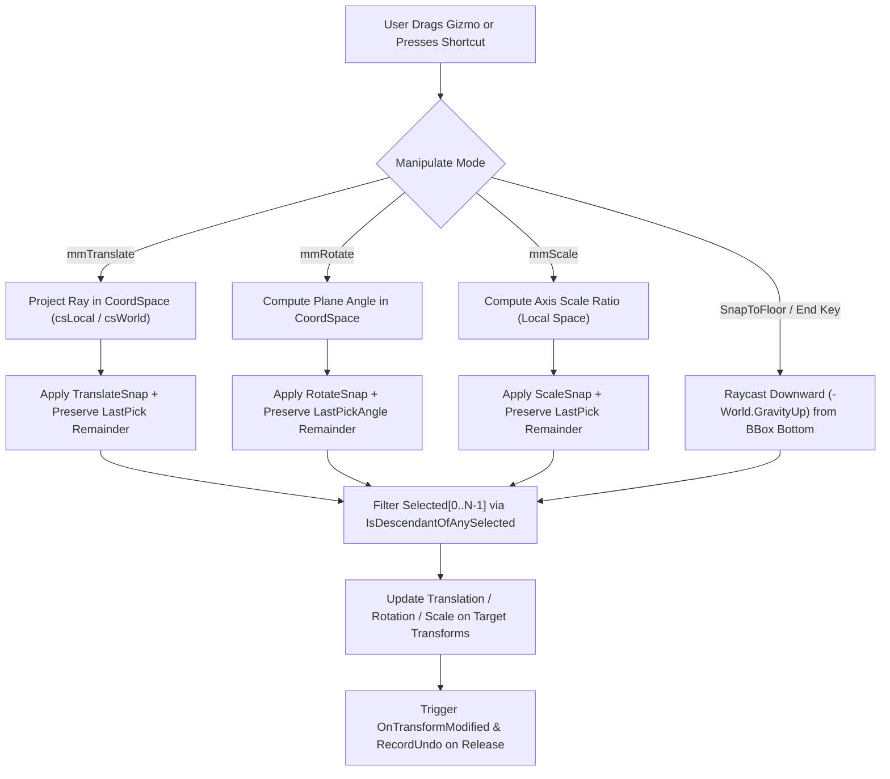
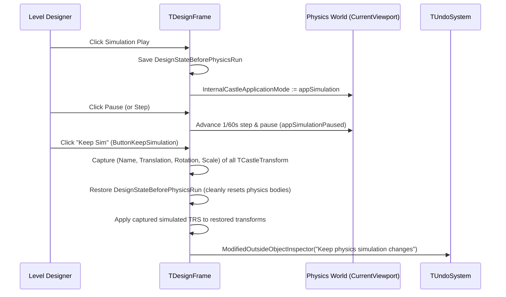

# Castle Game Engine — Editor Modernization & 3D Manipulation Guide

This guide provides comprehensive documentation for the **Castle Game Engine (`castle-editor`)** modernization initiative (Phases 1–27), inspired by **Unreal Engine 5.5** and **Blender** workflows. It covers both **interactive editor workflows** in `tools/castle-editor` and the **runtime/editor Pascal APIs** in `CastleTransformManipulate` and `CastleRenderOptions`.

---

## Table of Contents

1. [Overview & Unreal Engine 5.5 Feature Parity Matrix](#1-overview--unreal-engine-55-feature-parity-matrix)
2. [Phase 1: 3D Viewport Gizmos, Snapping, Coordinate Spaces & Multi-Selection](#2-phase-1-3d-viewport-gizmos-snapping-coordinate-spaces--multi-selection)
   - [2.1. World vs. Local Coordinate Space (`TManipulateCoordSpace`)](#21-world-vs-local-coordinate-space-tmanipulatecoordspace)
   - [2.2. 3D Grid, Rotation & Scale Snapping (`TranslateSnap`, `RotateSnap`, `ScaleSnap`)](#22-3d-grid-rotation--scale-snapping-translatesnap-rotatesnap-scalesnap)
   - [2.3. Multi-Selection Transform Manipulation & Ancestor Deduplication](#23-multi-selection-transform-manipulation--ancestor-deduplication)
   - [2.4. Snap to Floor (`SnapToFloor` / `End` Key)](#24-snap-to-floor-snaptofloor--end-key)
   - [2.5. Pascal API Reference & Code Examples (`CastleTransformManipulate`)](#25-pascal-api-reference--code-examples-castletransformmanipulate)
3. [Phase 2: Scene Outliner (Hierarchy Panel) Modernization](#3-phase-2-scene-outliner-hierarchy-panel-modernization)
   - [3.1. Live Hierarchy Filter by Name and `+ClassName`](#31-live-hierarchy-filter-by-name-and-classname)
   - [3.2. Quick Visibility Toggle (`H` Key) & `[Hidden]` Badges](#32-quick-visibility-toggle-h-key--hidden-badges)
   - [3.3. Multi-Selection Duplication (`Ctrl+D`)](#33-multi-selection-duplication-ctrld)
   - [3.4. Double-Click Node to Focus Camera](#34-double-click-node-to-focus-camera)
4. [Phase 3: Details Panel (Object Inspector) Enhancements](#4-phase-3-details-panel-object-inspector-enhancements)
   - [4.1. Live Property Search Across Inspector Tabs](#41-live-property-search-across-inspector-tabs)
   - [4.2. Copy, Paste & Multi-Selection Reset Transform](#42-copy-paste--multi-selection-reset-transform)
5. [Phase 4: Viewport Rendering Modes, Colliders Toggle & Real-Time Stats Overlay](#5-phase-4-viewport-rendering-modes-colliders-toggle--real-time-stats-overlay)
   - [5.1. Lit, Unlit, Wireframe & Solid Wireframe Modes (`InternalForceUnlit` & `ButtonViewMode`)](#51-lit-unlit-wireframe--solid-wireframe-modes-internalforceunlit--buttonviewmode)
   - [5.2. Real-Time Viewport Statistics & Active Transform HUD (`ButtonShowStats`)](#52-real-time-viewport-statistics--active-transform-hud-buttonshowstats)
   - [5.3. One-Click Physics Collider Visualization (`ButtonShowColliders`)](#53-one-click-physics-collider-visualization-buttonshowcolliders)
6. [Phase 5: Content Browser Search, Asset Filter Pills & Grid-Snapped Viewport Drop](#6-phase-5-content-browser-search-asset-filter-pills--grid-snapped-viewport-drop)
   - [6.1. Content Browser Live Search & Category Filter Pills](#61-content-browser-live-search--category-filter-pills)
   - [6.2. 3D Grid-Snapped Viewport Drag-and-Drop](#62-3d-grid-snapped-viewport-drag-and-drop)
7. [Phase 6: Quick-Add Component Palette (`Ctrl+P` / `+ Add`)](#7-phase-6-quick-add-component-palette-ctrlp---add)
8. [Phase 7: Enhanced In-Editor Physics Simulation (`Step` & `Keep Sim`)](#8-phase-7-enhanced-in-editor-physics-simulation-step--keep-sim)
   - [8.1. Frame-by-Frame Physics Stepping (`SimulationSingleStep`)](#81-frame-by-frame-physics-stepping-simulationsinglestep)
   - [8.2. Keep Simulation Transform Changes (`KeepSimulationChanges`)](#82-keep-simulation-transform-changes-keepsimulationchanges)
9. [Phase 8: Multi-Object Alignment, Distribution, Snap-to-Grid (`Ctrl+End`) & Selection Center Pivot](#9-phase-8-multi-object-alignment-distribution-snap-to-grid-ctrlend--selection-center-pivot)
   - [9.1. Selection Center Orbital Pivot Mode (`TManipulatePivotMode`)](#91-selection-center-orbital-pivot-mode-tmanipulatepivotmode)
   - [9.2. Multi-Object Alignment & Even Distribution (`AlignSelected`, `DistributeSelected`)](#92-multi-object-alignment--even-distribution-alignselected-distributeselected)
   - [9.3. Absolute Snap-to-Grid (`SnapSelectedToGrid` / `Ctrl+End`)](#93-absolute-snap-to-grid-snapselectedtogrid--ctrlend)
10. [Phase 9: Viewport Camera Bookmarks (`Ctrl+0..9` / `0..9`) & Move Transform to View](#10-phase-9-viewport-camera-bookmarks-ctrl09--09--move-transform-to-view)
    - [10.1. Instant Viewport Camera Bookmarks (`SaveCameraBookmark`, `RecallCameraBookmark`)](#101-instant-viewport-camera-bookmarks-savecamerabookmark-recallcamerabookmark)
    - [10.2. Move Selected Transform to Camera View (`ViewportAlignTransformToView`)](#102-move-selected-transform-to-camera-view-viewportaligntransformtoview)
11. [Phase 10: Hierarchy & Object Inspector Productivity Tools](#11-phase-10-hierarchy--object-inspector-productivity-tools)
    - [11.1. Select All of Same Class & Expand/Collapse Subtree](#111-select-all-of-same-class--expandcollapse-subtree)
    - [11.2. One-Click Reset Property to Default (`ResetSelectedPropertyToDefault`)](#112-one-click-reset-property-to-default-resetselectedpropertytodefault)
12. [Phase 11: Surface Normal Alignment (`Alt+End`), Physics-Safe Mirroring, 90° Step Rotation & Transform Randomizer](#12-phase-11-surface-normal-alignment-altend-physics-safe-mirroring-90-step-rotation--transform-randomizer)
    - [12.1. Snap to Floor with Surface Normal Alignment (`SnapToFloor(true)` / `Alt+End`)](#121-snap-to-floor-with-surface-normal-alignment-snaptofloortrue--altend)
    - [12.2. Physics-Safe Axis Mirroring (`MirrorSelected`)](#122-physics-safe-axis-mirroring-mirrorselected)
    - [12.3. Exact 90° Step Rotation (`RotateSelected90`) & Set-Dressing Randomizer (`RandomizeSelected`)](#123-exact-90-step-rotation-rotateselected90--set-dressing-randomizer-randomizeselected)
13. [Phase 12: Scene Outliner Selection Isolation (`Shift+H` / `Alt+H`) & Group Selected (`Ctrl+G`)](#13-phase-12-scene-outliner-selection-isolation-shifth--alth--group-selected-ctrlg)
    - [13.1. Isolate Selected (`Shift+H`) & Show All Hidden (`Alt+H`)](#131-isolate-selected-shifth--show-all-hidden-alth)
    - [13.2. Group Selected Under New Transform (`Ctrl+G` / `GroupSelectedTransforms`)](#132-group-selected-under-new-transform-ctrlg--groupselectedtransforms)
14. [Phase 13: Dynamic Viewport Camera Speed Controls (`[` / `]`) & Camera Speed HUD](#14-phase-13-dynamic-viewport-camera-speed-controls-----camera-speed-hud)
15. [Phase 14: Alt-Drag 3D Gizmo Duplication & Bounding-Box Flush Stacking (`StackSelected`)](#15-phase-14-alt-drag-3d-gizmo-duplication--bounding-box-flush-stacking-stackselected)
16. [Phase 15: Ungroup Selected Transforms (`Ctrl+Shift+G` / `UngroupSelectedTransforms`)](#16-phase-15-ungroup-selected-transforms-ctrlshiftg--ungroupselectedtransforms)
17. [Phase 16: Viewport Marquee / Box Selection (`SelectComponentsInMarquee`)](#17-phase-16-viewport-marquee--box-selection-selectcomponentsinmarquee)
18. [Phase 17: Interactive Surface & Vertex Snapping (`SnapSelectedToRay` / `V` Key)](#18-phase-17-interactive-surface--vertex-snapping-snapselectedtoray--v-key)
19. [Phase 18: Linear / Step Array Duplication Tool (`ArrayDuplicateSelected` / `Ctrl+Shift+D`)](#19-phase-18-linear--step-array-duplication-tool-arrayduplicateselected--ctrlshiftd)
20. [Phase 19: Hierarchy Selection Locking (`L` Key / `Alt+L` / `[Locked]` Badge)](#20-phase-19-hierarchy-selection-locking-l-key--altl--locked-badge)
21. [Phase 20: Radial / Circular Array Duplication (`RadialDuplicateSelected` / `Ctrl+Alt+D`)](#21-phase-20-radial--circular-array-duplication-radialduplicateselected--ctrlaltd)
22. [Phase 21: Multi-Component Replace With Another Class (`ReplaceSelectedComponents` / `Ctrl+Shift+R`)](#22-phase-21-multi-component-replace-with-another-class-replaceselectedcomponents--ctrlshiftr)
23. [Phase 22: Selection-Aware Standard Axis Viewport Camera Views (`Numpad 1/3/7/5` & `Alt+1/3/7/5`)](#23-phase-22-selection-aware-standard-axis-viewport-camera-views-numpad-1375--alt1375)
24. [Phase 23: 3D Viewport Ruler & Distance Measurement Tool (`M` Key / Multi-Select Ruler HUD)](#24-phase-23-3d-viewport-ruler--distance-measurement-tool-m-key--multi-select-ruler-hud)
25. [Phase 24: 2D / 3D Grid Array Duplication (`GridDuplicateSelected` / `Ctrl+Alt+G`)](#25-phase-24-2d--3d-grid-array-duplication-gridduplicateselected--ctrlaltg)
26. [Phase 25: Project Selected Transforms Along Any Direction / Camera View Ray (`ProjectSelectedAlongDirection` / `Ctrl+Shift+End`)](#26-phase-25-project-selected-transforms-along-any-direction--camera-view-ray-projectselectedalongdirection--ctrlshiftend)
27. [Phase 26: Hierarchy & Viewport Selection Power Tools (`InvertSelection` / `Ctrl+I`, `SelectChildren` / `Ctrl+]`)](#27-phase-26-hierarchy--viewport-selection-power-tools-invertselection--ctrli-selectchildren--ctrl)
28. [Phase 27: Bounding-Box Equal-Gap Distribution (`DistributeSelectedGaps`) & Absolute Rotation/Scale Grid Quantization (`SnapSelectedRotationAndScaleToGrid`)](#28-phase-27-bounding-box-equal-gap-distribution-distributeselectedgaps--absolute-rotationscale-grid-quantization-snapselectedrotationandscaletogrid)
29. [Complete Keyboard Shortcuts & Toolbar Reference](#29-complete-keyboard-shortcuts--toolbar-reference)
30. [Automated Unit Tests & Verification](#30-automated-unit-tests--verification)

---

## 1. Overview & Unreal Engine 5.5 Feature Parity Matrix

Modern 3D level design and UI composition require fast, deterministic spatial manipulation, immediate hierarchy/property/asset filtering, and seamless physics-assisted placement. The table below summarizes how Unreal Engine 5.5 workflows map to Castle Game Engine (`castle-editor`, `TCastleTransformManipulate`, and `CastleRenderOptions`):

| Workflow Feature | Unreal Engine 5.5 | Castle Game Engine (`editor-modernization`) | Source Location |
| :--- | :--- | :--- | :--- |
| **Coordinate Space Toggle** | World / Local gizmo toggle (`Ctrl+~` or toolbar icon) | `CoordSpace` (`csLocal` / `csWorld`) + Toolbar `Local`/`World` button (`ButtonCoordSpace`) + `Ctrl+~` | `src/scene/castletransformmanipulate.pas`<br>`tools/castle-editor/code/framedesign.pas` |
| **Multi-Selection Pivot Mode** | Pivot at Primary Actor vs. Selection Center | `PivotMode` (`pmPrimarySelected` / `pmSelectionCenter`) + Toolbar `Pivot: Primary`/`Center` button (`ButtonPivotMode`) | `src/scene/castletransformmanipulate.pas`<br>`tools/castle-editor/code/framedesign.pas` |
| **3D Translation Snapping** | Grid Snap increments (e.g., `1`, `5`, `10`, `50`) | `TranslateSnap: Single` + Toolbar `3D snap:` spin edit (`SpinEditSnap3D`) | `src/scene/castletransformmanipulate.pas` |
| **3D Rotation Snapping** | Angle Snap increments (e.g., `5°`, `15°`, `45°`) | `RotateSnap: Single` (in radians; automatically linked to `SpinEditSnap3D` in editor) | `src/scene/castletransformmanipulate.pas` |
| **3D Scale Snapping** | Scale Snap increments (e.g., `0.1`, `0.25`, `0.5`) | `ScaleSnap: Single` (linked to `SpinEditSnap3D` in editor) | `src/scene/castletransformmanipulate.pas` |
| **Multi-Actor Gizmo Drag** | Select multiple actors and translate/rotate/scale together | Multi-selection gizmo attached to `Selected[0]` (`SelectedCount >= 1`) with ancestor deduplication | `src/scene/castletransformmanipulate.pas` |
| **Viewport Marquee Box Selection** | Drag selection rectangle in viewport to batch-select actors | Left-Drag in `Select` mode (`moSelect`) or `Ctrl+Alt` + Left-Drag in any mode (`SelectComponentsInMarquee`, `Shift` for additive) | `tools/castle-editor/code/framedesign.pas` |
| **Surface & Vertex Snapping** | Hold `V` to snap selection onto mesh vertices or surfaces | `SnapSelectedToRay` (`V` = surface snap, `Shift+V` = vertex snap, `Alt+V` = surface + normal, `Shift+Alt+V` = vertex + normal) | `src/scene/castletransformmanipulate.pas`<br>`tools/castle-editor/code/framedesign.pas` |
| **Snap to Floor, Normal & Grid** | `End` snaps to floor; `Alt+End` aligns to surface normal; `Ctrl+End` snaps to grid | `SnapToFloor(false)` (`End`), `SnapToFloor(true)` (`Alt+End`), & `SnapSelectedToGrid` (`Ctrl+End`) | `src/scene/castletransformmanipulate.pas`<br>`tools/castle-editor/code/framedesign.pas` |
| **Alt-Drag & Array Duplication** | `Alt` + gizmo drag duplicates actor; Step-and-Repeat array | `GizmoTransformModifyBegin` (`Alt` + Gizmo drag) & `ArrayDuplicateSelected` (`Ctrl+Shift+D` / `Array Dup...`) | `src/scene/castletransformmanipulate.pas`<br>`tools/castle-editor/code/framedesign.pas` |
| **Mirror, 90° Step & Randomize** | Mirror Actor X/Y/Z, 90° Quick Rotate, Foliage/Actor Randomizer | `MirrorSelected` (`Mirror X/Y/Z`), `RotateSelected90` (`Rot 90° Y`), `RandomizeSelected` (`Randomize`) | `src/scene/castletransformmanipulate.pas`<br>`tools/castle-editor/code/framedesign.pas` |
| **Multi-Actor Align, Distribute & Stack** | Actor Align / Distribute / Flush Bounding-Box Stack along X, Y, Z | `AlignSelected` (`Align X/Y/Z`), `DistributeSelected` (`Dist X/Y/Z`), & `StackSelected` (`Stack X/Y/Z`) in `PanelLayoutTransform` | `src/scene/castletransformmanipulate.pas`<br>`tools/castle-editor/code/framedesign.pas` |
| **Camera Bookmarks & Speed** | `Ctrl+0..9` / `0..9` bookmarks; `[` / `]` camera speed | `SaveCameraBookmark`, `RecallCameraBookmark`, & `AdjustCameraSpeed` (`[` / `]` + HUD `Cam Speed`) | `tools/castle-editor/code/framedesign.pas` |
| **Move Actor to View** | Snap selected actor/light to current camera view | `Move to View` (`ButtonMoveTransformToView` / `ViewportAlignTransformToView`) | `tools/castle-editor/code/framedesign.pas` |
| **Outliner Live Search** | Top search box (`ActorName` or `+ClassName`) | Always-visible `EditFindInHierarchy` supporting `Name`, `ClassName`, and `+ClassName` with yellow node highlighting | `tools/castle-editor/code/framedesign.pas` |
| **Outliner Batch Selection & Tree Ops** | Select All of Same Class, Expand/Collapse All, Group (`Ctrl+G`) / Ungroup (`Ctrl+Shift+G`) | `Select All of Same Class`, `Expand/Collapse Subtree`, `Group Selected (Ctrl+G)`, and `Ungroup Selected (Ctrl+Shift+G)` | `tools/castle-editor/code/framedesign.pas` |
| **Actor Visibility, Isolation & Lock** | `H` toggles visibility, `Shift+H` isolates, `Alt+H` un-hides all, `L` locks selection | `H` (`ToggleSelectedVisibility`), `Shift+H` (`IsolateSelected`), `Alt+H` (`ShowAllHidden`), `L` (`ToggleSelectedLock`), `Alt+L` (`UnlockAll`), `[Hidden]` & `[Locked]` badges | `tools/castle-editor/code/framedesign.pas` |
| **Multi-Actor Duplicate** | `Ctrl+D` / `Ctrl+W` duplicates all selected actors | `Ctrl+D` (`DuplicateComponent`) duplicates all selected `TCastleTransform`, `TCastleUserInterface`, or `TCastleComponent` items | `tools/castle-editor/code/framedesign.pas` |
| **Outliner Focus Camera** | Double-click actor in Outliner or press `F` | Double-click `TCastleTransform` in `ControlsTree` or press `F` (`ViewportViewSelected`) | `tools/castle-editor/code/framedesign.pas` |
| **Details Property Search & Reset** | Top search bar + Reset to Default (`Revert`) arrow | `EditPropertyFilter` (`Search Properties...`) + `Reset Prop` (`ButtonResetProperty`) | `tools/castle-editor/code/framedesign.pas` |
| **Copy / Paste Transform** | Right-click Transform header -> Copy / Paste / Reset | `Copy Transform`, `Paste Transform`, and `Reset` buttons in `PanelLayoutTransform` (supports multi-selection) | `tools/castle-editor/code/framedesign.pas` |
| **Viewport View Modes** | `Lit`, `Unlit` (`Alt+3`), `Wireframe` (`Alt+2`), `Lit Wireframe` | `View: Lit / Unlit / Wire / SolidWire` button (`ButtonViewMode`) & `Ctrl+T` (`InternalForceUnlit`, `InternalForceWireframe`) | `src/base/castlerenderoptions_globals.inc`<br>`tools/castle-editor/code/framedesign.pas` |
| **Viewport Stats & Colliders** | `Stat FPS` / `Stat Unit` + `Show Collision` | Toolbar `Stats` (`ButtonShowStats`) & `Colliders` (`ButtonShowColliders`) toggles with enriched HUD | `tools/castle-editor/code/framedesign.pas` |
| **Content Browser Filtering** | Search bar + Asset Type Filter pills (`Meshes`, `Textures`, `Audio`...) | `EditFileFilter` + 6 Asset Category pills (`All`, `3D/Scenes`, `Designs`, `Images`, `Audio`, `Code`) | `tools/castle-editor/code/formproject.pas` |
| **Quick-Add Palette** | "Quickly Add to the Project" searchable popup | `+ Add` button (`ButtonQuickAdd`) & `Ctrl+P` shortcut opening `ShowQuickAddPalette` | `tools/castle-editor/code/framedesign.pas` |
| **Physics Step & Keep Sim** | Single-Step simulation & "Keep Simulation Changes" (`K`) | `Step` (`ButtonSimulationStep`) & `Keep Sim` (`ButtonKeepSimulation`) toolbar buttons during physics simulation | `tools/castle-editor/code/framedesign.pas` |

---

## 2. Phase 1: 3D Viewport Gizmos, Snapping, Coordinate Spaces & Multi-Selection

All 3D manipulation features are implemented in `TCastleTransformManipulate` (`src/scene/castletransformmanipulate.pas`), making them available both inside `castle-editor` and in any custom runtime level editor or CAD tool built with Castle Game Engine.



### 2.1. World vs. Local Coordinate Space (`TManipulateCoordSpace`)

By default, a `TCastleTransform` stores its `Translation`, `Rotation`, and `Scale` relative to its `Parent`. Because `TGizmoScene` is attached as an internal child of `FMainSelected` (`Selected[0]`):
- **`csLocal` (Default):** The gizmo inherits `FMainSelected`'s rotation and orientation directly. Dragging the X arrow translates the object along its own local X axis, and dragging a rotation ring rotates around its local axis.
- **`csWorld`:** When `CoordSpace = csWorld` and `Mode in [mmTranslate, mmRotate]`:
  1. **Visual Alignment (`TGizmoScene.LocalRender`):** Before rendering the gizmo mesh, `TGizmoScene` strips the rotation portion of `FMainSelected`'s world transformation while preserving the world translation center and uniform scale factor. Consequently, the Red (X), Green (Y), and Blue (Z) gizmo axes always point along the World $(X, Y, Z)$ axes regardless of how the object or its parent hierarchy is rotated.
  2. **Ray Projection (`TGizmoScene.GetEffectiveRay`):** Incoming pointer rays (`Pick.RayOrigin`, `Pick.RayDirection` in `FMainSelected` local space) are rotated by `FMainSelected` world rotation so that axis intersection (`PointOnAxis`) and rotation plane angle (`AngleOnPlane`) are evaluated in World axis directions.
  3. **Delta Application (`ApplyTranslateDelta`, `ApplyRotateDelta`):** World-aligned deltas are converted into each selected transform's parent coordinate space (`Parent.WorldToLocalDirection`), ensuring accurate movement even when selected objects sit inside rotated parent transforms.
  4. **Scale Exception:** Just like in Unreal Engine, `mmScale` always operates in `csLocal` space because non-uniform world-axis scaling on a rotated transform would induce shear, which cannot be represented by a TRS (`Translation`, `Rotation`, `Scale`) decomposition.

### 2.2. 3D Grid, Rotation & Scale Snapping (`TranslateSnap`, `RotateSnap`, `ScaleSnap`)

Interactive gizmo dragging requires **remainder-preserving snapping** so the object does not drift from the mouse cursor or get stuck on small mouse movements:
- **Translation Snapping (`TranslateSnap > 0`):**
  Let $\Delta = P_{\text{current}} - P_{\text{last}}$ be the raw displacement along the active gizmo axis (or plane) since the last snapped step, and let $S = \text{TranslateSnap}$. The snapped displacement is:
  $$\Delta_{\text{snapped}} = \text{Round}\!\left(\frac{\Delta}{S}\right) \cdot S$$
  Instead of advancing `LastPick` to the raw intersection $P_{\text{current}}$, `LastPick` is advanced by the exact snapped increment:
  $$P_{\text{last}} \leftarrow P_{\text{last}} + \Delta_{\text{snapped}}$$
  If $|\Delta_{\text{snapped}}| < \epsilon$, no movement is applied on that frame and the sub-grid motion accumulates until the cursor crosses the next snap boundary.
- **Rotation Snapping (`RotateSnap > 0`):**
  Angles are measured in radians. Given raw angular delta $\Delta\theta = \theta_{\text{current}} - \theta_{\text{last}}$ (normalized to $[-\pi, \pi]$) and snap step $S_\theta = \text{RotateSnap}$:
  $$\Delta\theta_{\text{snapped}} = \text{Round}\!\left(\frac{\Delta\theta}{S_\theta}\right) \cdot S_\theta, \qquad \theta_{\text{last}} \leftarrow \theta_{\text{last}} + \Delta\theta_{\text{snapped}}$$
  In `castle-editor`, setting the toolbar **`3D snap:`** spin edit (`SpinEditSnap3D`) to:
  - `0`: Disables 3D snapping (`TranslateSnap = 0`, `RotateSnap = 0`, `ScaleSnap = 0`).
  - `0 < Value <= 1.0` (e.g., `0.5` or `1.0` meter): Sets `TranslateSnap := Value`, `ScaleSnap := Value`, and `RotateSnap := DegToRad(15.0)` ($15^\circ$).
  - `Value > 1.0` (e.g., `5`, `10`, `15`, `45`): Sets `TranslateSnap := Value`, `ScaleSnap := Value`, and `RotateSnap := DegToRad(Value)`.

### 2.3. Multi-Selection Transform Manipulation & Ancestor Deduplication

Previously, selecting more than one `TCastleTransform` hid the 3D gizmo (`MainSelected` was set to `nil` when `SelectedCount > 1`). Now:
- Whenever `SelectedCount >= 1`, `MainSelected` is set to `Selected[0]`, displaying the gizmo at the primary selected transform while rendering selection bounding boxes around all `Selected[0 .. SelectedCount - 1]`.
- **Hierarchy Ancestor Deduplication (`IsDescendantOfAnySelected`):**
  If a user selects both a `ParentTransform` and its `ChildTransform` and drags the gizmo, applying the translation/rotation/scale delta to both would move `ChildTransform` **twice** (once inherited from `ParentTransform`, and once directly). `TCastleTransformManipulate.IsDescendantOfAnySelected` walks up `T.UniqueParent` and skips any selected transform that has an ancestor in the current selection.
- **Viewport Click Preservation (`TDesignerLayer.Press`):**
  Clicking directly on the 3D gizmo or on an already-selected `TCastleTransform` in the viewport preserves the existing multi-selection instead of collapsing it to a single object.

### 2.4. Snap to Floor (`SnapToFloor` / `End` Key)

Pressing the **`End`** key in the viewport or clicking the **`Snap to Floor (End)`** button in the Transform layout panel invokes `TCastleTransformManipulate.SnapToFloor`:
1. Determines the downward direction from the world gravity vector: $\vec{D}_{\text{down}} = -\text{World.GravityUp}$ (typically $(0, -1, 0)$).
2. For each top-level selected transform $T$:
   - Computes $T.\text{WorldBoundingBox}$.
   - Sets the ray origin at the horizontal center of the bounding box and at its lowest point along the gravity axis (plus a tiny upward offset $10^{-4}$ to avoid self-surface precision issues). If $T$ has an empty bounding box (such as a `TCastleTransform` grouping node or point light), the ray starts at $T$'s world translation origin.
   - Temporarily hides all selected transforms (`Exists := false`) and disables gizmo picking (`Pickable := false`) so the downward ray (`World.WorldRay`) only hits unselected environment geometry.
   - Moves $T$ downward by $( \text{Distance} - \text{RayEpsilon} ) \cdot \vec{D}_{\text{down}}$ converted into $T.\text{UniqueParent}$'s local space.
3. Fires `OnTransformModified` and `OnTransformModifyEnd` so the editor records a single Undo step.

### 2.5. Pascal API Reference & Code Examples (`CastleTransformManipulate`)

```pascal
uses
  CastleTransform, CastleTransformManipulate, CastleVectors, CastleUtils, Math;

procedure ConfigureManipulator(const Manipulate: TCastleTransformManipulate;
  const Box1, Box2: TCastleTransform);
begin
  // 1. Select multiple transforms at once
  Manipulate.SetSelected([Box1, Box2]);

  // 2. Choose World or Local coordinate space
  Manipulate.CoordSpace := csWorld;

  // 3. Configure 3D snapping increments
  Manipulate.TranslateSnap := 0.5;          // Snap translation to 0.5m grid steps
  Manipulate.RotateSnap := DegToRad(15.0);  // Snap rotation to 15-degree increments
  Manipulate.ScaleSnap := 0.25;             // Snap scale to 0.25x steps

  // 4. Programmatically translate/rotate/scale all selected transforms
  //    (automatically honors CoordSpace, Snapping, and Ancestor Deduplication)
  Manipulate.TranslateSelected(Vector3(1.2, 0.0, 0.0)); // Snaps to (1.0, 0.0, 0.0)
  Manipulate.RotateSelected(1 {Y axis}, DegToRad(28.0)); // Snaps to 30 degrees

  // 5. Snap all selected transforms down to the nearest floor collider/mesh
  Manipulate.SnapToFloor;
end;
```

---

## 3. Phase 2: Scene Outliner (Hierarchy Panel) Modernization

The left-hand Hierarchy panel (`ControlsTree` inside `TDesignFrame`) has been upgraded for large scenes with hundreds of components.

### 3.1. Live Hierarchy Filter by Name and `+ClassName`

The search bar (`EditFindInHierarchy`) at the top of the Hierarchy panel is now **always visible**:
- **Match by Name or Class:** Typing `light` matches any component whose `Name` contains `light` **or** whose `ClassName` contains `light` (e.g., `TCastleDirectionalLight`, `TCastlePointLight`).
- **Explicit Class Filter (`+ClassName`):** Prefixing the query with `+` (such as `+Scene`, `+Transform`, `+Button`, `+RigidBody`) restricts matching strictly to the component's `ClassName`.
- **Live Visual Highlighting:** All nodes in `ControlsTree` that match the current search filter have their class suffix highlighted in bright yellow (`clYellow`), making it effortless to spot all matching components across deep hierarchies while `F3` (`FindNext`) cycles selection through every matching node.

### 3.2. Quick Visibility Toggle (`H` Key) & `[Hidden]` Badges

- Pressing **`H`** while focused in either the **3D/2D Viewport** or the **Hierarchy Tree** (or choosing **`Toggle Visibility (Exists) (H)`** from the right-click Hierarchy context menu) toggles the `Exists` property of all currently selected `TCastleTransform` and `TCastleUserInterface` components.
- When multiple objects are selected, `ToggleSelectedVisibility` inspects the first selected item and sets all selected items to the opposite `Exists` state in a single Undo step.
- Any component with `Exists = false` is immediately marked in the Hierarchy tree with a dimmed **`[Hidden]`** suffix (e.g., `MyDungeonWall (TCastleScene) [Hidden]`).

### 3.3. Multi-Selection Duplication (`Ctrl+D`)

- Selecting multiple components (`Ctrl+Click` or `Shift+Click`) in the Hierarchy or Viewport and pressing **`Ctrl+D`** (or right-click -> **Duplicate**) duplicates every selected component (`TCastleTransform`, `TCastleUserInterface`, or non-visual `TCastleComponent`).
- **Ancestor Deduplication (`IsComponentDescendantOfSelection`):** If both a parent transform/UI and its child are selected during `Ctrl+D`, only the parent subtree is duplicated (which already clones its children), preventing duplicate copies of the child.
- After duplication, the editor automatically selects all newly created clones so you can immediately move them together with the 3D gizmo.

### 3.4. Double-Click Node to Focus Camera

- Double-clicking any `TCastleTransform` node in the Hierarchy tree (`ControlsTreeDblClick`) immediately frames and focuses the active 3D viewport camera onto that transform's bounding box (`ViewportViewSelected`, identical to pressing **`F`** in the viewport).

---

## 4. Phase 3: Details Panel (Object Inspector) Enhancements

### 4.1. Live Property Search Across Inspector Tabs

- A live **`Search Properties...`** filter bar (`EditPropertyFilter`) is positioned at the top of the right-hand Object Inspector panel.
- Typing any substring (e.g., `shadow`, `color`, `translation`, `url`, `anchor`, `collider`) immediately filters the property rows across **`Basic`**, **`Layout`**, **`Events`**, and **`All`** tabs via `TDesignFrame.InspectorFilter`.
- Clearing the search box restores the full property list for the active tab.
- The search bar remains accessible even when multiple components are selected simultaneously.

### 4.2. Copy, Paste & Multi-Selection Reset Transform

When one or more `TCastleTransform` instances are selected and the **`Layout`** tab is active in the Object Inspector (`PanelLayoutTransform`):
- **`Reset` (`ButtonResetTransformation`):** Resets `Translation := Zero`, `Rotation := Zero`, and `Scale := One` (`T.Identity`) on the selected transform — or across **all** selected transforms when multiple transforms are selected.
- **`Copy Transform` (`ButtonCopyTransform`):** Copies the primary selected transform's `Translation`, `Rotation`, and `Scale` vectors to the editor's transform clipboard (`FCopiedTranslation`, `FCopiedRotation`, `FCopiedScale`) and enables the `Paste Transform` button.
- **`Paste Transform` (`ButtonPasteTransform`):** Pastes the copied `Translation`, `Rotation`, and `Scale` onto the selected transform — or onto **all** selected transforms in a multi-selection — recording a single Undo step.

---

## 5. Phase 4: Viewport Rendering Modes, Colliders Toggle & Real-Time Stats Overlay

### 5.1. Lit, Unlit, Wireframe & Solid Wireframe Modes (`InternalForceUnlit` & `ButtonViewMode`)

Level designers frequently need to inspect dark indoor environments or check base albedo textures without lighting or shadow attenuation (equivalent to Unreal Engine's **Unlit (`Alt+3`)** mode), as well as inspect triangle topology via **Wireframe** and **Solid Wireframe**:
- **Engine Renderer Support (`InternalForceUnlit: Boolean`):**
  Defined in [`src/base/castlerenderoptions_globals.inc`](../src/base/castlerenderoptions_globals.inc) alongside `InternalForceWireframe`. When `InternalForceUnlit = true`:
  - `castleinternalrenderer_materials.inc` forces `Lighting := false`.
  - `castleinternalrenderer_meshrenderer.inc` switches `Shader.LightingModel` to `lmUnlit` and passes `Vector4(Shader.Material.MainColor, Shader.Material.Opacity)` to the unlit shader while preserving base/diffuse textures.
- **Toolbar & Shortcut Cycling (`ButtonViewMode` / `Ctrl+T`):**
  Clicking the **`View: Lit`** button on the top toolbar (or pressing **`Ctrl+T`**) cycles through all four rendering modes:
  $$\text{Lit} \longrightarrow \text{Unlit} \longrightarrow \text{Wireframe} \longrightarrow \text{Solid Wireframe} \longrightarrow \text{Lit}$$

### 5.2. Real-Time Viewport Statistics & Active Transform HUD (`ButtonShowStats`)

Clicking the **`Stats`** toggle button (`ButtonShowStats`) on the top toolbar displays a non-intrusive HUD overlay in the top-right corner of the viewport showing:
- **Frame Rate:** Current and real FPS (`Container.Fps.ToString`).
- **Editor State:** Active Rendering Mode (`Lit` / `Unlit` / `Wireframe` / `Solid Wireframe`), active Gizmo Coordinate Space (`Local` / `World`), and number of selected components.
- **Viewport Rendering Metrics:** `Viewport.Statistics.ToString` (Rendered Shapes, Total Shapes, Culling efficiency, Draw Calls).
- **Active Transform Spatial Telemetry:** When a `TCastleTransform` is selected, displays its exact **World Position** (`T.WorldTranslation`) and **World Bounding Box Dimensions** (`T.WorldBoundingBox.Size`).

### 5.3. One-Click Physics Collider Visualization (`ButtonShowColliders`)

Clicking the **`Colliders`** toggle button (`ButtonShowColliders`) on the top toolbar toggles wireframe visualization for all `TCastleCollider` behaviors (`TCastleBoxCollider`, `TCastleSphereCollider`, `TCastleCapsuleCollider`, `TCastleMeshCollider`, etc.) in the current viewport, staying synchronized with the `Physics -> Show Colliders` menu item.

---

## 6. Phase 5: Content Browser Search, Asset Filter Pills & Grid-Snapped Viewport Drop

### 6.1. Content Browser Live Search & Category Filter Pills

The project **Files** panel (`TProjectForm.CreateShellViews` in [`tools/castle-editor/code/formproject.pas`](../tools/castle-editor/code/formproject.pas)) now includes a top filter bar (`PanelFilesTop`) above `ShellListView1`:
- **Asset Category Filter Pills (`BtnFilterAll` .. `BtnFilterCode`):**
  - **`All`**: Shows all project files in the current folder.
  - **`3D/Scenes`**: Filters for `*.gltf;*.glb;*.x3d;*.x3dv;*.wrl;*.obj;*.dae;*.stl;*.md3;*.ifc;*.plist;*.castle-sprite-sheet;*.starling-xml;*.cocos2d-plist`.
  - **`Designs`**: Filters for `*.castle-user-interface;*.castle-transform;*.castle-component`.
  - **`Images`**: Filters for `*.png;*.jpg;*.jpeg;*.dds;*.ktx;*.tga;*.bmp;*.ppm;*.rgbe;*.webp`.
  - **`Audio`**: Filters for `*.wav;*.ogg`.
  - **`Code`**: Filters for `*.pas;*.inc;*.pp;*.lpr;*.dpr;*.glsl;*.vs;*.fs`.
- **Combined Substring + Category Filtering (`UpdateShellListMask`):**
  Typing in the **`Search files in folder...`** box (`EditFileFilter`) while a category pill is active dynamically rewrites each extension mask `*.ext` into `*<query>*.ext` (for example, selecting `3D/Scenes` and typing `tree` sets `ShellListView1.Mask` to `*tree*.gltf;*tree*.glb;*tree*.x3d;...`), filtering both by asset type and filename simultaneously.

### 6.2. 3D Grid-Snapped Viewport Drag-and-Drop

When dragging a 3D scene or `.castle-transform` asset from `ShellListView1` directly onto a `TCastleViewport` (`TDesignFrame.CastleControlDragDrop`):
- The editor raycasts into the 3D viewport (`Viewport.Items.WorldRay`) to find the exact surface hit point `DropPos`.
- If **`3D snap`** (`TransformManipulate.TranslateSnap > 0`) is enabled, `DropPos.X` and `DropPos.Z` are automatically snapped to multiples of `TranslateSnap` while keeping `DropPos.Y` flush with the hit surface elevation.

---

## 7. Phase 6: Quick-Add Component Palette (`Ctrl+P` / `+ Add`)

Instead of navigating multi-level context menus (`Add Transform -> ...` or `Add User Interface -> ...`), level and UI designers can press **`Ctrl+P`** while focused in the viewport or click the **`+ Add`** button (`ButtonQuickAdd`) on the top toolbar to open the **Quick-Add Component Palette** (`TDesignFrame.ShowQuickAddPalette`):
1. Automatically detects which component categories (`[Transform]`, `[UI]`, `[Behavior]`, `[NonVisual]`) are valid for the currently selected parent or active viewport.
2. Lists all non-deprecated registered CGE components (`RegisteredComponents`) formatted as `[Category] Caption (ClassName)`.
3. Typing in the search box filters the list live by caption, category, or class name (e.g., typing `point` finds `[Transform] Light -> Point (TCastlePointLight)`).
4. Use `Up`/`Down` arrow keys and press **`Enter`** (or double-click) to instantiate and select the component immediately.

---

## 8. Phase 7: Enhanced In-Editor Physics Simulation (`Step` & `Keep Sim`)

When Physics Simulation is started (`ButtonSimulationPlayStop`), two additional buttons appear on the top toolbar alongside Pause (`ButtonSimulationPause`):



### 8.1. Frame-by-Frame Physics Stepping (`SimulationSingleStep`)

Clicking **`Step`** (`ButtonSimulationStep`) while physics simulation is running pauses the simulation; clicking **`Step`** while paused advances `CurrentViewport.Update(1.0 / 60.0, ...)` by exactly one $60\text{ Hz}$ frame and returns immediately to `appSimulationPaused`. This makes debugging fast-moving rigid bodies, ragdolls, and joints effortless.

### 8.2. Keep Simulation Transform Changes (`KeepSimulationChanges`)

In Unreal Engine, pressing **`K`** ("Keep Simulation Changes") during Simulate-In-Editor saves the physically settled positions and rotations of actors back to the level design. In `castle-editor`, clicking **`Keep Sim`** (`ButtonKeepSimulation`) during an active or paused physics simulation:
1. Snapshots `(Name, Translation, Rotation, Scale)` of every selectable `TCastleTransform` in `DesignOwner`.
2. Calls `SimulationPlayStop`, which cleanly exits simulation mode and restores `DesignStateBeforePhysicsRun` (ensuring internal transient physics state is cleanly reset).
3. Applies the physically settled `Translation`, `Rotation`, and `Scale` onto all matching `TCastleTransform` components in the restored design.
4. Calls `ModifiedOutsideObjectInspector('Keep physics simulation changes (...)', ucHigh)`, recording the entire operation as a single Undo-able step (`Ctrl+Z` restores the pre-simulation layout).

---

## 9. Phase 8: Multi-Object Alignment, Distribution, Snap-to-Grid (`Ctrl+End`) & Selection Center Pivot

### 9.1. Selection Center Orbital Pivot Mode (`TManipulatePivotMode`)

When rotating multiple selected `TCastleTransform` objects simultaneously, level designers need to choose whether each object rotates in place around its own origin or whether the entire group orbits around its shared center:

- **`pmPrimarySelected` (Default — `Pivot: Primary`):**
  Each top-level selected transform rotates its orientation around its own local origin.
- **`pmSelectionCenter` (`Pivot: Center`):**
  `TCastleTransformManipulate.SelectionWorkingCenter` computes the arithmetic centroid of all top-level selected transforms:
  $$\mathbf{C} = \frac{1}{N} \sum_{i=1}^{N} \mathbf{P}_{\text{world}}(T_i)$$
  During rotation by angle $\Delta \theta$ around axis $\hat{\mathbf{u}}$ (in local or world space according to `CoordSpace`), each top-level selected transform $T_i$ both rotates its orientation **and** orbits its world position around $\mathbf{C}$:
  $$\mathbf{P}'_{\text{world}}(T_i) = \mathbf{C} + \operatorname{Rotate}_{\hat{\mathbf{u}}, \Delta\theta}\!\left(\mathbf{P}_{\text{world}}(T_i) - \mathbf{C}\right)$$
- **Toolbar Toggle (`ButtonPivotMode`):**
  Click **`Pivot: Primary`** / **`Pivot: Center`** on the top toolbar to switch between individual-pivot and orbital-center rotation at any time.

### 9.2. Multi-Object Alignment & Even Distribution (`AlignSelected`, `DistributeSelected`)

When 2 or more `TCastleTransform` objects are selected, `TCastleTransformManipulate` provides deterministic spatial alignment and distribution along any 3D axis (`Axis: T3DAxis`, where `0 = X`, `1 = Y`, `2 = Z`):

- **Multi-Object Alignment (`AlignSelected(Axis, Target)`):**
  Aligns the working coordinate $\mathbf{P}_{\text{working}}(T_i)[\text{Axis}]$ of all top-level selected transforms to one of four `TAlignTarget` references:
  - `atPrimary`: Coordinate of the primary (`Selected[0]`) transform.
  - `atMin`: Minimum coordinate among the selected transforms.
  - `atCenter`: Midpoint $\frac{1}{2}(\min + \max)$ of the selection along `Axis`.
  - `atMax`: Maximum coordinate among the selected transforms.
  In `castle-editor`, the **`Align X`**, **`Align Y`**, and **`Align Z`** buttons in the **`Layout`** tab (`PanelLayoutTransform`) align all selected transforms to the primary selected object along X, Y, or Z with one click.

- **Even Spatial Distribution (`DistributeSelected(Axis)`):**
  When 3 or more top-level `TCastleTransform` objects are selected:
  1. Sorts the selected transforms in ascending order of their coordinate along `Axis`: $c_0 \le c_1 \le \dots \le c_{N-1}$.
  2. Computes the uniform interval step:
     $$\Delta c = \frac{c_{N-1} - c_0}{N - 1}$$
  3. Places each interior transform $i \in \{1, \dots, N-2\}$ at:
     $$c'_i = c_0 + i \cdot \Delta c$$
  In `castle-editor`, the **`Dist X`**, **`Dist Y`**, and **`Dist Z`** buttons in `PanelLayoutTransform` evenly space any 3+ selected transforms along X, Y, or Z.

### 9.3. Absolute Snap-to-Grid (`SnapSelectedToGrid` / `Ctrl+End`)

While dragging the translation gizmo with `TranslateSnap > 0` snaps *relative movement deltas*, imported scenes or hand-placed objects often start at fractional coordinates (e.g., `(-4.3, 1.8, 0.2)`).
- **`TCastleTransformManipulate.SnapSelectedToGrid`:**
  Rounds each component $c \in \{X, Y, Z\}$ of `T.Translation` on every top-level selected transform to the nearest multiple of `TranslateSnap`:
  $$T.\text{Translation}[c] \leftarrow \operatorname{Round}\!\left(\frac{T.\text{Translation}[c]}{\text{TranslateSnap}}\right) \times \text{TranslateSnap}$$
- **Editor Shortcut & Button (`Ctrl+End` / `ButtonSnapToGrid`):**
  Press **`Ctrl+End`** in the viewport or click **`Snap to Grid (Ctrl+End)`** in the `Layout` tab (`PanelLayoutTransform`). If `3D snap` (`SpinEditSnap3D`) is `0`, `ViewportSnapToGrid` defaults to a `1.0` unit grid so `Ctrl+End` always works immediately.

```pascal
// Programmatic example of Phase 8 APIs in CastleTransformManipulate:
Manipulate.SetSelected([Column1, Column2, Column3, Column4]);

// 1. Align all columns to the same Y elevation and Z row as Column1:
Manipulate.AlignSelected(1, atPrimary); // Align Y
Manipulate.AlignSelected(2, atPrimary); // Align Z

// 2. Space all 4 columns evenly between the leftmost and rightmost X positions:
Manipulate.DistributeSelected(0);       // Distribute X

// 3. Orbit the entire colonnade 45 degrees around its shared center:
Manipulate.CoordSpace := csWorld;
Manipulate.PivotMode := pmSelectionCenter;
Manipulate.RotateSelected(1, DegToRad(45));
```

---

## 10. Phase 9: Viewport Camera Bookmarks (`Ctrl+0..9` / `0..9`) & Move Transform to View

### 10.1. Instant Viewport Camera Bookmarks (`SaveCameraBookmark`, `RecallCameraBookmark`)

Just like Unreal Engine's viewport camera bookmarks (`Ctrl+0..9` to save, `0..9` to recall), `TDesignFrame` maintains 10 camera bookmark slots (`FCameraBookmarks[0..9]`):
- **Save Camera Bookmark (`Ctrl+0` .. `Ctrl+9`):**
  Pressing `Ctrl` + any digit key `0..9` while the viewport is focused captures the current `CurrentViewport.InternalCamera` world view vectors (`Pos`, `Dir`, `Up`) into slot `0..9`.
- **Recall Camera Bookmark (`0` .. `9`):**
  Pressing any digit key `0..9` (with no modifier keys and without right-mouse navigation held) smoothly animates `CurrentViewport.InternalCamera` back to the saved `(Pos, Dir, Up)` over `CameraTransitionTime` (`0.2s`) via `V.InternalCamera.AnimateTo`.

### 10.2. Move Selected Transform to Camera View (`ViewportAlignTransformToView`)

Previously, `castle-editor` only supported aligning a `TCastleCamera` to the viewport view. Level designers frequently pilot the viewport camera to look from a desired vantage point and want to place a **`TCastleSpotLight`**, **`TCastleDirectionalLight`**, **`TCastlePointLight`**, **`TCastleScene`**, or spawn marker at that exact position and orientation:
- Clicking **`Move to View`** (`ButtonMoveTransformToView` in `PanelLayoutTransform`) invokes `TDesignFrame.ViewportAlignTransformToView`:
  1. Queries `CurrentViewport.InternalCamera.GetWorldView(CamPos, CamDir, CamUp)`.
  2. Applies `T.SetWorldView(CamPos, CamDir, CamUp)` on the selected `TCastleTransform`.
  3. Records an Undo step (`Move Transform To View: <Name>`).

---

## 11. Phase 10: Hierarchy & Object Inspector Productivity Tools

### 11.1. Select All of Same Class & Expand/Collapse Subtree

Right-clicking any node in the Hierarchy (`ControlsTree`) opens `MenuTreeView` with three new batch productivity actions:
- **`Select All of Same Class` (`SelectAllOfSameClass`):**
  Finds every component in the Hierarchy whose exact `ClassType` matches `SelectedComponent.ClassType` (for example, seleccionar one `TCastlePointLight` and clicking `Select All of Same Class` immediately multi-selects all `TCastlePointLight` instances in the level so you can batch-edit their `Color`, `Intensity`, or `Shadows` in the Object Inspector).
- **`Expand Subtree` (`ExpandSelectedSubtree`):**
  Recursively expands all child nodes under the selected hierarchy node(s), or expands the entire hierarchy tree if nothing is selected.
- **`Collapse Subtree` (`CollapseSelectedSubtree`):**
  Recursively collapses all child nodes under the selected hierarchy node(s), or collapses the entire hierarchy tree if nothing is selected.

### 11.2. One-Click Reset Property to Default (`ResetSelectedPropertyToDefault`)

Next to the **`Search Properties...`** filter box (`EditPropertyFilter`) at the top of the Object Inspector panel is the **`Reset Prop`** button (`ButtonResetProperty`):
- Clicking **`Reset Prop`** queries the active row (`ActiveInspector.GetActiveRow`) in the current Object Inspector tab (`Basic`, `Layout`, `Events`, or `All`).
- Retrieves the property's registered default value via `Row.Editor.GetDefaultValue` and applies `Row.Editor.SetValue(DefaultVal)` (falling back to `Row.Editor.Revert` when applicable), recording a full Undo step (`Reset property <PropName> to default`).

---

## 12. Phase 11: Surface Normal Alignment (`Alt+End`), Physics-Safe Mirroring, 90° Step Rotation & Transform Randomizer

### 12.1. Snap to Floor with Surface Normal Alignment (`SnapToFloor(true)` / `Alt+End`)

In Unreal Engine 5.5, pressing `End` drops an actor vertically onto the floor while preserving its existing rotation, whereas `Alt+End` aligns the actor's local Up vector (`+Y` in Castle Game Engine) to the hit surface normal before resting its bounding box onto the surface.

`TCastleTransformManipulate.SnapToFloor` now accepts `AlignToNormal: Boolean = false`:
```pascal
function SnapToFloor(const AlignToNormal: Boolean = false): Boolean;
```

1. **Surface Normal Extraction (`WorldRay`):**
   Instead of `T.World.WorldRayCast`, `SnapToFloor` calls `RayHit := T.World.WorldRay(RayOrigin, DownDir)` (which returns a detailed `TRayCollision` chain).
   - If the ray hits a `TCastleScene` triangle (`RayHit.First.Triangle <> nil`), its face normal in scene space (`RayHit.First.Triangle^.SceneSpace.Normal`) is transformed into world space via `RayHit.First.Item.LocalToWorldDirection(...)`.
   - If the ray hits a primitive transform without triangle data (`TCastleBox`, `TCastlePlane`, etc.), the hit transform's local `+Y` axis is transformed into world space (`RayHit.First.Item.LocalToWorldDirection(Vector3(0, 1, 0))`).
   - If the normal points downward ($\mathbf{N}_{\text{world}} \cdot \mathbf{D}_{\text{down}} > 0$), it is negated so it always points outward toward the ray origin.
2. **Quaternion Up-Axis Alignment:**
   Given the selected transform's current local `+Y` axis in parent space $\mathbf{u}_{\text{cur}} = \text{RotatePointAroundAxis}(R, (0, 1, 0))$ and the target surface normal in parent space $\mathbf{u}_{\text{target}}$, the shortest-arc rotation is applied:
   $$q_{\text{new}} = q_{\text{align}}(\mathbf{u}_{\text{cur}} \to \mathbf{u}_{\text{target}}) \otimes q_{\text{current}}$$
3. **Editor Controls:**
   - Press **`Alt+End`** (or **`Shift+End`**) in the 3D Viewport.
   - Click **`Snap + Normal (Alt+End)`** (`ButtonSnapToFloorNormal`) in the `Layout` tab (`PanelLayoutTransform`).

### 12.2. Physics-Safe Axis Mirroring (`MirrorSelected`)

Game engines that mirror objects by negating `Scale` (e.g. `Scale.X := -Scale.X`) often break physics engines (`TCastleBoxCollider`, `TCastleMeshCollider`, Kraft physics) and invert triangle winding normals.

`TCastleTransformManipulate.MirrorSelected` performs **physics-safe reflection** along `Axis: T3DAxis` (`0 = X`, `1 = Y`, `2 = Z`) while keeping `Scale` strictly positive:
```pascal
function MirrorSelected(const Axis: T3DAxis): Boolean;
```

- **Position Reflection:**
  For a multi-selection (`SelectedCount > 1`), each root-selected transform's position along `Axis` is reflected across `SelectionWorkingCenter[Axis]`:
  $$P'_{\text{axis}} = 2 \cdot C_{\text{axis}} - P_{\text{axis}}$$
  For a single selected transform (`SelectedCount = 1`), its position is reflected across its parent's origin ($C_{\text{axis}} = 0 \implies P'_{\text{axis}} = -P_{\text{axis}}$).
- **Orientation Reflection:**
  An axis-angle rotation $(\mathbf{v}, \theta)$ reflected across the plane perpendicular to `Axis` negates the two rotation axis components perpendicular to `Axis` (which flips the handedness twice: once from reflecting the axis and once from the pseudovector chirality change, leaving `T.Rotation[Axis]` unchanged and negating the other two axis components).
- **Editor Controls:**
  Click **`Mirror X`**, **`Mirror Y`**, or **`Mirror Z`** (`ButtonMirrorX`, `ButtonMirrorY`, `ButtonMirrorZ`) in the `Layout` tab (`PanelLayoutTransform`).

### 12.3. Exact 90° Step Rotation (`RotateSelected90`) & Set-Dressing Randomizer (`RandomizeSelected`)

- **Exact 90° Step Rotation (`RotateSelected90`):**
  ```pascal
  function RotateSelected90(const Axis: T3DAxis; const Clockwise: Boolean = true): Boolean;
  ```
  Rotates all selected transforms by an exact $\pm 90^\circ$ ($\pm \pi/2\text{ rad}$) around `Axis`, respecting both `CoordSpace` (`csLocal` vs. `csWorld`) and `PivotMode` (`pmPrimarySelected` vs. `pmSelectionCenter`), while temporarily bypassing `RotateSnap`.
  - Accessible in the `Layout` tab via **`Rot 90° Y`** (`ButtonRotate90Y`).
- **Set-Dressing Transform Randomizer (`RandomizeSelected`):**
  ```pascal
  function RandomizeSelected(const MaxYawRad: Single;
    const ScaleMin, ScaleMax: Single;
    const MaxPositionJitter: Single = 0): Boolean;
  ```
  Applies natural variation to selected props (trees, rocks, crates, foliage):
  - Random yaw rotation around $+Y$ in $[-\text{MaxYawRad}, +\text{MaxYawRad}]$.
  - Uniform scale multiplier in $[\text{ScaleMin}, \text{ScaleMax}]$.
  - Optional XZ position jitter in $[-\text{MaxPositionJitter}, +\text{MaxPositionJitter}]$.
  - Accessible in the `Layout` tab via **`Randomize`** (`ButtonRandomizeTransform`, which applies $\pm 180^\circ$ random yaw and $0.85\times\text{–}1.15\times$ uniform scale with a single Undo step).

---

## 13. Phase 12: Scene Outliner Selection Isolation (`Shift+H` / `Alt+H`) & Group Selected (`Ctrl+G`)

### 13.1. Isolate Selected (`Shift+H`) & Show All Hidden (`Alt+H`)

When editing dense 3D scenes or complex multi-layer UIs, isolating a subset of components eliminates visual clutter and prevents accidental selection of background objects:
- **Isolate Selected (`Shift+H` / `IsolateSelected`):**
  - Keeps all currently selected `TCastleTransform` and `TCastleUserInterface` components visible (`Exists := true`).
  - Keeps every **ancestor** of a selected component visible (`IsAncestorOfSelected`) so the selected component's parent chain remains rendered in the viewport.
  - Keeps every **descendant** of a selected component visible (`IsDescendantOfSelected`) so composite prefabs/groups remain intact.
  - Sets `Exists := false` on all other sibling/unrelated components in the design tree and refreshes the Hierarchy tree with `[Hidden]` badges.
- **Show All Hidden (`Alt+H` / `ShowAllHidden`):**
  - Recursively traverses `DesignRoot` and restores `Exists := true` on every hidden `TCastleTransform` and `TCastleUserInterface` in a single Undo step (`Show All Hidden`).
- Both actions are also available in the Hierarchy context menu (`Isolate Selected (Shift+H)` and `Show All Hidden (Alt+H)`).

### 13.2. Group Selected Under New Transform (`Ctrl+G` / `GroupSelectedTransforms`)

Pressing **`Ctrl+G`** in the Viewport or Hierarchy tree (or choosing **`Group Selected Under New Transform (Ctrl+G)`** from the Hierarchy context menu) groups the current 3D selection:
1. Collects all top-level selected `TCastleTransform` components (skipping `DesignRoot` and any selected transform whose ancestor is also selected).
2. Computes the group center in world space via `TransformManipulate.SelectionWorkingCenter` and converts it into the common parent's local coordinate space.
3. Creates a new `TCastleTransform` (`Group1`, `Group2`, ...) inside the common parent at the selection center.
4. Reparents each selected transform into the new group while adjusting its `Translation` so that its world-space position remains unchanged.
5. Selects the newly created group in the Hierarchy tree and records a single Undo step (`Group Selected`).

---

## 14. Phase 13: Dynamic Viewport Camera Speed Controls (`[` / `]`) & Camera Speed HUD

When navigating between macro-scale terrain and micro-scale interior props, level designers need instant keyboard control over camera fly speed without leaving the viewport:
- **Decrease / Increase Camera Speed (`[` and `]` Keys):**
  - Pressing **`[`** (`keyLeftBracket`) in the 3D Viewport divides the active navigation's `MoveSpeed` by $1.5$ (clamped to a minimum of $0.05$).
  - Pressing **`]`** (`keyRightBracket`) in the 3D Viewport multiplies the active navigation's `MoveSpeed` by $1.5$ (clamped to a maximum of $5000$).
- **Live Camera Speed HUD Readout:**
  - When the **`Stats`** HUD overlay (`ButtonShowStats`) is enabled, the overlay now includes a live `Cam Speed: X.XX` readout alongside `FPS`, `Shapes`, `Manipulate`, `Selection`, and `World BBox`.

---

## 15. Phase 14: Alt-Drag 3D Gizmo Duplication & Bounding-Box Flush Stacking (`StackSelected`)

### 15.1. Alt-Drag 3D Gizmo Duplication (`OnTransformModifyBegin` / `GizmoTransformModifyBegin`)

In Unreal Engine 5.5, holding **`Alt`** while dragging any 3D gizmo handle (Translate, Rotate, or Scale) duplicates the selected actor(s) in-place and immediately transforms the active selection away from the stationary clone(s):
- **`TCastleTransformManipulate.OnTransformModifyBegin`:** Fired by `TGizmoScene.PointingDevicePress` at the exact moment a 3D gizmo drag gesture starts.
- **`TDesignFrame.GizmoTransformModifyBegin`:** When `mkAlt` is held in `CastleControl.Container.Pressed.Modifiers` during design mode (`appDesign`), iterates over all top-level selected `TCastleTransform` instances, clones each via `ComponentToString` / `StringToComponent` into the same `Parent` at the original index (leaving the stationary duplicate at the drag start transform while the gizmo continues dragging the selected instance seamlessly), and records a single `'Alt-Drag Duplicate ...'` Undo step upon mouse release in `GizmoTransformModifyEnd`.
- **`Ctrl+~` Coordinate Space Shortcut:** Pressing **`Ctrl+~`** (`keyBackQuote` with `mkCtrl`) in the 3D Viewport toggles `TransformManipulate.CoordSpace` between `csLocal` and `csWorld`.

### 15.2. Bounding-Box Flush Edge-to-Edge Stacking (`StackSelected` / `Stack X/Y/Z`)

While `DistributeSelected` spaces object centers evenly, modular level design (walls, floor tiles, crates, pillars, fences) requires placing objects **flush edge-to-edge** using their actual 3D bounding-box extents:
- **`TCastleTransformManipulate.StackSelected(const Axis: T3DAxis; const Spacing: Single = 0): Boolean`:**
  1. Collects all top-level selected `TCastleTransform` instances and queries their `WorldBoundingBox` (or `BoundingBox` when `HasWorldTransform = false`).
  2. Sorts the transforms by their world position along `Axis`.
  3. Keeps the first transform (`Items[0]`) anchored in place and sets `CurrentEdge := Items[0].BoxMax`.
  4. Places each subsequent transform `Items[I]` so that its minimum bounding-box face along `Axis` aligns with `CurrentEdge + Spacing`, advancing `CurrentEdge` by `Items[I].BoxSize + Spacing`.
- **Editor UI (`PanelLayoutTransform`):** Exposed via **`Stack X`**, **`Stack Y`**, and **`Stack Z`** (`ButtonStackX`, `ButtonStackY`, `ButtonStackZ`), enabled whenever 2 or more `TCastleTransform` objects are selected.

---

## 16. Phase 15: Ungroup Selected Transforms (`Ctrl+Shift+G` / `UngroupSelectedTransforms`)

Complementing **`Ctrl+G`** (`GroupSelectedTransforms`), pressing **`Ctrl+Shift+G`** in the 3D Viewport or Hierarchy Tree (or choosing **`Ungroup Selected Transform(s) (Ctrl+Shift+G)`** from the Hierarchy context menu) unpacks selected transform groups:
1. For each selected `TCastleTransform` group with a valid `Parent`, captures the world position and orientation (`GetWorldView`) of every selectable child `TCastleTransform`.
2. Moves each child into the group's parent at the group's hierarchy position and restores its exact world transform via `SetWorldView`.
3. If the group was a plain `TCastleTransform` container with no remaining children, behaviors, or non-visual components, automatically frees the empty group container.
4. Selects all unpacked child transforms in the Hierarchy tree and records a single `'Ungroup ...'` Undo step.

---

## 17. Phase 16: Viewport Marquee / Box Selection (`SelectComponentsInMarquee`)

Batch-selecting dozens of props or UI widgets one by one is slow in large levels. Phase 16 introduces **Viewport Marquee / Box Selection** for both 3D viewports and 2D UI designs:
- **Activation:**
  - In **Select Mode (`moSelect`)**: Left-drag anywhere in the viewport. Once the cursor moves $\ge 4\text{ px}$ from the initial press point, the drag transitions into a marquee selection box (`dmMarquee`), while a simple click ($< 4\text{ px}$) still performs standard single-object picking.
  - In **Any Mode (`moTranslate`, `moRotate`, `moScale`, `moInteract`)**: Hold **`Ctrl+Alt`** + Left-drag to draw a marquee selection box without switching tools.
- **Visual Feedback (`TDesignerLayer.Render`):**
  - Draws a translucent blue selection rectangle (`Vector4(0.2, 0.6, 1.0, 0.22)`) with a crisp 1 px border (`Vector4(0.3, 0.75, 1.0, 0.9)`).
- **3D & 2D Projection (`SelectComponentsInMarquee`):**
  - **3D `TCastleViewport`**: Recursively traverses all selectable, visible (`ExistsInRoot`), unlocked (`not IsComponentLocked`) `TCastleTransform` instances in `V.Items`. For each transform, tests whether its world origin (`T.LocalToWorld(TVector3.Zero)`) or world bounding-box center (`T.WorldBoundingBox.Center`) is in front of the camera (`CamDir.DotProduct(WorldPos - CamPos) > 0`) and projects inside `MarqueeRect` via `V.LocalToContainerPosition(V.PositionFromWorld(WorldPos))`.
  - **2D `TCastleUserInterface`**: Selects all selectable, visible, unlocked `TCastleUserInterface` controls whose `RenderRect` overlaps `MarqueeRect`.
  - **Additive Selection (`Shift`)**: Holding **`Shift`** when releasing the mouse button adds the marquee-enclosed objects to the existing selection instead of replacing it.

---

## 18. Phase 17: Interactive Surface & Vertex Snapping (`SnapSelectedToRay` / `V` Key)

While `SnapToFloor` (`End`) always raycasts along the downward gravity vector, level designers frequently need to snap selected props directly onto walls, ceilings, arbitrary mesh surfaces, or exact corner vertices under the mouse cursor:
- **`TCastleTransformManipulate.SnapSelectedToRay`:**
  ```pascal
  function SnapSelectedToRay(const RayOrigin, RayDirection: TVector3;
    const SnapToNearestVertex: Boolean = false;
    const AlignToNormal: Boolean = false): Boolean;
  ```
  1. Temporarily sets `Pickable := false` on all internal gizmo scenes (`FGizmoTranslate`, `FGizmoRotate`, `FGizmoScale`) and all currently selected `TCastleTransform` instances so the ray hits only unselected scene geometry.
  2. Casts `FMainSelected.World.WorldRay(RayOrigin, RayDirection.Normalize)`.
  3. **Surface Snap (`SnapToNearestVertex = false`)**: Uses the exact ray-surface intersection point `RayHit.First.Point` in world space.
  4. **Nearest Vertex Snap (`SnapToNearestVertex = true`)**: Inspects the hit triangle `RayHit.First.Triangle^.SceneSpace.Triangle`, transforms its 3 vertices (`Data[0..2]`) into world space via `RayHit.First.Item.LocalToWorld(...)`, and selects the vertex with minimum squared distance to `RayHit.First.Point`.
  5. Computes the world-space delta from the active pivot (`SelectionWorkingCenter` when `PivotMode = pmSelectionCenter`, or `FMainSelected`'s world origin when `PivotMode = pmPrimarySelected`) to `TargetWorldPos`, moving all selected transforms together while preserving their relative offsets.
  6. When `AlignToNormal = true`, extracts the hit triangle's world normal and rotates each selected transform so its local `+Y` axis aligns with the surface normal.
- **Interactive Viewport Shortcuts (`ViewportSnapToCursor`):**
  - **`V`**: Snap selected transform(s) onto the surface point directly under the mouse cursor.
  - **`Shift+V`**: Snap selected transform(s) onto the **nearest mesh triangle vertex** under the mouse cursor.
  - **`Alt+V`**: Snap selected transform(s) onto the surface under the cursor and align local `+Y` to the surface normal.
  - **`Shift+Alt+V`**: Snap selected transform(s) onto the nearest mesh vertex under the cursor and align local `+Y` to the surface normal.

---

## 19. Phase 18: Linear / Step Array Duplication Tool (`ArrayDuplicateSelected` / `Ctrl+Shift+D`)

Constructing stairs, colonnades, fences, streetlamps, or evenly spaced UI grids is automated by the **Array Duplication Tool**:
- **`TDesignFrame.ArrayDuplicateSelected(Count, StepOffset, StepYawDeg)`:**
  - Accepts `Count` ($1\dots 100$), `StepOffset: TVector3`, and `StepYawDeg: Single`.
  - Collects all top-level selected components (deduplicating descendants via `HasSelectedAncestor`).
  - For each step $i \in \{1\dots \text{Count}\}$, serializes and clones each source component into the same parent:
    - For `TCastleTransform`: adds $i \times \text{StepOffset}$ to `Translation` and applies an incremental Y-axis rotation of $i \times \text{StepYawDeg}$ degrees (`QuatFromAxisAngle(T.Rotation) * QuatFromAxisAngle(Vector4(0, 1, 0, DegToRad(StepYawDeg * i)))`).
    - For `TCastleUserInterface`: adds $i \times (\text{StepOffset.X}, \text{StepOffset.Y})$ to `Translation`.
  - Selects all newly created clones and records a single Undo step (`'Array Duplicate (N copies)'`).
- **Modal Dialog (`ShowArrayDuplicateDialog`):**
  - Triggered via **`Ctrl+Shift+D`** (in the Viewport or Hierarchy Tree), **`Array Dup...`** (`ButtonArrayDuplicate`) in `PanelLayoutTransform`, or **`Array Duplicate... (Ctrl+Shift+D)`** in `MenuTreeView`.
  - Prompts for **Number of Copies (`1..100`)**, **Step Offset X / Y / Z**, and **Step Yaw Rotation (deg, Y axis)**, automatically pre-filling `Step Offset X` from `TranslateSnap` when 3D snapping is active.

---

## 20. Phase 19: Hierarchy Selection Locking (`L` Key / `Alt+L` / `[Locked]` Badge)

When dressing an interior room or terrain, accidentally clicking the floor, skybox, or surrounding walls in the 3D viewport constantly disrupts selection. **Hierarchy Selection Locking** lets you keep background actors visible while making them unpickable in the viewport:
- **Lock / Unlock Selected (`L` Key / `ToggleSelectedLock`):**
  - Toggles the lock state of all selected components in `FLockedComponents`.
  - Locked components display a `' [Locked]'` badge in the Hierarchy tree (`ControlsTreeAdvancedCustomDrawItem`).
  - **Ancestor Lock Propagation (`IsComponentLocked`)**: Locking a parent `TCastleTransform` or `TCastleUserInterface` group automatically locks all of its child/descendant transforms and controls in the viewport.
- **Viewport & Gizmo Protection:**
  - `HoverUserInterface` and `HoverComponent` skip any component where `IsComponentLocked` is `true`, allowing clicks to pass through locked foreground/background objects to unlocked props.
  - `SelectComponentsInMarquee` skips locked components during box selection.
  - Selecting a locked component in the Hierarchy tree (`ControlsTree`) still allows inspecting its properties in the Object Inspector, while `UpdateSelectedControl` detaches the 3D transform gizmo (`TransformManipulate.SetSelected([])`) and blocks 2D UI dragging so its transform cannot be accidentally dragged in the viewport.
- **Unlock All (`Alt+L` / `UnlockAll`):**
  - Clears `FLockedComponents` and refreshes the Hierarchy tree in one keystroke (also available in `MenuTreeView` as `Unlock All (Alt+L)`).

---

## 21. Phase 20: Radial / Circular Array Duplication (`RadialDuplicateSelected` / `Ctrl+Alt+D`)

Creating circular pillars, stonehenge rings, chandelier lights, turret emplacements, or curved archways is automated by the **Radial / Circular Array Duplication Tool**:
- **`TDesignFrame.RadialDuplicateSelected(Count, Radius, TotalAngleDeg, OrientToCenter)`:**
  - Accepts `Count` ($1\dots 360$), `Radius: Single`, `TotalAngleDeg: Single`, and `OrientToCenter: Boolean`.
  - When `Abs(TotalAngleDeg)` is $360^\circ$, uses $\Delta\theta = \text{TotalAngleDeg} / (\text{Count} + 1)$ so `Count` copies plus the original transform are evenly distributed around the full circle without overlapping the final copy onto the original ($0^\circ$). For partial arcs (e.g. $180^\circ$ or $90^\circ$), uses $\Delta\theta = \text{TotalAngleDeg} / \text{Count}$.
  - Places each copy $k \in \{1\dots \text{Count}\}$ at angle $\theta_k = k \cdot \Delta\theta$ around the circle center $\mathbf{C} = \mathbf{P}_0 - (0, 0, R)$ in the XZ plane:
    $$\mathbf{P}_k = \mathbf{C} + (R \sin\theta_k,\, 0,\, R \cos\theta_k)$$
    (or orbits around the origin $(0,0,0)$ when $R = 0$).
  - When `OrientToCenter = true`, composes a $+Y$ yaw rotation of $\theta_k$ (`CombineRotations(Src.Rotation, Vector4(0, 1, 0, AngleRad))`) so each copy faces consistently inward/outward along the ring.
  - Selects all newly created clones and records a single Undo step.
- **Modal Dialog (`ShowRadialDuplicateDialog`):**
  - Triggered via **`Ctrl+Alt+D`** (in the Viewport or Hierarchy Tree), **`Radial Dup...`** (`ButtonRadialDuplicate`) in `PanelLayoutTransform`, or **`Radial / Circular Duplicate... (Ctrl+Alt+D)`** in `MenuTreeView`.

---

## 22. Phase 21: Multi-Component Replace With Another Class (`ReplaceSelectedComponents` / `Ctrl+Shift+R`)

When greyboxing a level with placeholder `TCastleBox` or `TCastleSphere` primitives and later swapping them to `TCastleScene` or `TCastleTransformDesign` instances (or swapping multiple `TCastlePointLight` nodes to `TCastleSpotLight`), **Replace Selected With...** replaces any number of selected components in-place:
- **`TDesignFrame.ReplaceSelectedComponents(NewClass, ComponentOnCreate)`:**
  - Filters the current selection to components compatible with `NewClass` (`TCastleTransform`, `TCastleUserInterface`, `TCastleBehavior`, or non-visual) that are not subcomponents.
  - Uses `TInternalComponentLoadInfo` (`ChangeClassName` / `ChangeClassClass`) across all selected component names so that:
    - Component names (`Name`) are preserved.
    - All shared properties (`Translation`, `Rotation`, `Scale`, `Center`, `Exists`, UI anchors, etc.) are preserved.
    - All child transforms, UI controls, behaviors, and non-visual components inside each replaced component are preserved.
    - Cross-component references throughout the design remain intact.
  - Re-selects all replaced components and records a single Undo entry (`'Replace N component(s) with ClassName'`).
- **Searchable Replace Palette (`ShowReplaceComponentPalette`):**
  - Triggered via **`Ctrl+Shift+R`** in the Viewport or Hierarchy Tree, or **`Replace Selected With... (Ctrl+Shift+R)`** in `MenuTreeView`.

---

## 23. Phase 22: Selection-Aware Standard Axis Viewport Camera Views (`Numpad 1/3/7/5` & `Alt+1/3/7/5`)

Inspecting alignment from orthogonal directions is streamlined with selection-aware axis views:
- **Selection-Aware `ViewportViewAxis(Dir, Up)`:**
  - Orbits the camera to view `TransformManipulate.SelectionWorkingCenter` when one or more transforms are selected (or `V.Items.BoundingBox.Center` when nothing is selected, with a safe $(0, 0, 0)$ fallback at distance $10$ when the scene is empty), preserving the camera's distance to the target.
- **Viewport Shortcuts & Layout Buttons:**
  - **`Numpad 7`** or **`Alt+7`**: Top View ($-Y$ direction, $-Z$ up). Hold **`Ctrl`** (`Ctrl+Numpad 7` / `Ctrl+Alt+7`) for Bottom View ($+Y$).
  - **`Numpad 1`** or **`Alt+1`**: Front View ($-Z$ direction, $+Y$ up). Hold **`Ctrl`** (`Ctrl+Numpad 1` / `Ctrl+Alt+1`) for Back View ($+Z$).
  - **`Numpad 3`** or **`Alt+3`**: Right View ($-X$ direction, $+Y$ up). Hold **`Ctrl`** (`Ctrl+Numpad 3` / `Ctrl+Alt+3`) for Left View ($+X$).
  - **`Numpad 5`** or **`Alt+5`**: Toggle viewport camera between Perspective (`ptPerspective`) and Orthographic (`ptOrthographic`) projection (`ViewportToggleProjection`).
  - **`View: Top (-Y)`**, **`View: Front (-Z)`**, and **`View: Right (-X)`** buttons in `PanelLayoutTransform` (`Ctrl`-click for opposite axis).

---

## 24. Phase 23: 3D Viewport Ruler & Distance Measurement Tool (`M` Key / Multi-Select Ruler HUD)

Verifying corridor widths, jump gaps, ceiling heights, and prop spacing directly in the 3D viewport is provided by two complementary measurement modes:
- **Automatic Multi-Selection Ruler (`TCastleTransformManipulate.MeasureSelectedDistance`):**
  - Whenever 2 or more `TCastleTransform` objects are selected and the `Stats` HUD is active, the HUD automatically displays the exact world-space Euclidean distance and axis breakdown $(\Delta X, \Delta Y, \Delta Z)$ between the first two selected transforms (`Ruler (Sel[0]->Sel[1]): Dist (dX=..., dY=..., dZ=...)`).
- **Interactive Cursor Ray Measurement (`TCastleTransformManipulate.MeasureRayDistanceFromSelected` / `M` Key):**
  - Pressing **`M`** in the 3D viewport casts a ray from the mouse cursor into the scene (ignoring gizmos and selected objects) and measures the exact world-space distance and $(\Delta X, \Delta Y, \Delta Z)$ from `SelectionWorkingCenter` to the hit surface point.
  - Automatically enables the `Stats` HUD to display `Measured Ray (M): Dist (dX=..., dY=..., dZ=...)` and renders 2D screen-space start and end crosshair markers over the viewport.
  - Pressing **`Alt+M`** clears the active cursor ray measurement (`ClearViewportMeasurement`).

---

## 25. Phase 24: 2D / 3D Grid Array Duplication (`GridDuplicateSelected` / `Ctrl+Alt+G`)

Building multi-dimensional tile floors, crate stacks, pillar halls, or 3D voxel lattices is automated by **2D / 3D Grid Array Duplication**:
- **How It Works (`TDesignFrame.GridDuplicateSelected` & `ShowGridDuplicateDialog`):**
  - Press **`Ctrl+Alt+G`** in the Viewport or Hierarchy Tree, click **`Grid Dup...`** (`ButtonGridDuplicate`) in the Layout (`PanelLayoutTransform`) tab, or choose **`2D / 3D Grid Duplicate... (Ctrl+Alt+G)`** from the Hierarchy context menu.
  - Automatically pre-populates cell spacing $(S_X, S_Y, S_Z)$ from the active transform's world bounding-box size (`WorldBoundingBox.SizeX/Y/Z`, defaulting to $2.0$ when empty).
  - Iterates over $(i_X, i_Y, i_Z) \in [0\dots N_X-1] \times [0\dots N_Y-1] \times [0\dots N_Z-1] \setminus \{(0, 0, 0)\}$ and places each serialized clone at:
    $$\mathbf{P}(i_X, i_Y, i_Z) = \mathbf{P}_{\text{src}} + (i_X S_X,\; i_Y S_Y,\; i_Z S_Z)$$
  - Selects all newly created lattice copies and records a single Undo step (`Grid duplicate (Nx*Ny*Nz, M new copies)`).

---

## 26. Phase 25: Project Selected Transforms Along Any Direction / Camera View Ray (`ProjectSelectedAlongDirection` / `Ctrl+Shift+End`)

While `SnapToFloor` (`End`) always projects downward along `-World.GravityUp`, level designers frequently need to push wall sconces, decals, posters, ceiling lights, or angled props flush against walls, ceilings, or arbitrary surfaces along the camera's line of sight:
- **Runtime / Editor API (`TCastleTransformManipulate.ProjectSelectedAlongDirection`):**
  - Casts a ray from each top-level selected transform along any arbitrary world-space vector `WorldDirection`, temporarily disabling `Pickable` on gizmos and selected transforms.
  - Computes the selected transform's half-extent along `WorldDirection` from its `WorldBoundingBox` (`HalfExtent = 0.5 * (|Dir.X|*SizeX + |Dir.Y|*SizeY + |Dir.Z|*SizeZ)`) so the transform's leading face lands flush against the hit surface without penetrating it.
  - When `AlignToNormal = true`, rotates the transform's local `+Y` axis to match the hit triangle's world normal.
- **Editor Shortcuts & Controls (`TDesignFrame.ViewportProjectAlongView`):**
  - **`Ctrl+Shift+End`** in the 3D Viewport projects selected transforms along the viewport camera's forward look direction (`CamDir`). Hold **`Alt`** (`Ctrl+Shift+Alt+End`) to also align local `+Y` to the hit surface normal.
  - **`Project Along View`** button (`ButtonProjectAlongView`) in `PanelLayoutTransform` (`Shift`- or `Alt`-click to align to surface normal).

---

## 27. Phase 26: Hierarchy & Viewport Selection Power Tools (`InvertSelection` / `Ctrl+I`, `SelectChildren` / `Ctrl+]`)

Managing complex component hierarchies is accelerated by three keyboard-driven selection commands:
- **Invert Selection (`TDesignFrame.InvertSelection` / `Ctrl+I`):**
  - When components are selected inside a parent node, **`Ctrl+I`** inverts the selection among all sibling nodes under that same parent (allowing you to select 1 or 2 exceptions in a group and press `Ctrl+I` to select all other siblings). When at root level, inverts selection across all non-root components in the design.
- **Select Direct Children (`TDesignFrame.SelectChildren(false)` / `Ctrl+]`):**
  - Replaces the current selection with all direct child components of the currently selected hierarchy node(s).
- **Select All Descendants (`TDesignFrame.SelectChildren(true)` / `Ctrl+Shift+]`):**
  - Replaces the current selection with all recursive descendant components of the currently selected hierarchy node(s).

---

## 28. Phase 27: Bounding-Box Equal-Gap Distribution (`DistributeSelectedGaps`) & Absolute Rotation/Scale Grid Quantization (`SnapSelectedRotationAndScaleToGrid`)

- **Bounding-Box Equal-Gap Distribution (`TCastleTransformManipulate.DistributeSelectedGaps` / `Shift+Dist X/Y/Z`):**
  - Standard `DistributeSelected` spaces object centers evenly, which causes objects of different sizes to have uneven gaps (or overlap).
  - `DistributeSelectedGaps(Axis)` sorts 3+ selected transforms by their world bounding-box centers along `Axis`, computes the total outer span $[B_{\min}, B_{\max}]$ and the sum of all individual object widths $\sum W_i$, and places each intermediate object so the empty gap between every pair of adjacent bounding boxes is identical:
    $$\text{Gap} = \frac{(B_{\max} - B_{\min}) - \sum_{i=0}^{N-1} W_i}{N - 1}$$
  - Triggered in `castle-editor` by holding **`Shift`** while clicking **`Dist X`**, **`Dist Y`**, or **`Dist Z`** in `PanelLayoutTransform`.
- **Absolute Rotation & Scale Grid Quantization (`TCastleTransformManipulate.SnapSelectedRotationAndScaleToGrid` / `Ctrl+End`):**
  - Rounds each selected transform's existing `Rotation.W` angle to the nearest multiple of `RotateSnap` (when `RotateSnap > 0`) and each component of `Scale` to the nearest non-zero multiple of `ScaleSnap` (when `ScaleSnap > 0`).
  - Automatically invoked alongside `SnapSelectedToGrid` when pressing **`Ctrl+End`** (`ViewportSnapToGrid`) or clicking **`Snap to Grid (Ctrl+End)`**.

---

## 29. Complete Keyboard Shortcuts & Toolbar Reference

| Shortcut / Control | Context | Action |
| :--- | :--- | :--- |
| **Left-Drag (in Select Mode)** or **`Ctrl+Alt` + Left-Drag** | 3D / 2D Viewport | Draw a **Marquee / Box Selection** rectangle (`Shift` for additive selection). |
| **`V`** | 3D Viewport | Snap selected `TCastleTransform` object(s) onto the mesh surface under the mouse cursor. |
| **`Shift+V`** | 3D Viewport | Snap selected `TCastleTransform` object(s) onto the **nearest mesh triangle vertex** under the mouse cursor. |
| **`Alt+V`** / **`Shift+Alt+V`** | 3D Viewport | Snap selected `TCastleTransform` object(s) to surface (`Alt+V`) or nearest vertex (`Shift+Alt+V`) and align local `+Y` to the surface normal. |
| **`M`** / **`Alt+M`** | 3D Viewport | **Measure 3D distance** (`M`) from active selection center to surface under cursor (with HUD readout & markers); **`Alt+M`** clears measurement. |
| **`Numpad 7 / 1 / 3`** or **`Alt+7 / 1 / 3`** | 3D Viewport | Snap camera to **Top (`-Y`)**, **Front (`-Z`)**, or **Right (`-X`)** view centered on selection (`Ctrl` for **Bottom / Back / Left**). |
| **`Numpad 5`** or **`Alt+5`** | 3D Viewport | Toggle viewport camera between **Perspective** and **Orthographic** projection. |
| **`Alt` + Drag 3D Gizmo** | 3D Viewport | Duplicate selected `TCastleTransform` object(s) in-place and drag the active copy. |
| **`Ctrl+Shift+D`** / **`Array Dup...`** | Viewport / Hierarchy / Layout Tab | Open the **Linear / Step Array Duplicate** dialog (`Count`, `StepOffset`, `StepYawDeg`). |
| **`Ctrl+Alt+D`** / **`Radial Dup...`** | Viewport / Hierarchy / Layout Tab | Open the **Radial / Circular Array Duplicate** dialog (`Count`, `Radius`, `TotalAngleDeg`, `OrientToCenter`). |
| **`Ctrl+Alt+G`** / **`Grid Dup...`** | Viewport / Hierarchy / Layout Tab | Open the **2D / 3D Grid Array Duplicate** dialog (`CountX`, `CountY`, `CountZ`, `Spacing`). |
| **`Ctrl+Shift+R`** | Viewport / Hierarchy Tree | Open the searchable **Replace Selected Component(s) With...** class palette (`ShowReplaceComponentPalette`). |
| **`Ctrl+I`** | Viewport / Hierarchy Tree | **Invert Selection** among sibling components (or across the design if at root level). |
| **`Ctrl+]`** / **`Ctrl+Shift+]`** | Hierarchy Tree / Context Menu | **Select Direct Children** (`Ctrl+]`) or **Select All Descendants** (`Ctrl+Shift+]`) of selected node(s). |
| **`L`** | Viewport or Hierarchy Tree | Toggle **Selection Lock** (`[Locked]`) on selected components to prevent accidental viewport picking/dragging. |
| **`Alt+L`** | Viewport or Hierarchy Tree | **Unlock All** locked components in the design (`UnlockAll`). |
| **`Ctrl+~`** / **`Local` / `World` Button** | 3D Viewport / Top Toolbar | Toggle 3D gizmo coordinate space between `csLocal` and `csWorld`. |
| **`End`** / **`Snap to Floor (End)`** | 3D Viewport / Layout Tab | Snap all selected `TCastleTransform` objects down onto the nearest floor surface along `-GravityUp`. |
| **`Alt+End`** / **`Snap + Normal (Alt+End)`** | 3D Viewport / Layout Tab | Snap selected `TCastleTransform` objects to the floor and align their local `+Y` Up vector to the hit surface normal. |
| **`Ctrl+Shift+End`** / **`Project Along View`** | 3D Viewport / Layout Tab | Project selected `TCastleTransform` object(s) along the viewport camera's forward view ray onto hit geometry (`Alt`/`Shift` to align normal). |
| **`Ctrl+End`** / **`Snap to Grid (Ctrl+End)`** | 3D Viewport / Layout Tab | Snap absolute `Translation`, `Rotation`, and `Scale` of all selected `TCastleTransform` objects to active 3D snap increments. |
| **`[` / `]`** | 3D Viewport | Decrease (`÷ 1.5`) or increase (`× 1.5`) viewport camera fly speed (`MoveSpeed`). |
| **`Ctrl+0` .. `Ctrl+9`** | 3D Viewport | Save current viewport camera position & orientation into Bookmark slot `0..9`. |
| **`0` .. `9`** | 3D Viewport | Smoothly animate viewport camera to saved Bookmark slot `0..9`. |
| **`Pivot: Primary` / `Center` Button** | Top Toolbar | Toggle multi-selection rotation pivot between `pmPrimarySelected` and `pmSelectionCenter`. |
| **`3D snap:` SpinEdit** | Top Toolbar | Set 3D Translation, Rotation, and Scale snap increment (`0` = off). |
| **`View: Lit / Unlit / Wire / SolidWire`** (`Ctrl+T`) | Top Toolbar / Menu | Cycle viewport rendering mode through Lit, Unlit, Wireframe, and Solid Wireframe. |
| **`Stats` Button** | Top Toolbar | Toggle real-time Viewport Statistics, Camera Speed, Ruler, & Active Transform World BBox HUD overlay. |
| **`Colliders` Button** | Top Toolbar | Toggle wireframe visualization of all physics colliders (`ShowColliders`). |
| **`+ Add` Button** / **`Ctrl+P`** | Top Toolbar / Viewport | Open the searchable Quick-Add Component Palette (`ShowQuickAddPalette`). |
| **`Step` Button** | Top Toolbar (in Simulation) | Pause or advance physics simulation by a single frame ($1/60\text{ s}$). |
| **`Keep Sim` Button** | Top Toolbar (in Simulation) | Stop physics simulation and apply simulated `Translation`, `Rotation`, and `Scale` to the design. |
| **`Move to View` Button** | Layout Tab (`PanelLayoutTransform`) | Snap selected `TCastleTransform` to current viewport camera position and orientation. |
| **`View: Top / Front / Right` Buttons** | Layout Tab (`PanelLayoutTransform`) | Align viewport camera to Top (`-Y`), Front (`-Z`), or Right (`-X`) view (`Ctrl`-click for opposite axis). |
| **`Align X` / `Align Y` / `Align Z`** | Layout Tab (`PanelLayoutTransform`) | Align 2+ selected transforms along X, Y, or Z to the primary selected transform. |
| **`Dist X` / `Dist Y` / `Dist Z`** | Layout Tab (`PanelLayoutTransform`) | Evenly distribute 3+ selected transforms by center (or **`Shift`-click** for equal bounding-box gaps) along X, Y, or Z. |
| **`Stack X` / `Stack Y` / `Stack Z`** | Layout Tab (`PanelLayoutTransform`) | Stack 2+ selected transforms flush edge-to-edge along X, Y, or Z using their 3D bounding boxes. |
| **`Mirror X` / `Mirror Y` / `Mirror Z`** | Layout Tab (`PanelLayoutTransform`) | Physics-safe mirror selected transform(s) across X, Y, or Z while preserving positive `Scale`. |
| **`Rot 90° Y` Button** | Layout Tab (`PanelLayoutTransform`) | Rotate selected transform(s) by an exact $90^\circ$ step around the Y axis. |
| **`Randomize` Button** | Layout Tab (`PanelLayoutTransform`) | Apply set-dressing random yaw ($\pm 180^\circ$) and uniform scale ($0.85\text{–}1.15\times$) to selected transform(s). |
| **`Reset Prop` Button** | Object Inspector Header | Reset the active Object Inspector property row to its default value. |
| **`Select All of Same Class`** | Hierarchy Context Menu | Select all components in the design matching the selected component's class. |
| **`Expand Subtree` / `Collapse Subtree`** | Hierarchy Context Menu | Recursively expand or collapse the selected hierarchy node(s). |
| **`Ctrl+G`** | Viewport or Hierarchy Tree | Group all selected `TCastleTransform` objects under a new parent `TCastleTransform` at the selection center. |
| **`Ctrl+Shift+G`** | Viewport or Hierarchy Tree | Ungroup selected `TCastleTransform` group(s), preserving children's world transforms. |
| **`H`** | Viewport or Hierarchy Tree | Toggle visibility (`Exists`) for all selected `TCastleTransform` / `TCastleUserInterface` items. |
| **`Shift+H`** | Viewport or Hierarchy Tree | Isolate selected components (`Exists := true` on selection, ancestors, and descendants; hides others). |
| **`Alt+H`** | Viewport or Hierarchy Tree | Show all hidden `TCastleTransform` and `TCastleUserInterface` components (`Exists := true`). |
| **`Ctrl+D`** | Viewport or Hierarchy Tree | Duplicate all selected components (supports multi-selection with ancestor deduplication). |
| **`F`** or **Double-Click Node** | Viewport or Hierarchy Tree | Move and orient the 3D camera to frame the selected `TCastleTransform`. |
| **`Ctrl+F`** | Anywhere in Design Frame | Focus the Hierarchy live filter box (`Filter by name or +Class`). |
| **`F3`** | Anywhere in Design Frame | Jump selection to the next component matching the Hierarchy filter (`FindNext`). |
| **`Delete`** | Viewport or Hierarchy Tree | Delete all selected components (`DeleteComponent`). |

---

## 30. Automated Unit Tests & Verification

All core 3D manipulation algorithms in `CastleTransformManipulate` are covered by 14 automated unit tests in [`tests/code/testcases/testcastletransformmanipulate.pas`](../tests/code/testcases/testcastletransformmanipulate.pas):

1. **`TestSelectedCountAndFree`**: Verifies single/multi-selection filtering, freeing a selected transform while selected, and translating the remaining selection.
2. **`TestTranslateSnapAndCoordSpace`**: Verifies grid snapping (`TranslateSnap := 2.0`) and `csLocal` vs. `csWorld` translation on a $90^\circ$-rotated transform.
3. **`TestRotateSnapAndCoordSpace`**: Verifies angular snapping (`RotateSnap := DegToRad(15.0)`) rounds rotation angles to exact $15^\circ$ increments.
4. **`TestScaleSnap`**: Verifies scale snapping (`ScaleSnap := 0.25`) rounds scale deltas to exact $0.25$ increments.
5. **`TestMultiSelectionManipulateAndHierarchy`**: Selects `Parent1`, `Child1` (child of `Parent1`), and `Sibling2`, translates and scales the selection, and verifies `Parent1` and `Sibling2` transform once while `Child1` is not double-transformed.
6. **`TestSnapToFloor`**: Constructs a floor box at $Y = 0$, places floating boxes and an empty transform above it, calls `SnapToFloor`, and asserts that each object's bottom (or origin) lands flush with $Y = 0$.
7. **`TestAlignAndDistributeSelected`**: Verifies `AlignSelected` (`atPrimary` along Y, `atCenter` along Z) and `DistributeSelected` (even spacing of 4 transforms along X).
8. **`TestSnapSelectedToGridAndPivotCenter`**: Verifies `SnapSelectedToGrid` on fractional positions, `SelectionWorkingCenter`, and $90^\circ$ orbital multi-transform rotation with `PivotMode := pmSelectionCenter`.
9. **`TestSnapToFloorAlignToNormal`**: Places a $30^\circ$-tilted ramp (`Floor`) and drops a transform onto it with `SnapToFloor(true)`, verifying that the transform's local $+Y$ up axis rotates in world space to match the ramp's tilted surface normal $(\approx (-\sin 30^\circ, \cos 30^\circ, 0))$.
10. **`TestMirrorRotate90AndRandomizeSelected`**: Verifies `MirrorSelected(0)` across selection center while keeping `Scale` positive, `RotateSelected90(1, false)` bypassing a $40^\circ$ `RotateSnap` to apply an exact $90^\circ$ step, and `RandomizeSelected` bounded uniform scaling, yaw, and XZ jitter.
11. **`TestStackSelected`**: Creates 3 `TCastleBox` instances of widths $4$, $2$, and $6$ along X, verifies `StackSelected(0, 0)` places them flush edge-to-edge at $X = 0, 3, 7$, and verifies `StackSelected(0, 1.5)` places them with an exact $1.5$-unit gap at $X = 0, 4.5, 10.0$.
12. **`TestSnapSelectedToRaySurfaceAndVertex`**: Casts rays onto a `TCastleBox` and verifies that `SnapSelectedToRay(..., false, false)` snaps a multi-selection (`Prop1`, `Prop2`) onto the exact ray-surface hit point $(10.5, 1.0, 0.5)$ while preserving relative offsets, and `SnapSelectedToRay(..., true, false)` snaps onto the nearest corner vertex $(12.0, 1.0, 2.0)$.
13. **`TestMeasureSelectedAndRayDistance`**: Verifies `MeasureSelectedDistance` returns $-1$ for a single selected object and returns exact Euclidean distance $5.0$ and world delta $(3, 4, 0)$ between two selected transforms, and verifies `MeasureRayDistanceFromSelected` casts a ray onto a target `TCastleBox` and returns the exact distance $9.0$, hit point $(1, 11, 3)$, and world delta $(0, 9, 0)$.
14. **`TestProjectAlongDirectionDistributeGapsAndSnapRotScale`**: Verifies `ProjectSelectedAlongDirection` projects a box along $+X$ flush against a vertical wall at $X = 19$ (landing at $X = 17.0$), `DistributeSelectedGaps(0)` spaces 3 boxes of different widths ($2$, $6$, $4$) with an identical $5.5$-unit gap between adjacent bounding boxes, and `SnapSelectedRotationAndScaleToGrid` quantizes existing rotation angles and scale vectors to `RotateSnap` and `ScaleSnap`.

To run this test suite from the command line:
```bash
fpc -Mobjfpc -Sh -Ci -Cr -Co -gl -gh -dTEXT_RUNNER @castle-fpc.cfg \
  -Fu'tools/common-code' -Fu'tests/code/tester-castle' -Fu'tests/code/testcases' \
  -FE'tests' tests/castle_tester_standalone.dpr
./tests/castle_tester_standalone --console --filter=TTestCastleTransformManipulate*
```


