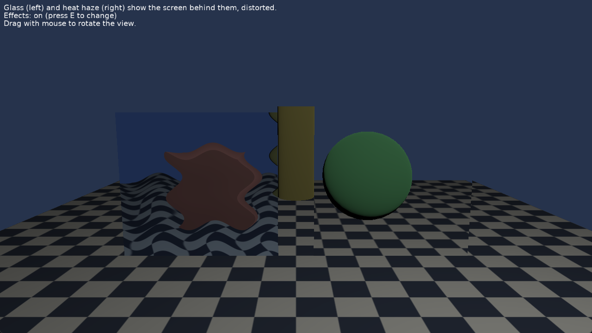

# Shader Effects: Screen Texture

[Shader effects](https://castle-engine.io/shaders) that show the screen behind a shape, distorted: glass and heat haze. They use a [ScreenTexture](https://castle-engine.io/api?id=TScreenTextureNode): the colors of the shapes rendered before them.

Keys:

- _E_: turn the effects off / on.
- Drag with the mouse to rotate the view (follows [TCastleExamineNavigation](https://castle-engine.io/api?id=TCastleExamineNavigation)).

## How it works

The design file has a few objects and loads [data/glass.x3dv](data/glass.x3dv): two panes with blending, each with an `Effect` that has a `ScreenTexture` in a field (a `sampler2D` uniform). The screen texture is updated every frame after the opaque shapes are rendered, before the shapes with blending.

The shader [data/shaders/screen_distortion.fs](data/shaders/screen_distortion.fs) samples it at the fragment's screen position, moved by waves: still ones for the glass, moving ones (the `time` field, routed from a `TimeSensor`) for the heat haze.

## Building

Compile by:

- [CGE editor](https://castle-engine.io/editor). Just use menu items _"Compile"_ or _"Compile And Run"_.

- Or use [CGE command-line build tool](https://castle-engine.io/build_tool). Run `castle-engine compile` in this directory.

- Or use [Lazarus](https://www.lazarus-ide.org/). Open in Lazarus `shader_effects_screen_texture_standalone.lpi` file and compile / run from Lazarus. Make sure to first register [CGE Lazarus packages](https://castle-engine.io/lazarus).

- Or use [Delphi](https://www.embarcadero.com/products/Delphi). Open in Delphi `shader_effects_screen_texture_standalone.dproj` file and compile / run from Delphi. See [CGE and Delphi](https://castle-engine.io/delphi) documentation for details.
