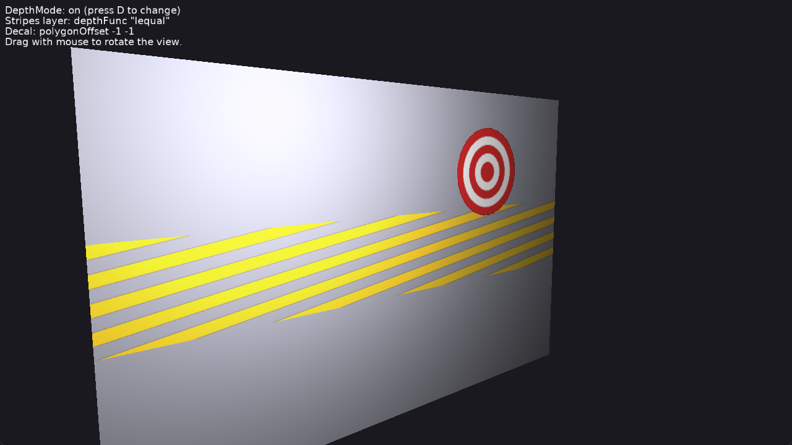

# Depth Mode: Layers and Decals

Shapes rendered on the same surface as other shapes, using the [DepthMode](https://castle-engine.io/api?id=TDepthModeNode) node in [Appearance.DepthMode](https://castle-engine.io/api?id=TAppearanceNode.DepthMode): its depth function and polygon offset.

Keys:

- _D_: turn the `DepthMode` settings off / on, to compare with the default depth test.
- Drag with the mouse to rotate the view (follows [TCastleExamineNavigation](https://castle-engine.io/api?id=TCastleExamineNavigation)).

## How it works

The design file shows [data/wall.x3dv](data/wall.x3dv): a wall, and two shapes exactly on its surface:

- a layer of stripes, rendered with blending after the wall, with `depthFunc "lequal"`: it passes the depth test at the wall's depth (the default "less" rejects it);
- a decal with `polygonOffset -1 -1`: moved towards the camera in the depth buffer, so it doesn't flicker with the wall (z-fighting).

The code ([code/gameviewmain.pas](code/gameviewmain.pas)) only switches these settings.

## Building

Compile by:

- [CGE editor](https://castle-engine.io/editor). Just use menu items _"Compile"_ or _"Compile And Run"_.

- Or use [CGE command-line build tool](https://castle-engine.io/build_tool). Run `castle-engine compile` in this directory.

- Or use [Lazarus](https://www.lazarus-ide.org/). Open in Lazarus `depth_mode_layers_and_decals_standalone.lpi` file and compile / run from Lazarus. Make sure to first register [CGE Lazarus packages](https://castle-engine.io/lazarus).

- Or use [Delphi](https://www.embarcadero.com/products/Delphi). Open in Delphi `depth_mode_layers_and_decals_standalone.dproj` file and compile / run from Delphi. See [CGE and Delphi](https://castle-engine.io/delphi) documentation for details.
