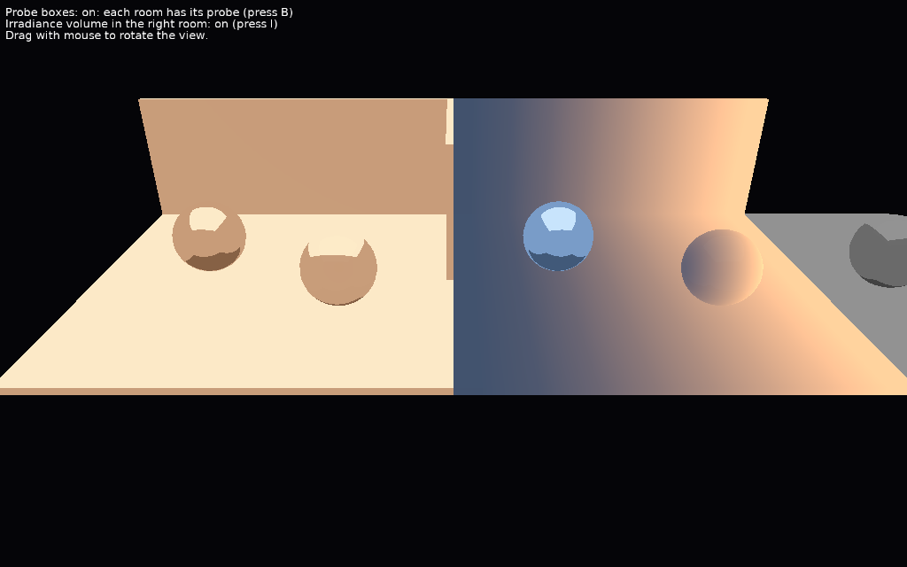

# Environment Probes

Several image-based lights (`EnvironmentLight` nodes) as environment probes: each has an influence box, and each shape is lit by the probe whose box contains it. One probe also has an irradiance volume: diffuse light that varies with the position.

Keys:

- _B_: probe boxes on / off. Without the boxes, every probe lights everything (they add up).
- _I_: the irradiance volume of the right room on / off. Without it, the room uses its probe's diffuse cube map.
- Drag with the mouse to rotate the view (follows [TCastleExamineNavigation](https://castle-engine.io/api?id=TCastleExamineNavigation)).

## How it works

The rooms and the probes are in [data/rooms.x3dv](data/rooms.x3dv):

- Each room has an `EnvironmentLight` with `influenceCenter` and `influenceSize`: a shape is lit by the environment light with the smallest box containing the center of its bounding box. So the floor and walls are separate shapes for each room.
- The environment light without a box (`influenceSize` < 0, the default) is the fallback, for the shapes outside all boxes.
- `diffuseTexture` is the irradiance (the diffuse light for each normal direction), `specularTexture` the light reflected by smooth surfaces (the mirror spheres). Here they are solid colors, to keep the example small; real probes are rendered from their position and convolved.

The code ([code/gameviewmain.pas](code/gameviewmain.pas)) computes the irradiance volume of the right room: a grid of order 1 spherical harmonics (see `TEnvironmentLightNode.IrradianceVolume`), saved as a float KTX 3D texture, and assigned to the probe's `irradianceVolume`.

## Building

Compile by:

- [CGE editor](https://castle-engine.io/editor). Just use menu items _"Compile"_ or _"Compile And Run"_.

- Or use [CGE command-line build tool](https://castle-engine.io/build_tool). Run `castle-engine compile` in this directory.

- Or use [Lazarus](https://www.lazarus-ide.org/). Open in Lazarus `environment_probes_standalone.lpi` file and compile / run from Lazarus. Make sure to first register [CGE Lazarus packages](https://castle-engine.io/lazarus).

- Or use [Delphi](https://www.embarcadero.com/products/Delphi). Open in Delphi `environment_probes_standalone.dproj` file and compile / run from Delphi. See [CGE and Delphi](https://castle-engine.io/delphi) documentation for details.
