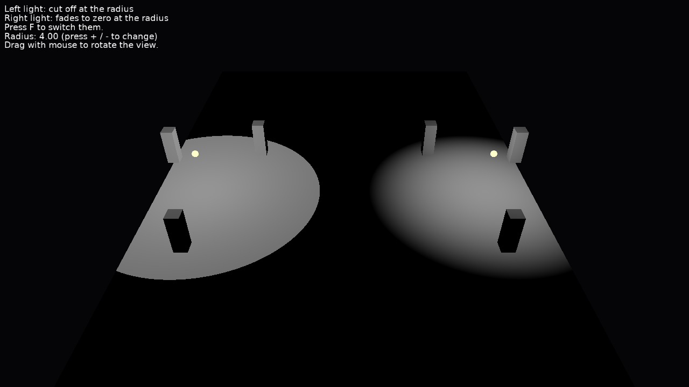

# Light Radius Falloff

Point lights cut off at their radius, or fading smoothly to zero there.

Keys:

- _F_: switch which light fades at its radius.
- _+_ / _-_: change the radius of both lights.
- Drag with the mouse to rotate the view (follows [TCastleExamineNavigation](https://castle-engine.io/api?id=TCastleExamineNavigation)).

## How it works

Both lights in the [design](data/gameviewmain.castle-user-interface) have the same [TCastlePointLight.Radius](https://castle-engine.io/api?id=TCastlePointLight.Radius) and no attenuation. A light doesn't shine at all beyond its radius. By default it is cut off there, so its edge shows. With [TCastlePointLight.RadiusFalloff](https://castle-engine.io/api?id=TCastlePointLight.RadiusFalloff) the light is multiplied by `clamp(1 - (distance / radius)^4, 0, 1)^2`, so it fades smoothly to zero at the radius. This is the falloff of the `range` of [glTF lights](https://github.com/KhronosGroup/glTF/blob/main/extensions/2.0/Khronos/KHR_lights_punctual/README.md), and glTF models with such lights use it.

In X3D, it is the `radiusFalloff` field of `PointLight` and `SpotLight` ([TAbstractPositionalLightNode.RadiusFalloff](https://castle-engine.io/api?id=TAbstractPositionalLightNode.RadiusFalloff)).

## Building

Compile by:

- [CGE editor](https://castle-engine.io/editor). Just use menu items _"Compile"_ or _"Compile And Run"_.

- Or use [CGE command-line build tool](https://castle-engine.io/build_tool). Run `castle-engine compile` in this directory.

- Or use [Lazarus](https://www.lazarus-ide.org/). Open in Lazarus `light_radius_falloff_standalone.lpi` file and compile / run from Lazarus. Make sure to first register [CGE Lazarus packages](https://castle-engine.io/lazarus).

- Or use [Delphi](https://www.embarcadero.com/products/Delphi). Open in Delphi `light_radius_falloff_standalone.dproj` file and compile / run from Delphi. See [CGE and Delphi](https://castle-engine.io/delphi) documentation for details.
