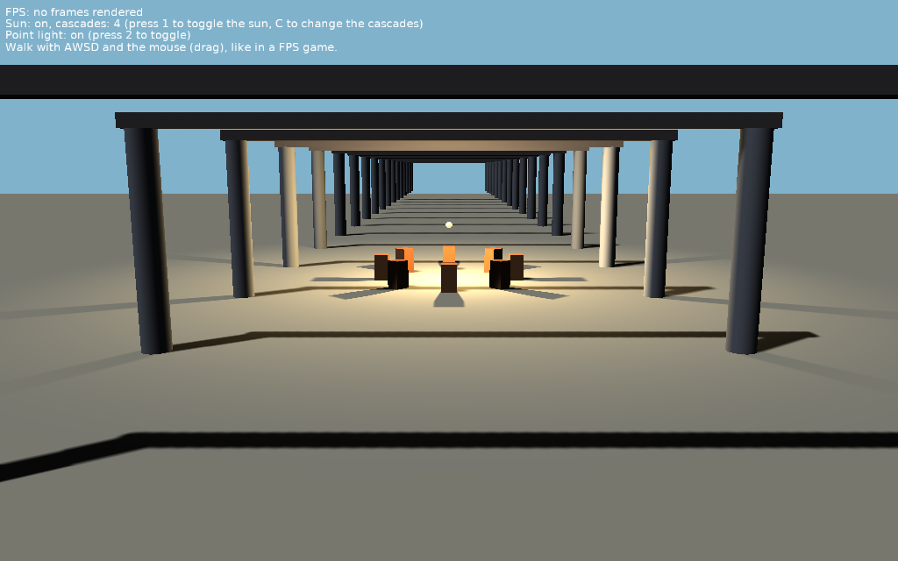

# Shadow Maps: Point Lights and Cascades

Shadow maps from a point light and from a directional light with cascades:

- The point light (the lamp in the middle) casts shadows in all directions: its shadow map has 6 views, the faces of a cube around it.
- The directional light (the sun) has 4 cascades: the view of the camera is split by the distance, each part has its own shadow map, so the shadows near the camera are sharp. Press _C_ to change the number of cascades and compare with 1 (one shadow map over the whole world).
- Near the end of each cascade, its shadow is blended with the next one (`ShadowMapsCascadeBlend`), so the change of the resolution isn't a visible line. Press _B_ to compare without it.
- Press _Z_ to choose the size of the point light's shadow map by how big its range is on the screen (`ShadowMapsSizeByScreen`): walk away from the lamp and its shadow map gets smaller.
- All these views are parts of one depth texture, the shadow map atlas (see `ShadowMapsAtlasSize`).

Keys:

- _1_: the sun on / off.
- _2_: the point light on / off.
- _C_: the number of cascades of the sun (1 to 4).
- _B_: blending between the cascades on / off.
- _Z_: shadow map sizes by the size on the screen on / off.
- Walk with _AWSD_ and look around by dragging with the mouse (follows [TCastleWalkNavigation](https://castle-engine.io/api?id=TCastleWalkNavigation)).

## How it works

The lights are in [data/scene.x3dv](data/scene.x3dv), with `shadows TRUE` (shadow maps, see https://castle-engine.io/shadow_maps ):

- `PointLight` with `shadows TRUE` renders 6 views around the light.
- `DirectionalLight` with `shadowCascades 4` renders 4 views that follow the camera (every frame).
- `defaultShadowMap GeneratedShadowMap { size ... }` sets the size of each view.

The code ([code/gameviewmain.pas](code/gameviewmain.pas)) only toggles the lights, the cascades and the global settings `ShadowMapsCascadeBlend` and `ShadowMapsSizeByScreen`.

## Building

Compile by:

- [CGE editor](https://castle-engine.io/editor). Just use menu items _"Compile"_ or _"Compile And Run"_.

- Or use [CGE command-line build tool](https://castle-engine.io/build_tool). Run `castle-engine compile` in this directory.

- Or use [Lazarus](https://www.lazarus-ide.org/). Open in Lazarus `shadow_maps_point_lights_and_cascades_standalone.lpi` file and compile / run from Lazarus. Make sure to first register [CGE Lazarus packages](https://castle-engine.io/lazarus).

- Or use [Delphi](https://www.embarcadero.com/products/Delphi). Open in Delphi `shadow_maps_point_lights_and_cascades_standalone.dproj` file and compile / run from Delphi. See [CGE and Delphi](https://castle-engine.io/delphi) documentation for details.
