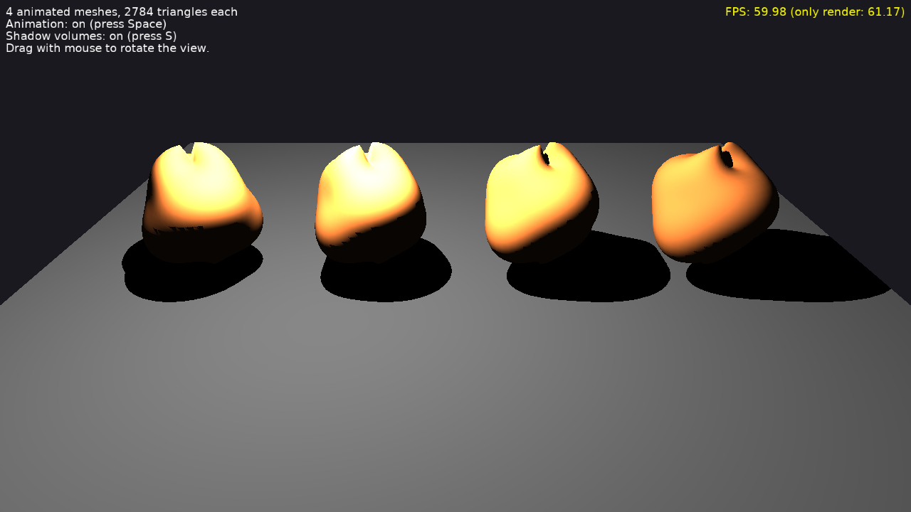

# Shadow Volumes: Animated Caster

[Shadow volumes](https://castle-engine.io/shadow_volumes) cast by meshes deformed every frame, like skinned animation.

Keys:

- _Space_: stop / resume the animation.
- _S_: shadow volumes on / off.
- Drag with the mouse to rotate the view (follows [TCastleExamineNavigation](https://castle-engine.io/api?id=TCastleExamineNavigation)).

## How it works

The design file has a light with [Shadows](https://castle-engine.io/api?id=TCastlePunctualLight.Shadows) and 4 scenes loading [data/blob.x3dv](data/blob.x3dv): a closed (2-manifold) mesh whose coordinates are animated by a `CoordinateInterpolator`.

When only the coordinates of a shape change, its shadow volumes keep the edges between the triangles (the topology didn't change) and move the same triangles, instead of triangulating the mesh again. Compare the "only render" frame rate with the animation on and off, and with shadow volumes on and off.

## Building

Compile by:

- [CGE editor](https://castle-engine.io/editor). Just use menu items _"Compile"_ or _"Compile And Run"_.

- Or use [CGE command-line build tool](https://castle-engine.io/build_tool). Run `castle-engine compile` in this directory.

- Or use [Lazarus](https://www.lazarus-ide.org/). Open in Lazarus `shadow_volumes_animated_caster_standalone.lpi` file and compile / run from Lazarus. Make sure to first register [CGE Lazarus packages](https://castle-engine.io/lazarus).

- Or use [Delphi](https://www.embarcadero.com/products/Delphi). Open in Delphi `shadow_volumes_animated_caster_standalone.dproj` file and compile / run from Delphi. See [CGE and Delphi](https://castle-engine.io/delphi) documentation for details.
