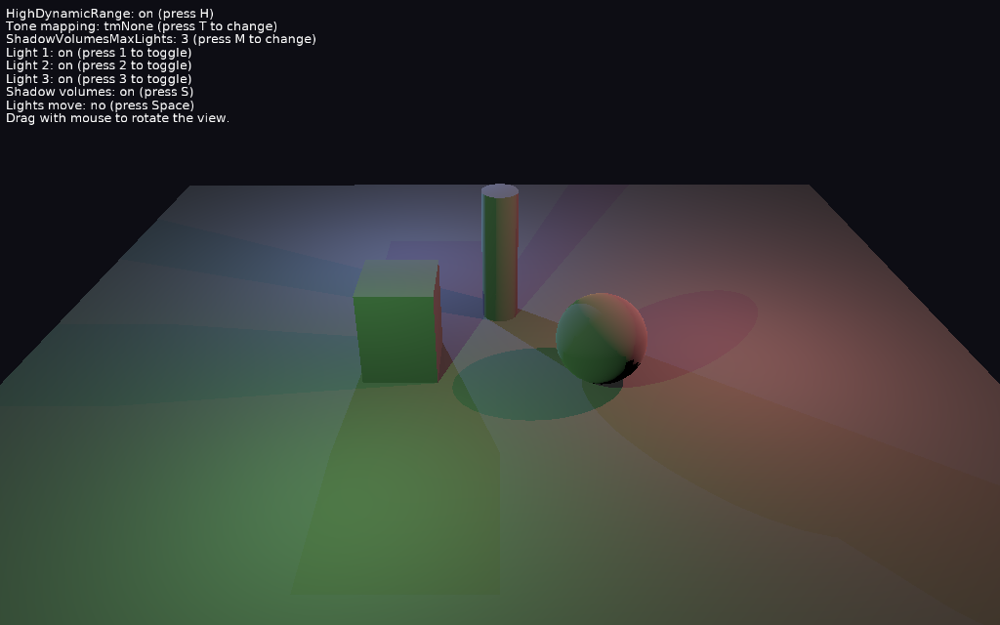

# Shadow Volumes With High Dynamic Range

[Shadow volumes](https://castle-engine.io/shadow_volumes) cast by several lights ([TCastleViewport.ShadowVolumesMaxLights](https://castle-engine.io/api?id=TCastleViewport.ShadowVolumesMaxLights)) on physical (PBR) materials, with [TCastleViewport.HighDynamicRange](https://castle-engine.io/api?id=TCastleViewport.HighDynamicRange).

Keys:

- _H_: `HighDynamicRange` on / off. Without it, where the lights overlap the floor is too bright.
- _T_: change the [tone mapping](https://castle-engine.io/api?id=ToneMapping).
- _M_: switch `ShadowVolumesMaxLights` between 3 and 1.
- _1_, _2_, _3_: turn a light on / off.
- _S_: shadow volumes on / off. With `ShadowVolumesMaxLights` = 1 and shadow volumes off, all lights are rendered at once: compare with this how bright the floor should be.
- _Space_: stop / resume moving the lights.
- Drag with the mouse to rotate the view (follows [TCastleExamineNavigation](https://castle-engine.io/api?id=TCastleExamineNavigation)).

## How it works

Like [shadow_volumes_several_lights](../shadow_volumes_several_lights/), but the objects use physical materials, and the viewport in the design file has `HighDynamicRange` = `true`.

Each light casting shadows is added in its own rendering pass. Physical materials apply gamma correction, so adding the passes after it is too bright. With `HighDynamicRange` the world is rendered to a float color buffer in linear color space, the passes add up there, and gamma correction and tone mapping are applied once at the end. See the [HighDynamicRange](https://castle-engine.io/api?id=TCastleViewport.HighDynamicRange) documentation for the details and limitations.

The code ([code/gameviewmain.pas](code/gameviewmain.pas)) only moves the lights and handles the keys.

## Building

Compile by:

- [CGE editor](https://castle-engine.io/editor). Just use menu items _"Compile"_ or _"Compile And Run"_.

- Or use [CGE command-line build tool](https://castle-engine.io/build_tool). Run `castle-engine compile` in this directory.

- Or use [Lazarus](https://www.lazarus-ide.org/). Open in Lazarus `shadow_volumes_high_dynamic_range_standalone.lpi` file and compile / run from Lazarus. Make sure to first register [CGE Lazarus packages](https://castle-engine.io/lazarus).

- Or use [Delphi](https://www.embarcadero.com/products/Delphi). Open in Delphi `shadow_volumes_high_dynamic_range_standalone.dproj` file and compile / run from Delphi. See [CGE and Delphi](https://castle-engine.io/delphi) documentation for details.
