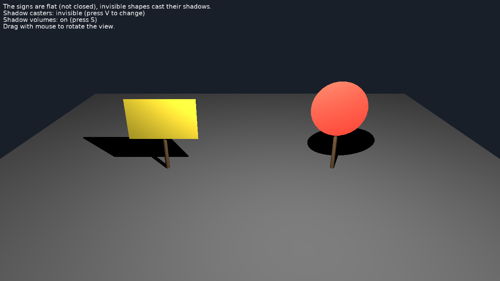

# Shadow Volumes: Invisible Caster

[Shadow volumes](https://castle-engine.io/shadow_volumes) cast by invisible shapes: shadow-only casters.

Keys:

- _V_: show / hide the invisible shadow casters.
- _S_: shadow volumes on / off.
- Drag with the mouse to rotate the view (follows [TCastleExamineNavigation](https://castle-engine.io/api?id=TCastleExamineNavigation)).

## How it works

Shadow volumes need closed (2-manifold) casters. The signs in [data/objects.x3dv](data/objects.x3dv) are flat, so they cannot cast shadows themselves. Each has a thin closed shape just behind it with `visible FALSE` ([TAbstractShapeNode.Visible](https://castle-engine.io/api?id=TAbstractShapeNode.Visible)): it is not rendered, but it casts the shadow volume.

The same works to cast the shadow of a detailed model with a simpler mesh, or of a level whose rendered surfaces are not closed.

## Building

Compile by:

- [CGE editor](https://castle-engine.io/editor). Just use menu items _"Compile"_ or _"Compile And Run"_.

- Or use [CGE command-line build tool](https://castle-engine.io/build_tool). Run `castle-engine compile` in this directory.

- Or use [Lazarus](https://www.lazarus-ide.org/). Open in Lazarus `shadow_volumes_invisible_caster_standalone.lpi` file and compile / run from Lazarus. Make sure to first register [CGE Lazarus packages](https://castle-engine.io/lazarus).

- Or use [Delphi](https://www.embarcadero.com/products/Delphi). Open in Delphi `shadow_volumes_invisible_caster_standalone.dproj` file and compile / run from Delphi. See [CGE and Delphi](https://castle-engine.io/delphi) documentation for details.
