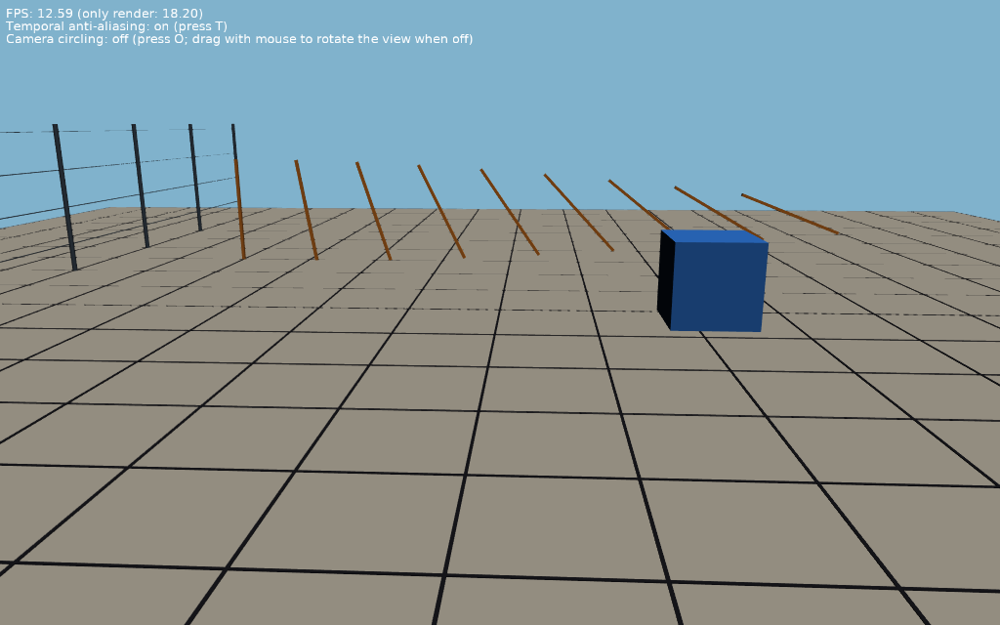

# Temporal Anti-Aliasing

Temporal anti-aliasing (`TCastleViewport.TemporalAntiAliasing`): every frame is rendered with a different sub-pixel shift of the projection (jitter) and blended with the previous frames, so thin poles, wires and the far lines of the floor's grid don't break up and flicker when the camera moves.

Keys:

- _T_: temporal anti-aliasing on / off (it is on in the design).
- _O_: the camera circling around the scene on / off. When off, drag with the mouse to rotate the view (follows [TCastleExamineNavigation](https://castle-engine.io/api?id=TCastleExamineNavigation)).

## How it works

- The viewport has `TemporalAntiAliasing` = `true` in [data/gameviewmain.castle-user-interface](data/gameviewmain.castle-user-interface). The scene is [data/fence.x3dv](data/fence.x3dv).
- The previous frames are found by motion vectors computed from the depth buffer and the camera movement. The spinning box moves by itself, so its motion vectors are wrong: its previous colors are limited to the colors around each pixel in the current frame (neighborhood clamping), which keeps it sharp but less anti-aliased than the static scene.
- See the `TCastleViewport.TemporalAntiAliasing` documentation for the details.

## Building

Compile by:

- [CGE editor](https://castle-engine.io/editor). Just use menu items _"Compile"_ or _"Compile And Run"_.

- Or use [CGE command-line build tool](https://castle-engine.io/build_tool). Run `castle-engine compile` in this directory.

- Or use [Lazarus](https://www.lazarus-ide.org/). Open in Lazarus `temporal_anti_aliasing_standalone.lpi` file and compile / run from Lazarus. Make sure to first register [CGE Lazarus packages](https://castle-engine.io/lazarus).

- Or use [Delphi](https://www.embarcadero.com/products/Delphi). Open in Delphi `temporal_anti_aliasing_standalone.dproj` file and compile / run from Delphi. See [CGE and Delphi](https://castle-engine.io/delphi) documentation for details.
